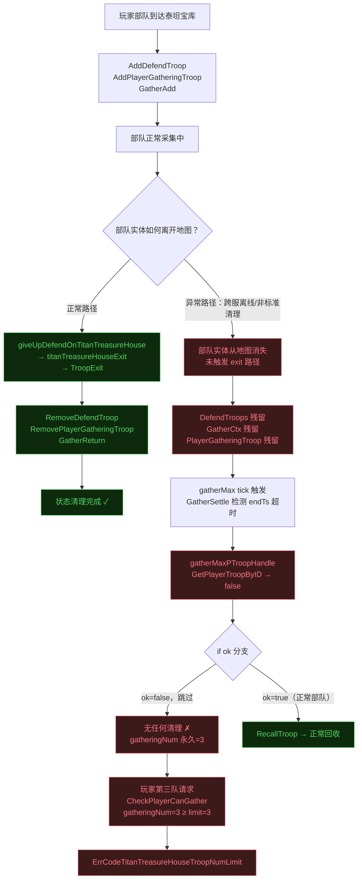
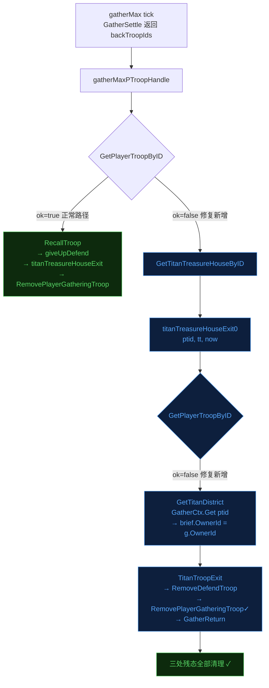

## 基本信息

| 字段 | 内容 |
|------|------|
| 发现时间 | 2026-06-11 17:41 |
| 报告人 | 玩家反馈 → wenyu 排查 |
| 影响模块 | `game/wmap/internal` — 泰坦宝库采集 |
| 服务名称 | cross1007（远征图跨服实例） |
| 严重程度 | High — 玩家功能永久受阻，需重启服务器才能自愈 |
| 发现方式 | 玩家反馈 + 日志排查 |

---

## 根因结论

> **根因：** 玩家部队在远征图泰坦宝库采集途中，因跨服异常离开地图时未走泰坦宝库标准 exit 路径，导致 `PlayerGatheringTroop`（纯内存 map）产生僵尸条目。`gatherMaxPTroopHandle` 缺少部队实体不存在时的清理分支，每 tick 触发 gatherMax 警告但永远跳过清理，`gatheringNum` 永久卡在上限（3），玩家无法再派采集队。

---

## 触发链路



---

## 现象描述

- 玩家 6422422 反馈泰坦宝库"只能进两个队，第三队进不了"
- 前端收到错误码 `ErrCodeTitanTreasureHouseTroopNumLimit`（25703）
- 重新派遣、更换目标宝库均被拒绝
- 现象持续数小时，不会自动恢复

---

## 复现步骤

自然复现概率较低，需以下前置条件：

1. 玩家在远征图（cross server）参与泰坦宝库采集
2. 在采集期间，部队实体因跨服异常（网络断开、离线处理时序问题等）从地图上被移除，**但未触发** `giveUpDefendOnTitanTreasureHouse`
3. 上述状态持续到该玩家已有采集部队数量达到 `TitanMineGatherLimit`（= 3）
4. 玩家尝试派第四支（或新的第三支）队伍 → 被拦截

**测试环境构造方法**（需 GM 工具辅助）：
1. 派 3 支队伍进入不同宝库采集
2. 通过 GM/DB 直接删除其中 1 支的 `PlayerTroop` 实体，不触发 exit 事件
3. 等待下一个 gatherMax tick（约 1 分钟）
4. 再次尝试派队 → 复现拦截

---

## 相关日志

**gatherMax 触发但无清理（cross1007，12:49:33）：**
```
[WAR] mtitan_treasure_house/gather.go:138
======gaterMax return troop: 7649932796986012219, endTs: 1781153373653, now: 1781153373833
```

**注意：** 正常情况此后应有 `TitanTreasureHouse Player: xxx GatherMax` 日志，但此处缺失，说明 `GetPlayerTroopByID` 已返回 false。

**玩家被拦截（cross1007，17:41:17）：**
```
[WAR] titan_treasure_house/titan_mgr.go:87
playerId = 6422422 CheckPlayerCanGather
  diff = [7649932796986012219 7650044629344502968 7650044693769023483],
  gatheringNum = 3,
  DefendTroops = [7650048778283089888 7650048894247207348 ...],
  GatheringTroops = [7649932796986012219 7650044629344502968 ...]

[WAR] internal/ctl_titan_treasure_house.go:651
can not gather player = 6422422
```

**时间线（玩家 6422422）：**

| 时间 | 事件 |
|------|------|
| 11:00:44 | `AddPlayerGatheringTroop` × 2，含僵尸部队 `...986012219` |
| 12:49:33 | gatherMax 触发，部队已消失，清理被跳过 |
| 13:16:40+ | 每次尝试派队均被 `gatheringNum=3` 拦截 |
| 16:06:19/47 | 又加入 2 支有效部队，gatheringNum 仍为 3 |
| 17:41:17 | 用户反馈，日志确认 |

---

## 根因分析

### 漏洞 1 — `gatherMaxPTroopHandle` 缺少 else 分支

文件：`game/wmap/internal/ctl_titan_treasure_house.go`，函数 `gatherMaxPTroopHandle`

```diff
- func (wmap *WMap) gatherMaxPTroopHandle(_ *mtitan_treasure_house.District, troopIds []int64) {
+ func (wmap *WMap) gatherMaxPTroopHandle(d *mtitan_treasure_house.District, troopIds []int64) {
      for _, troopId := range troopIds {
          if pt, ok := wmap.GetPlayerTroopByID(troopId); ok {
              playerId := pt.OwnerInfo().ID
              wmap.RecallTroop(pt)
              tlog.Infof("=========TitanTreasureHouse Player: %v GatherMax", playerId)
+         } else {
+             // 部队实体已不在地图，直接调用 exit 清理残态
+             if tt, ok2 := wmap.GetTitanTreasureHouseByID(d.GetUID()); ok2 {
+                 wmap.titanTreasureHouseExit0(troopId, tt, util.NowTs())
+                 tlog.Warnf("gatherMaxPTroopHandle troop %v not found on map, force exit titan gather", troopId)
+             }
          }
      }
  }
```

### 漏洞 2 — `titanTreasureHouseExit0` 的 OwnerId 取不到时是 no-op

文件同上，函数 `titanTreasureHouseExit0`

```diff
  if pt, ok := wmap.GetPlayerTroopByID(ptid); ok {
      brief.OwnerId = pt.OwnerInfo().ID
+ } else if d := wmap.GetTitanDistrict(tt.GetAreaID()); d != nil {
+     // 部队实体不存在时从 GatherCtx 补全 OwnerId
+     if g := d.GetGatherCtx().Get(ptid); g != nil {
+         brief.OwnerId = g.OwnerId
+     }
  }
```

`GatherCtx.Gatherer` 在 `GatherAdd` 时持久化保存了 `OwnerId`，可作为兜底来源。  
原代码 `brief.OwnerId = 0` 导致 `RemovePlayerGatheringTroop(0, troopId)` 命中 `if playerId == 0 { return }` 保护，成为 no-op。

### 为何服务器重启能自愈

`PlayerGatheringTroop` 是纯内存结构（`bson:"-"`），重启时：
1. `afterLoad()` → `fixTitanTresureHouse()` 先清除 `DefendTroops` 中找不到实体的部队
2. `ServerStarted` → `serverStartLoadTitanGatherPlayer()` 从已清理的 `DefendTroops` 重建，僵尸条目不会被加入

---

## 影响范围

| 维度 | 评估 |
|------|------|
| 受影响玩家 | 远征图（cross server）参与泰坦宝库采集，且有部队实体异常消失经历的玩家 |
| 受影响功能 | 泰坦宝库采集（仅采集槽位被占满后无法新增，已在采集中的部队不受影响） |
| 数据异常 | 无，`PlayerGatheringTroop` 是内存状态，重启可恢复；持久化数据（DefendTroops/GatherCtx）有轻微残留但不影响存档完整性 |
| 服务稳定性 | 不影响，gatherMax 告警每 tick 重复但无崩溃风险 |
| 回归风险 | 低，两处修改均只影响"部队实体不存在"的异常路径，正常流程代码路径未改动 |

---

## 修复方案

### 方案对比

| 方案 | 操作 | 是否需发版 | 是否需重启 | 效果 |
|------|------|-----------|-----------|------|
| **代码修复（推荐）** | 补 else 分支 + OwnerId fallback | 是 | 否（部署后下一 tick 自愈） | 彻底修复，后续不再出现 |
| 重启 cross 服 | 运维操作 | 否 | 是 | 临时修复当前被卡玩家，不防止再次触发 |
| GM 刷新宝库 | `refreshTitanTreasure` | 否 | 否 | **无效**，只清 DefendTroops，不更新内存 PlayerGatheringTroop |

### 修复路径流程图



---

## 验证方法

### TC1 — 正常采集回归

1. 玩家派队到泰坦宝库采集
2. 等待采集时间到期，部队自动回城
3. **验证**：日志出现 `TitanTreasureHouse Player: xxx GatherMax`，`RemovePlayerGatheringTroop` 正常调用，玩家可继续派队

### TC2 — 手动召回回归

1. 派队采集中途手动召回
2. **验证**：部队正常回城，`PlayerGatheringTroop` 清零

### TC3 — Bug 修复验证（核心）

> 需 GM 工具构造前置条件

1. 玩家派 3 支队伍分别进入不同宝库（gatheringNum=3）
2. 通过 GM/DB **直接删除**其中 1 支的 `PlayerTroop` 实体（不触发 exit 事件）
3. 等待约 1 分钟（gatherMax tick）
4. **验证**：
   - 日志出现 `gatherMaxPTroopHandle troop xxx not found on map, force exit titan gather`
   - `RemovePlayerGatheringTroop` 被正确调用
   - `gatheringNum` 从 3 降为 2
   - 玩家可成功派第三队

### TC4 — 服务器重启路径回归

1. 构造与 TC3 相同的僵尸状态
2. 重启 cross 服
3. **验证**：重启后玩家 `gatheringNum` 正确，可正常采集

---

## 延伸风险

`PlayerGatheringTroop` 是纯内存结构，所有对它的修改都必须在运行时同步维护，不能依赖持久化兜底。  
凡是涉及部队离开泰坦宝库（召回、击败、超时、跨服清理）的代码路径，**均需确保调用了 `titanTreasureHouseExit` 或 `titanTreasureHouseExit0`**，否则会复现此问题。

类似的隐患路径需排查：
- 跨服断线重连时的部队清理路径
- 远征活动结束时的批量回收路径
- 被攻击击败后的 `giveUpDefend` 各分支
