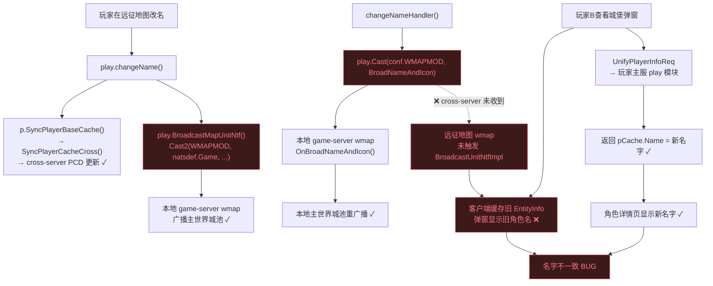
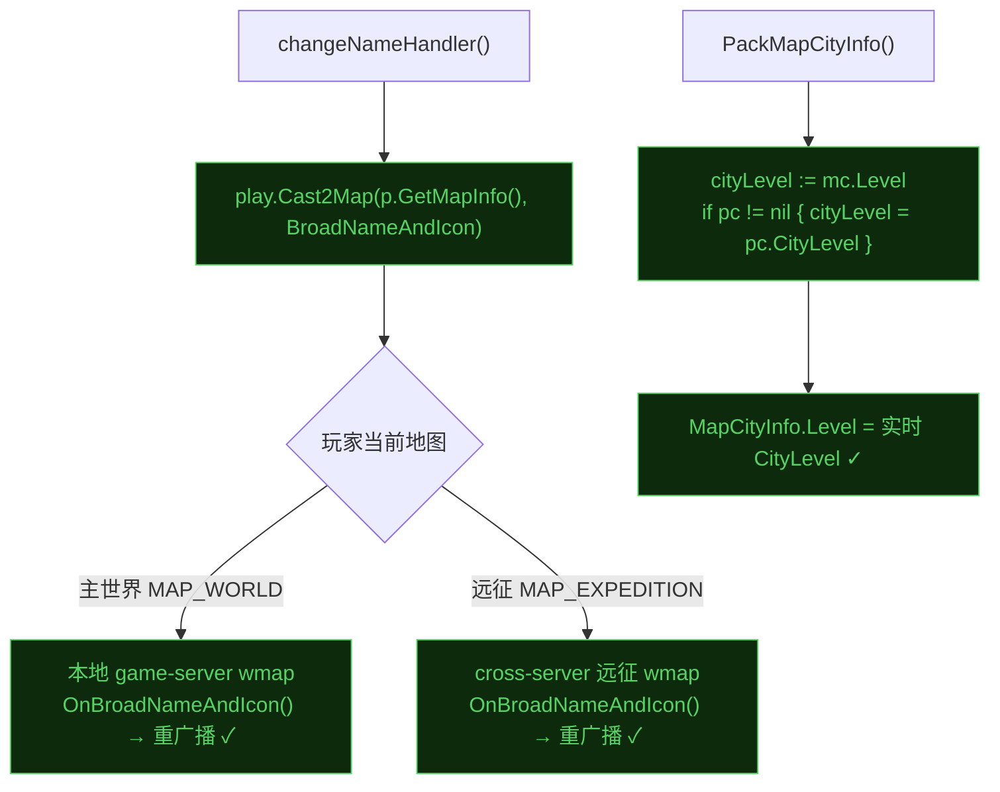

# 远征地图城堡弹窗角色名和等级与角色详情页不一致

## 基本信息

| 字段 | 内容 |
|------|------|
| 发现时间 | 2026-05-21 |
| 影响模块 | `game/wmap/internal/`、`game/play/internal/` |
| 服务 | wmap（远征 cross-server 实例）、play |
| 严重程度 | **High** |
| 发现方式 | 线上玩家反馈 |

---

## 根因结论

> **根因：** 远征地图（`MAP_EXPEDITION`）运行在独立的 **cross-server** 实例上，`changeNameHandler` 改名后只广播到本地 game server 的 `wmap` 模块（`play.Cast(conf.WMAPMOD, ...)`），cross-server 上的远征地图 wmap 模块收不到 `BroadNameAndIcon` 消息，城池实体不重广播，其他玩家客户端缓存的旧 `EntityInfo` 持续显示旧名字。等级不一致的原因是 `PackMapCityInfo` 使用 `mc.Level`（城池对象快照），玩家在主世界升级后远征城池的 `mc.Level` 不同步，而角色详情页读 `pCache.CityLevel`（最新值）。

---

## 触发链路



---

## 现象描述

在远征地图（冰地图等跨服战场）中，点击其他玩家的城堡，弹窗显示的**角色名**和**等级**与点进该玩家**角色详情页**所展示的值不一致。

- 弹窗数据来源：服务端最后一次推送的 `EntityInfo`（客户端缓存）
- 详情页数据来源：`UnifyPlayerInfoReq` → 玩家主服 play 模块 → 实时 `pCache`

---

## 复现步骤

1. 玩家 A 进入远征地图，主城出现在战场
2. 玩家 A（当前在远征地图或返回主世界后）修改角色名
3. 玩家 B 处于远征地图视野内，点击玩家 A 的城堡
4. 弹窗显示旧角色名；点击头像进入详情页显示新角色名

等级复现：
1. 玩家 A 以城堡等级 20 进入远征地图（远征城池 `mc.Level = 20`）
2. 玩家 A 返回主世界并升级城堡至等级 21
3. 玩家 B 在远征地图点击玩家 A 的城堡
4. 弹窗等级显示 20，详情页显示 21

---

## 根因分析

### Bug 1：角色名不一致

**关键代码对比：**

```diff
// game/play/internal/ctl_player.go — changeNameHandler()
- play.Cast(conf.WMAPMOD, &iproto.BroadNameAndIcon{p.PlayerID})
+ play.Cast2Map(p.GetMapInfo(), &iproto.BroadNameAndIcon{p.PlayerID})
```

`Cast(conf.WMAPMOD, ...)` 只投递到 **本地 game-server** 的 `"wmap"` 模块。远征地图的模块名由 `FormatModuleName` 生成，格式为 `"<MapType>_<MapId>_<InstId>"`（如 `"13_1_1"`），运行在独立 cross-server 进程，与 `"wmap"` 完全不同。

对照：改头像处（`OnChangeAvatarReq`，line 307）**正确使用** `Cast2Map(p.GetMapInfo(), ...)`，会根据玩家当前所在地图路由到 cross-server 远征 wmap。改名却遗漏了这一调整，属于不一致的实现。

```go
// game/play/internal/ctl_cross.go — JumpToForMapInfo
case cspb.MAP_GVG, cspb.MAP_EXPEDITION:
    serverType, moduleName = natsdef.Cross, play.GetMapModuleName(mapInfo)
// 确认：远征地图确实在 cross-server
```

`Cast2Map` 内部：

```go
func (play *Play) Cast2Map(mapInfo *cspb.MapInfo, msg interface{}) {
    serverType := natsdef.Game
    serverId   := conf.ServerID
    modName    := conf.WMAPMOD
    if mapInfo != nil {
        serverType = mapInfo.ServerType   // natsdef.Cross（远征）
        serverId   = mapInfo.ServerId
        modName    = play.GetMapModuleName(mapInfo) // "13_1_1"
    }
    ...
}
```

### Bug 2：等级不一致

`PackMapCityInfo`（`game/wmap/internal/packproto.go:282`）中：

```go
cityInfo := &cspb.MapCityInfo{
    Level: mc.Level,  // ← 城池对象快照，不随 pCache.CityLevel 更新
    ...
}
```

`mc.Level` 仅通过 `OnTrainingLevelUpgrade` 更新，该消息由 `SyncWMapCityLevel` 通过 `Cast2Map(p.GetMapInfo(), ...)` 发送。玩家在**主世界**升级时，`p.GetMapInfo()` = 主世界 wmap，远征地图 wmap 收不到升级通知，`mc.Level` 保持进入远征时的快照值。

角色详情页读取 `pCache.CityLevel`（`PackUnifyPlayerInfoByCache` line 549），该值由 `SyncPlayerCache()` 实时同步，是准确的当前值。

`PackMapCityInfo` 中已获取 `pc = cache.GetPlayerCache(mc.Owner.ID)`，可直接改用 `pc.CityLevel`：

```go
var cityLevel int32 = mc.Level
if pc != nil {
    cityLevel = pc.CityLevel  // 使用 cache 中的最新值
}
cityInfo := &cspb.MapCityInfo{
    Level: cityLevel,
    ...
}
```

---

## 影响范围

| 维度 | 说明 |
|------|------|
| 受影响功能 | 远征地图城堡弹窗（名字、城堡等级显示） |
| 受影响版本 | 所有含远征地图的版本 |
| 数据完整性 | 不影响，仅展示层问题 |
| 服务稳定性 | 不影响 |
| 触发概率 | 玩家在远征期间改名，或进入远征后在主世界升级，被其他玩家点击查看时必现 |

---

## 修复方案

| 方案 | 操作 | 文件 | 是否需重启 | 推荐 |
|------|------|------|-----------|------|
| **A（首选）** | `changeNameHandler` 改用 `Cast2Map` | `ctl_player.go:186` | 是 | ✅ |
| **B（首选）** | `PackMapCityInfo` 改用 `pc.CityLevel` | `packproto.go:282` | 是 | ✅ |
| C（临时） | 运营手动重置玩家在远征地图的城池 | — | 否 | ❌ |

**方案 A + B 同步修复，两个独立 bug 各自修复。**

### 修复路径



### 修复代码

**Fix 1 — `game/play/internal/ctl_player.go`**

```diff
  func (play *Play) changeNameHandler(p *mplayer.Player, newName, oldName string) {
      play.changeName(p, newName)
      play.Event.Fire(gdevent.ChangeName, gdevent.ParamPlayer, p)
      play.EventChangeName(p)
-     play.Cast(conf.WMAPMOD, &iproto.BroadNameAndIcon{p.PlayerID})
+     play.Cast2Map(p.GetMapInfo(), &iproto.BroadNameAndIcon{p.PlayerID})
      ...
  }
```

**Fix 2 — `game/wmap/internal/packproto.go`**

```diff
  func (wmap *WMap) PackMapCityInfo(mc *mcity.PlayerCity) *cspb.MapCityInfo {
      pc := cache.GetPlayerCache(mc.Owner.ID)
      var armor, official, dragonRank int32
      if pc != nil {
          armor       = pc.CityArmor
          official    = pc.KingWarOfficial
          dragonRank  = pc.DragonRank
          ...
      }
+     cityLevel := mc.Level
+     if pc != nil {
+         cityLevel = pc.CityLevel
+     }
      cityInfo := &cspb.MapCityInfo{
          ...
-         Level: mc.Level,
+         Level: cityLevel,
          ...
      }
```

---

## 验证方法

1. 部署修复后，让测试账号进入远征地图
2. 在远征地图期间通过改名道具修改角色名
3. 另一账号在远征地图点击该玩家城堡：弹窗应显示新名字
4. 点击头像进入详情页：名字应与弹窗一致
5. 主世界升级城堡等级（需要 GM 指令），再由远征地图内玩家点击城堡查看等级是否与详情页一致

---

## 延伸风险

- `BroadcastMapUnitNtf`（`ctl_player.go:871-874`）同样硬编码 `natsdef.Game`，若其他功能依赖它广播到 cross-server，也会有同类问题，建议排查调用方是否有漏掉远征/GvG 地图的情况。
- 其他使用 `play.Cast(conf.WMAPMOD, ...)` 而非 `Cast2Map` 的地方，需对照确认是否有 cross-server 地图的场景需要覆盖。
