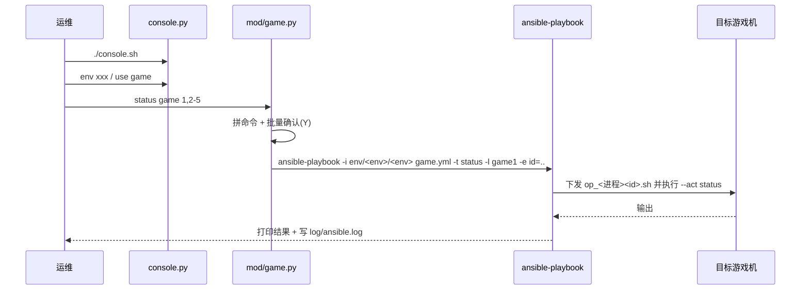

# ansible 运维 console 使用与日志位置

机器：`192.168.1.204`（通过 JumpServer 跳过去，见 [[jumper-logs-setup]]）
目录：`/home/ubuntu/ops/ansible`

> 注意：目录下是 `console.sh`，不是 `.console.sh`。

---

## 一、console.sh 怎么运行

`console.sh` 只有一行：

```bash
#!/bin/bash
python3 py/console.py
```

**必须在 `/home/ubuntu/ops/ansible` 目录下执行**，因为代码里全用相对路径（`env/`、`history.txt`、`game.yml`）：

```bash
cd /home/ubuntu/ops/ansible
./console.sh
```

### 调用链

| 层 | 文件 | 作用 |
|---|---|---|
| 入口 | `py/console.py` | prompt_toolkit 交互式命令行，`q` 退出，`h` 帮助，命令历史写到 `history.txt` |
| 应用 | `py/app.py` | 扫描 `./env/` 下的子目录，每个子目录就是一个环境；有 `revive` 就默认选它，否则选第一个 |
| 顶层模式 | `py/mod/base.py` | 提示符 `[env] >`，负责环境切换、选 game、批量操作 |
| game 模式 | `py/mod/game.py` | `use <game>` 后进入，提示符 `[env] game>`，把命令拼成 ansible-playbook 执行 |
| playbook | `game.yml` → `roles/deploy` | 渲染 `templates/op3.sh` 成 `op_<进程><id>.sh`，复制到目标机执行，最终是 `docker run/stop` |



### 顶层模式命令（base.py）

| 命令 | 作用 |
|---|---|
| `env [名字\|编号]` | 不带参数列出环境；带参数切换环境 |
| `games [host]` | 列出该环境的 game 配置（带 host 则只列该主机上的） |
| `use <game>` | 进入某个 game 模式 |
| `sh <host> <shell>` | 实际执行 `ansible <host> -i env/<env> -m shell -a '<shell>'` |
| `ids <host>` | 查看该主机最小可用 id |
| `sel / seladd / seldel / seldo` | 选中一批 game 后批量执行操作 |
| `vars` | 查看 `group_vars/all/env_specific` |

### game 模式命令（game.py）

每条命令都拼成：

```
ansible-playbook -i env/<env>/<env> game.yml -t <命令> -l <进程名> [-e id=..] [-e image=..]
```

然后用 `os.system` 执行。

| 命令 | 示例 / 说明 |
|---|---|
| `deploy` | `deploy gs_revive_ice:ea21582 game 1,2,3 [tsv=ice]` 更新 docker |
| `safe_deploy` | 新增 docker，参数同 deploy |
| `status` / `start` / `stop` / `restart` | `status game 151,152` |
| `showlog` | 在目标机执行 `tail -100 /data/gslog/$fullname.log` |
| `initenv` / `initdb` / `cleardb` / `remove` / `download` | 初始化环境、初始化 db 等 |
| `hostname <进程> [ids]` | 查看进程所在主机名/IP |
| `hosts` / `vars` / `op <tags>` / `sh` | 辅助命令 |

**批量 id 写法**：`1,2-5,!3` → 1、2、4、5（`!` 表示排除）。批量执行前要输入 `Y` 确认。

---

## 二、看日志该看哪里

| 想看什么 | 位置 |
|---|---|
| console 每次执行了哪些 ansible 操作、成功还是失败 | 204 上的 `/home/ubuntu/ops/ansible/log/ansible.log`（`ansible.cfg` 里 `log_path = ./log/ansible.log`） |
| console 里输入过的命令历史 | `/home/ubuntu/ops/ansible/history.txt` |
| 游戏进程本身的运行日志 | **目标游戏机**上的 `/data/gslog/<进程全名>.log`（容器内 `/go/src/gs/log` 挂载到这里） |

补充：

- console 里的 `showlog` 本质就是在目标机上 `tail -100 /data/gslog/$fullname.log`，要看更多直接跳到目标机 grep。
- `ansible.log` 约 94MB，**没有做日志轮转**，查的时候用 `tail` 或 `grep`，别直接 `cat`。
- 截至 2026-10-22 查看时，`ansible.log` 最后一次写入是 2026-10-13 23:14，那两次 deploy 都显示 `User interrupted execution`（被手动中断）。
- `ansible.cfg` 关键配置：`become=True`（sudo 到 root），`private_key_file=~/.ssh/id_rsa`，`forks=5`。
