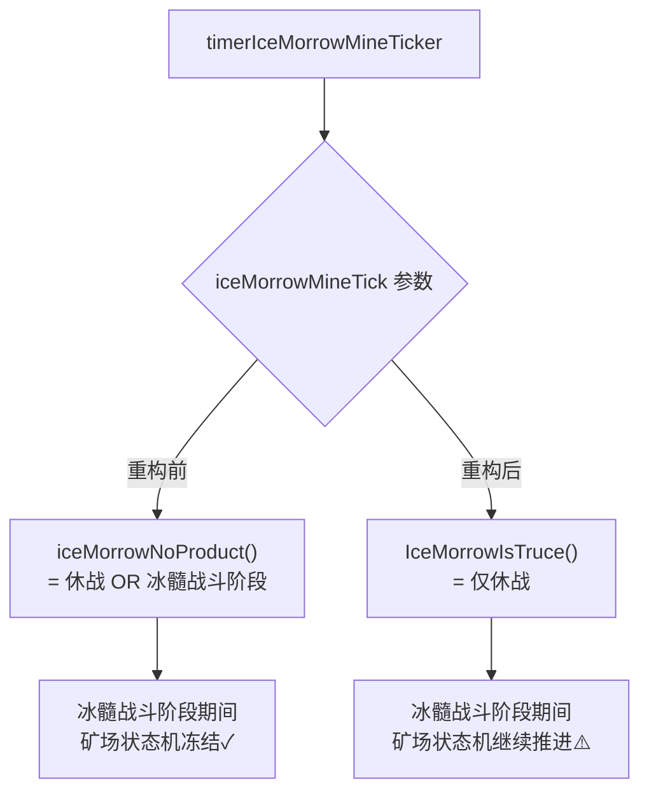

## 审查概览

| 项目 | 内容 |
|------|------|
| 审查人 | Claude |
| 被审查人 | 798714038 / 1179004618 / 2237389726 / wenyu(995426409) |
| 日期 | 2026-05-26 |
| 分支 | h5_new_tf_v1043 |
| Commit 范围 | HEAD~10..HEAD（约 2026-05-20 至今） |
| 审查维度 | 逻辑正确性 · 并发安全 · 扩展性 |

**问题总数：P0 × 0，P1 × 5，P2 × 2**

---

## 问题汇总表

| 优先级 | 问题描述 | 文件位置 | 类型 |
|--------|---------|---------|------|
| P1 | 水晶塔只取第一个 EffectParam，多参数配置静默丢失 | `slg_crystal_tower_action.go:47` | logic |
| P1 | 水晶塔 AddPageSkillInfo 被移除，战报页面减伤信息缺失 | `slg_crystal_tower_action.go:79(old)` | logic |
| P1 | packproto.go 未完成 IceMorrowMine accessor 迁移 | `packproto.go:2659` | safety |
| P1 | IceMorrowIsTruce vs iceMorrowNoProduct 语义拆分导致行为变更 | `ctl_ice_morrow.go:453` | logic |
| P1 | GetCfgId() 与生成的 GetCfgID() 并存，访问路径分裂 | `ice_morrow_mine.go:70` | logic |
| P2 | IceMorrowIsTruce() 导出但仅包内使用 | `ctl_ice_morrow.go:1676` | spec |
| P2 | ice_morrow_mine.go 注释掉的函数未删除 | `ice_morrow_mine.go:71` | style |

---

## 问题详情

### P1-1 水晶塔只取第一个 EffectParam，多参数配置静默丢失

**文件：** `game/wmap/internal/battle/slg_crystal_tower_action.go:45`  
**作者：** 798714038  
**关联 BUG：** H5-9547 水晶塔减伤 buff 叠加修复

**问题说明：**  
原逻辑遍历所有 `EffectParam`，修复后改为只取 `[0]`。如果配置表中某个水晶塔有多条 EffectParam，只有第一条会生效，其余静默丢失，不产生任何错误日志，排查极难。

```diff
- for _, param := range effectParms {
-     applyCrystalTowerParam(owner, enemy, re, param, defRate, args)
- }
+ if len(buildCfg.EffectParam) > 0 {
+     applyCrystalTowerParam(owner, enemy, re, buildCfg.EffectParam[0], defRate, args, activeCount, buildCfg.Id)
+ }
```

**修改建议：**  
若当前所有水晶塔配置确实只有一条 EffectParam，补充一个配置校验断言（启动时检测）；若未来可能多条，改回遍历并在 `applyCrystalTowerParam` 内部累加：

```go
for _, param := range buildCfg.EffectParam {
    applyCrystalTowerParam(owner, enemy, re, param, defRate, args, activeCount, buildCfg.Id)
}
```

---

### P1-2 水晶塔 AddPageSkillInfo 被移除，战报页面减伤信息缺失

**文件：** `game/wmap/internal/battle/slg_crystal_tower_action.go`  
**作者：** 798714038

**问题说明：**  
修改前 `applyCrystalTowerParam` 会调用：

```go
defRecode = append(defRecode, math.Abs(defIncreased)*100)
owner.AddPageSkillInfo(owner.GetTroopID(), owner.GetPlayerID(), defRecode, effectId, cspb.ReportSkillType_Effect)
```

此调用负责向战报页面写入减伤数据。移除后，水晶塔的减伤效果在战报页面不再显示。如果客户端依赖该字段渲染"受到减益"图标，会静默消失。

**修改建议：**  
确认客户端是否使用此字段。若使用，需恢复 `AddPageSkillInfo` 调用，或用新字段替代。若客户端已不依赖，需在 MR 中注明"战报减伤显示已废弃"，避免后续排查疑惑。

---

### P1-3 packproto.go 未完成 IceMorrowMine accessor 迁移

**文件：** `game/wmap/internal/packproto.go:2659`  
**作者：** wenyu（整理代码提交）

**问题说明：**  
`IceMorrowMine` 已生成 accessor（`accessor_IceMorrowMine.go`），但 `PackIceMorrowMineInfo` 中仍有两处直接字段访问：

```go
Status:      build.State,        // ← 应改为 build.GetState()
OccupyEndTs: build.OccupyEndTs,  // ← 应改为 build.GetOccupyEndTs()
```

`CoordCfgId` 和 `ProtectTs` 已经迁移，但以上两个遗漏会使后续若 `SetState`/`SetOccupyEndTs` 增加副作用逻辑时，此处的读取路径不一致。

**修改建议：**

```diff
- Status:      build.State,
+ Status:      build.GetState(),
- OccupyEndTs: build.OccupyEndTs,
+ OccupyEndTs: build.GetOccupyEndTs(),
```

---

### P1-4 IceMorrowIsTruce vs iceMorrowNoProduct 语义拆分导致行为变更

**文件：** `game/wmap/internal/ctl_ice_morrow.go:453`  
**作者：** 1179004618 / wenyu

**问题说明：**  
重构前，`timerIceMorrowMineTicker` 用一个缓存变量 `isTruce := wmap.iceMorrowNoProduct()` 同时控制：
1. 矿场状态机推进（`iceMorrowMineTick`）  
2. 产出结算跳过

`iceMorrowNoProduct()` 定义为：
```go
return wmap.IsTruce(IceMorrow) || wmap.IsIceContestInBattlePhase() == ErrCodeSuccess
```

重构后，状态机推进改用 `IceMorrowIsTruce()`（只检查休战），产出跳过改用 `iceMorrowNoProduct()`：



**行为变更：** 冰髓争夺战战斗阶段内，矿场的 `Contesting → Occupied` 转换原本是冻结的，现在会正常推进。若策划设计要求战斗阶段矿场冻结，这是一个隐患。

**修改建议：**  
与策划确认冰髓战斗阶段的矿场状态机行为预期。若确需分离，在函数内补注释说明两个条件的语义区别；若应保持原行为，`iceMorrowMineTick` 的参数改回 `iceMorrowNoProduct()`。

---

### P1-5 GetCfgId() 与生成的 GetCfgID() 并存，访问路径分裂

**文件：** `game/wmap/internal/mmap/melem/mcity/ice_morrow_mine.go:70`  
**关联：** `accessor_IceMorrowMine.go`

**问题说明：**  
accessor 生成了 `GetCfgID()` 方法（符合 Go 首字母缩写全大写规范），但 `ice_morrow_mine.go` 内还保留着手写的 `GetCfgId()` 方法，二者读取的是同一个字段 `CfgID`：

```go
// ice_morrow_mine.go（手写，保留中）
func (mine *IceMorrowMine) GetCfgId() int32 { return mine.CfgID }

// accessor_IceMorrowMine.go（生成）
func (p *IceMorrowMine) GetCfgID() int32 { return p.CfgID }
```

`packproto.go` 等调用方仍在用 `GetCfgId()`，不走 accessor。两条路径未来一旦在 accessor 的 getter 加副作用逻辑，`GetCfgId()` 调用方将被绕过。

**修改建议：**  
删除手写 `GetCfgId()`，用 `grep -rn "GetCfgId()"` 全量找到调用方，统一替换为 `GetCfgID()`。

---

### P2-1 IceMorrowIsTruce() 导出但仅包内使用

**文件：** `game/wmap/internal/ctl_ice_morrow.go:1676`

```diff
- func (wmap *WMap) IceMorrowIsTruce() bool {
+ func (wmap *WMap) iceMorrowIsTruce() bool {
```

当前调用方只有 `timerIceMorrowMineTicker`（同包）。改为小写即可，避免外部依赖。

---

### P2-2 ice_morrow_mine.go 注释掉的函数未删除

**文件：** `game/wmap/internal/mmap/melem/mcity/ice_morrow_mine.go`

```go
//func (mine *IceMorrowMine) GetCoordCfgID() int32 {
//	return mine.CoordCfgId
//}
```

accessor 已生成 `GetCoordCfgId()`，这段注释是迁移过程的临时残留，应直接删除。

---

## 正确改动 Praise

- **player_pet.go:40 — 关键 Bug 修复**：`GetPetEquips()` 中初始化目标从 `PetMap` 改为 `Equips`，这是一处高危类型错误（nil map 返回后调用方直接使用），修复及时。

- **ctl_ice_contest.go — 通知顺序调整**：将 `OnIceContestPhaseChangeNtfOnlinePlayers` 和 `CastIceContestPhaseToAllServers` 移到阶段处理 handler 之后再调用，确保状态更新先于通知广播，H5-9285 的时间显示问题根因正是此顺序颠倒。

- **pet_skill.go — LastInvalidation 字段设计**：在技能升级边界场景下，客户端依赖服务端下发的失效时间戳才能正确展示 CD，新增 `LastInvalidation` 字段解决了客户端无法自行推算的问题，思路清晰。

- **ctl_ice_morrow.go — getPeaceTime 提取**：同一段"查 cfg → 取 PeaceTime → 报 Errorf"逻辑原来在代码中重复出现两次，提取为 `getPeaceTime(cfgId)` 符合 DRY 原则。

- **gdconf/conf_expgrid_exp.go — 魔数替换**：`* 1000` → `* util.SecMs`，消除时间单位魔数，可读性提升。

---

## 修复进度追踪

| 编号 | 问题 | 负责人 | 状态 |
|------|------|--------|------|
| P1-1 | 水晶塔 EffectParam 只取第一条 | 798714038 | 待确认 |
| P1-2 | 战报 AddPageSkillInfo 被移除 | 798714038 | 待确认 |
| P1-3 | packproto.go accessor 迁移不完整 | wenyu | 待修复 |
| P1-4 | IceMorrowIsTruce 行为变更确认 | 1179004618 | 待确认 |
| P1-5 | GetCfgId/GetCfgID 并存 | wenyu | 待修复 |
| P2-1 | IceMorrowIsTruce 改小写 | wenyu | 待修复 |
| P2-2 | 注释代码删除 | wenyu | 待修复 |
