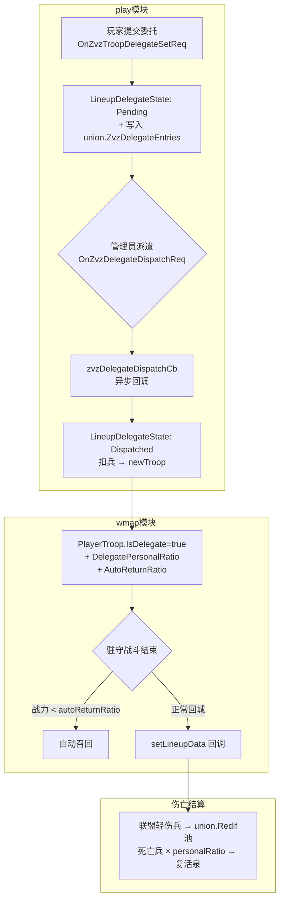
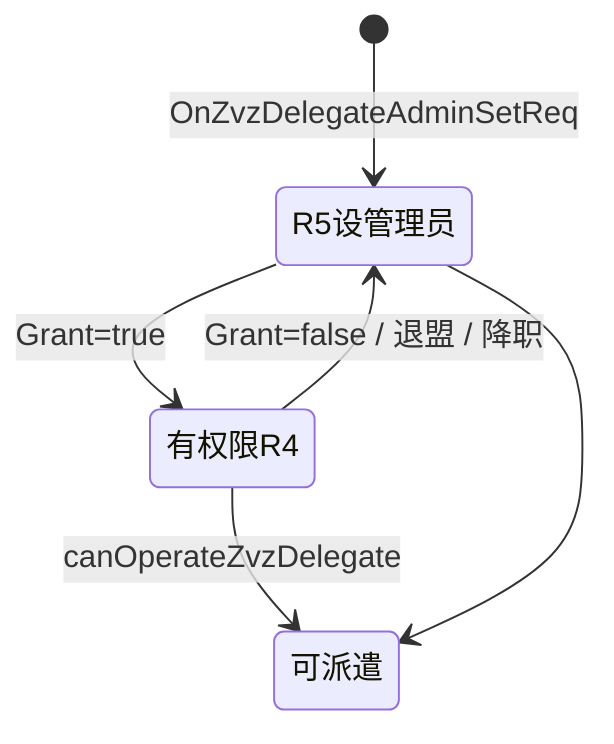
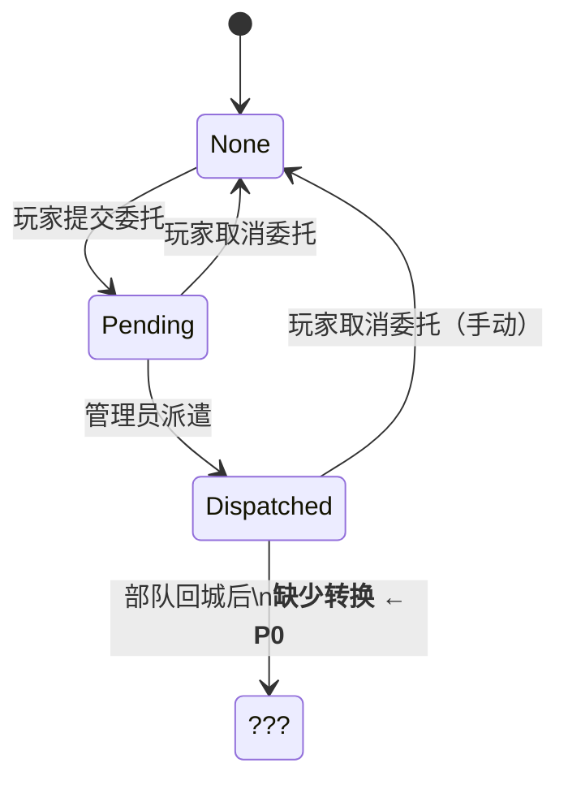

## 审查概览

| 项 | 内容 |
|----|------|
| 审查人 | wenyu |
| 被审查人 | zengbo |
| 日期 | 2026-05-26 |
| 分支 | `h5_new_tf_v1043_leaguewar_delegate` |
| Commit 范围 | `1847fb4b` → `d7cd318b`（共 7 个提交） |
| 功能模块 | 巅峰领地委托（ZVZ Delegate） |

**问题总数：P0 × 1，P1 × 3，P2 × 2**

---

## 功能设计梳理

### 整体架构

巅峰领地委托允许玩家将编队控制权交给联盟 R4/R5 管理员，由其在 ZVZ 期间统一调配。核心分三层：



### 权限层次



### 委托状态机（现状）



---

## 问题汇总表

| 优先级 | 问题描述 | 文件位置 | 类型 |
|--------|---------|---------|------|
| **P0** | Dispatched 回城后缺少 → Pending 状态转换，管理员无法二次派遣 | `ctl_lineup.go:3036` / `ctl_zvz_delegate.go:649` | 逻辑Bug |
| **P1** | `ZvzDelegateEntries` 未标 `bson:"-"`，含 proto 类型字段无法安全序列化 | `munion/union.go:264` | 数据安全 |
| **P1** | 委托玩家退盟无清理，遗留 ghost 条目在管理员面板 | `event.go:105` | 逻辑偏差 |
| **P1** | 玩家在编队已 Dispatched 时取消委托，`IsDelegate=true` 的部队回城后不 auto-fill，但 DelegateState 已被清空 | `ctl_zvz_delegate.go:446` | 潜在隐患 |
| **P2** | 兵力边界缺护卫：`total=0 && currentSoldiers>0` 允许派遣空编队 | `ctl_zvz_delegate.go:695` | 逻辑 |
| **P2** | 异步回调中操作者权限未二次校验 | `ctl_zvz_delegate.go:627` | 规范 |

---

## 问题详情

### P0 — Dispatched 回城后状态机中断

**文件：** `game/play/internal/ctl_lineup.go:3036` / `ctl_zvz_delegate.go:649`

**问题说明**

部队被管理员派出后，`DelegateState` 置为 `Dispatched`。部队回城（`setLineupDataCb`）时，代码只重置 `lineup.CurrentState = LineupStateDefender`，**没有将 `DelegateState` 回退到 `Pending`**。

后续派遣检查：

```go
// ctl_zvz_delegate.go:649
if l == nil || l.GetDelegateState() != cspb.LineupDelegateStatePending {
    sendAck(cspb.ErrCodeLineupNotFound)
    return
}
```

状态已是 `Dispatched`，条件永远失败 → 管理员无法再次派遣此编队。
同时 `p.Other.HasZvzDelegate()` 仍返回 `true` → 玩家无法重新提交委托。
唯一出路是玩家手动取消，**导致功能上"一次派遣即退出委托"**，与设计意图明显不符。

**修改建议**

在 `setLineupDataCb` 正常回城分支（约 3061 行）补充：

```diff
  lineup.CurrentState = cspb.LineupStateDefender
  lineup.RunTimeOut = 0
  lineup.SetIsRally(false)
+ if lineup.GetDelegateState() == cspb.LineupDelegateStateDispatched {
+     lineup.SetDelegateState(cspb.LineupDelegateStatePending)
+     play.syncZvzDelegateEntry(p) // 推送管理员面板刷新
+ }
```

---

### P1-A — ZvzDelegateEntries 持久化问题（proto 字段 + 会话状态）

**文件：** `game/play/internal/munion/union.go:264`

**问题说明**

```go
// union.go
ZvzDelegateEntries []*ZvzDelegateEntry  // 无 bson:"-" tag
```

`ZvzDelegateEntry` 包含两个 proto 类型字段：

```go
Head   *cspb.UnifyPlayerHead   // protobuf 生成类型
Heroes []*cspb.LineupHero      // protobuf 生成类型
```

项目约定：含 proto 类型的字段应标 `bson:"-"`，参考同文件：

```go
AltarStatus map[int64]*cspb.UnionBuildAltarInfo `bson:"-" json:"-"`
AltarGatherSpeeds map[int32]*cspb.GatherSpeed   `bson:"-"`
```

`Entries` 是 ZVZ 期间的运行时状态，服务重启后 lineup 侧数据会重新加载，但 union 中的 `Entries` 若持久化则会与 lineup 状态产生版本不一致（entry 存在但编队 `DelegateState` 可能已丢失）。

**修改建议**

```diff
- ZvzDelegateEntries []*ZvzDelegateEntry
+ ZvzDelegateEntries []*ZvzDelegateEntry `bson:"-" json:"-"`
```

配套：玩家上线时通过事件重建 entry（`OnEventZvzDelegateSync` 已注册 `PlayerOnline`，可在此重写 entry 或在 `LoginLoad` 阶段重新注册）。

> **根因：** 运行时聚合状态误入库，且 proto 类型不适合 bson 序列化。

---

### P1-B — 委托玩家退盟不清理 ZvzDelegateEntries

**文件：** `game/play/internal/event.go:105`

**问题说明**

目前 `ExitUnion` 事件只注册了 `OnZvzDelegateAdminExitUnion`，作用是清理**管理员**授权。

```go
// event.go:105
play.Event.QuickRegister(gdevent.ExitUnion, 0, play.OnZvzDelegateAdminExitUnion)
```

但**委托玩家**退盟时，其 `ZvzDelegateEntries` 条目没有从 union 中移除。管理员面板会持续看到已离盟玩家的编队（ghost entry），若尝试派遣会在 callback 中才报错（玩家不在联盟），浪费异步调用。

**修改建议**

新增事件处理函数，在 `ctl_zvz_delegate.go` 中：

```go
// OnZvzTroopDelegateExitUnion 委托玩家退盟时清理委托状态
func (play *Play) OnZvzTroopDelegateExitUnion(param *event.Param) {
    p := param.Get(gdevent.ParamPlayer).(*mplayer.Player)
    unionID := param.Get(gdevent.ParamUnionId).(int64)
    union := play.GetUnion(unionID)
    if union == nil || !p.Other.HasZvzDelegate() {
        return
    }
    play.cancelZvzDelegate(p, union)
    play.sendZvzDelegateListNtf(union)
}
```

注册：

```diff
+ play.Event.QuickRegister(gdevent.ExitUnion, 0, play.OnZvzTroopDelegateExitUnion)
```

---

### P1-C — 取消委托时编队在外出状态的不一致

**文件：** `game/play/internal/ctl_zvz_delegate.go:446`

**问题说明**

`cancelZvzDelegate` 遍历所有 `IsDelegate()` 的编队，将 `DelegateState` 重置为 `None`：

```go
for _, l := range p.LineupMgr.Lineups {
    if l != nil && l.IsDelegate() {
        l.SetDelegateState(cspb.LineupDelegateStateNone) // Dispatched 也被重置
    }
}
```

若某编队处于 `Dispatched`（外出状态），这时 `l` 在 `LineupMgr` 中仍存在，被强制置 `None`。但 wmap 侧的 `PlayerTroop.IsDelegate = true` 依然存在（不受影响）。

当部队回城（`setLineupDataCb`）时：
- `req.IsDelegate = true` → 跳过 `autoFillLineupSoldiers`（编队不自动补满）
- `lineup.GetDelegateState()` 此时为 `None`，若补上 P0 的状态恢复逻辑，会误将其置为 `Pending`

两个修复方向互相干扰，建议：

```go
// setLineupDataCb 中判断时增加 req.IsDelegate 守卫
if lineup.GetDelegateState() == cspb.LineupDelegateStateDispatched {
    lineup.SetDelegateState(cspb.LineupDelegateStatePending)
    play.syncZvzDelegateEntry(p)
} else if req.IsDelegate {
    // 已被玩家取消，回城后按普通编队处理，补满兵力
    play.autoFillLineupSoldiers(p, playerId, lineups, req.LineupType)
}
```

---

### P2-A — 兵力派遣边界未完整校验

**文件：** `game/play/internal/ctl_zvz_delegate.go:695`

**问题说明**

当前边界条件：

```go
if total == 0 && currentSoldiers == 0 {
    sendAck(cspb.ErrCodeAssetCount)
    return
}
```

漏掉 `total=0 && currentSoldiers>0` 的情形：进入后，现有兵力会被回收至 personal pool，但 `calcSoldier(tp, []*mlineup.Lineup{l}, 0)` 不执行，编队以 0 兵力出征。

**修改建议**

```diff
- if total == 0 && currentSoldiers == 0 {
+ if total == 0 {
      sendAck(cspb.ErrCodeAssetCount)
      return
  }
```

---

### P2-B — 异步派遣回调未二次校验操作者权限

**文件：** `game/play/internal/ctl_zvz_delegate.go:627`

**问题说明**

在 `zvzDelegateDispatchCb` 中，操作者的联盟身份未重新验证：

```go
func (play *Play) zvzDelegateDispatchCb(tp *mplayer.Player, err error, ctx cbctx.M) {
    operatorID := ctx[types.TargetPlayerID].Int64()
    // 只校验 tp（委托玩家）的 union，未校验 operatorID 是否仍在联盟且有权限
    union := play.GetUnion(tp.PlayerUnion.UnionID)
    ...
}
```

极端情形：从 Request 到 Callback 期间操作者被踢出联盟，派遣仍会执行。

**修改建议**

```go
operator := play.playerMgr.GetPlayer(operatorID)
if operator == nil || !play.canOperateZvzDelegate(operator, union) {
    sendAck(cspb.ErrCodeActvZvzNoPermisson)
    return
}
```

---

## Praise — 写得好的地方

1. **权限事件驱动自动清理**：退盟、职位降级均通过 event 触发 admin 权限清理，不需要定时轮询，设计干净。

2. **派遣回调中的并发保护**：`zvzDelegateDispatchCb` 中二次校验 `DelegateState == Pending`，防止两个管理员并发派遣同一编队。

3. **个人/联盟预备兵比例分摊机制**：`DelegatePersonalRatio` 在派遣时精确记录，回城后死亡兵按比例分摊，财务处理清晰公平。

4. **委托英雄与自动集结英雄的互斥校验**：`delegateHeroIDs` 与 `autoParams.LineupIds` 对比，防止同一英雄被双重使用，细节到位。

5. **autoReturnRatio 自动召回驻防**：在 `ctl_playertroop.go` 战斗结算后检查当前战力比例，自动回城的触发时机选择正确（战斗结束后）。

6. **操作记录上限控制**：`zvzDelegateRecordLimit = 200`，新旧记录头插保持有序，避免无限增长。

7. **盟主变更同步**：`syncZvzDelegatePermissionAfterLeaderChange` 在禅让和踢人两个路径都已接入，逻辑完备。

---

## 修复优先级建议

| 顺序 | 问题 | 理由 |
|------|------|------|
| 1 | **P0 — 状态机中断** | 功能主流程失效，必须在上线前修复 |
| 2 | **P1-A — bson 序列化** | 可能导致重启后数据异常，测试期发现风险高 |
| 3 | **P1-B — 退盟不清理** | ghost 条目会误导管理员操作，影响体验 |
| 4 | **P1-C — 取消时状态交叉** | 与 P0 修复有交互，建议同批处理 |
| 5 | **P2-A / P2-B** | 边界保护，内测期可跟进 |
