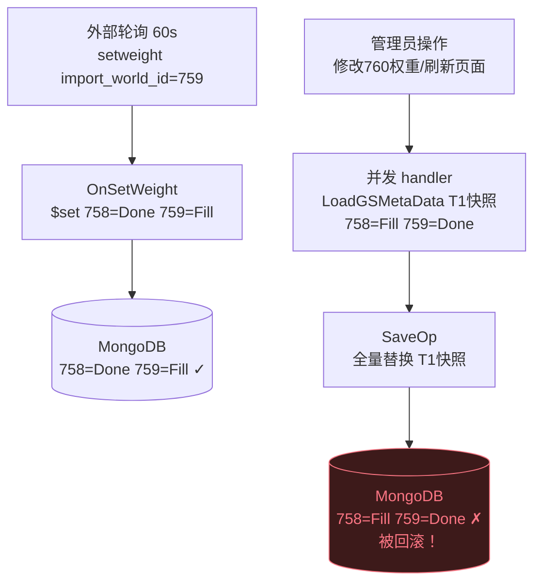

## 审查概览

| 项目 | 内容 |
|------|------|
| 审查人 | wenyu |
| 被审查人 | chenqiang |
| 日期 | 2026-06-11 |
| 分支 | `h5_new_tf_v1044_gmt` |
| Commit | `23bc79334313` — 【1044】gsmeta原子化更新 |
| 背景 | 修复 igame 中 `GSMetas` 数据的读-改-写竞态问题：多个 HTTP handler 使用 `SaveOp`（全量文档替换），导致并发写入时互相覆盖服务器状态（`status`/`weight` 等字段）。该问题在外部轮询每 60 秒调 `OnCheckImportFlag` 与 `OnSetWeight` 并发时尤为严重。 |
| 问题总数 | P0 × 1，P1 × 2，P2 × 1 |

---

## 问题汇总表

| 优先级 | 问题描述 | 文件位置 | 类型 |
|--------|---------|---------|------|
| P0 | `newServerCheck` 缺少 `$exists` 保护，可覆盖已有完整服务器配置 | `ctl_server.go:342` | logic |
| P1 | 多处将 `dbMod` 参数硬编码为 `doorConf.DBMOD` | `ctl_server.go` 多处 | safety |
| P1 | `OnManualSetKadminKey` 响应体返回旧值 | `ctl_server.go:996` | logic |
| P2 | `meta.KadminKey = req.AccessKey` 为死代码 | `ctl_server.go:996` | style |

---

## 问题详情

### P0 · logic — `newServerCheck` 缺少 `$exists` 保护

**文件**：`igame/internal/receiver/handler/ctl_server.go:342`

**问题说明**

`newServerCheck` 在 GET 请求（`/ark/servers/details/{serverId}`）中触发。当管理员刷新某服务器详情页时，若该服务器在 cluster 中但尚未在 `meta.GSInfo` 里，会执行 `$set {infos.X: <new GSMeta>}`。

由于没有 `{infos.X: {$exists: false}}` 过滤条件，若并发的 `OnSetWeight` 或 `OnServerAdd` 刚刚写入了完整配置（`Status=Fill`, `Weight=ImportWeight`, `MaxLoginCount=N` 等），该 `$set` 会将整个 `infos.X` 字段替换为 `{status: Test}` 的空对象，丢失所有已配置字段。

```diff
- op := utility.GSMetas{}.GetUpdateOp(doorConf.DBName(), bson.D{{"$set", update}})
- ret := db.SaveCall(doorConf.DBMOD, op)
+ op := meta.GetCondUpdateOp(doorConf.DBName(),
+     bson.M{fieldPath: bson.M{"$exists": false}},       // 仅在不存在时写入
+     bson.D{{Key: "$set", Value: bson.M{fieldPath: info}}},
+ )
+ ret := db.SaveCall(dbMod, op)
```

**修改建议**：改用 `GetCondUpdateOp` 加 `{$exists: false}` 过滤，确保只有服务器真正不存在于 DB 时才创建记录。

---

### P1 · safety — 多处 `doorConf.DBMOD` 硬编码替换了 `dbMod` 参数

**文件**：`ctl_server.go`（`newServerCheck`、`OnModifyTrustUDID`、`OnAlterationArkServer`）

**问题说明**

所有 handler 通过 `wrapDB` 注入 `dbMod` 参数，目的是让调用方（包括单测）可以传入不同的数据库模块。部分修改将 `db.SaveCall(dbMod, ...)` 改成了 `db.SaveCall(doorConf.DBMOD, ...)`，硬编码为生产库。

```diff
- ret := db.SaveCall(doorConf.DBMOD, op)
+ ret := db.SaveCall(dbMod, op)
```

**影响范围**：生产环境无影响（`wrapDB` 注入的就是 `doorConf.DBMOD`），但单测注入测试库时会静默写到生产库，属于测试隔离漏洞。

**修改建议**：统一改回 `dbMod` 参数，与文件内其他 handler 保持一致。

---

### P1 · logic — `OnManualSetKadminKey` 响应体返回旧值

**文件**：`igame/internal/receiver/handler/ctl_server.go:996`

**问题说明**

改动后虽然正确地用 `$set` 更新了 DB，但响应体仍然序列化的是从 DB load 进来的旧值：

```go
meta, err := LoadGSMetaData(dbMod)   // load 旧值
...
meta.KadminKey = req.AccessKey        // 修改内存（未用于写库）
ret := db.SaveCall(dbMod, meta.GetUpdateOp(..., bson.M{"kadminkey": req.AccessKey}))
...
buf, _ := json.Marshal(meta.KadminKey)  // ← 返回旧值，非 req.AccessKey
```

前端调用后看到的 accessKey 不变，误以为设置失败。

```diff
- buf, _ := json.Marshal(meta.KadminKey)
+ buf, _ := json.Marshal(req.AccessKey)
```

---

### P2 · style — `meta.KadminKey = req.AccessKey` 为死代码

**文件**：`igame/internal/receiver/handler/ctl_server.go:996`

```go
meta.KadminKey = req.AccessKey  // 此后 meta 不再被读取或写库
```

`meta` 对象在这行之后只用于 `meta.GetUpdateOp()`（仅借用其方法，不需要字段值）。该行赋值无实际作用，应删除。

---

## 覆盖范围对比

> **注**：本次 chenqiang 的提交覆盖范围比同期 wenyu 的改动更全面。

| 文件 | wenyu 修改 | chenqiang 修改 | 差异说明 |
|------|-----------|--------------|---------|
| `ctl_server.go` | ✓ | ✓ | 均覆盖 |
| `api/import.go` | ✗ | ✓ | chenqiang 额外修复 `HandleImportRuleInsert/Edit`、`HandleImportSyncAddrEdit` |
| `ctl_import.go` | ✗ | ✓ | chenqiang 额外修复 `refreshChannelImportCnt` |
| `ctl_match.go` | ✗ | ✓ | chenqiang 额外修复 `serverListTest` |

这 3 个文件中同样存在 `SaveOp` 全量覆盖风险，wenyu 的分析遗漏了它们。

---

## 正确改动 Praise

1. **覆盖范围更广**：`api/import.go`、`ctl_import.go`、`ctl_match.go` 中的 `SaveOp` 一并修复，比 wenyu 的改动多覆盖 4 处，更彻底。

2. **`OnAlterationArkServer` 加了 nil 保护**：`req.Locales == nil` / `req.Countries == nil` 时初始化空 slice，防止 MongoDB 写入 `null` 覆盖已有配置，是一处主动防御。

3. **多处加了 `serverID == 0` 校验**：`OnWeightModify`、`OnArkServerStart`、`OnArkServerTermination`、`OnArkServerInnerOper`、`OnAlterationArkServer` 统一补充边界检查，避免误操作 serverID=0 的占位文档。

4. **enum 显式 `int32()` 转换**：`int32(cspb.ServerStatus_Fill)` 等写法使 BSON 序列化意图更明确，避免 proto enum 类型被序列化为 string 导致 MongoDB 类型不一致。

5. **`AddNewServerInfo` 返回 `*GSMeta`**：修改了 `utility/gsmeta.go` 中 `AddNewServerInfo` 的签名，使调用方可以直接拿到 info 引用用于 `$set`，接口设计更合理。

---

## 根因回顾（本次修复的核心问题）

> **根因：** `ctl_server.go` 中 10+ 个 HTTP handler（包括每 60 秒调一次的 `OnCheckImportFlag`）使用 `meta.SaveOp()` 全量替换 MongoDB 文档，而 `OnSetWeight` 使用 `$set` 字段级原子更新。并发时，任意一个 `SaveOp` handler 若在 `$set` 之前 load 了快照，就会在写回时把 `OnSetWeight` 的修改覆盖掉，导致导量服状态（758=Done、759=Fill）被重置。


