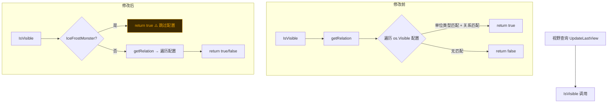

## 审查概览

| 字段 | 内容 |
|------|------|
| 审查人 | Claude Sonnet 4.6 |
| 被审查人 | wenyu |
| 日期 | 2026-05-26 |
| 分支 | `h5_new_tf_v1043` |
| Commit 范围 | `8019dace60` → `9353f9bcf5` |
| 涉及模块 | wmap/observer、wmap/ctl_battlefield_melting_ice、play/ctl_item、play/ctl_union_war |

**问题总数：P0 × 0，P1 × 3，P2 × 1**

---

## 问题汇总表

| 优先级 | 问题描述 | 文件位置 | 类型 |
|--------|---------|---------|------|
| P1 | IceFrostMonster 绕过可见性配置，对全体玩家无条件可见 | `observer.go:82` | logic |
| P1 | EventCampDragonNests 参数由 `(1, nil)` 变为 `(0, sumMap)`，语义未确认 | `ctl_union_war.go:571` | logic |
| P1 | PetMgr nil 检查移至 EffectAcquirePet 类型判断之前，作用范围扩大 | `ctl_item.go:310` | logic |
| P2 | `int32(mCostNum/rewardNum)` 未做溢出保护 | `ctl_battlefield_melting_ice.go:671` | safety |

---

## 问题详情

### P1-01 · IceFrostMonster 绕过可见性配置

**文件：** `game/wmap/internal/mmap/mplayer/observer.go:82`

**问题说明**

新增的早返回直接跳过了 `os.Visible` 循环，而该循环是根据策划配置（单位类型 + LOD 缩放级别 + 关系）决定可见性的核心逻辑。这意味着冰霜怪物在任意缩放级别、对任意阵营玩家均可见，无视配置约束。

```diff
  func (os *Observer) IsVisible(mapUnit munit.IUnit) bool {
+     if mapUnit.GetCategory() == int32(gdconf.MonsterType_IceFrostMonster) {
+         return true   // 跳过了下方全部可见性规则
+     }
      relation := mapUnit.GetRelation(munit.NewOwnerInfo(cspb.TypePlayerOwner, os.ID, 0))
      for _, u := range os.Visible {
          ...
      }
      return false
  }
```

**触发路径对比**



**修改建议**

确认策划配置中是否存在对 IceFrostMonster 的 LOD/关系限制。若设计意图就是"全图全玩家始终可见"，建议补充注释说明原因；若有 LOD 约束需求，应改为在 `os.Visible` 循环内增加对 IceFrostMonster 的特殊处理，而非绕过整个循环。

---

### P1-02 · EventCampDragonNests 参数变更语义未确认

**文件：** `game/play/internal/ctl_union_war.go:571`

**问题说明**

该行之前一直被注释掉，注释代码使用的是 `goalEvent(goal.EventCampDragonNests, 1, nil)`，本次重新启用时参数变为 `goalEvent(goal.EventCampDragonNests, 0, sumMap)`——第二个参数从 `1` 改为 `0`，第三个参数从 `nil` 改为 `sumMap`。

```diff
  play.OnBattleFieldUnionAndCampEvent(0, nil, goalEvent(goal.EventCampDragonNestsOnEnd, 0, sumMap))
+ play.OnBattleFieldUnionAndCampEvent(0, nil, goalEvent(goal.EventCampDragonNests, 0, sumMap))
  // 旧注释：//play.OnBattleFieldUnionAndCampEvent(0, goalEvent(goal.EventCampDragonNests, 1, nil))
```

`EventCampDragonNests`（type 903）使用 `MaxAboveHandler`，本身幂等，不会双重计数。但 `goalEvent` 第二个参数含义（可能是 level 或 flag）从 `1` 变成 `0` 有语义差异，且该事件已在 `ctl_goal_eval_all.go:100` 登录时推送，两条路径参数不同可能导致任务判断不一致。

**修改建议**

确认 `goalEvent` 第二参数语义，以及原注释中 `1` 是否为特定龙巢等级过滤值。若 `0` 表示"不过滤"而 `1` 表示"仅一级龙巢"，则行为发生了变化需要说明。

---

### P1-03 · PetMgr nil 检查作用范围扩大

**文件：** `game/play/internal/ctl_item.go:310`

**问题说明**

旧代码只在 `EffectAcquirePet` 效果类型内检查 PetMgr；新代码将 nil 检查提到效果类型判断之前，覆盖了所有 `ItemPetFragment` 类道具。

```diff
  if oldCfg.Category == gdconf.ItemPetFragment {
      cfg := gdconf.GetItemCfg(oldCfg.IsMerge[1])
      if cfg == nil { ... }
+     if p.GetPetMgr() == nil {
+         err = cspb.ErrCodeItemMergePetNoUnlock
+         return
+     }
      if cfg.CategoryParam.Effect != nil && cfg.CategoryParam.Effect[0].Typ == gdconf.EffectAcquirePet {
-         if p.GetPetMgr() != nil && p.GetPetMgr().HasPet(...) {
+         if p.GetPetMgr().HasPet(...) {
```

> **根因：** 若存在 `Category=ItemPetFragment` 但 `Effect[0].Typ != EffectAcquirePet` 的道具配置（如宠物装备碎片），旧代码允许 PetMgr 为 nil 时合成，新代码将其一并拦截。

**修改建议**

结合 H5-9521 策划需求确认：若"所有宠物碎片合成都需要宠物系统解锁"是正确行为，则此改动正确，建议补充注释。若存在不依赖 PetMgr 的宠物碎片道具，需缩小 nil 检查的作用范围，重新放回 `EffectAcquirePet` 分支内。

---

### P2-01 · int32 截断未做保护

**文件：** `game/wmap/internal/ctl_battlefield_melting_ice.go:671`

**问题说明**

```go
rAssets := gdconf.RewardsToAssetsTimes(tmpReward, int32(mCostNum/rewardNum))
```

`mCostNum` 和 `rewardNum` 均为 `int64`，除法结果直接强转 `int32`。当结果超过 `2,147,483,647` 时将溢出为负数，导致 `RewardsToAssetsTimes` 计算出错误（或零）的奖励数量。

当前游戏内魔碳单次消耗量触发概率极低，但属于防御性编程缺失。

**修改建议**

```go
multiplier := mCostNum / rewardNum
if multiplier > math.MaxInt32 {
    multiplier = math.MaxInt32
}
rAssets := gdconf.RewardsToAssetsTimes(tmpReward, int32(multiplier))
```

---

## 正确改动 Praise

本次提交中以下改动质量高，值得肯定：

1. **playerTroopMeltingIceCb 函数拆分彻底**：从一个 100+ 行的大函数中提取了 `consumeOriginMeltCnt`、`updateMeltingAreaCount`、`processMeltingIceStamina`、`broadcastMeltingIceArrived`、`calcMagicCarbonCost`、`grantCarbonReward` 六个小函数，每个职责单一，可读性大幅提升。

2. **getMeltingIceWeekSettleTime 签名简化**：去掉外部传入的 `startTime` 参数，改为函数内部自取，消除了三处调用方的重复 `GetPhaseStartTime` 调用，降低了调用方心智负担，也避免了参数不一致的潜在问题。

3. **IceMorrowMine accessor 引入**：通过 `accessor_engine2` 生成 accessor 后，原文件精简了约 100 行手写的 getter/setter，同时 `MakeDirty` 调用得到统一管理，不易遗漏。

4. **TimeFormNow 工具函数提取**：将散落在 `exp_union_center.go` 和 `ice_contest_crystal_tower.go` 的三处相同计算逻辑统一为 `util.TimeFormNow`，符合 DRY 原则，且函数命名清晰。

5. **grantCarbonReward 错误处理改进**：旧代码在配置长度不对时只打 `tlog.Errorf` 没有 MakeReward 错误路径的日志；新代码在 `MakeReward` 失败时补充了错误日志，便于排查奖励异常。

---

## 修复进度追踪

| 编号 | 问题 | 状态 |
|------|------|------|
| P1-01 | IceFrostMonster 可见性策略确认 | 待确认 |
| P1-02 | EventCampDragonNests 参数语义确认 | 待确认 |
| P1-03 | PetMgr nil 检查范围与策划需求对齐 | 待确认 |
| P2-01 | int32 溢出保护 | 待修复 |
