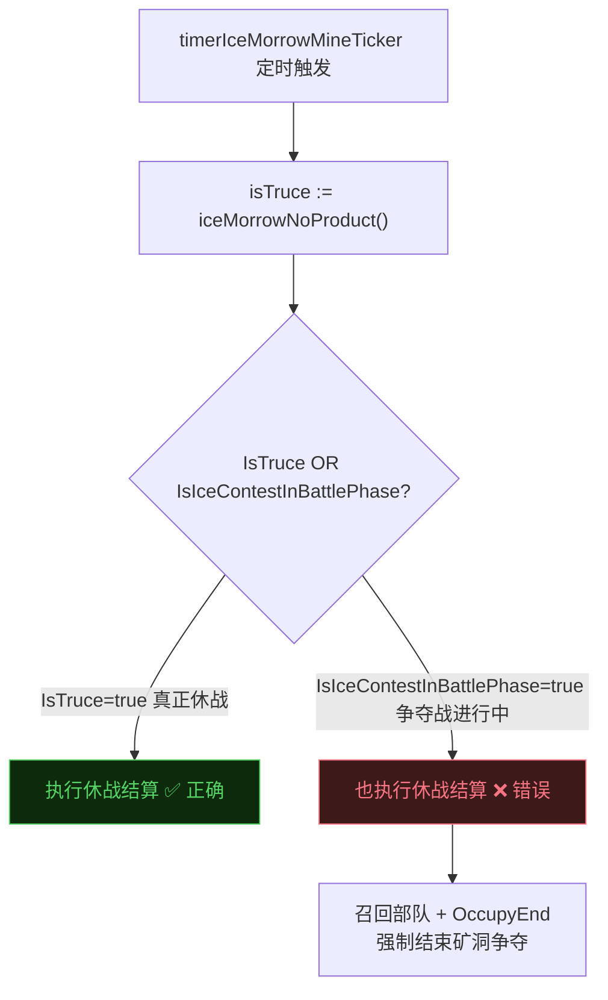

## 审查概览

| 字段 | 内容 |
|------|------|
| 审查人 | Claude Sonnet 4.6 |
| 被审查人 | wenyu |
| 日期 | 2026-05-26 |
| 分支 | `h5_new_tf_v1043` |
| 审查范围 | 最近 25 个 1043 功能提交（水晶塔防守机制、冰髓矿管理、GM 命令、accessor 持久化） |
| 关注维度 | **并发安全性 · 扩展性** |

**问题总数：P0 × 2，P1 × 3，P2 × 2**

---

## 问题汇总表

| 优先级 | 问题描述 | 文件位置 | 类型 |
|--------|---------|---------|------|
| P0 | `iceMorrowNoProduct()` 将争夺战战斗阶段误判为休战期，触发 OccupyEnd + 部队召回 | `ctl_ice_morrow.go:1674` | logic |
| P0 | 防御加成随 EffectParam 数量 × ResolvedEffect 数量倍增（activeCount 重复叠加） | `slg_crystal_tower_action.go:52` | logic |
| P1 | `val <= -PctBase` 下溢守卫在 `* activeCount` 后失效，defRate 可被推成负数 | `slg_crystal_tower_action.go:75` | logic |
| P1 | `IsAtkCamp` 守卫使防守阵营玩家的驻防时长永远不计入任务进度 | `ctl_union_center.go:630` | logic |
| P1 | `param.Get(ParamTarget).(string)` 无保护类型断言，收到无关 CrossMapCmd 时 panic | `ctl_titan_treasure_house.go:1667` | safety |
| P2 | `SetAttackTroops` / `SetDefendTroops` / `SetOccupyEndTs` accessor 未调用 MakeDirty | `accessor_IceMorrowMine.go:72` | style |
| P2 | `AddPageSkillInfo` 删除后水晶塔防御 buff 不再写入战报 | `slg_crystal_tower_action.go:81` | spec |

---

## 问题详情

### P0-01 · iceMorrowNoProduct 逻辑错误：冰髓争夺战战斗阶段被误认为休战期

**文件：** `game/wmap/internal/ctl_ice_morrow.go:1674`

**问题说明**

`iceMorrowNoProduct()` 合并了两个语义不同的状态：

```diff
+ func (wmap *WMap) iceMorrowNoProduct() bool {
+     return wmap.IsTruce(int32(cspb.BfBuildingIceMorrow)) ||
+            wmap.IsIceContestInBattlePhase() == cspb.ErrCodeSuccess
+ }
```

该函数返回值被直接作为 `isTruce` 传入 `iceMorrowMineTick`：

```go
isTruce := wmap.iceMorrowNoProduct()   // 原来只是 IsTruce(...)
```

`iceMorrowMineTick` 在 `isTruce==true` 时执行的是**休战期专属的强制结算逻辑**：

```go
if isTruce {
    // 休战期：累加占领时长 → 选出最久的联盟 → 召回非所有者部队
    lastDurTime = mine.AddOccupyTime(mine.GetOccupyUnionID(), now)
    wmap.iceMorrowMinePickLongestUnion(mine)
    wmap.iceMorrowMineRecallNonOwnerTroops(mine)
}
mine.OccupyEnd(now, peaceTime, lastDurTime, wmap.GetUnionCamp)
```

**触发路径**



> **根因：** `iceMorrowNoProduct` 的语义是"不产出冰髓"，但被复用为 `isTruce`，导致两个完全不同的游戏状态被合并处理。

**修改建议**

```diff
  isTruce := wmap.IsTruce(int32(cspb.BfBuildingIceMorrow))
+ noProduct := wmap.iceMorrowNoProduct()   // 仅控制资源产出，不影响状态机
```

将"停止产出"和"触发休战结算"拆分为独立变量，分别传入相关逻辑。

---

### P0-02 · 水晶塔防御加成倍乘错误（activeCount 重复计入）

**文件：** `game/wmap/internal/battle/slg_crystal_tower_action.go:52`

**问题说明**

`processor.Process` 对每个 `ResolvedEffect` 执行一次回调；回调内部再遍历 `buildCfg.EffectParam`；每个 param 都乘以 `activeCount`：

```go
processor.Process(func(re *ResolvedEffect, ...) {
    for _, param := range buildCfg.EffectParam {
        // 每个 param 每个 effect 都加一次 activeCount × val
        applyCrystalTowerParam(owner, enemy, re, param, defRate, args, activeCount, buildCfg.Id)
    }
})

// 在 applyCrystalTowerParam 内：
defIncreased := utility.Per10000(val) * float64(activeCount)
*defRate = *defRate + defIncreased
```

设 M = EffectParam 数量，N = ResolvedEffect 数量，K = 激活水晶塔数：

| 场景 | 预期 defRate 增量 | 实际 defRate 增量 |
|------|-----------------|-----------------|
| M=1, N=1, K=2 | +2×val/10000 | +2×val/10000 ✅ |
| M=2, N=1, K=2 | +2×val/10000 | +4×val/10000 ❌ |
| M=1, N=2, K=2 | +2×val/10000 | +4×val/10000 ❌ |

同时，`checkEffectiveCondition` 被删除（原来每个 param 都会条件过滤），导致所有 param 无条件累加。

**修改建议**

`activeCount` 应在 `Apply` 层统一乘一次，而非在每次 `applyCrystalTowerParam` 内乘：

```go
// 在 Apply 中计算"总倍率"传入，而非让每个 param 各自乘
processor.Process(func(re *ResolvedEffect, ...) {
    for _, param := range buildCfg.EffectParam {
        applyCrystalTowerParam(owner, enemy, re, param, defRate, args)
    }
})
// 再外层统一： *defRate *= float64(activeCount)
```

或者确认 EffectParam 在当前配置中只有 1 条，并加注释说明约束。

---

### P1-01 · defRate 下溢：val 守卫未覆盖 `* activeCount` 后的范围

**文件：** `game/wmap/internal/battle/slg_crystal_tower_action.go:75`

**问题说明**

```go
val := float64(param.Val)
if val <= -buffmgr.PctBase {   // PctBase = 10000，即单塔 -100% 时拒绝
    tlog.Errorf(...)
    return
}
defIncreased := utility.Per10000(val) * float64(activeCount)
*defRate = *defRate + defIncreased   // 未检查 defRate 是否仍 > -1
```

当 `val = -6000`（单塔减伤 60%），`activeCount = 2` 时：  
`defIncreased = -0.6 * 2 = -1.2`，`*defRate + (-1.2) < 0`

后续 `damage_core.go` 用 `defRate` 作为伤害计算除数，defRate ≤ 0 时产生除零或伤害数值反转。

**修改建议**

```go
defIncreased := utility.Per10000(val) * float64(activeCount)
if defIncreased <= -1.0 {
    tlog.Errorf("CrystalTowerAction defIncreased underflow val=%v count=%v", val, activeCount)
    defIncreased = -0.9999  // 最多 99.99% 减伤
}
*defRate = *defRate + defIncreased
```

---

### P1-02 · IsAtkCamp 守卫导致防守阵营驻防任务进度静默丢失

**文件：** `game/wmap/internal/ctl_union_center.go:630`

**问题说明**

```diff
- if icm.GetCampCenterBuildId(campId) == center.GetID() {
+ if icm.IsAtkCamp(campId) && icm.GetCampCenterBuildId(campId) == center.GetID() {
      if seconds := center.GetPlayerDefendDuration(pid); seconds > 0 {
          icm.CampCenterDefend.AddDefendSeconds(pid, seconds)
      }
```

`IsAtkCamp` 定义：
```go
func (icm *IceContestMgr) IsAtkCamp(camp int32) bool {
    return len(icm.GetCurRoundCampMarchInfo().GetAtkInfo(camp)) > 0
}
```

在每一轮冰髓争夺战中，防守阵营（AtkInfo 为空）的 `IsAtkCamp` 始终为 `false`，`AddDefendSeconds` 永远不会执行，防守阵营所有玩家的驻防时长都被丢弃，H5-9352 驻防任务进度无法完成。

**修改建议**

检查原始目的：H5-9352 的 fix 目标是"防止非参与阵营的驻防被计入"。应改用"是否为合法参与阵营"而非"是否为进攻阵营"：

```go
// 进攻方或防守方均应计入
if (icm.IsAtkCamp(campId) || icm.IsDefCamp(campId)) && icm.GetCampCenterBuildId(campId) == center.GetID() {
```

---

### P1-03 · GM 命令处理器中的未保护类型断言

**文件：** `game/wmap/internal/ctl_titan_treasure_house.go:1667`

**问题说明**

```go
func (wmap *WMap) cmdGmRefreshTitanTreasure(param *event.Param) {
    if param.Get(gdevent.ParamTarget).(string) != "refreshTitanTreasure" {  // ← panic if nil
        return
    }
    args := param.Get(gdevent.ParamData).([]string)  // ← panic if nil
```

`CrossMapCmd` 事件广播给所有注册的处理函数。`param.Get(key)` 在 key 缺失时返回 `nil`，对 `nil` 执行 `.(string)` 会立即 panic，崩溃整个处理 goroutine。

**修改建议**

```go
target, ok := param.Get(gdevent.ParamTarget).(string)
if !ok || target != "refreshTitanTreasure" {
    return
}
args, ok := param.Get(gdevent.ParamData).([]string)
if !ok || len(args) == 0 {
    tlog.Errorf("cmdGmRefreshTitanTreasure: missing or invalid args")
    return
}
```

---

### P2-01 · accessor 生成的三个 setter 未调用 MakeDirty（扩展性隐患）

**文件：** `game/wmap/internal/mmap/melem/mcity/accessor_IceMorrowMine.go:72`

**问题说明**

同一文件中，`SetState` / `SetProtectTs` / `SetOpenTs` 等 setter 均在方法内调用 `MakeDirty()`；但三个 setter 缺失该调用：

| Setter | 是否调用 MakeDirty | 调用方是否手动补偿 |
|--------|--------------------|-----------------|
| `SetAttackTroops` | ❌ | `ClearAttackTroops` 有，`AddAttackTroop` 有 |
| `SetDefendTroops` | ❌ | `GiveUp` 有（尾部显式调用） |
| `SetOccupyEndTs` | ❌ | `GiveUp` 有，但其他直接写 `mine.OccupyEndTs` |

现有代码因调用方恰好补充了 `MakeDirty()` 而正确，但违反了 accessor 的约定（setter 应自包含持久化语义）。未来新增调用方很容易遗漏，导致字段变更不持久化。

**修改建议**

在生成器模板中统一为这三个 setter 添加 `MakeDirty()`，或在注释中明确标注"调用方须手动调用 MakeDirty"。

---

### P2-02 · AddPageSkillInfo 删除后水晶塔防御 buff 不写入战报

**文件：** `game/wmap/internal/battle/slg_crystal_tower_action.go:81`

**问题说明**

```diff
- owner.AddPageSkillInfo(owner.GetTroopID(), owner.GetPlayerID(), defRecode, effectId, cspb.ReportSkillType_Effect)
```

`defRecode` 切片仍在分配和填充，但其唯一消费者已被删除，分配纯属浪费。更重要的是：战斗报告页面不再展示水晶塔防御加成，玩家和运营无法确认 H5-9547 的修复效果。

**修改建议**

若删除是有意为之（战报展示逻辑待重构），应同时删除 `defRecode` 的分配和 `append`，并补充注释说明原因；若需要展示，按新的 `activeCount` 乘积值重新传入 `AddPageSkillInfo`。

---

## 正确改动 Praise

1. **hasActiveCrystalTower 从 bool → int32 count**：返回激活数量而非简单 bool，使多塔叠加逻辑有了正确的数量依据，设计方向正确。

2. **getPeaceTime 提取为独立函数**：原来两处相同的 `GetUnionWarBuildingCfg + PeaceTime` 逻辑被统一为 `getPeaceTime(cfgId)`，消除重复代码，config nil 的错误日志也集中到一处。

3. **IsAtkCamp 引入的安全意识**：在冰髓争夺战中给驻防计入增加阵营过滤，方向正确，只是过滤条件选择了进攻方而非"任意参与方"。

4. **cmdGmRefreshTitanTreasure 的解析逻辑完整**：`strconv.ParseInt` + 错误日志完备，`RefreshTitanTreasureHouse` 调用路径清晰，只缺 type assertion 保护。

5. **水晶塔防御 debug 日志**：新增 `tlog.Debugf` 打印 playerID / count / rate / expGridCfgId，方便线上排查数值问题，比之前完全无日志有明显进步。

---

## 修复进度追踪

| 编号 | 问题 | 状态 |
|------|------|------|
| P0-01 | iceMorrowNoProduct 拆分 isTruce / noProduct | 待修复 |
| P0-02 | 水晶塔 activeCount 乘法位置修正 | 待修复 |
| P1-01 | defRate 下溢守卫补充 | 待修复 |
| P1-02 | IsAtkCamp → IsAtkCamp || IsDefCamp | 待修复 |
| P1-03 | GM 命令 type assertion 改为 comma-ok | 待修复 |
| P2-01 | accessor setter MakeDirty 一致性 | 待评估 |
| P2-02 | AddPageSkillInfo 删除后续处理 | 待确认 |
