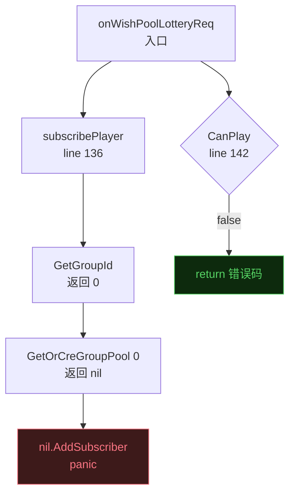

## 审查概览

| 项 | 内容 |
|----|------|
| 审查人 | Claude Code |
| 提交人 | wenyu |
| 日期 | 2026-05-25 |
| 分支 | `h5_new_tf_v1044_wish_pool_sort` |
| Commit 范围 | `efc23e54ff` → `48b30dfc02`（共 4 次提交） |
| 涉及模块 | `actv/cactv/.../wish_pool_v2/`、`game/actv/.../mgr/`、`actv_play/ap_rank/` |

**问题总数：P0 × 5，P1 × 4，P2 × 0**

---

## 问题汇总表

| 优先级 | 问题描述 | 文件位置 | 类型 |
|--------|---------|---------|------|
| P0 | subscribePlayer 先于 CanPlay 调用，groupId=0 时 nil panic | `comp.go:156` | logic |
| P0 | PPower 分支 cfg 无 nil 守卫，直接访问 cfg.Reward panic | `lottery.go:317` | safety |
| P0 | lotteryRewardByAccount 返回 nil 后访问 cfg.Reward panic | `lottery.go:322` | safety |
| P0 | NoBigDecrCnt 为空时下标 -1 越界 panic | `comp.go:113` | safety |
| P0 | minCycleIxArr 耗尽后 RandInt(0,-1) 非法参数 panic | `lottery.go:77` | logic |
| P1 | CmdAddRecord 在 Logs 为空时 GetLogs()[0] 越界 panic | `account.go:45` | safety |
| P1 | CmdSendReward 缺少 return，每次成功发奖都打出 Warnf | `play_rank.go:198` | logic |
| P1 | CmdActvWishPoolRankMail 传 sid=0，GM 发奖静默失效 | `cmd.go:495` | logic |
| P1 | FateGear CmdRankReward 发奖代码被注释，GM 命令无效 | `game/actv/mgr/cmd.go:728` | logic |

---

## 问题详情

### P0-1 · subscribePlayer 先于 CanPlay 调用，nil 指针崩溃

**文件：** `actv/cactv/internal/activity/template/wish_pool_v2/comp.go:156`

> **根因：** `onWishPoolLotteryReq` 第 136 行无条件调 `subscribePlayer`，而 `CanPlay` 校验在第 142 行；当玩家 SID 尚无分组时，`GetGroupId` 返回 0，`GetOrCreGroupPool(0)` 底层是纯 map 读取（`c.Progresses[0]`），key 不存在返回 nil，随后 `nil.AddSubscriber()` panic。



**修改建议：** 将 `subscribePlayer` 移到 `CanPlay` 校验之后，与 `onWishPoolOpenBoxReq` 的处理保持一致。

```diff
  func (ths *ActvTmplWishPool) onWishPoolLotteryReq(playerID int64, req0 any) {
      req := req0.(*cspb.WishPoolLotteryReq)
      tfCnf := gdconf.GetTreviFountainCfgByContentId(ths.GetContentID())
      actvProgress := ths.CoreComp.GetProgress()
-     ths.subscribePlayer(req.SID, playerID)
      if !ths.IsStart() {
          ...
          return
      }
      if !ths.CanPlay(playerID, req.SID) {
          ...
          return
      }
+     ths.subscribePlayer(req.SID, playerID)
```

---

### P0-2 · PPower 分支 cfg 无 nil 守卫

**文件：** `actv/cactv/internal/activity/template/wish_pool_v2/lottery.go:315–318`

> **根因：** `GetTreviFountainprobabilityCfgByContentIdAndIndex` 在配置缺失时返回 nil，随后 `tlog.Infof` 参数中直接访问 `cfg.Reward`，触发 nil pointer dereference。

```diff
  if account.GetEnergy() >= wishPoolCfg.PPower[1] {
      cfg := gdconf.GetTreviFountainprobabilityCfgByContentIdAndIndex(ths.GetContentID(), wishPoolCfg.PPower[0])
+     if cfg == nil {
+         tlog.Errorf("WishPool PPower cfg not found contentId:%v index:%v", ths.GetContentID(), wishPoolCfg.PPower[0])
+         return nil
+     }
      tlog.Infof("... cfg:%+v Reward:%v", wishPoolCfg, cfg.Reward)
      return cfg
  }
```

---

### P0-3 · lotteryRewardByAccount 返回 nil 后访问 cfg.Reward

**文件：** `actv/cactv/internal/activity/template/wish_pool_v2/lottery.go:320–323`

> **根因：** 当全部特殊奖励被个人/全服库存或能量门槛过滤完后，`lotteryRewardByAccount` 显式返回 nil（line 490）；调用方 `tlog.Infof` 直接访问 `cfg.Reward`，panic。

```diff
  cfg := ths.lotteryRewardByAccount(account)
+ if cfg == nil {
+     tlog.Warnf("WishPool specialReward all filtered pid:%v energy:%v", playerID, account.GetEnergy())
+     return nil
+ }
  tlog.Infof("... cfg:%+v Reward:%v", ..., cfg.Reward)
  return cfg
```

---

### P0-4 · NoBigDecrCnt 为空时下标 -1 越界

**文件：** `actv/cactv/internal/activity/template/wish_pool_v2/comp.go:113`

> **根因：** `min(len(tfCnf.NoBigDecrCnt)-1, x)` 当数组为空时 = `min(-1, x)` = `-1`，`tfCnf.NoBigDecrCnt[-1]` 立即越界 panic。

```diff
- if personalReachCnt := tfCnf.NoBigDecrCnt[min(len(tfCnf.NoBigDecrCnt)-1, int(p.GetNoSuperRewardCircleCnt()))]; account.GetTotalDraw() >= personalReachCnt {
+ if len(tfCnf.NoBigDecrCnt) > 0 {
+     idx := min(len(tfCnf.NoBigDecrCnt)-1, int(p.GetNoSuperRewardCircleCnt()))
+     if personalReachCnt := tfCnf.NoBigDecrCnt[idx]; account.GetTotalDraw() >= personalReachCnt {
          return rewardIx
+     }
  }
```

---

### P0-5 · minCycleIxArr 耗尽后 RandInt(0,-1) 非法

**文件：** `actv/cactv/internal/activity/template/wish_pool_v2/lottery.go:77`

> **根因：** `calcHits` 中每个小循环桶满载后从 `minCycleIxArr` 中删除；若奖励总数超过容量，数组耗尽后 `random.RandInt(0, len(minCycleIxArr)-1)` = `RandInt(0, -1)`，参数非法崩溃。

```diff
  for i := range len(maxHitTimesArr) {
+     if len(minCycleIxArr) == 0 {
+         tlog.Errorf("calcHits: minCycleIxArr exhausted at i=%d, cfgId=%v", i, cfgId)
+         break
+     }
      ix := random.RandInt(0, len(minCycleIxArr)-1)
```

---

### P1-1 · CmdAddRecord 在 Logs 为空时 GetLogs()[0] 越界

**文件：** `actv/cactv/internal/activity/template/wish_pool_v2/account.go:45`

> **根因：** GM 对从未参与许愿池的玩家执行 CmdAddRecord，`GetLogs()` 为空切片，`GetLogs()[0]` 立即 panic，崩溃 actv 服务。

```diff
  func (ths *ActvTmplWishPool) CmdAddRecord(playerID int64, cnt int32) {
      account := ths.getOrCreAccount(playerID, 0)
+     if len(account.GetLogs()) == 0 {
+         tlog.Warnf("CmdAddRecord: player %v has no logs", playerID)
+         return
+     }
      for range cnt {
          account.SetLogs(append(account.GetLogs(), account.GetLogs()[0].DeepCopy()))
      }
```

---

### P1-2 · CmdSendReward 缺少 return，Warnf 每次必执行

**文件：** `actv/cactv/internal/activity/actv_play/ap_rank/play_rank.go:194–198`

> **根因：** for 循环内找到匹配 section 并调 `SendRankRewards` 后没有 `return`，穿透至 line 198 的 `Warnf`；每次成功发奖都输出"no rank section found"，运维误读后可能重复触发 GM 补发。

```diff
          rankMailCtx.SendRankRewards(sid, a.base.CfgID, []*ranklist.RankItem{ri}, 0, idgen.NewID())
          tlog.Infof("ActvPlayRank GM CmdSendReward actvCfgId:%v playerId:%v rank:%v sid:%v reward:%v",
              a.base.CfgID, playerId, rank, sid, secCfg.GetRewards())
+         return
      }
  }
  tlog.Warnf("ActvPlayRank CmdSendReward actvCfgId:%v no rank section found for playerId:%v rank:%v", ...)
```

---

### P1-3 · CmdActvWishPoolRankMail 传 sid=0，GM 发奖静默失效

**文件：** `actv/cactv/internal/activity/mgr/cmd.go:495`

> **根因：** 原调用 `wishPool.CmdRankMail(playerID, rankType, rank)`；重构后改为 `wishPool.RankPlay.CmdSendReward(playerID, int64(rank), 0)`，第三参数 `sid` 硬编码 0 而非传入的 `rankType`。`SendRankRewards` 用 sid 确定目标服务器，传 0 导致邮件无法送达。

```diff
- wishPool.RankPlay.CmdSendReward(playerID, int64(rank), 0)
+ wishPool.RankPlay.CmdSendReward(playerID, int64(rank), rankType)
```

---

### P1-4 · FateGear CmdRankReward 发奖代码被注释，GM 命令无效

**文件：** `game/actv/internal/activity/mgr/cmd.go:728`

> **根因：** `game/actv` 侧 CmdRankReward 的 `RankPlay.CmdSendReward` 调用被注释且无替代路径，函数返回 nil 成功但实际不发任何奖励；`cactv` 侧已正确迁移，`game/actv` 侧漏掉。

**修改建议：** 参照 `cactv` 侧的 `CmdActvWishPoolRankMail` 实现，在 `game/actv` 的对应 case 中补全 `ext0.RankPlay.CmdSendReward(...)` 调用，或明确注释说明该功能在此模块不支持。

---

## 正确改动 Praise

1. **奖池重置逻辑拆分清晰**：`resetRecord` / `resetCntHits` / `checkResetRewardPool` 职责单一，version 变更与循环计数分别处理，逻辑清晰易追踪。

2. **`doSingleLottery` 拆分五步骤**：将原整块抽奖逻辑拆分为 `doGrandPrize` → `doSpecialReward` → `doFixedReward` → `doOutputReward` 四个子函数，命名清楚，每步职责明确，符合项目 60 行函数上限规范。

3. **删除 Redis 排行榜依赖**：将活动内排行榜从 Redis 迁移到内置 `ap_rank` 组件，移除了 `UpdateRankScore` / `GetRank` / `OnRankReq` 等旧接口及其在 service 层的实现，清理彻底，无遗留死代码（除 FateGear 注释行）。

4. **`calcHits` 算法设计**：大奖位置先随机分布、小奖再填充的两阶段设计合理，`minCycleMaxHit` 约束保证单小周期不过度集中，整体概率模型思路清晰。

5. **`StageData` 独立成 Component**：许愿池阶段进度从原 `ActvWishPoolAccount.StageMap(map[int32]bool)` 拆出为独立的 `StageData + ActvPlayWishPoolStage`，活动结束时可独立遍历并补发邮件，扩展性更好。

---

## 修复进度追踪

| # | 问题 | 状态 |
|---|------|------|
| P0-1 | subscribePlayer 顺序 | ⬜ 待修复 |
| P0-2 | PPower nil 守卫 | ⬜ 待修复 |
| P0-3 | lotteryRewardByAccount nil 守卫 | ⬜ 待修复 |
| P0-4 | NoBigDecrCnt 越界守卫 | ⬜ 待修复 |
| P0-5 | minCycleIxArr 耗尽守卫 | ⬜ 待修复 |
| P1-1 | CmdAddRecord 空 Logs 守卫 | ⬜ 待修复 |
| P1-2 | CmdSendReward 补 return | ⬜ 待修复 |
| P1-3 | CmdActvWishPoolRankMail sid 参数 | ⬜ 待修复 |
| P1-4 | FateGear CmdRankReward 补全 | ⬜ 待修复 |
