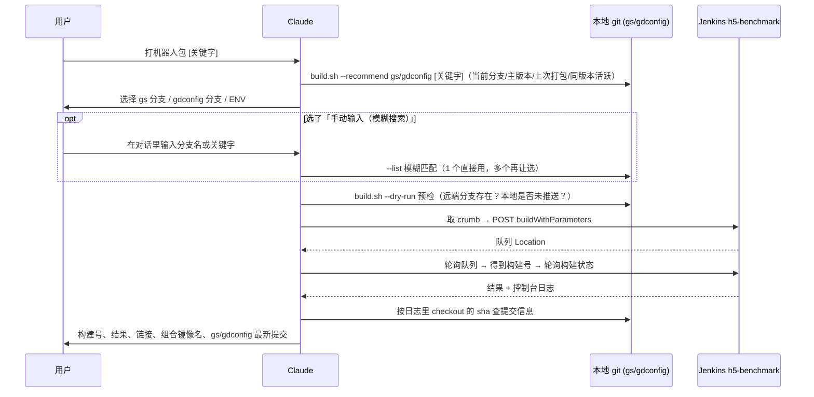

# Skill: jenkins-benchmark

| 项 | 值 |
|---|---|
| 名称 | `jenkins-benchmark` |
| 源文件 | `~/.claude/skills/jenkins-benchmark/SKILL.md` + `build.sh` |
| 作用域 | 全局 |
| 行数 | SKILL.md 35 / build.sh 144 |
| 用途 | 选择 gs / gdconfig 分支和环境，触发 Jenkins h5-benchmark 打包机器人镜像 |

**触发条件（description 字段，决定什么时候自动加载）**

> 触发 Jenkins h5-benchmark 打包 gs-benchmark 镜像。用户说「打 benchmark 包」「打机器人包」「打包 benchmark」「打包机器人」「jenkins 打包」「打个 benchmark 镜像」时使用。BRANCH_benchmark 取 gs 分支、BRANCH_gdconfig 取 gdconfig 分支，三者都由用户每次自己选择。

> 归档已**脱敏**：账号密码只在本机 `~/.config/jenkins-330stars.env`（权限 600），不写进笔记。相关：[[v1052 Benchmark机器人系统-架构流程与启动]]

---

## 目标
在 Claude Code 里说「打机器人包 / 打 benchmark 包」，就能选分支和环境，自动触发 Jenkins `h5-benchmark` 打包 `gs-benchmark` 镜像，并等结果、回报镜像名，不用再打开 Jenkins 页面手填参数。

## 文件位置

| 文件 | 说明 |
|------|------|
| `~/.claude/skills/jenkins-benchmark/SKILL.md` | Skill 说明，规定 Claude 的操作流程 |
| `~/.claude/skills/jenkins-benchmark/build.sh` | 列分支、预检、触发构建、等结果的脚本 |
| `~/.config/jenkins-330stars.env` | Jenkins 账号凭据（权限 600，**不入库、不导出**） |

凭据文件格式（自行填写）：
```bash
JENKINS_URL=https://jenkins.330stars.com
JENKINS_USER=<你的账号>
JENKINS_PASS=<你的密码或 API Token>
```

## Jenkins Job 参数

Job：https://jenkins.330stars.com/view/h5/job/h5-benchmark/ （Pipeline，禁止并发构建，单次约 4~5 分钟）

| 参数 | 取值 | 说明 |
|------|------|------|
| `BRANCH_benchmark` | 用户选择 | **gs 仓库**分支（构建日志确认拉的是 gs 提交） |
| `BRANCH_gdconfig` | 用户选择 | gdconfig 仓库分支 |
| `ENV` | 内网dev / 外网beta / 正式 | 用户选择 |
| `harborURL` | 由 ENV 自动对应 | 见下表 |
| `BaseImg` | `harbor-dev.330stars.com/public/330gamelauncher:latest` | 固定 |
| `GameId` | `h5` | 固定 |
| `way` | `harbor` | 固定 |

ENV 与镜像仓库对应关系（来自历史构建记录）：

| ENV | harborURL | 产出镜像示例 |
|-----|-----------|--------------|
| 内网dev | `harbor-dev.330stars.com/gs,` | `harbor-dev.330stars.com/gs/gs-benchmark:<时间戳>` |
| 外网beta | `harbor-beta.330stars.com/gs,` | `harbor-beta.330stars.com/gs/gs-benchmark:<时间戳>` |
| 正式 | `zjwg-harbor.zhangyuqu.com/benchmark,` | `zjwg-harbor.zhangyuqu.com/benchmark/gs-benchmark:<时间戳>` |

## 使用方式

- 触发词：「打机器人包」「打 benchmark 包」「打包机器人」「jenkins 打包」「打个 benchmark 镜像」
- 可带模糊关键字：「打机器人包 1054 light」→ 候选分支只列匹配项
- 每次都会弹出 3 个选择：gs 分支、gdconfig 分支、ENV，不替用户默认

## 流程



### 分支候选与模糊搜索
- `build.sh --list <gs|gdconfig> [关键字...]`：先 `git fetch --prune`，按远端分支最后提交时间倒序列出前 15 个。
- 关键字按空格拆成多个词，忽略大小写，**全部命中才匹配，顺序不限**，例如 `1054 LIGHT` → `h5_new_tf_v1054_remote_fight_light`。
- 弹框选项（每个仓库 4 个）：`--recommend` 的 3 个推荐分支 + 「手动输入（模糊搜索）」。
- 选择框不支持输入时实时过滤，所以要么下指令时带关键字，要么选「手动输入」后在对话里输入。
- 部分界面不显示 AskUserQuestion 自带的 Other 输入框，因此固定加了「手动输入」选项。

### 预检规则
- 远端没有该分支 → 停止，提示先推送。
- 本地分支提交 ≠ 远端 → 提示 Jenkins 打的是远端版本（本地可能有未推送提交）。
- 工作区有未提交改动 → 提示不会进入打包。

### 推荐分支规则（`build.sh --recommend <gs|gdconfig> [关键字...]`）
每行输出「分支<TAB>推荐理由」，最多 3 个，理由显示在选项说明里。

- **无关键字**：按以下顺序去重，取前 3 个，并且只推荐远端存在的 `h5_` 分支
  1. 本地当前分支
  2. 当前分支对应的主版本分支（如 `h5_new_tf_v1054_remote_fight_light` → `h5_new_tf_v1054`）
  3. Jenkins 上次打包用的分支（gs 取 `BRANCH_benchmark`，gdconfig 取 `BRANCH_gdconfig`）
  4. 同版本号下最近有提交的 `h5_` 分支
  5. 还不够 3 个时，补其他最近有提交的 `h5_` 分支
- **有关键字**：在匹配的分支里，本地当前分支排第一，其余按最近提交排序；`pirate_`、`zjwg_` 这类分支也能搜到
- 实测（当前分支为 `h5_new_tf_v1054_remote_fight_light`）：推荐 `h5_new_tf_v1054_remote_fight_light` / `h5_new_tf_v1054` / `h5_new_tf_v1054_assistant`

### 打包结束输出示例
```text
构建号: #20  https://jenkins.330stars.com/job/h5-benchmark/20/console
结果: SUCCESS
组合镜像名: harbor-dev.330stars.com/gs/gs-benchmark:20261028-143623
---- 打包使用的最新提交 ----
[gs] 96098d9432  yemingheng  2026-10-27 18:41
       build
[gdconfig] 55c21a39d  zhangxin  2026-10-27 17:57
       改bug。
```
提交信息取自构建日志里 `Checking out Revision <sha> (refs/remotes/origin/...)` 的 sha：先 fetch 两个仓库，再看这个 sha 属于哪个仓库，然后归类输出。这样即使预检之后又有人推送，显示的也是实际打进镜像的版本。

## 注意
- 打包会占用共享 Jenkins，正式 ENV 会推到正式 harbor，**必须由用户确认后才触发**。
- 用账号密码调 POST 接口要带 CSRF crumb，并保持同一个 cookie 会话，脚本已处理；改用 API Token 可以不带 crumb。
- 只查状态或日志：
  ```bash
  source ~/.config/jenkins-330stars.env
  curl -sS -u "$JENKINS_USER:$JENKINS_PASS" "$JENKINS_URL/job/h5-benchmark/<号>/consoleText"
  ```

## 踩过的坑

- `BRANCH_benchmark` 的 Jenkins 描述写的是「game分支名」，实际拉的是 **gs 仓库**（构建日志里 checkout 的提交就是 gs 的提交）。
- `config.xml` 没有读权限，参数和 ENV→harborURL 的对应关系是从历史构建的参数里反推出来的。
- 用账号密码调用 POST 接口必须带 crumb，并且和取 crumb 时用**同一个 cookie 会话**，否则会返回 403。
- AskUserQuestion 自带的 Other 输入框在部分界面上不显示，所以固定加了「手动输入（模糊搜索）」选项。
- 选择框只能显示预先生成的选项，不能边输入边过滤，所以模糊搜索要么在下指令时带上关键字，要么在对话里输入。
- 只按最近提交时间推荐分支，会混进 `pirate_`、`zjwg_` 等其他项目的分支，所以改成了 `--recommend` 规则。

## 红线

- gs 分支、gdconfig 分支、ENV **每次都让用户选**，不替用户默认。
- 选「正式」会推到正式 harbor，触发前必须确认。

## 验证记录

| 日期 | 构建号 | gs | gdconfig | ENV | 结果 | 镜像 |
|------|--------|----|----------|-----|------|------|
| 2026-10-28 | #20 | h5_new_tf_v1054 @96098d9432 | h5_new_tf_v1054 @55c21a39d1 | 内网dev | SUCCESS | `harbor-dev.330stars.com/gs/gs-benchmark:20261028-143623` |

## 附录：SKILL.md 全文

````markdown
---
name: jenkins-benchmark
description: 触发 Jenkins h5-benchmark 打包 gs-benchmark 镜像。用户说「打 benchmark 包」「打机器人包」「打包 benchmark」「打包机器人」「jenkins 打包」「打个 benchmark 镜像」时使用。BRANCH_benchmark 取 gs 分支、BRANCH_gdconfig 取 gdconfig 分支，三者都由用户每次自己选择。
---

# Jenkins h5-benchmark 打包

Job: https://jenkins.330stars.com/view/h5/job/h5-benchmark/ ，凭据在 `~/.config/jenkins-330stars.env`（不要把密码写进对话或仓库）。

参数含义：
- `BRANCH_benchmark` = **gs 仓库**分支（/home/cc/slgh5/gs）
- `BRANCH_gdconfig` = **gdconfig 仓库**分支（/home/cc/slgh5/gdconfig）
- `ENV` → `harborURL` 由脚本自动对应：内网dev→harbor-dev.330stars.com/gs，外网beta→harbor-beta.330stars.com/gs，正式→zjwg-harbor.zhangyuqu.com/benchmark
- 其余参数（BaseImg / GameId=h5 / way=harbor）固定为历史默认值

## 流程

1. **取推荐分支**：`build.sh --recommend gs [关键字...]` 和 `build.sh --recommend gdconfig [关键字...]`，每行输出「分支<TAB>推荐理由」，最多 3 个，直接作为选项（理由放 description）。
   - 无关键字：本地当前分支 → 主版本分支（如 `h5_new_tf_v1054_remote_fight_light` → `h5_new_tf_v1054`）→ Jenkins 上次打包用的分支 → 同版本号最近有提交的 `h5_` 分支，去重取 3 个；只推荐 `h5_` 分支。
   - 有关键字：匹配项里本地当前分支优先，其余按最近提交；匹配为空时告诉用户换关键字。
   - 需要看更多候选时用 `build.sh --list <repo> [关键字...]`（按最近提交排序，前 15 个，不限前缀）。关键字是模糊匹配：按空格拆成多个词，忽略大小写，全部命中即匹配，顺序不限，例如 `1054 light`、`remote fight`。用户请求里带了关键字（如「打机器人包 1054」）就带上。
2. **让用户自己选**：gs 分支、gdconfig 分支、ENV **三项都必须用一次 AskUserQuestion（3 个问题）让用户选择**，即使用户在请求里已经提到，也不要自己默认或替用户决定。
   - gs 分支 / gdconfig 分支：各 4 个选项 = `--recommend` 给出的 3 个分支 + 固定最后一项「手动输入（模糊搜索）」。**界面不一定显示 Other，不要依赖它**。
   - ENV：选项为 内网dev / 外网beta / 正式。
   - 用户选了「手动输入（模糊搜索）」：用普通文字回复让用户直接在对话里输入分支名或关键字（说明可以空格分隔多个词），等用户回复。拿到输入后若不是精确存在的分支名，就当关键字用 `--list` 模糊搜索：只命中 1 个就直接用它（在预检输出里展示给用户）；命中多个再用 AskUserQuestion 让用户从匹配结果里选；命中 0 个就告诉用户并让其换个关键字。
3. **预检**：`bash ~/.claude/skills/jenkins-benchmark/build.sh --env <ENV> --gs <分支> --cfg <分支> --dry-run`
   - 远端没有这个分支 → 停下，提示先推送。
   - 提示本地和远端不一致或有未提交改动 → 告诉用户 Jenkins 打的是远端版本，问要不要先推送再打。
4. **触发**：用户选完、预检通过后，去掉 `--dry-run`，用 `run_in_background` 执行。脚本会等到排队结束、构建完成（约 5 分钟），job 禁止并发，前面有构建时会排队。
5. **汇报**：构建号、结果、控制台链接、推送的镜像名（`组合镜像名` 那一行），以及「打包使用的最新提交」：gs 和 gdconfig 各一条，包含短哈希、作者、时间和提交说明。这里以构建日志里实际 checkout 的版本为准，不用预检时的版本。失败时脚本会打印日志末尾，根据日志说明原因。

## 注意

- 打包会占用共享 Jenkins，而且正式 ENV 会推送到正式 harbor，**不要在没有确认的情况下触发**。
- 只查状态或日志时直接用 curl：`source ~/.config/jenkins-330stars.env; curl -sS -u "$JENKINS_USER:$JENKINS_PASS" "$JENKINS_URL/job/h5-benchmark/<号>/consoleText"`。
````

## 附录：build.sh 全文

```bash
#!/usr/bin/env bash
# 触发 Jenkins h5-benchmark 打包并等待结果。
# 用法: build.sh [--env 内网dev|外网beta|正式] [--gs 分支] [--cfg 分支] [--dry-run] [--no-wait]
# 分支默认取 /home/cc/slgh5/{gs,gdconfig} 的当前分支。
set -euo pipefail

source ~/.config/jenkins-330stars.env
JOB="$JENKINS_URL/job/h5-benchmark"
ROOT=/home/cc/slgh5
ENV_NAME="内网dev"; GS_BR=""; CFG_BR=""; DRY=0; WAIT=1

while [[ $# -gt 0 ]]; do
  case "$1" in
    # 列出远端分支候选（按最近提交排序），可带关键字模糊过滤: --list <gs|gdconfig> [关键字...]
    # 关键字按空格拆分，忽略大小写，所有词都命中才算匹配，顺序不限（如 "1054 light"）
    --list)
      repo=$2; shift 2
      git -C "$ROOT/$repo" fetch -q --prune origin
      echo "当前分支: $(git -C "$ROOT/$repo" branch --show-current)"
      git -C "$ROOT/$repo" for-each-ref --sort=-committerdate --format='%(refname:lstrip=3)  %(committerdate:short)' refs/remotes/origin \
        | grep -v '^HEAD' | awk -v q="$*" 'BEGIN{n=split(tolower(q),w," ")}
            {b=tolower($1); for(i=1;i<=n;i++) if(index(b,w[i])==0) next; print}' | head -15
      exit 0;;
    # 给选择框用的 3 个推荐分支，每行「分支<TAB>理由」: --recommend <gs|gdconfig> [关键字...]
    # 无关键字: 本地当前分支 → 主版本分支 → Jenkins 上次打包用的分支 → 同版本号最近活跃的 h5_ 分支，去重取 3 个
    # 有关键字: 匹配项里本地当前分支优先，其余按最近提交
    --recommend)
      repo=$2; shift 2
      git -C "$ROOT/$repo" fetch -q --prune origin
      remotes=$(git -C "$ROOT/$repo" for-each-ref --sort=-committerdate --format='%(refname:lstrip=3)' refs/remotes/origin | grep -v '^HEAD$')
      cur=$(git -C "$ROOT/$repo" branch --show-current)
      cands=()
      add() { [[ -n "$1" ]] && grep -qxF -- "$1" <<<"$remotes" && ! printf '%s\n' "${cands[@]%%$'\t'*}" | grep -qxF -- "$1" && cands+=("$1"$'\t'"$2") || true; }
      if [[ $# -gt 0 ]]; then
        matched=$(awk -v q="$*" 'BEGIN{n=split(tolower(q),w," ")} {b=tolower($0); for(i=1;i<=n;i++) if(index(b,w[i])==0) next; print}' <<<"$remotes")
        grep -qxF -- "$cur" <<<"$matched" && add "$cur" "本地当前分支"
        while read -r b; do add "$b" "匹配关键字"; done <<<"$matched"
      else
        add "$cur" "本地当前分支"
        ver=$(grep -oE '^h5_.*_v[0-9]+' <<<"$cur" || true)
        add "$ver" "当前分支的主版本分支"
        param=$([[ $repo == gs ]] && echo BRANCH_benchmark || echo BRANCH_gdconfig)
        last=$(curl -sS -g -m 15 -u "$JENKINS_USER:$JENKINS_PASS" "$JOB/lastBuild/api/json?tree=actions[parameters[name,value]]" \
          | python3 -c "import json,sys;print(next((p['value'] for a in json.load(sys.stdin)['actions'] for p in a.get('parameters',[]) if p['name']=='$param'),''))" 2>/dev/null || true)
        add "$last" "Jenkins 上次打包用的分支"
        num=$(grep -oE 'v[0-9]+' <<<"$cur" | head -1 || true)
        while read -r b; do add "$b" "同版本最近有提交"; done < <(grep '^h5_' <<<"$remotes" | grep -- "${num:-h5_}")
        while read -r b; do add "$b" "最近有提交"; done < <(grep '^h5_' <<<"$remotes")
      fi
      [[ ${#cands[@]} -gt 0 ]] && printf "%s\n" "${cands[@]:0:3}"
      exit 0;;
    --env) ENV_NAME="$2"; shift 2;;
    --gs) GS_BR="$2"; shift 2;;
    --cfg) CFG_BR="$2"; shift 2;;
    --dry-run) DRY=1; shift;;
    --no-wait) WAIT=0; shift;;
    *) echo "未知参数: $1" >&2; exit 2;;
  esac
done

case "$ENV_NAME" in
  内网dev) HARBOR="harbor-dev.330stars.com/gs,";;
  外网beta) HARBOR="harbor-beta.330stars.com/gs,";;
  正式) HARBOR="zjwg-harbor.zhangyuqu.com/benchmark,";;
  *) echo "ENV 只能是 内网dev / 外网beta / 正式" >&2; exit 2;;
esac

[[ -z "$GS_BR" ]] && GS_BR=$(git -C $ROOT/gs branch --show-current)
[[ -z "$CFG_BR" ]] && CFG_BR=$(git -C $ROOT/gdconfig branch --show-current)

# Jenkins 拉的是远端分支：校验远端存在，并提示本地未推送的提交
check_branch() {
  local repo=$1 br=$2 remote_sha local_sha
  remote_sha=$(git -C $ROOT/$repo ls-remote origin "refs/heads/$br" | awk '{print $1}')
  if [[ -z "$remote_sha" ]]; then
    echo "✗ $repo: 远端不存在分支 $br" >&2; return 1
  fi
  local_sha=$(git -C $ROOT/$repo rev-parse -q --verify "refs/heads/$br" 2>/dev/null || true)
  if [[ -n "$local_sha" && "$local_sha" != "$remote_sha" ]]; then
    echo "⚠ $repo/$br: 本地 ${local_sha:0:10} ≠ 远端 ${remote_sha:0:10}，Jenkins 会打远端版本（本地可能有未推送提交）"
  fi
  [[ -n "$(git -C $ROOT/$repo status --porcelain 2>/dev/null)" && "$(git -C $ROOT/$repo branch --show-current)" == "$br" ]] \
    && echo "⚠ $repo: 工作区有未提交改动，不会进入打包"
  echo "✓ $repo: $br @ ${remote_sha:0:10}"
}
check_branch gs "$GS_BR"
check_branch gdconfig "$CFG_BR"
echo "ENV=$ENV_NAME  harborURL=$HARBOR"

[[ $DRY -eq 1 ]] && { echo "(dry-run，未触发)"; exit 0; }

CJ=$(mktemp); trap 'rm -f "$CJ"' EXIT
AUTH=(-u "$JENKINS_USER:$JENKINS_PASS" -b "$CJ" -c "$CJ")
CRUMB=$(curl -sSf -m 15 "${AUTH[@]}" "$JENKINS_URL/crumbIssuer/api/json" \
  | python3 -c 'import json,sys;d=json.load(sys.stdin);print(d["crumbRequestField"]+":"+d["crumb"])')

LOC=$(curl -sSf -m 30 "${AUTH[@]}" -H "$CRUMB" -o /dev/null -D - -X POST "$JOB/buildWithParameters" \
  --data-urlencode "BaseImg=harbor-dev.330stars.com/public/330gamelauncher:latest" \
  --data-urlencode "BRANCH_benchmark=$GS_BR" \
  --data-urlencode "BRANCH_gdconfig=$CFG_BR" \
  --data-urlencode "GameId=h5" \
  --data-urlencode "ENV=$ENV_NAME" \
  --data-urlencode "way=harbor" \
  --data-urlencode "harborURL=$HARBOR" \
  | awk 'tolower($1)=="location:"{print $2}' | tr -d '\r')
echo "已入队: $LOC"
[[ $WAIT -eq 0 ]] && exit 0

# 等排队转成构建号（job 禁止并发，前面有构建时会排队）
NUM=""
for _ in $(seq 1 360); do
  NUM=$(curl -sS -m 15 "${AUTH[@]}" "${LOC}api/json" \
    | python3 -c 'import json,sys;d=json.load(sys.stdin);e=d.get("executable");print(e["number"] if e else ("CANCELLED" if d.get("cancelled") else ""))')
  [[ -n "$NUM" ]] && break
  sleep 5
done
[[ "$NUM" == "CANCELLED" || -z "$NUM" ]] && { echo "✗ 排队被取消或超时"; exit 1; }
echo "构建号: #$NUM  $JOB/$NUM/console"

# 等构建结束（通常 4~5 分钟）
for _ in $(seq 1 180); do
  RES=$(curl -sS -m 15 "${AUTH[@]}" "$JOB/$NUM/api/json?tree=result,building" \
    | python3 -c 'import json,sys;d=json.load(sys.stdin);print("" if d["building"] else d["result"])')
  [[ -n "$RES" ]] && break
  sleep 10
done
LOG=$(curl -sS -m 30 "${AUTH[@]}" "$JOB/$NUM/consoleText")
echo "结果: ${RES:-超时仍在构建}"
grep -E "组合镜像名|docker push" <<<"$LOG" | sed 's/^+ //' | sort -u || true

# 输出 Jenkins 实际打包用的最新提交（以构建日志里 checkout 的版本为准，按提交所在仓库归类）
for repo in gs gdconfig; do git -C "$ROOT/$repo" fetch -q origin || true; done
echo "---- 打包使用的最新提交 ----"
SHAS=$(grep -oE 'Checking out Revision [0-9a-f]{40} \(refs/remotes/origin/[^)]*\)' <<<"$LOG" | awk '{print $4}' | sort -u)
for repo in gs gdconfig; do
  for sha in $SHAS; do
    if git -C "$ROOT/$repo" cat-file -e "$sha^{commit}" 2>/dev/null; then
      echo "[$repo] $(git -C "$ROOT/$repo" log -1 --format='%h  %an  %ad%n       %s' --date=format:'%Y-%m-%d %H:%M' "$sha")"
    fi
  done
done
if [[ "$RES" != "SUCCESS" ]]; then
  echo "---- 日志末尾 ----"; tail -40 <<<"$LOG"; exit 1
fi
```
