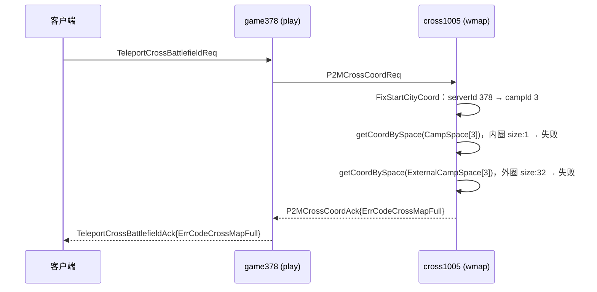

# cross1005 阵营3出生区被小号占满 — 378 服玩家进不去远征

## 概述

线上 378 服玩家进入远征战场 cross1005 时提示「地图位置被占满」（`ErrCodeCrossMapFull`）。查下来不是 378 服的配置问题，而是**阵营 3（地图东北角）的出生区被约 460 个批量小号占满**。这些小号来自同阵营的 493 服和 378 服，按每组 14 个连号编进同一个联盟，进图后再没有活动。另外，现在刷请求的 378 账号里，26 个有 25 个也是同一段连号脚本号（12560699–12560917），大约每 10 秒请求一次。

## 关键数据

| 指标 | 数值 |
|---|---|
| 地图 | cross1005（远征，playbook 3） |
| 阵营 3 成员服 | 270 / 378 / 414 / 489 / 490 / 493 / 557 / 579 / 603 / 645 / 649 / 668 |
| 阵营 3 出生堡 | 建筑 21103，坐标 (4567500, 4462500)，东北角 |
| 出生点容量 | 内圈 `Expedition_Birth_Point_Max`=500；外圈 32 组 × 每组最多 68（`citySpaceCount`） |
| 失败日志 `other_battlefield.go:168` | 10-01 约 27 万条，10-02 约 99 万条（按日志时间） |
| 最近 1 小时请求 | 约 1 万次，99.8% 来自 378 服，**只有 26 个玩家**，其中 25 个是 12560xxx 连号 |
| 东北角近 16 天落城 | 1433 座，其中 10-01 到 10-03 无日志的 431 座 |
| 连号小号 | 35 组，共 460 个（493 服 381 个，378 服 79 个） |

## 报错链路



- `game/wmap/internal/ctl_battlefield.go:1156` `OnP2MCrossCoordReq` 失败时直接返回 `ErrCodeCrossMapFull`。
- `game/wmap/internal/other_battlefield.go:112` `FixStartCityCoord`：先找内圈 `CampSpace`，找不到再找外圈补充点 `ExternalCampSpace`。**放不下时挪到其他区域的兜底逻辑是有的，但外圈也全满了。**
- `game/wmap/internal/other_battlefield.go:138` `getCoordBySpace`：
  - 点位只要检测到一次碰撞，就设 `UseEndTime = now + 30min`（`CITY_SPACE_OUT_TIME`，`expedition/conf.go:10`）。原来的城走了，这个点位也要等锁到期才能再分配。
  - 分配成功的点位同样锁 30 分钟，不管玩家最后有没有进图。
- game 侧回调在 `game/play/internal/ctl_battlefield.go:1921` `OnCrossBattlefieldCoordCallback`。第一次进图会发 `ExpeditionEntersReward` 奖励，我推测这是有人批量刷号进图的动机，还没核实。

## 排查过程

1. cross1005 日志里看到 `FixStartCityCoord serverId:378 campId:3` 后面紧跟两条 `getCoordBySpace coord is not found`（size:1 和 size:32），说明内圈和外圈都失败了。
2. 统计 `getCoordBySpace size:` 的成功日志：四个角都有成功记录，东北角（阵营 3）10-02 内圈成功 172 次、外圈成功 58 次。说明阵营 3 是容量饱和，空出一个位置马上被抢，并不是整个阵营坏了。
3. 从 `NewMapCity Coord:{X Z} Ok`（`ctl_map.go:482`）里捞出东北角所有落城，共 1433 座。用 filters 聚合查这些玩家 10-01 到 10-03 在 cross1005 的日志数，0 条的有 431 个。
4. 把不活跃的 pid 按 ID 间隔 ≤50 聚类，得到 35 组连号，基本每组正好 14 个，同一天进图。
5. 用 `FixStartCityCoord` 日志反查来源服（493 / 378），用 `internal_shistory/event.go:30` 和 `ctl_union_common.go:348` 反查联盟，用 `ctl_rank.go:941`（`ZvzUnionPowerRank`）取联盟名和战力。
6. 样本号 11667640：493 服，32 级，战力 7100 万，联盟「萌主/七品」，09-28 进图后在 cross1005 上再无活动。

## 处理方案

### 踢人方式对比

- `kickout` / `KickPlayer`（`ctl_battlefield.go:3004`）只把**在线**玩家踢下线。这批小号基本都离线，城还留在 cross1005 上，位置腾不出来。
- 要腾出位置，必须走 `ChangeMapForce`（`ctl_cross.go:642`）把玩家地图切回本服，cross 上的城才会被删掉。
- `unionMemberMapBackByName` 按联盟整体踢回本服，会把联盟里的真玩家一起踢走。
- **`battlefield <pid> back` 按单个玩家踢回本服，线上可以直接用，首选这个。**

### 代码修复

- `unionMemberInBattlefield` / `unionMemberTroopBackByName` / `unionMemberMapBackByName` 三个命令在联盟不存在时，`ci.Ret` 之后没有 `return`，会继续对 nil 取 `union.Members`。已补上 `return`，在 `game/play/internal/ctl_battlefield_cmd.go` 中。

### 执行清单

**首选：用现有的 `battlefield <pid> back`，不用发版**

- 实现：`game/play/internal/ctl_battlefield_cmd.go:152`，`runType == "back"` 时调 `ChangeMapForce(p, def2.Game, conf.ServerID, conf.WMAPMOD, nil)`，和新 GM 效果一样。
- 注册：`ctl_cmd.go:929` 用的是 `RegisterPlayerCmd(cmds.Developer, "battlefield", ...)`。`Developer` 是最低级别，door telnet 用 `Owner` 级别执行（`door/telnet/module.go:154`），所以线上可以直接用。
- `RegisterPlayerCmd` 会先用 `GetPlayerAsyn` 加载玩家，离线玩家也能处理。**要在 pid 所属的 game 服上执行。**
- ⚠️ `battlefield` 下面还有 `reset` / `reset_phase` / `playbook` / `down` 这些会改整个远征状态的子命令。批量执行时一定确认参数是 `back`。

- [ ] game493：逐条执行 381 条 `battlefield <pid> back`，命令按下方「小号名单」game493 部分生成
- [ ] game378：逐条执行 79 条 `battlefield <pid> back`，包括无联盟的 22 个
- [ ] 高战联盟（周三、周四、三号、平安）里的小号也按 pid 处理，不要用联盟命令
- [ ] 脚本号 12560699–12560917（378 服）：建议封号或限制登录。其中 5 个已经进图，也在 378 无联盟名单里

**备选**
- `unionMemberMapBackByName <serverid> <联盟名>`：会把整个联盟踢回本服，只适合确认过的纯小号联盟。
- 曾经写过批量版 `playerMapBackByIds`，因为 `battlefield <pid> back` 已经能做同样的事，已撤回。

**C. 验证**

- [ ] 执行前后各跑一次 `campSpaceSetTimeOut 378 0 0`，路由到 378 所在的远征图，返回 `coreUseCount` / `extUseCount`。参数传 0 时只统计、不改点位。
- [ ] 腾出来的点位如果之前因为碰撞被锁，最多要 30 分钟才能重新分配。
- [ ] Kibana 观察 `other_battlefield.go:168` 的失败量下降，以及 378 真号（比如 5260578、4855834）能正常进图。

## 后续优化（待定）

- `getCoordBySpace`：碰撞失败时不锁 30 分钟，或者把锁时间大幅缩短；玩家进图失败时释放分配给他的点位。
- 对同一玩家的 `P2MCrossCoordReq` 做频率限制。
- 长时间离线、停在出生区的城，自动踢回本服或挪到其他区域。

## 小号名单

名单里的联盟是每个号最近一次日志中的联盟，执行前请再核对一次。


### game493  共 381 个

**[主力] 7690407855814777355 (68)**
```
10151297,10151299,10151300,10151308,10151309,10151311,10151313,10151323,10151325,10151366,10151376,10151377,10151393,10151400,10232685,10232688,10232692,10232696,10232700,10232722,10232730,10232735,10232737,10232740,10232744,10232750,10232751,10232776,10241414,10241415,10241416,10241417,10241421,10241422,10241423,10241426,10241428,10241429,10241430,10241432,11643802,11643804,11643808,11643809,11643815,11643819,11643822,11643824,11643826,11643828,11643830,11643831,11643836,11643838,11821419,11821420,11821422,11821423,11821424,11821425,11821426,11821427,11821428,11821429,11821430,11821431,11821432,11821433
```
**[啥也没有] 7654029684685772381 (27)**
```
10151302,10151306,10151327,10151330,10151368,10151369,10151372,10151380,10151386,10151387,10151390,10151392,10151394,11671984,11671993,11690274,11690275,11690276,11690277,11690279,11690282,11690284,11690285,11690286,11690287,11690288,11690289
```
**[掀刘海] 7672975953655470025 (19)**
```
9884844,9884857,9884864,9884877,11294605,11671263,11671264,11671270,11671280,11671282,11671286,11671288,11671292,11671294,11671298,11671300,11671301,11689264,11689268
```
**[菜篮] 7683758816948104622 (17)**
```
10570889,10570907,10570925,11838737,11838738,11838739,11838740,11838741,11838742,11838743,11838744,11838745,11838746,11838747,11838748,11838749,11838777
```
**[黄菊瘦] 7673762027159326712 (16)**
```
11301184,11701106,11701107,11701110,11701111,11701112,11701113,11701114,11701115,11701116,11701117,11701118,11701119,11701120,11701121,11701426
```
**[菜板] 7683752692324695214 (15)**
```
10570391,11837920,11837921,11837922,11837925,11837926,11837927,11837928,11837929,11837930,11837931,11837932,11837933,11837934,11837935
```
**[干快递] 7672976524886122625 (15)**
```
11294604,11671977,11671980,11671987,11671988,11671991,11671994,11671997,11672000,11672002,11672007,11672011,11672015,11690281,11690283
```
**[下西洋] 7658118407647399162 (14)**
```
10151296,11671268,11689262,11689263,11689265,11689266,11689267,11689269,11689270,11689271,11689272,11689273,11689275,11689276
```
**[小弃子] 7583791928416577678 (14)**
```
11287899,11287900,11287901,11287902,11287903,11287904,11287905,11287906,11287907,11287909,11287910,11287911,11287912,11287913
```
**[迎春花] 7673761052201744940 (14)**
```
11302494,11302495,11302496,11302498,11302499,11302500,11302501,11302502,11302503,11302504,11302505,11302506,11302507,11302508
```
**[灵界篇] 7684165765095104133 (14)**
```
11638899,11638902,11638904,11638905,11638906,11638910,11638914,11638917,11638918,11638922,11638923,11638924,11638925,11638938
```
**[高手] 7583902931845896623 (14)**
```
11666945,11666947,11666948,11666949,11666952,11666954,11666958,11666961,11666966,11666968,11666969,11666970,11666973,11666974
```
**[萌主] 7584270503739584609 (14)**
```
11667639,11667640,11667643,11667644,11667648,11667650,11667651,11667654,11667657,11667660,11667661,11667667,11667669,11667673
```
**[水中仙] 7673761932670045593 (14)**
```
11726794,11726796,11726798,11726799,11726800,11726801,11726802,11726804,11726805,11726820,11726821,11726823,11726824,11726826
```
**[梅傲雪] 7673762198958025550 (14)**
```
11727161,11727162,11727163,11727164,11727165,11727166,11727168,11727169,11727170,11727171,11727172,11727173,11727174,11727175
```
**[心眼偏] 7684127471166581838 (14)**
```
11822349,11822350,11822351,11822352,11822353,11822354,11822355,11822356,11822357,11822358,11822359,11822360,11822361,11822362
```
**[万事全] 7684106305568292682 (13)**
```
10570378,10570379,10570380,10570381,10570382,10570383,10570384,10570385,10570386,10570387,10570388,10570389,10570390
```
**[先锋] 7690400081923892445 (13)**
```
11701427,11701434,11701435,11701437,11701439,11701440,11701441,11701442,11701443,11701444,11701445,11701446,11701447
```
**[宋词] 7684103591148914423 (11)**
```
10570892,10570895,10570902,10570903,10570904,10570905,10570906,10570908,10570909,10570910,10570913
```
**[元曲] 7656713631219275530 (8)**
```
10357272,10357280,10357287,10357290,10357319,10357328,10357354,10357359
```
**[周四] 7584641623272705749 (7) 【高战联盟，混有主号风险】**
```
11463331,11463334,11463335,11463336,11463337,11463853,11463855
```
**[周五] 7584674273617181713 (7)**
```
11463332,11463333,11463851,11463856,11463857,11463858,11463859
```
**[三号] 7584639630410920919 (3) 【高战联盟，混有主号风险】**
```
11294602,11294610,11294611
```
**[平安] 7659276189096578253 (3) 【高战联盟，混有主号风险】**
```
11294615,11301174,11301183
```
**[荡秋千] 7672676147757698721 (2)**
```
11294606,11294608
```
**[蔷薇风] 7673761550417953507 (1)**
```
9884811
```
**[绑野猪] 7672672114783382895 (1)**
```
11294600
```
**[那个拜] 7672975781856777504 (1)**
```
11294601
```
**[爱曹操] 7672975077482137590 (1)**
```
11294603
```
**[碎碎念] 7672974944338150747 (1)**
```
11294607
```
**[泡奶茶] 7672975262165732203 (1)**
```
11294609
```
**[好喜欢] 7672975408194621263 (1)**
```
11294627
```
**[桂凝香] 7673762125943581041 (1)**
```
11301168
```
**[捣凤仙] 7673761816705928034 (1)**
```
11301177
```
**[立清荷] 7673761735101548635 (1)**
```
11301180
```
**[周三] 7584780629891204415 (1) 【高战联盟，混有主号风险】**
```
11671283
```

### game378  共 79 个

**[第二军91] 7691284226682771253 (25)**
```
12494145,12494146,12494147,12494148,12494164,12494165,12494166,12494167,12494168,12494169,12494170,12494171,12494172,12494173,12494201,12494202,12494203,12494204,12494206,12494208,12494210,12494212,12494213,12494216,12494217
```
**[无联盟] 0 (22)**
```
12509774,12509776,12509777,12509778,12509780,12509785,12509786,12509790,12527556,12527557,12527562,12527563,12527566,12527568,12527569,12527570,12560904,12560907,12560912,12560914,12560915,12560918
```
**[第三军102] 7691614934868660770 (14)**
```
12509783,12514825,12514842,12514843,12514844,12514845,12514846,12514848,12514849,12514853,12514854,12514856,12514857,12514868
```
**[第一军81] 7690991138113424369 (12)**
```
12484285,12484287,12484288,12484289,12484290,12484291,12484292,12484293,12484295,12484296,12484297,12484298
```
**[天涯明月] 7569114118170032322 (5)**
```
12527558,12527560,12527561,12527565,12527567
```
**[简单] 7569158815929302437 (1)**
```
12494211
```

### game378 脚本号（还没进图，在刷请求） 29 个

```
12560699,12560700,12560701,12560702,12560703,12560704,12560705,12560706,12560707,12560708,12560709,12560710,12560711,12560712,12560713,12560903,12560904,12560905,12560906,12560907,12560908,12560910,12560911,12560912,12560913,12560914,12560915,12560916,12560917
```
