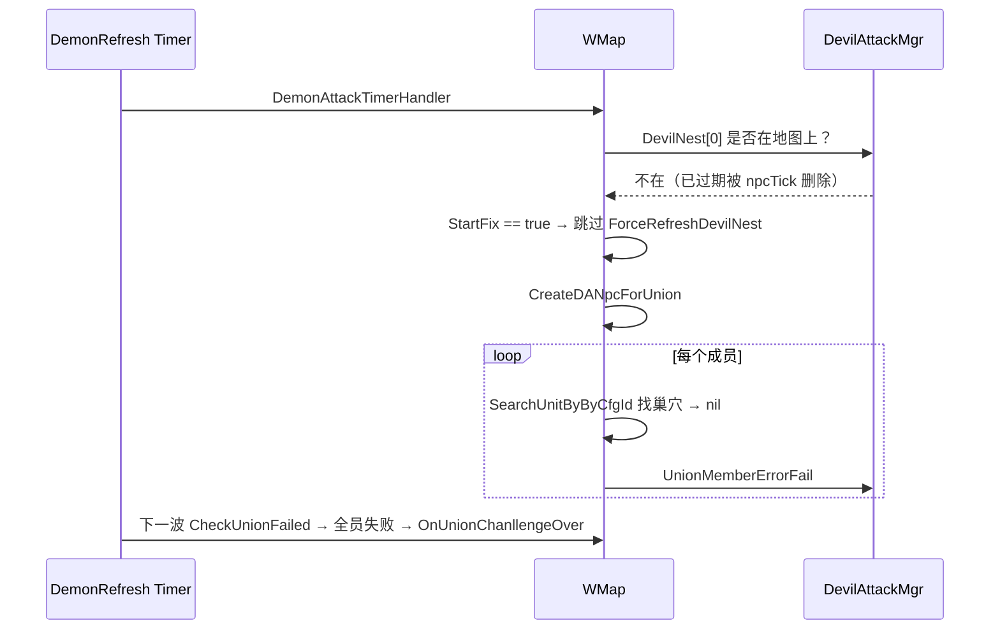

# 魔物入侵远征图巢穴过期导致全员刷怪失败

## 现象
- 反馈：643 服 小吉（pid 8343999，联盟 7615804097838440383）10-13 中午 12:00 魔物入侵，"怪都没看见就直接全部失败"。
- 期望：开启后每波给每名成员刷怪并攻城。
- 实际（cross1005，UTC 时间）：
  - `04:00:00` `DevilAttackJoin` level 9
  - `04:00:10` 第 1 波：104 名成员全部未刷出怪，92 人报 `CreateDANpcForMember ... cant find nest or nest has no route to city`，12 人报 `find city failed`（城堡不在远征图上）
  - `04:01:10` 第 2 波：同样全部失败
  - `04:02:11` `CheckUnionFailed` → `OnUnionChanllengeOver`，判定挑战失败

## 影响范围
截至 2026-10-13 22:00（北京时间），共 **40 个联盟、2592 名参与玩家**受影响：39 个已判失败，1 个正在进行中（必然失败）。全部集中在 09-10 开赛的 3 张老远征图上：

| 跨服 | 地图 instId | 受影响联盟数 |
|---|---|---|
| cross1005 | 7685034804616926272 | 15 |
| cross1011 | 7685034804618499131 | 11 |
| cross1012 | 7685034804618761277 | 14 |

- 导出文件（与本文同目录，UTF-8 BOM，Excel 可直接打开）：
  - `2026-10-13-魔物入侵受影响联盟.csv`：跨服、地图、联盟ID、联盟名、原服、阵营、开启/结束时间、结果、参与人数、找不到巢穴人数、城堡不在远征图人数
  - `2026-10-13-魔物入侵受影响玩家.csv`：每个联盟本次参与的玩家 ID，可用于发补偿
- 统计口径：ES `ctl_devil_attack.go:311` 的成员名单 + `:530`（找不到巢穴）按 pid 归属到联盟，结果取自 `:748`（成功）/ `:1225`（失败），时间范围 10-12 00:00 UTC 至今。
- **晚上活动高峰还会继续增加**，修复上线或重启前需要再导出一次。
- 这三张图恰好都处在 phase 6（王座争夺），但 phase 本身不是原因：它们是开赛最早的图，所以巢穴最早过期，补刷机会也最早被用掉。

| 跨服 | 联盟ID | 联盟名 | 原服 | 阵营 | 开启(北京) | 结果 | 参与 | 无巢穴 |
|---|---|---|---|---|---|---|---|---|
| cross1005 | 7616579197693868552 | u8378767 | 649 | 3 | 10-13 07:30 | 失败 | 87 | 13 |
| cross1005 | 7618941786190515089 | 四海 | 648 | 1 | 10-13 11:20 | 失败 | 84 | 17 |
| cross1005 | 7615804097838440383 | 榜一 | 643 | 4 | 10-13 12:00 | 失败 | 78 | 46 |
| cross1005 | 7621806632460022398 | u8655308 | 668 | 3 | 10-13 16:50 | 失败 | 50 | 1 |
| cross1005 | 7623460482632844674 | 苍穹 | 667 | 2 | 10-13 19:00 | 失败 | 63 | 60 |
| cross1005 | 7620556943004784595 | 星辰之海 | 662 | 1 | 10-13 19:00 | 失败 | 57 | 52 |
| cross1005 | 7617442065218367591 | 逆天 | 649 | 3 | 10-13 19:02 | 失败 | 94 | 39 |
| cross1005 | 7616253823857114748 | 光脚板丶 | 648 | 1 | 10-13 19:06 | 失败 | 66 | 62 |
| cross1005 | 7620115188446960398 | 雨过天晴 | 660 | 1 | 10-13 19:18 | 失败 | 41 | 39 |
| cross1005 | 7619010595863229033 | 大汉王朝 | 644 | 2 | 10-13 19:21 | 失败 | 53 | 48 |
| cross1005 | 7625212180756184910 | 山海 | 665 | 2 | 10-13 19:24 | 失败 | 72 | 48 |
| cross1005 | 7624139718843587386 | 都市 | 668 | 3 | 10-13 21:03 | 失败 | 66 | 49 |
| cross1005 | 7618151293168239730 | 车行天下 | 645 | 3 | 10-13 21:11 | 失败 | 73 | 53 |
| cross1005 | 7615863355493678203 | 上善若水 | 647 | 4 | 10-13 21:17 | 失败 | 78 | 69 |
| cross1005 | 7621464181832005887 | 纯属娱乐 | 661 | 4 | 10-13 21:34 | 失败 | 87 | 70 |
| cross1011 | 7647012726098370561 | 战无不胜 | 746 | 1 | 10-13 09:19 | 失败 | 82 | 22 |
| cross1011 | 7646578492019167274 | 纯属娱乐 | 744 | 1 | 10-13 09:24 | 失败 | 98 | 47 |
| cross1011 | 7647893855818710660 | 跳动 | 748 | 2 | 10-13 17:20 | 失败 | 1 | 1 |
| cross1011 | 7645789351903688854 | 六六大顺 | 739 | 4 | 10-13 17:34 | 失败 | 74 | 27 |
| cross1011 | 7650692855940873277 | 气氛拉满 | 756 | 4 | 10-13 19:57 | 失败 | 65 | 37 |
| cross1011 | 7648273642596196742 | 曜临星河 | 752 | 1 | 10-13 19:59 | 失败 | 30 | 29 |
| cross1011 | 7645598616698991953 | 三角洲 | 738 | 2 | 10-13 20:00 | 失败 | 67 | 47 |
| cross1011 | 7647389497805288004 | 惊鸿殿 | 748 | 2 | 10-13 20:14 | 失败 | 66 | 38 |
| cross1011 | 7648887213033985175 | 战火 | 754 | 3 | 10-13 20:51 | 失败 | 67 | 31 |
| cross1011 | 7647115633513775688 | 玄武门 | 747 | 2 | 10-13 21:00 | 失败 | 21 | 20 |
| cross1011 | 7647963898141566474 | 三国志 | 751 | 4 | 10-13 21:58 | 进行中(必失败) | 42 | 36 |
| cross1012 | 7650114263714851834 | 大风车 | 759 | 4 | 10-13 07:04 | 失败 | 60 | 38 |
| cross1012 | 7649813963896493904 | 诸天万界 | 758 | 1 | 10-13 13:27 | 失败 | 94 | 44 |
| cross1012 | 7650127307532533156 | 云汐聚落 | 759 | 4 | 10-13 18:16 | 失败 | 35 | 29 |
| cross1012 | 7650698813059929113 | 玉清宗 | 760 | 2 | 10-13 18:52 | 失败 | 90 | 25 |
| cross1012 | 7646066845446242560 | 风流人物 | 741 | 4 | 10-13 20:00 | 失败 | 80 | 33 |
| cross1012 | 7648559940818485931 | 花海 | 753 | 3 | 10-13 20:01 | 失败 | 104 | 33 |
| cross1012 | 7645911810011602661 | Slay | 740 | 4 | 10-13 20:01 | 失败 | 42 | 30 |
| cross1012 | 7650759728581496757 | 娱乐 | 760 | 2 | 10-13 20:04 | 失败 | 83 | 55 |
| cross1012 | 7647579760561060600 | YYDS | 749 | 2 | 10-13 20:20 | 失败 | 103 | 27 |
| cross1012 | 7646311787429259212 | LeGe神Bi | 742 | 2 | 10-13 20:37 | 失败 | 43 | 29 |
| cross1012 | 7649288569135986966 | 投名俯 | 755 | 3 | 10-13 21:00 | 失败 | 36 | 35 |
| cross1012 | 7646738909044165732 | 浮生若梦 | 745 | 1 | 10-13 21:00 | 失败 | 53 | 47 |
| cross1012 | 7649714797396028998 | u9884019 | 757 | 3 | 10-13 21:03 | 失败 | 51 | 46 |
| cross1012 | 7647871247111320208 | 资源多活人来 | 750 | 1 | 10-13 21:18 | 失败 | 56 | 37 |

- 同一联盟 7615804097838440383 在 09-29、10-06 都成功过。

## 根因分析

### 1. 巢穴只有 10 天寿命
- 巢穴配置 `D2NpcTroopClassCfg` 13330023：`Lifetime = 864000000`（10 天），`LifetimeType = 1`（固定寿命）。
- `game/wmap/internal/ctl_npc.go:67` 的 `npcTick` 在 `now >= Deadline && cfg.Lifetime > -1` 时直接 `DelUnit`，巢穴被从地图上删除。
- 远征图的设计却是巢穴"焊死在地图上，不随活动开关创建删除"（`ctl_devil_attack.go:2265` 的注释）。`ExpOnDevilAttackStart` / `ExpDevilAttackClose` 只对 `startTs <= Expedition_PlayBook_Ice_Compatible`（2024-12-30）的老图做每周重刷和清理，新图巢穴到期后不会再重刷。

### 2. 兜底补刷失效
- `ctl_devil_attack.go:451-456` `DemonAttackTimerHandler`：只有 `DevilNest[0]` 不在地图上，且 `!StartFix` 时才执行 `ForceRefreshDevilNest`。
  - `StartFix` 的 tag 是 `bson:"-"`（`devilattack/devilattack.go:34`），只存在内存里，**每个进程、每张图只能触发一次，之后永不重置**。
- `ctl_devil_attack.go:367` / `:1134` 的兜底条件是 `len(DevilNest) == 0`。但巢穴被删时不会从这个列表里移除，列表只增不减（地图 7685 的列表现有 4899 个 ID，其中 3264 个已失效），所以条件永远不成立。

### 3. 地图 7685 时间线（UTC）

| 时间             | 事件                                                                                       |
| -------------- | ---------------------------------------------------------------------------------------- |
| 09-28 18:57:24 | 第 1 次 `force refresh nest`（1635 个），deadline = 10-08 18:57:24                             |
| 09-29 03:52    | 全体 cross 重启：停服时巢穴快照写入 DB，重启后 `StartFix` 回到 false                                         |
| 09-29 05:04:49 | 小吉联盟开活动，发现 `DevilNest[0]` 不在，再次强制刷新（1628 个，deadline 10-09 05:04）。**`StartFix` 从此为 true** |
| 10-06 05:00    | 巢穴未过期，挑战成功                                                                               |
| 10-08 ~ 10-09  | 两批巢穴先后到期，被 `npcTick` 删光                                                                  |
| 10-12 16:00    | 新一周活动开始，远征图不重刷巢穴                                                                         |
| 10-13 04:00    | `StartFix` 已为 true，不补刷 → 找不到巢穴 → 全员失败                                                    |

### 4. 为什么 DB 里还能查到巢穴
- npctroop 表只在停服时整表快照写入（`module.go:816` `SaveAll` → `saver.go:446` `saveNpcTroop`，只在 `OnDestroy` 里调用）。
- DB 里看到的是 09-29 停服那一刻的数据，不代表内存里的现状。所以 DB 里只有第一批巢穴，第二批（重启后刷的）不在 DB 里。

### 5. 对照组
- cross1005 地图 7690229997058253523（phase 4）的巢穴 10-07 15:00 过期。它此前从未触发过补刷，`StartFix` 为 false，所以 10-12 16:23 自动补刷后当天两次挑战都成功。
- 这张图的 `StartFix` 现在也已用掉，新巢穴会在 **10-22 16:23 UTC** 到期，之后会出现同样的问题（赛季约 11-02 结束）。cross1011、cross1012 在 10-12 / 10-13 补刷过的图同理。

### 6. 排除项
- 不是阵营或寻路区域的问题：同时间段三台跨服都没有玩家行军的 `has no paths` 报错，失败的联盟也分属阵营 1、3、4，所在区域各不相同。
- 日志 `cant find nest or nest has no route` 把两种情况混在一起，这次实际是前半句"找不到巢穴"。

## 修复方案
- 涉及文件：`game/wmap/internal/ctl_devil_attack.go`、`game/wmap/internal/devilattack/devilattack.go`、配置 `D2NpcTroopClassCfg` 13330023
1. **远征图巢穴不设寿命**：在 `InitExpDevilAttackNest` / `ForceRefreshDevilNest` 创建巢穴后把 Deadline 设为不过期，或者把 13330023 的 `LifetimeType` 配成 2（`GetAliveTime` 返回近似无限）。大世界巢穴在活动关闭时会由 `WorldMapDevilAttackClose` 清理，不受影响。
2. **去掉一次性 `StartFix`**：改为每次检查地图上是否还有活着的巢穴（按 `DevilNest` 实际存在数量判断），没有就补刷。
3. **清理失效 ID**：补刷前先清掉 `DevilNest` 列表中已不在地图上的 ID。
4. （顺带）刷怪失败不应计为成员失败：`CreateDANpcForUnion` 中 `UnionMemberErrorFail` 会让 `CheckUnionFailed` 判负；全员都刷不出怪时应退还挑战次数。
5. （顺带）`ctl_devil_attack.go:530` 的日志拆成"没找到巢穴"和"无法寻路"两条。

### 线上止血
- 重启对应的 cross 进程可以重置 `StartFix`，下一个开活动的联盟会触发补刷。赛季中重启需要评估。
- 现有 GM 命令 `refreshdevilnest` 调用的是 `RefreshDevilNestImpl`（大世界坐标），**不适用于远征图**。

### 补偿
- 上面 40 个联盟（2592 名参与玩家，见导出 CSV）这周的挑战机会被白白消耗，建议补发。

## 验证
- [ ] 本地：远征图巢穴 Deadline 改为过去时间后，新一轮魔物入侵能自动补刷并正常刷怪
- [ ] 多次过期 / 多周循环后仍能正常刷怪
- [ ] 提交：commit

## 排查方法备忘
- ES：`src_location` = `internal/ctl_devil_attack.go:530`（找不到巢穴）、`:454`（force refresh nest）、`:311`（开启）、`:748`（成功）、`:1225`（失败）
- Mongo（cross 实例）：`cross_<instId>_wmap_devilattack.devilnest`、`cross_<instId>_wmap_npctroop`（cfgid 13330023，看 `deadline`）、`cross_<instId>_wmap_battlefieldmgr.basic.phase`
- 玩家所在地图：`playercache_cross_<id>` 的 `serverinfo.mapinfo.instid`、`horde`
