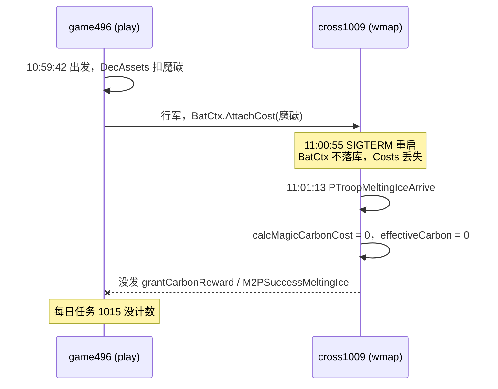

# 远征融冰：跨服重启后魔碳消耗未计入每日任务

- 区服 496，角色 6531012（唉唉唉），远征图 cross1009
- 网页版：[[2026-10-14-远征融冰跨服重启后魔碳消耗未计入每日任务.html]] · 线上 artifact：https://claude.ai/artifact/EGkC8NAHSwvWMTwxZChuqK

## 现象
- 期望：北京时间 10:59 融冰消耗的魔碳计入远征每日任务「消耗魔碳」（goal 1015 `EventBfMeltingIceCarbonConsume`），并发放魔碳消耗奖励。
- 实际：融冰进度正常增加，但每日任务没有计数，魔碳消耗奖励也没发。魔碳已经扣了，没有退。

## 时间线（北京时间 2026-10-14，来自线上 Kibana）

| 时间 | 事件 |
|---|---|
| 10:59:42 | 融冰部队出发，game496 扣除魔碳（`ctl_lineup.go:1148 redif startmarch`） |
| **11:00:55** | **cross1009 收到 SIGTERM 重启**（`core/core.go:268 server closing down`） |
| 11:01:03 ~ 11:01:13 | cross1009 重新加载地图和部队 |
| 11:01:09 | 玩家下线 |
| 11:01:13 | 融冰部队到达（`PTroopMeltingIceArrive`），`pushMeltingIceRank` 积分 500 → 860 |
| — | 没有 `AddExpCampTrainPlayerContribute`（正常到达都会有），也就是没发魔碳消耗奖励、没发 `M2PSuccessMeltingIce` |

## 复现步骤
1. 远征融冰，用付费次数（消耗魔碳）派出融冰部队。
2. 部队到达前重启所在的 cross / wmap 进程。
3. 部队到达后，每日任务「消耗魔碳」不涨，也没有魔碳消耗奖励。

## 根因分析
1. 每日任务的“消耗魔碳”不在出发扣费时计数，要等部队**到达**后在 `playerTroopMeltingIceCb` 里结算（`game/wmap/internal/ctl_battlefield_melting_ice.go:542`）。
2. 结算时用 `calcMagicCarbonCost` 算魔碳消耗，数据来自 `troop.BatCtx().GetCosts()[troopId]`（`ctl_battlefield_melting_ice.go:863`）。这份数据是出发时由 `batCtx.AttachCost` 写入的（`game/wmap/internal/ctl_lineup.go:975`）。
3. `BatCtx` 不落库：`battleCtx *BatCtx \`bson:"-"\``（`game/wmap/internal/battle/battlebehavior.go:58`）。重启后 `LoadPlayerTroop` 调用 `t.InitBattle`，新建一个空的 BatCtx（`game/wmap/internal/mmap/loader.go:36`），`Costs` 就丢了。
4. `OriginMarchExtra`（融冰次数）是落库的，所以融冰进度还在。但魔碳消耗算成 0 后，`paidUse = 0`，这次融冰全部被当成免费次数，`effectiveCarbon = 0`。
5. `effectiveCarbon > 0` 不满足，`grantCarbonReward` 没调用，它里面的 `M2PSuccessMeltingIce` 也没发出（`ctl_battlefield_melting_ice.go:878-901`）。play 侧的 `M2PSuccessMeltingIce`（`game/play/internal/ctl_battlefield.go:2073`）就没有推进任务。

## 玩家损失（估算）
| 项目 | 数量 | 依据 |
|---|---|---|
| 本次融冰次数 | 36 次 | 赛季榜积分 500 → 860，每次融冰加 10 格（`IceMapGame_MeltingIce_add_grid_num`=10） |
| 已扣魔碳 | 4650 或 5400 | 每天免费 5 次（`IceMapGame_Expedition_Expend_Num`），每次付费 150（`IceMapGame_Expedition_Expend_Item`）。当天免费次数没用时付费 31 次，已用完时付费 36 次 |
| 每日任务魔碳计数 | 同上 | 没有推进 |
| 魔碳消耗奖励 | 约 31 份 | `Expedition_Ice_Marrow_War_reward` = [150, 3117000] |

> 精确扣费数待查：game496 在 10:59:42 的 BI `user_asset` 日志，reason 是 `melting_ice_action_cost`。

## 修复方案
- 把付费魔碳量存进会落库的字段，不要只放在 `BatCtx.Costs`：可以在 `PlayerTroop` 上加 `MeltingIceCarbon`，或者放进 `OriginMarchExtra`，到达和退费时都从这里读。
  - 涉及文件：`game/wmap/internal/ctl_battlefield_melting_ice.go`、`game/wmap/internal/ctl_lineup.go`、`game/wmap/internal/mmap/melem/mtroop/player_troop.go`（改完要 `make deepcopy`）
- `refundExcessMeltingIce` 和 `emptyCostReturnExtra`（`game/wmap/internal/ctl_march.go:1594`）也依赖这份消耗数据。重启后会把本该退的魔碳错退成免费次数，要一起改。
- 补偿：筛出 cross1009 在 11:01:03 之后的 `PTroopMeltingIceArrive` 日志，对照 game496 的扣费记录，得到受影响玩家名单，再补发魔碳、奖励和任务进度。

## 验证
- [ ] 本地：融冰途中重启 wmap，到达后任务计数和奖励都正常
- [ ] 本地：融冰途中重启后撤回，退回的是魔碳而不是免费次数
- [ ] 提交：commit
