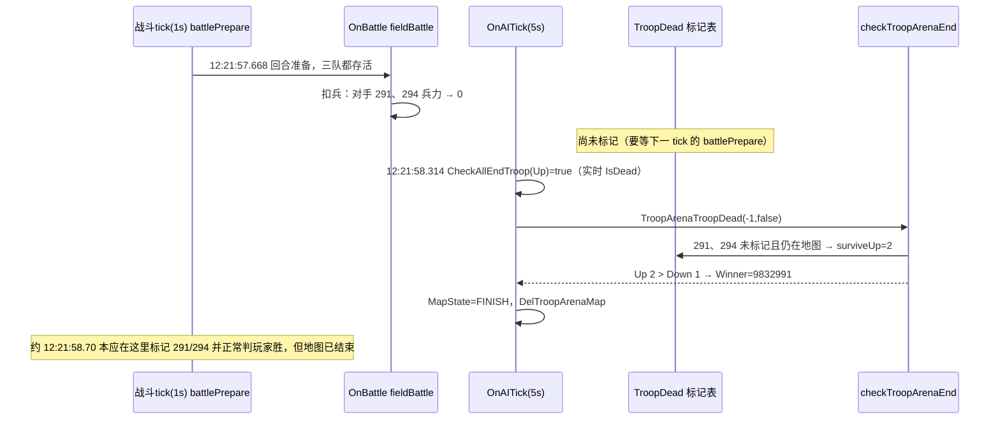

# 巅峰对决淘汰赛对手空血反胜判定错误

> 玩家：区服 819，角色 ID `10834225`
> 关联版本：[[v1054]]

## 现象

- 期望：对手部队全部被打空（兵力 0），自己仍有部队存活 → 判自己胜。
- 实际：对手兵力 0，自己还剩一队，却被判为失败。

## 线上证据（Kibana，2026-11-02）

玩家当天巅峰对决共打了 13 场，**第 9 场判错**：

```
2026-11-02T12:21:58Z（北京 20:21:58）  game754  internal/ctl_troop_arena.go:1075
TroopArenaTroopDead TroopArenaResultNtf MapState OwnerId:7703547573688386864, isTimeOut:false,
checkRet:{BattleEnd:false WinnerId:9832991 FailId:10834225
  UpPlayerId:9832991    UpAliveNum:2  UpCurPower:0          UpDamage:473973626
  DownPlayerId:10834225 DownAliveNum:1 DownCurPower:57968228 DownDamage:527478679}
round:9 count:1
```

| 方    | 玩家           | 存活队数（判定用） | 实际剩余兵力     |
| ---- | ------------ | --------- | ---------- |
| Up   | 9832991（对手）  | **2**     | **0**      |
| Down | 10834225（玩家） | 1         | 57,968,228 |

对手兵力已经是 0，却被统计成「存活 2 队」；判定逻辑先比存活队数，2 > 1，所以判对手胜。

同一玩家的第 4、5 场（game777 / game798）也是 `BattleEnd:false`，对手一方都是 `AliveNum:1 CurPower:0`。这两场因为玩家存活队数本来就更多，结果碰巧是对的，但走的也是同一条错误路径。

## 根因分析

### 1. 胜负判定只认「死亡标记表」，不看实际兵力

`game/wmap/internal/ctl_troop_arena.go:777` `checkTroopArenaEnd()`：

```go
for k, v := range wmap.GetTroopArenaMgrUpTroop() {
    upDamage += troopArenaMgr.GetDamage(k)
    if wmap.GetTroopArenaMgrTroopDead()[k] {   // 只看死亡标记表
        continue
    }
    target, ok := wmap.GetMapUnitByUID(v.GetID())
    if target == nil || !ok { continue }
    unit := melem.UnitToIBattleUnitMust(v)
    surviveUpNum++                             // 兵力为 0 也会 ++
    curPowerUp += unit.GetCurPower()
}
// Down 方同理（:805）
```

判定优先级（`:822-844`）：**存活队数 > 剩余兵力 > 造成伤害**。存活队数算错时，后面的兵力比较根本不会执行。

### 2. 死亡标记是「延迟写入」的：要等到下一个战斗 tick 的 `battlePrepare` 才会写

#### 2.1 战斗主循环分两步，伤害和判死不在同一步

战斗由 `timerBattleTicker`（`ctl_battle.go:253`）驱动，周期 `types.BattleTick = 1000ms`（`types/def.go:61`）。每一轮分两步：

| 步骤     | 函数                                                                               | 做什么                                                 | 会不会写死亡标记                                      |
| ------ | -------------------------------------------------------------------------------- | --------------------------------------------------- | --------------------------------------------- |
| ① 回合准备 | `timerBattleTicker` → 遍历所有战斗单位 `battlePrepare`（`ctl_battle.go:160`）              | 检查自己/目标是否死亡、追击、选目标、把战斗对加入战场                         | **会**：只有这里检测 `IsDead()` 并调用 `battleTroopDead` |
| ② 回合战斗 | `wmap.Cast(iproto.Battle)` → `OnBattle` → `fieldBattle`（`ctl_battle.go:276/320`） | `RoundStart / AfterRoundStart / RoundOver`，**真正扣兵** | **不会**：兵力扣到 0 只改了 `TroopData`，不触发任何死亡回调       |

所以一支部队在第 N 轮的 ② 中被打空，要等到第 N+1 轮的 ①（大约 1 秒后）才会被检测到并写入死亡标记。

#### 2.2 第 ① 步中死亡被检测到的唯一入口

```go
// ctl_battle.go:160 battlePrepare
if wmap.exitBattleLogic(batUnit) { return }        // 不在战斗中：直接返回（副本地图里死亡部队会被直接删掉，:150-155）
...
targetId := batUnit.BatCtx().GetCurTargetTroopID()
ff := func(unit battle.IBattleUnit) bool {
    if unit.IsDead() {                               // 兵力合计 <= 0（battle/lineup.go:193）
        wmap.battleTroopDead(unit)                   // :196
        return false
    }
    return true
}
if !ff(batUnit) { return }                           // 先查自己
if !ff(targetBatUnit) { return }                     // 再查当前目标
```

```
battleTroopDead(unit)                    ctl_battle.go:453
  ├─ if IsDuplicatemgrMap()              竞技场 MAP_ARENA_SCORE/GROUP/KING 属于副本地图（module.go:1055）
  │    └─ MapOther.TroopDead(unit)       :455
  │         └─ TroopArenaOther.TroopDead other_troop_arena.go:19
  │              └─ TroopArenaTroopDead(troopID>0, false)   ctl_troop_arena.go:997
  │                   ├─ TroopDead[troopID] = true          ← 唯一写死亡标记的地方
  │                   ├─ checkTroopArenaEnd()  → BattleEnd 为 true 才结算
  ├─ unitCtx.TroopDead()                  断开战斗关系（battle/battlectx.go:1021）
  ├─ settleBattle(...)                    战斗结算（打 clacPvpKillScore 日志）
  └─ battleEnd(...)                       死亡部队走 pTroopBattleEndDead → pTroopDel 从地图删除
```

也就是说，正常结束路径（`troopID>0`）一定发生在**战斗 tick 时刻**，并且是逐个部队标记、逐个判定：最后一个死亡部队被标记时，`checkTroopArenaEnd` 返回 `BattleEnd:true` 才结算。

### 3. 兜底结算在另一个定时器上，会抢在死亡标记写入之前执行

`OnAITick`（`ctl_troop_arena.go:509`）是独立的 **5 秒**定时器，和 1 秒的战斗 tick 没有任何先后约束：

```go
// ctl_troop_arena.go:535
if wmap.MapState == cspb.MAP_STATE_RUNNING {
    wmap.startTroopArenaAI()
    if wmap.CheckAllEndTroop(Up) || wmap.CheckAllEndTroop(Down) {   // 按 IsDead() 实时兵力判断
        wmap.TroopArenaTroopDead(-1, false)                          // troopID=-1：不写任何死亡标记
        wmap.DelTroopArenaMap()
    }
}
```

`CheckAllEndTroop`（`:554`）用的是**实时兵力** `IsDead()`；进入 `TroopArenaTroopDead(-1)` 后，`checkTroopArenaEnd` 用的却是**死亡标记表**。

如果 `OnAITick` 恰好落在「第 N 轮 ② 扣兵完成」和「第 N+1 轮 ① 写死亡标记」之间（窗口约 1 秒，AI tick 周期 5 秒，大约 1/5 的概率），那么：
- 最后一轮被打空的部队：兵力 0，**仍在地图上**（还没走到 `pTroopDel`），**没有死亡标记**；
- `checkTroopArenaEnd` 把它们算作存活（`surviveNum++`，`curPower += 0`）；
- 由于判定先比存活队数，**最后一轮同时阵亡的部队越多，越容易反超**。

| 位置 | 判死口径 | 时机 |
|---|---|---|
| `CheckAllEndTroop`（`OnAITick` 触发兜底结算） | `IsDead()` 实时兵力 ≤ 0 | 5 秒定时器，随时 |
| `checkTroopArenaEnd`（判定胜负） | `TroopArenaMgrTroopDead` 标记表 | 标记要等下一个战斗 tick 的 `battlePrepare` |

#### 3.1 误判成立的条件

1. 结算走的是 `OnAITick` 的 `-1` 兜底路径（日志 `BattleEnd:false`、`isTimeOut:false`）；
2. 败方在**最后一轮**阵亡、尚未标记的部队数 > 胜方实际存活部队数（相等时会继续比兵力，败方兵力为 0，结果反而正确）。

积分赛误判大量呈现 `alive 4 3`、`3 2` 的模式（NPC 4 队在最后一轮同时被清空，玩家剩 3 队），也符合这个条件。

### 4. 线上时序佐证

战斗 tick 打印的 `settarget >>>>>>>>joinpassive`（`ctl_battle.go:248`，每轮 `battlePrepare` 一次）可以作为战斗 tick 的时间锚点：

| 场次 | 最后一次战斗 tick | 结算日志时间 | 偏移 | `BattleEnd` | 路径 |
|---|---|---|---|---|---|
| round 6（game819） | 11:51:09.047 | **11:51:10.080** | +1033ms，正好是下一 tick | true | 正常：`battlePrepare` 中逐个标记 |
| round 4（game777） | 11:31:45.739 | 11:31:45.740 | tick 的 ② 刚扣完兵，AI tick 紧跟其后 | false | `OnAITick` 兜底 |
| round 5（game798） | 11:41:34.735 | 11:41:34.994 | +259ms，不在 tick 上 | false | `OnAITick` 兜底 |
| **round 9（game754，误判）** | 12:21:57.668 | **12:21:58.314** | +646ms，下一 tick 本应在约 58.70 | false | `OnAITick` 兜底 |

round 9 的部队明细（来自 `ctl_battle.go:248`，格式为 `玩家 settarget joinpassive 自己部队 atk:目标部队`）：

```
12:21:57.668  9832991  ...141291 atk:...141298     ← 对手 2 队：291、294
12:21:57.668  9832991  ...141294 atk:...141298
12:21:57.668  10834225 ...141298 atk:...141294     ← 玩家 1 队：298
```

12:21:57.668 这一轮 ② 中，对手的 291 和 294 被同时打空；12:21:58.314 `OnAITick` 先到，此时两队还没被标记 → `UpAliveNum:2 UpCurPower:0`，玩家 298 → `DownAliveNum:1 DownCurPower:57968228`，2 > 1 判对手胜。

结算之后紧接着的 `clacPvpKillScore`（`ctl_battle_settle.go:209`，日志中 `PlayerId` 是**攻击方**，`curPower` 是**目标**的剩余兵力）也对得上：
- `PlayerId:10834225 starPower:101422063 curPower:0`：玩家打的对手部队，兵力 0；
- `PlayerId:9832991 starPower:110612875 curPower:57968228`：对手打的玩家部队，还剩 57,968,228。

### 4.1 时序图



> 更正：之前写的「部队不在战斗中被打空，所以不会标记」不成立。副本地图里，不在战斗中的死亡部队会在 `exitBattleLogic`（`ctl_battle.go:150-155`）中直接 `DeleteUnitObj`，`checkTroopArenaEnd` 里 `GetMapUnitByUID` 找不到，也就不会被计入存活。真正的原因是上面的 **AI tick 抢在死亡标记写入之前结算**。

### 5. 识别特征

日志 `TroopArenaTroopDead TroopArenaResultNtf` 里同时满足：
- `BattleEnd:false`（说明是走 `-1` 兜底路径结算的）
- 胜方 `CurPower:0`，败方 `CurPower > 0`

## 影响面

统计口径：线上 ES 现存的全部日志（2026-10-31 ~ 2026-11-03，更早的已过保留期），按小时分片**全量拉取**（无截断）所有 `ctl_troop_arena.go:1075` 且 `BattleEnd:false` 的结算日志，共 **39,980** 条兜底结算；从中筛出「胜方 CurPower=0 且败方 CurPower>0」的记录，共 **729 场误判**，全部是 `isTimeOut:false`，即 AI tick 抢跑这条路径。

明细 Excel（误判行已标红）：[[2026-11-02-编队竞技场空血反胜-误判标记.xlsx]]（同目录）

| 日期(UTC) | 误判场次 |
|---|---|
| 2026-10-31 | 166 |
| 2026-11-01 | 248 |
| 2026-11-02 | 273 |
| 2026-11-03（截至查询时） | 42 |

### 巅峰对决（round > 0）：4 场 / 4 名玩家

| 时间(北京) | 地图所在服 | 受影响玩家（被判负） | 判胜方 | 受影响方剩余兵力 | 场次 | 存活队数 Up/Down |
|---|---|---|---|---|---|---|
| 2026-11-01 19:30:21 | game967 | **12915429** | 12914131 | 58,096 | round 4 | 2 / 1 |
| 2026-11-02 19:00:46 | game48 | **509140** | 2466481 | 329,176,401 | round 1 | 1 / 2 |
| 2026-11-02 19:01:06 | game28 | **2791327** | 293463 | 98,933,294 | round 1 | 2 / 1 |
| 2026-11-02 20:21:58 | game754 | **10834225**（本单） | 9832991 | 57,968,228 | round 9 | 2 / 1 |

> 地图所在服是战斗地图的承载服，不一定是玩家的原服。日志里无法区分小组赛和淘汰赛（地图类型没有打印），需要结合当场赛程确认。

### 积分赛（round = 0）：725 场 / 639 名玩家 / 189 个服

- 716 场是输给 NPC（`1000200000xxx`），9 场是输给其他玩家的防守阵容；
- 每人误判次数：1 次 569 人，2 次 56 人，3 次 12 人，4 次 2 人（`13027575`@game980、`3442153`@game265）；
- 典型形态是 `alive 4/3`、`3/2`：NPC 4 队在最后一轮被同时清空，玩家剩 3 队。

## 修复方案（暂不修复，仅记录）

- 涉及文件：`game/wmap/internal/ctl_troop_arena.go` `checkTroopArenaEnd()`
- 建议：Up、Down 两个计数循环里，在 `survive*Num++` 之前加 `if unit.IsDead() { continue }`，让判定口径和 `CheckAllEndTroop` 保持一致。
- 或者：`OnAITick` / `OnStartFightReq` 在调用 `TroopArenaTroopDead(-1)` 前，先把 `IsDead()` 的部队补写进 `TroopDead` 标记表，让两套口径在结算前一致。

## 相关数据

- 昨日（11-02）巅峰对决参赛玩家名单：[[2026-11-02-巅峰对决参赛玩家名单.xlsx]]（10,647 人，含原服、战绩、名次、淘汰信息，误判玩家标红）

## 待确认

- [ ] 玩家 10834225 第 9 场应判胜，是否补偿或修正晋级（需策划/运营决定，可参考 H5-13187 的 GM 处理方式）
- [ ] 修复上线版本
