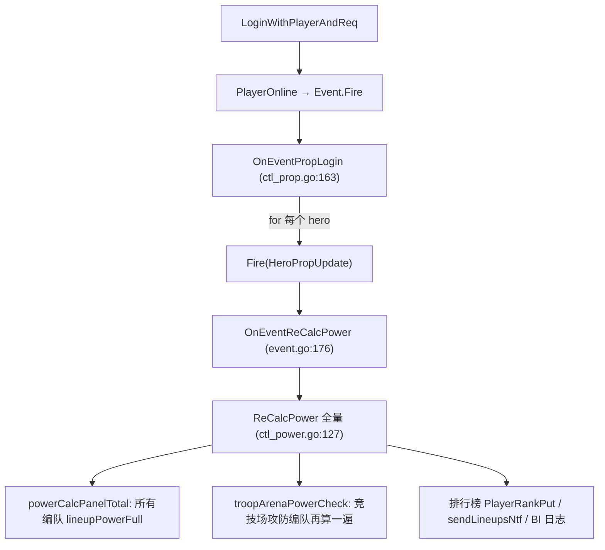

# game1 CPU Profile 分析（20261023_150909）

源文件：`330/prof/20261023/game1_cpu_20261023_150909.prof`

## 结论

- 采样 30.07s，CPU 总计 4.29s，**平均只占 14% 的单核**，整个进程负载不高，没有死循环或 CPU 打满。
- 但 `wmap` 和 `play` 都跑在单 goroutine 的 Skeleton 上，热点会直接拉长这两个模块的消息处理延迟。主要有 3 个问题：

| # | 热点 | cum | 占比 | 性质 |
|---|------|-----|------|------|
| 1 | 玩家登录时，每个英雄都触发一次**全量** `ReCalcPower` | 0.86s | 20% | **逻辑问题（O(英雄数) 次重复全量计算）** |
| 2 | 战斗 tick 每秒遍历全图所有 NPC 部队，并对空闲 NPC 计算 `IsDead` | 0.81s | 19% | 全量扫描 + 无效计算 |
| 3 | 采集 tick 每秒遍历全图所有资源点 `gatherRepair` | 0.35s | 8% | 全量扫描（cache miss 为主） |

其他：`actv` 的 `RefreshAllActvs` 约 0.22s（5%），mongo bson 编解码约 0.24s，GC/调度合计 <10%，都属正常。

## 1. 登录时战力被重复全量计算（重点）

调用链（cum 0.86s，占 `PlayerOnline` 的 90%）：



- `game/play/internal/ctl_prop.go:166-169`：登录时遍历**所有**英雄，每个都 `Fire(gdevent.HeroPropUpdate)`。
- `game/play/internal/event.go:176`：`HeroPropUpdate` 绑定 `OnEventReCalcPower`，后者（`ctl_power.go:95`）除了重算这个英雄的属性，还会调一次 **全量** `ReCalcPower(p)`。
- `ReCalcPower` 会重算所有上阵英雄模块、所有编队战力（`powerCalcPanelTotal` → `lineupPowerFull`，0.43s）、竞技场编队（`troopArenaPowerCheck`，0.29s），并写排行榜、可能发 `sendLineupsNtf` 和 BI 日志。

结果：一个玩家有 N 个英雄，登录时就做 N 次完整战力计算，而只有最后一次的结果有用。英雄越多的老玩家登录越慢，集中上线（开服、维护后）时 play 模块会被卡住。

**建议**：登录场景只重算英雄属性，最后统一算一次战力。例如：

```go
func (play *Play) OnEventPropLogin(param *event.Param) {
	p := param.Get(gdevent.ParamPlayer).(*mplayer.Player)
	p.RecomputeProp()
	for _, hero := range p.GetHeros() {
		hero.HeroRecompute()
		calcHeroProp(p, hero) // 只算英雄属性，不 Fire HeroPropUpdate
	}
	play.ReCalcPower(p) // 最后算一次
	play.PushPropNtf(p)
	play.SyncProp2Map(p, nil)
	play.PushUnionPropNtf(p)
}
```

> 改之前要确认 `HeroPropUpdate` 除了 `OnEventReCalcPower` 之外还有没有别的监听者依赖登录时的这次触发（全局 grep `gdevent.HeroPropUpdate` 的 `QuickRegister`/`Register`）。

## 2. 战斗 tick 全量扫描 NPC 部队

`timerBattleTicker`（`game/wmap/internal/ctl_battle.go:253`，`BattleTick = 1s`）每秒调 `RangeBattleUnit`，按顺序遍历全图所有玩家部队、集结部队、**NPC 部队**，每个单位都走一次 `battlePrepare` → `exitBattleLogic`。

- `RangeNpcTroop` 这一段 cum 1.43s（其中走进 `battlePrepare` 的 0.81s）。可见全图 NPC 数量很大，并且**绝大多数处于空闲（不在战斗中）**。
- `exitBattleLogic`（`ctl_battle.go:140`）对空闲单位：
  - `checkExitBattle`：`ExitBattleRound++`，开销小；
  - `unit.IsDead()`：0.46s。`TroopData.IsDead`（`battle/lineup.go:193`）用 `SumMapValueByCond` 遍历兵种 map 求和，**而结果只在 `wmap.IsDuplicatemgrMap()` 时才用**。大世界地图上这次计算完全是浪费。

**建议**：

1. 低成本改法：把判断顺序调换，先判副本再判死亡：
   ```go
   if wmap.IsDuplicatemgrMap() && unit.IsDead() { ... }
   ```
   可以直接省掉大世界上约 0.46s / 30s 的开销（约 57% 的 `exitBattleLogic`）。
2. 进一步：维护一个「战斗中 / 退出战斗倒计时中」单位的集合，`timerBattleTicker` 只遍历这个集合，不再每秒扫全图 NPC。

## 3. 采集 tick 全量扫描资源点

`timerNpcGatherTicker`（`game/wmap/internal/ctl_gather_ticker.go:32`，`NpcGatherTick = 1s`）每秒 `RangeNpcGather` 遍历全图所有资源点，cum 0.66s。

- `gatherRepair`（`ctl_gather_ticker.go:140`）0.31s，其中 flat 0.18s 落在第 145 行 `len(ng.Troops())`，`Troops()` 本身只是返回切片。这是遍历大量分散对象时的 **cache miss**，不是逻辑复杂。
- 遍历本身的开销 `RangeUnits`（`mmap/melem/unit_mgr.go:421`）：每个单位要做 `mapUnits[t]` 迭代 + `GetGridByIndex` + `grid.Entities[id]` 一次 map 查找。`Grid.GetEntity` 合计 0.55s、`mapaccess2_fast64` 0.59s，大部分出在这里。

**建议**：资源点修复检查（`CheckTime` 本来就是 5~90s 随机间隔）和删除检查（15s 时间片）都不需要每秒对全部资源点做一遍。可以：
- 只遍历有部队在采的资源点（维护集合），或
- 把资源点分桶，每 tick 只处理一个桶。

## 其他观察

- `RangeUnits` 是所有全图遍历的公共入口，通过 `grid.Entities` 二次查 map 拿对象。如果 UnitMgr 能直接维护 `id → IUnit`，所有 Range 类操作都能省掉一次 map 查找。
- `actv` 的 `ActvMgr.OnTick → RefreshAllActvs` 约 5%，量级不大，暂不处理。

## 优先级

1. **问题 1**：改动小、收益明确（登录耗时随英雄数线性下降），建议优先修。
2. **问题 2 的第一步**（`IsDuplicatemgrMap()` 提前判断）：一行改动，零风险。
3. 问题 2/3 的「只遍历活跃集合」需要重构，可以等 NPC/资源点规模继续增长时再做。

相关：[[v1054]]
