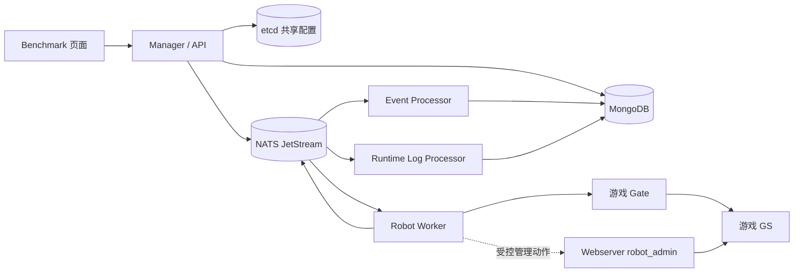
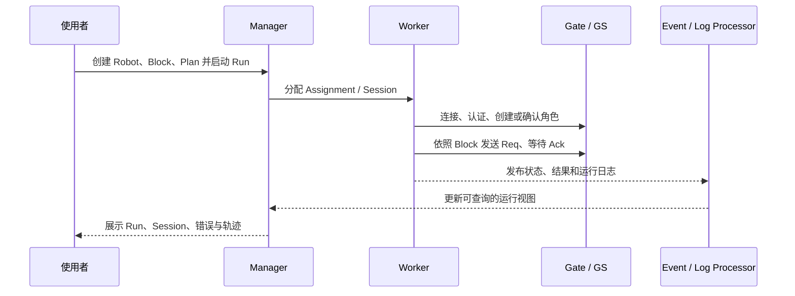

# v1052 Benchmark 机器人提交梳理

> 范围：`gs/h5_new_tf_v1052_benchmark` 上的 `2e8667db2dcca13cf43d22e22a82940ac04f47f5` 与 `41b72b57e7f7a39214a105bfa00f78e49324d6c6`。本文依据当前分支代码和仓库说明整理；没有启动外部服务做实机验证。

## 一句话认识

`2e8667d` 将一套独立的 Benchmark 机器人控制与执行系统移入 H5 的 `gs`，并给游戏服务、Webserver 和客户端协议加了接入点。`41b72b5` 随后同步 `pb/gspb` 服务端协议的生成代码；其 `.proto` 源文件差异忽略空白后为空，没有新增消息字段或修改字段号。两次提交解决的是不同层次的问题：前者提供功能，后者整理服务端协议生成物。

## 一、系统架构

| 层    | 组件                    | 职责                                            | 代码入口                                                                                                 |
| ---- | --------------------- | --------------------------------------------- | ---------------------------------------------------------------------------------------------------- |
| 操作界面 | Benchmark Frontend    | 管理机器人、Plan/Run、Block、运行记录、AI 配置               | `benchmark/frontend/src/app.tsx:1`、`benchmark/frontend/src/pages/`                                   |
| 控制面  | Manager/API           | 提供 HTTP API、存储定义与运行记录、调度 Session、读取 etcd 共享配置 | `benchmark/backend/main.go:27`、`benchmark/backend/http.go:162`                                       |
| 执行面  | Robot Worker          | 接收分配、连接 Gate、完成登录、执行 Block 与 AI 行为、上报事件       | `benchmark/backend/cmd/robot_worker/main.go:21`、`benchmark/backend/cmd/robot_worker/workload.go:242` |
| 事件投影 | Event Processor       | 消费机器人运行事件，更新可查询的运行状态                          | `benchmark/backend/cmd/robot_event_processor/main.go:19`                                             |
| 日志处理 | Runtime Log Processor | 处理运行明细日志，支持 MongoDB 或配置后的 ClickHouse 存储       | `benchmark/backend/cmd/robot_runtime_log_processor/main.go:19`                                       |
| 游戏侧  | Gate、GS、Webserver     | 承接正常游戏协议；Webserver 提供受控机器人管理动作与环境拓扑           | `webserver/webs/router.go:60`、`webserver/webs/robotadmin/machine_handler.go:33`                      |



图表示职责和主要数据流，并非每条 API 的完整调用栈。控制面和执行面使用独立进程；`make benchmark-all-in-one` 这个名字只代表前端构建、`robotflow` 构建和 Manager 启动，**不会自动启动 Worker、Event Processor、Runtime Log Processor**。依据：`Makefile:485-489`。

## 二、主要对象与运行流程

| 对象 | 含义 |
|---|---|
| Robot | 长期保存的逻辑机器人，记录账号、角色、环境和生命周期状态 |
| Plan | 机器人选择规则、Gate 地址、Block、上下线时间等任务模板 |
| Run | Plan 的一次启动实例 |
| Assignment | Run 选中的一个机器人及其执行分配 |
| Session | 机器人一次从连接 Gate 到下线的在线过程；一个 Run 可以有多个 Session |
| BlockTask | Session 中的一段 ASL Block Chain 执行 |

对象定义和生命周期说明见 `benchmark/README.md:214-270`。实际使用流程如下：

1. 在页面初始化 Robot 主档。Preview 后批量创建；游戏账号和角色在首次 Session 中按需创建，初始化主档本身不会登录游戏。`benchmark/README.md:339-350`
2. 在 Block 编辑器定义登录后的行为。ASL 状态支持 `Request`、`Pass`、`Choice`、`Local`、`Succeed`、`Fail`；其中 `Request` 发送客户端 protobuf 请求并等待 Ack。`benchmark/README.md:352-365`
3. 创建 Plan，选择机器人、环境、Gate、Block 和运行节奏；发布并启动后产生 Run 与 Assignment。Manager 根据调度额度、Worker 容量等安排 Session。`benchmark/README.md:214-270`、`benchmark/README.md:180-210`
4. Worker 接收任务，创建 SessionRunner；按“连接 Gate → 认证 → 角色确认或创建 → 初始化状态 → 执行 Block → 下线”推进，并持续发布事件。主要实现见 `benchmark/backend/internal/robotmanager/session_runner.go:414`、`:531`、`:1043`、`:1099`、`:1789`。
5. Event Processor 把事件投影为可查询的状态，Runtime Log Processor 处理详细运行日志；页面用 Run、Session、BlockTask 和错误事件查看结果。Block 成功不代表 Run 自动结束；若计划设置了离线等待，调度仍可进入下一次 Session。`benchmark/README.md:241-270`



## 三、两个提交分别改了什么

### `2e8667d`：功能导入与 H5 适配

- 新增 `benchmark/` 下的前后端、机器人运行时、Block/ASL、RobotManager、AI 聊天与自主动作、MCP/robotflow、部署脚本和验收测试。功能面很大，以上是按主要模块概括，不能将其理解为一个只会发 GM 命令的简单机器人。入口见 `benchmark/backend/http.go:162`、`benchmark/backend/internal/robotmanager/session_runner.go:414`、`benchmark/README.md:1`。
- 新增 Webserver 管理动作：管理员可配置动作模板、调用凭证、允许的 Server/Robot/IP、QPS，并查询审计；机器接口有 `/internal_api/robot/admin_action` 和 `/internal_api/robot/environment_topology`。调用使用签名、nonce 和审计去重，动作最终经 GM 命令入口执行。`webserver/webs/router.go:60-63`、`:157-170`、`webserver/webs/robotadmin/machine_handler.go:33-134`、`webserver/webs/ctl_cmd.go:21`
- 游戏侧记录机器人标记 `is_robot`，用于 BI 日志，并在两处自动入盟事件中跳过机器人；另修正改名预检失败后的提前返回。`game/bi/bi_info.go:24`、`game/bi/record.go:78`、`game/play/internal/ctl_union.go:3860`、`:5431`、`game/play/internal/ctl_player.go:105`
- 注册 `BatchQueryAssetNameReq/Ack` 等客户端消息，并引入依赖升级。`pb/cspb/msg.go:66`、`pb/cspb/msgid.def:2263`、`go.mod:18`

### `41b72b5`：服务端协议生成物同步

- 修改 `pb/gspb/ark.proto`、`game.proto`、`socket.proto` 及其生成的 `.pb.go`，另更新 `pb/grpc/rank.pb.go`。提交统计为 7 个文件。
- 对三个 `.proto` 源文件运行忽略空白的差异检查后没有剩余差异，因此可确认这些源协议的消息字段和字段号没有语义变化；生成代码变化较大，不能仅凭提交名判断其生成器版本或全部行为完全等价。这里没有对生成代码逐项做 ABI/序列化回归验证。

## 四、如何启动

### 先准备依赖和配置

本地运行至少需要 Go 1.24、Node.js、MongoDB、etcd，以及可连接的游戏 Gate/GS。分布式 Worker 和事件处理路径还需要 NATS JetStream；MongoDB 的部分动作存储使用事务，需要 MongoDB 4.4 副本集，单机 standalone 不够。依据：`benchmark/README.md:7-15`、`Makefile:282-299`。

**先检查并改好共享配置文件。** 当前分支随附的 `benchmark/deploy/runtime-config.k8.json` 仍填着 K8 默认值：数据库 `gs_benchmark_k8`、Gate `127.0.0.1:21001`、Manager `:28082`、Worker `:28083`、NATS `127.0.0.1:4222`。为 H5 建议复制一份到项目外或部署配置目录，按实际环境修改 `fields.shared.mongo_uri` / `mongo_database` / `nats_url`、`fields.manager.http_addr`、`fields.worker.gate_addr` 等，再把 `BENCHMARK_RUNTIME_CONFIG_BOOTSTRAP_FILE` 指向它。不要仅改 Makefile 参数：Manager 启动时会从 etcd 快照覆盖 DB URL、DB 名和 HTTP 地址。`benchmark/deploy/runtime-config.k8.json:1-31`、`benchmark/backend/runtime_config.go:69-125`

etcd 根路径要与目标环境独立，例如 `/benchmark/h5/local/runtime-config`；当前 Makefile 默认仍是 `/benchmark/k8/local/runtime-config`。配置文件导入是启动引导过程，既有快照的更新应按运行配置管理流程处理，不要假设每次重启都能用本地文件覆盖现有值。`Makefile:297-299`、`benchmark/backend/runtime_config.go:87-105`

### 第一步：本地启动管理页面

仓库根目录执行，以下尖括号替换为实际 H5 值：

```bash
make benchmark-all-in-one \
  BENCHMARK_CSV=<H5配置库名> \
  BENCHMARK_ETCD_ENDPOINTS=<etcd地址> \
  BENCHMARK_ETCD_RUNTIME_CONFIG_ROOT=/benchmark/h5/local/runtime-config \
  BENCHMARK_RUNTIME_CONFIG_BOOTSTRAP_FILE=<已修改的共享配置JSON路径> \
  BENCHMARK_DEV_AUTH_BYPASS=1
```

这个目标会安装前端依赖、构建 UI、编译 `robotflow` 和 Manager，然后以前台方式运行 Manager。只在本机开发环境使用 `BENCHMARK_DEV_AUTH_BYPASS=1`；共享测试环境应配置 Portal SSO，见 `benchmark/README.md:55-145`。访问共享配置中 `manager.http_addr` 对应的 `http://<host>:<port>/ui/`；用 `GET /ping` 检查 HTTP 服务，`/ping` 成功只证明 Manager 可响应，不证明 Worker 或 Gate 已就绪。`Makefile:324-360`、`:408-439`、`:485-489`、`benchmark/README.md:20-55`

### 第二步：需要真正跑机器人时启动执行组件

先准备共享配置、MongoDB 副本集、NATS JetStream、可用的 Gate/GS，并按环境设置 Worker 兼容性清单。仓库提供如下目标：

```bash
make benchmark-jetstream-provision BENCHMARK_JETSTREAM_COMMAND=check \
  BENCHMARK_ROBOT_ENVIRONMENT_ID=<环境ID> \
  BENCHMARK_ETCD_RUNTIME_CONFIG_ROOT=/benchmark/h5/local/runtime-config

make benchmark-robot-worker-manifest-local \
  BENCHMARK_ROBOT_ENVIRONMENT_ID=<环境ID> \
  BENCHMARK_ROBOT_MONGO_URI='<Mongo副本集URI>' \
  BENCHMARK_ROBOT_MONGO_DATABASE=<Benchmark数据库>

make benchmark-robot-worker-start \
  BENCHMARK_ROBOT_ENVIRONMENT_ID=<环境ID> \
  BENCHMARK_ETCD_RUNTIME_CONFIG_ROOT=/benchmark/h5/local/runtime-config

make benchmark-projection-processor-start \
  BENCHMARK_ETCD_RUNTIME_CONFIG_ROOT=/benchmark/h5/local/runtime-config

make benchmark-runtime-log-processor-start \
  BENCHMARK_ETCD_RUNTIME_CONFIG_ROOT=/benchmark/h5/local/runtime-config
```

每个 `*-start` 都以前台方式运行，应放在独立终端或由进程管理器托管。`benchmark-robot-worker-manifest-local` 只用于**本地开发**；部署环境的兼容性清单需由部署流程维护。实际环境 ID、Worker ID、端口和 Gate 地址都应与共享配置一致，不能照抄 K8 默认值。代码依据：`Makefile:377-406`、`:442-483`、`benchmark/backend/cmd/robot_worker/workload.go:242-337`。

### 第三步：创建并执行任务

页面进入 RobotManager → 机器人管理，Preview 并初始化逻辑机器人；在 Block 编辑器新建并校验 Block；创建 Plan、发布和启动 Run；到机器人 Run 和错误事件页面确认 Session、BlockTask、Ack 与日志。具体操作入口见 `benchmark/README.md:167-270`、`:339-365`。首次尝试建议使用测试 Gate、少量机器人和明确的 Stop 条件，避免 Run 在 `offline_duration_sec` 后继续创建下一次 Session。

### 可选：让机器人执行受控管理动作

这条链路需要 Webserver 额外启用 `ROBOT_ADMIN_MASTER_KEY` 或密钥文件，后台配置动作和调用凭证，再给 Worker/robotflow 配 `ROBOT_ADMIN_WEBSERVER_URL`、`ROBOT_ADMIN_KEY_ID`、`ROBOT_ADMIN_SECRET` 或 `ROBOT_ADMIN_SECRET_FILE`。普通 Block 流程和页面启动不等于已经配置管理动作。`webserver/conf/conf.go:120-121`、`:198-209`、`webserver/webs/robotadmin/service.go:37-54`、`Makefile:311-320`

## 五、边界与核对项

1. 本文所写启动命令来自当前分支 Makefile 和配置代码，未在本机实际拉起 MongoDB、etcd、NATS、Gate 或 Benchmark；地址、库名、证书、Portal 与 AI Provider 均需按目标环境填写。
2. `benchmark/README.md` 的部分示例仍使用 K9/K8 源项目默认值；以当前分支的 Makefile、共享配置以及实际部署环境为准。
3. `41b72b5` 的协议源文件无字段语义变化，但生成代码和 `pb/grpc/rank.pb.go` 有改动；若需要证明跨版本协议兼容，仍需编译及序列化回归测试。
4. AI Block 助手和自主动作是可选能力；它们需要单独的模型地址、凭据、环境准入和相应配置。未配置时不应把普通机器人运行与 AI 运行混为一谈。`benchmark/README.md:367-410`、`benchmark/doc/k8_ai_port.md:1-27`

## 关联

- 仓库自带手册：`benchmark/README.md`
- K8 来源与移植范围记录：`benchmark/doc/k8_ai_port.md`
- [[登录流程]]
- [[网络层与消息转发链路]]
