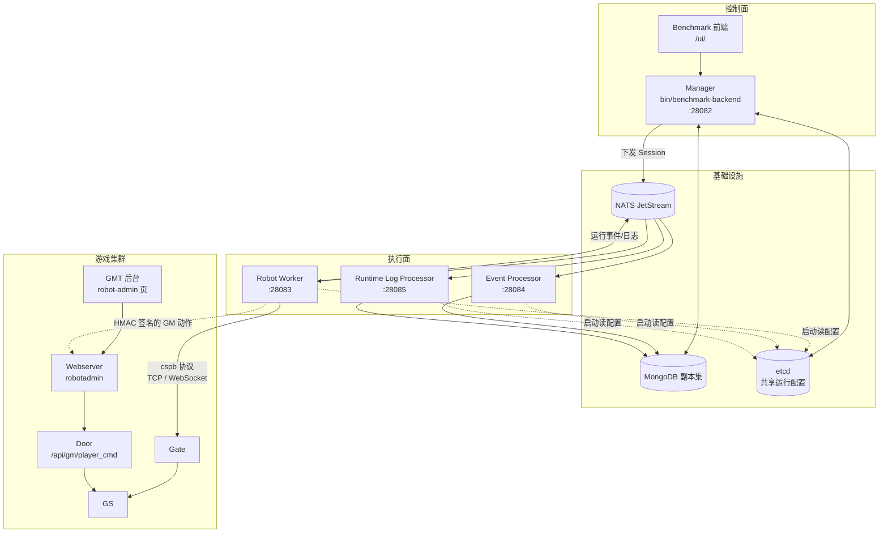
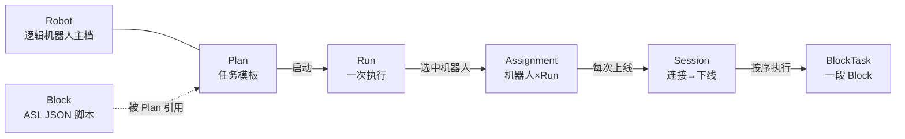
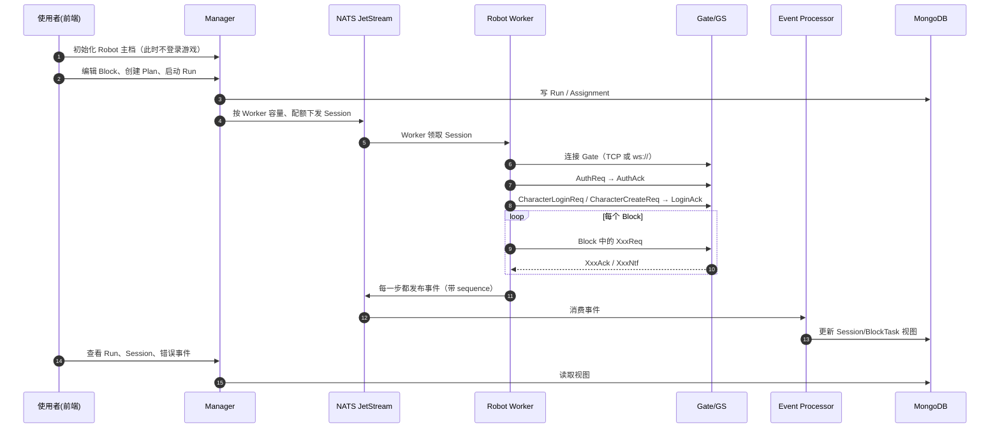
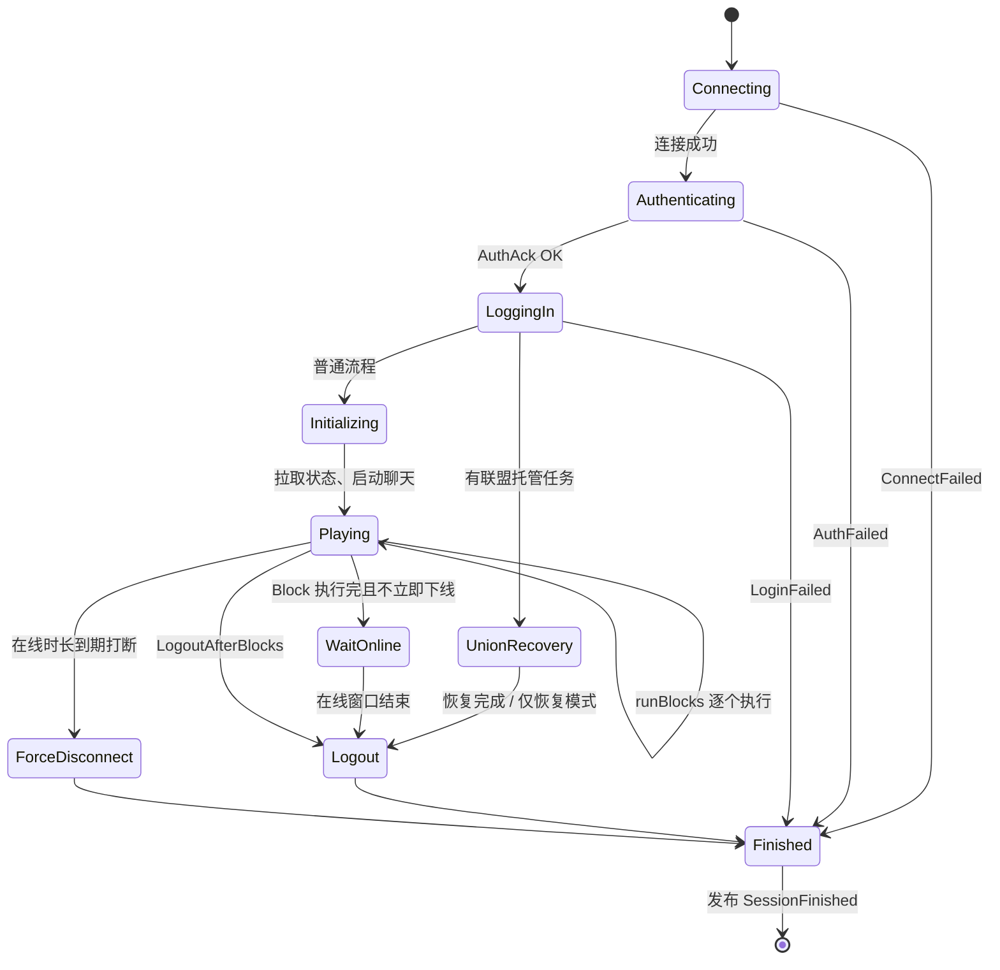
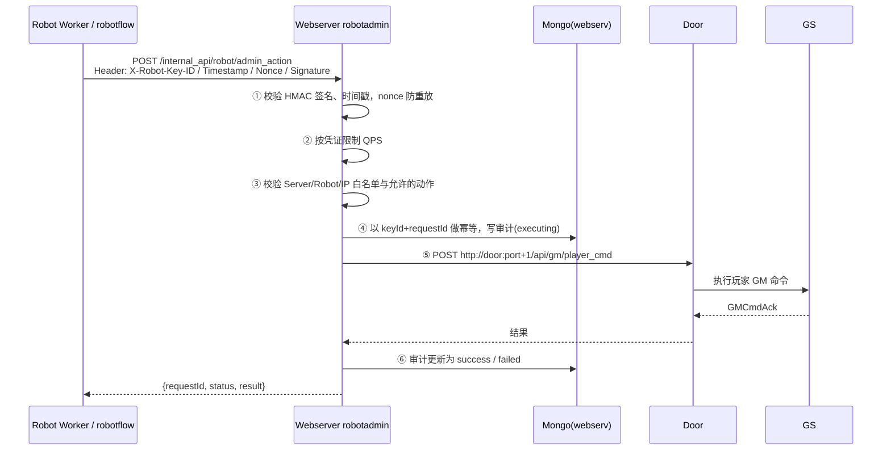

# v1052 K8 机器人合入 H5：两次提交梳理

> 分支 `h5_new_tf_v1052_benchmark`，作者 tanglei，2026-09-23
> - `2e8667db2d` feat：合并 K8 机器人功能并适配 H5 协议
> - `41b72b57e7` chore：同步服务端协议及生成代码
>
> 所有结论来自阅读代码和 diff，**没有实际启动过**。

---

## 0. 三句话说清楚

1. **`2e8667d` 是功能本体**：它把 K8 项目的一整套「机器人压测平台」（目录 `benchmark/`）搬进 H5 的 gs，包括管理后台、调度器、机器人执行进程、事件处理进程和 Block 脚本引擎。机器人是用**模拟客户端**实现的：它像真实玩家一样连 Gate、发 `cspb` 协议，所以不需要改动 GS 的主链路。
2. 游戏服侧的改动很少，只有三处：协议 `ClientInfo` 加了 `isRobot` 字段；BI 日志打 `is_robot` 标记；机器人不参与自动入盟。此外 Webserver 和 GMT 新增了一套「机器人受控 GM 动作」接口。
3. **`41b72b5` 没有业务变化**：`.proto` 只改了注释格式（`//xx` → `// xx`），`.pb.go` 是用新版生成器重新生成的。

---

## 1. 两个提交的改动范围

### 1.1 `2e8667d` 改动分布（共 2852 个文件，+93 万 / -4.1 万行）

| 区域                                          | 规模                     | 内容                                                                                                                                                                                                      | 需要关注吗                            |
| ------------------------------------------- | ---------------------- | ------------------------------------------------------------------------------------------------------------------------------------------------------------------------------------------------------- | -------------------------------- |
| `benchmark/`                                | 1178 个文件，+34 万行，全部新增   | 机器人平台全部代码：Go 后端、React 前端、Block 规则、部署脚本、验收测试                                                                                                                                                             | 独立目录，不参与 `make elf` 的游戏服构建       |
| `vendor/`、`go.mod`、`go.sum`                 | 约 1626 个文件             | 新增依赖：`expr-lang/expr`、`tidwall/gjson`、`modelcontextprotocol/go-sdk`、`bbolt` 等；**升级依赖：`nats.go` 1.13→1.49、`gin` 1.8→1.10、`golang.org/x/net` 0.22→0.47、`google.golang.org/protobuf` 1.28→1.34**           | ⚠️ **需要关注**：nats、gin 是全体游戏服共用的依赖 |
| `pb/cspb/`                                  | 8 个文件，+3.2 万 / -1.8 万行 | 实际语义变化只有两处：①`ClientInfo.isRobot = 45`（`pb/cspb/login.pb.go:335`）；②新增 `BatchQueryAssetNameReq/Ack`、`AssetNameQueryItem`、`AssetNameInfo`（`pb/cspb/msg.go:66`、`pb/cspb/msgid.def:2263`）。其余大部分是重新生成带来的 diff | 客户端协议需要与 protocol 仓库对齐           |
| `game/`                                     | 3 处逻辑改动                | 见第 5 节                                                                                                                                                                                                  | 小改动                              |
| `webserver/`                                | 19 个文件                 | 新增 `robotadmin` 服务，包括机器人 GM 动作、凭证、审计和环境拓扑                                                                                                                                                               | 新接口，默认不启用                        |
| `gmt/`                                      | 7 个文件                  | GMT 后台新增页面 `system/robot-admin`，含动作管理、凭证管理、审计日志                                                                                                                                                         | 前端页面                             |
| `Makefile`、`Jenkinsfile.benchmark_gdconfig` | +428 行                 | 新增 `benchmark-*` 系列 target 和 CI 流水线                                                                                                                                                                     | 不影响原有 target                     |

### 1.2 `41b72b5` 改动（7 个文件）

| 文件 | 变化 |
|---|---|
| `pb/gspb/ark.proto`、`game.proto`、`socket.proto` | 只改注释格式，`git show -w` 忽略空白后 diff 为 0 行 |
| `pb/gspb/*.pb.go` | 重新生成：注释跟着变，文件描述符字节也跟着变 |
| `pb/grpc/rank.pb.go` | gogo 生成器版本差异：`if (skippy < 0) \|\| (iNdEx+skippy) < 0` 被拆成两个判断，`skippy < 0` 时返回 `ErrInvalidLengthRank` |

**结论**：字段、字段号、消息都没有变化，线上兼容。这是一次「protocol 仓库与生成代码对齐」的提交。

---

## 2. 整体架构

### 2.1 组件全景



**核心思路**：Manager 只负责「编排和调度」，Worker 才真正「扮演玩家」。两者之间通过 NATS JetStream 解耦，Worker 可以横向扩容。机器人对 GS 来说就是普通客户端，唯一的标识是 `ClientInfo.IsRobot = true`。

### 2.2 进程清单

| 进程 | 源码入口 | 端口（共享配置默认值） | 职责 |
|---|---|---|---|
| Manager | `benchmark/backend/main.go` | `:28082` | HTTP API、前端静态页、Robot/Block/Plan/Run 管理、调度、AI 配置 |
| Robot Worker | `benchmark/backend/cmd/robot_worker/main.go:20` | `:28083` | 领取 Session，跑 `SessionRunner`；单进程容量 1000，Session 并发 100 |
| Event Processor | `benchmark/backend/cmd/robot_event_processor/main.go` | `:28084` | 消费事件，投影成 Run/Session/BlockTask 的查询视图 |
| Runtime Log Processor | `benchmark/backend/cmd/robot_runtime_log_processor/main.go` | `:28085` | 消费运行明细日志，写入 Mongo 或 ClickHouse |
| JetStream Provision | `benchmark/backend/cmd/robot_jetstream_provision/` | — | 一次性工具：检查或创建 NATS Stream |
| robotflow | `benchmark/backend/cmd/robotflow/` | — | 命令行里直接跑 Block，供 MCP/Block 自测使用 |

端口定义见 `benchmark/deploy/runtime-config.k8.json`，所有进程**启动时从 etcd 读取**这份共享配置。

### 2.3 代码分层（`benchmark/backend/internal/`）

| 包 | 作用 |
|---|---|
| `robotmanager` | Session 调度，以及单次 Session 的生命周期 `SessionRunner` |
| `robotworker` | Worker 侧实现：`basic_client.go`（Auth/创角/登录）、NATS outbox、聊天、联盟托管 |
| `robotcore` | Block(ASL) 引擎、表达式/JSONPath、机器人状态模块、规则引擎、GM 动作客户端 |
| `fakeclientcore` | 模拟客户端网络层：连接、`cspb.Processor` 编解码、心跳 |
| `robotevent` / `projectionruntime` | 事件定义与投影 |
| `runtimeconfig` / `processruntime` | etcd 共享配置、进程托管（健康检查、优雅退出） |
| `ai*` / `robotchat` / `robotaction` | AI 能力（可选）：Block 助手、自主动作、聊天 |

---

## 3. 核心概念



| 概念         | 一句话                                           |
| ---------- | --------------------------------------------- |
| Robot      | 长期存在的「虚拟玩家」，记录账号、密码、国家/语言、已绑定角色               |
| Block      | 一段 JSON 状态机脚本，描述「发什么协议、等什么回包、如何分支」            |
| Plan       | 选哪些机器人、连哪个 Gate、执行哪些 Block、在线/离线节奏如何          |
| Run        | Plan 启动一次，生成一个 Run                            |
| Assignment | Run 中「某个机器人」的执行单元                             |
| Session    | 机器人一次上线到下线；一个 Assignment 可以反复上下线，产生多个 Session |
| BlockTask  | Session 内执行一个 Block 的记录                       |

---

## 4. 主流程

### 4.1 端到端时序



### 4.2 Session 生命周期（最核心的代码）

入口 `benchmark/backend/internal/robotmanager/session_runner.go:414` `SessionRunner.Run()`



| 阶段 | 代码位置 | 实际做的事 |
|---|---|---|
| 连接 | `session_runner.go:520` → `robotworker/basic_client.go:401` → `fakeclientcore/fakenet.go:200` | 地址以 `ws://`/`wss://` 开头走 WebSocket（H5 Gate），否则走 TCP |
| 认证 | `session_runner.go:531` → `basic_client.go:403` | `AuthReq{UserType:"tap4fun", UserName:"robot<ID>", Password}`，从 `AuthAck` 取 AccessToken 和已有角色 |
| 登录 | `session_runner.go:540`、`:1043` | 有绑定角色时发 `CharacterLoginReq`，否则发 `CharacterCreateReq`（名字为 `robot<ID>`），都等 `LoginAck`（`basic_client.go:437`、`:460`） |
| 联盟托管恢复 | `session_runner.go:553-583` | 可选。Run 为 `ManagedUnionRecoveryOnly` 时恢复后直接下线 |
| 初始化 | `session_runner.go:586-630` | `client.Initialize` 拉状态；配置了聊天时启动 Chat 运行时 |
| 执行 | `session_runner.go:632-638`、`runBlocks` `:1099`、`runBlock` `:1629` | 先启动 AI 动作运行时，再逐个执行 Block |
| 收尾 | `session_runner.go:640-655`、`logout` `:1789` | 在线时长到期打断时 `forceDisconnect`；否则按策略等待后正常下线 |
| 结束事件 | `session_runner.go:452-512`（defer） | 发布 `SessionFinished`，Reason 取值 `completed` / `failed` / `initialization_failed`，失败时带 `FailureStage` + `ErrorCode` |

**机器人身份**：`basicClientInfo()` 固定填 `IsRobot: true`、`OpenUDID: "robot_<ID>"`、`Version: "1.0.4"`（`robotworker/basic_client.go:812-817`）。

### 4.3 Block 怎么写

Block 采用 AWS Step Functions (ASL) 风格。内置示例位于 `benchmark/robot_rules/blocks/`，最简单的是 `city_info.json`：

```json
{
  "Name": "city_info",
  "StartAt": "FetchCity",
  "States": {
    "FetchCity": {
      "Type": "Request", "Request": "CityReq", "Ack": "CityAck",
      "Notify": ["CityNtf"], "TimeoutMs": 5000, "End": true
    }
  }
}
```

| 状态类型 | 用途 |
|---|---|
| `Request` | 按消息名构造 cspb 请求，等待 `Ack`（可附带 `Notify`），支持 `TimeoutMs`、`Assert` |
| `Choice` | 用表达式分支，如 `has_path('session.characters.0.playerID')` |
| `Pass` / `Local` | 数据变换 / 本地计算 |
| `Succeed` / `Fail` | 结束 |

`Parameters` 里可以使用模板变量：`{{global.robot_id}}`、`{{global.server_id}}`、`{{session.accessToken}}`。带分支和断言的完整示例见 `robot_rules/blocks/acceptance_name_preoccupy.json`。

### 4.4 机器人执行 GM 动作的链路（可选功能）

压测时常需要「给机器人加资源、跳过前置」，这类操作走 Webserver 的受控 GM 通道：



| 环节 | 代码 |
|---|---|
| 路由 | `webserver/webs/router.go`：机器接口 `/internal_api/robot/{admin_action, environment_topology}`；管理接口 `/webapi/robot_admin/*`（需要登录） |
| 主处理 | `webserver/webs/robotadmin/machine_handler.go:33`（ExecuteAction）、`:183`（authenticate） |
| 签名头 | `machine_handler.go:24-27` |
| 转发 Door | `webserver/webs/robotadmin_adapter.go:16` → `webserver/webs/ctl_cmd.go:21` `execPlayerCmd` |
| 后台页面 | `gmt/src/pages/system/robot-admin/`：ActionManagement（动作模板）、ClientManagement（凭证、QPS、白名单、轮换密钥）、AuditLogs |

---

## 5. 游戏服侧改动（重点审阅）

| 改动 | 位置 | 说明 |
|---|---|---|
| BI 识别机器人 | `game/bi/bi_info.go:27`、`:77`；`game/bi/record.go:81` | `Info.IsRobot` 取自 `ClientInfo.IsRobot`，每条 BI 日志加 `is_robot` 字段，方便数据侧过滤 |
| 机器人不自动入盟 ① | `game/play/internal/ctl_union.go:3862` `OnEventUnionAutoJoin` | `p.BIInfo.IsRobot` 为真时直接 return |
| 机器人不自动入盟 ② | `game/play/internal/ctl_union.go:5433` `CheckAutoJoinUnion` | 同上。机器人入盟完全由 Block 里的 `ensure_union` 控制 |
| 改名预检 Bug 修复 | `game/play/internal/ctl_player.go:108` `OnChangeNameCheckReq` | 以前 `checkPlayerName` 失败、回 Ack 后没有 return，会继续执行并可能再回一次 Ack。现在补上了 `return`。**这是影响真实玩家的 Bug 修复** |

每项都有单测：`game/bi/record_test.go`、`ctl_player_name_check_test.go`、`ctl_union_test.go`。

---

## 6. 如何启动

### 6.1 依赖清单

| 依赖 | 要求 | 说明 |
|---|---|---|
| Go | 1.24 | |
| Node.js + npm | — | 构建前端 |
| MongoDB | **4.4+ 副本集** | AI 动作存储要用事务，standalone 不行。默认 URI 为 `mongodb://127.0.0.1:27017/?replicaSet=rs0` |
| etcd | — | 存放共享运行配置，默认 `127.0.0.1:2379` |
| NATS | **开启 JetStream** | 真正跑机器人时才需要。默认 `nats://127.0.0.1:4222` |
| 游戏环境 | Gate + GS 可连接 | 可以是本地开发服或测试服 |
| mongosh | — | `benchmark-robot-worker-manifest-local` 会用到 |

### 6.2 第 0 步：准备 H5 专用的共享配置（必须）

仓库自带的 `benchmark/deploy/runtime-config.k8.json` 填的是 **K8 的默认值**，需要先复制一份再修改：

```bash
cp benchmark/deploy/runtime-config.k8.json ~/benchmark-h5-runtime-config.json
```

需要修改的字段：

| 字段 | 默认 | 改成 |
|---|---|---|
| `fields.shared.mongo_uri` | `mongodb://127.0.0.1:27017/?replicaSet=rs0` | 你的 Mongo 副本集 |
| `fields.shared.mongo_database` | `gs_benchmark_k8` | 如 `gs_benchmark_h5` |
| `fields.shared.nats_url` | `nats://127.0.0.1:4222` | 你的 NATS |
| `fields.worker.gate_addr` | `127.0.0.1:21001` | **H5 Gate 地址**，WebSocket Gate 要写 `ws://host:port/...` |
| `fields.manager.http_addr` 等 | `:28082` ~ `:28085` | 端口冲突时再改 |

> ⚠️ 这份文件只在 etcd 里**还没有配置时**导入一次。之后再改本地文件不会覆盖 etcd，而且 Manager 会用 etcd 快照覆盖命令行里的 DB 地址、库名和 HTTP 地址。所以要么 **换一个新的 etcd 根路径**，要么走配置管理接口修改。

以下命令统一使用一组变量（写进 shell 或 `Profile.mk` 都可以）：

```bash
export BENCHMARK_ETCD_ENDPOINTS=127.0.0.1:2379
export BENCHMARK_ETCD_RUNTIME_CONFIG_ROOT=/benchmark/h5/local/runtime-config
export BENCHMARK_RUNTIME_CONFIG_BOOTSTRAP_FILE=$HOME/benchmark-h5-runtime-config.json
export BENCHMARK_ROBOT_ENVIRONMENT_ID=h5
export BENCHMARK_ROBOT_MONGO_URI='mongodb://127.0.0.1:27017/?replicaSet=rs0'
export BENCHMARK_ROBOT_MONGO_DATABASE=gs_benchmark_h5
export BENCHMARK_CSV=<H5 配置库名>
```

> Makefile 使用 `?=` 赋值，所以环境变量可以覆盖默认值。

### 6.3 方式一：只起管理后台（看页面、编辑 Block）

```bash
make benchmark-all-in-one BENCHMARK_DEV_AUTH_BYPASS=1
```

- 依次执行：`npm install` → 构建前端 → 编译 `bin/robotflow` → 编译并**前台**运行 Manager（`Makefile:489`、`:424`）。
- 打开 `http://127.0.0.1:28082/ui/`，用 `curl http://127.0.0.1:28082/ping` 检查，返回 `{"message":"pong"}` 即正常。
- `BENCHMARK_DEV_AUTH_BYPASS=1` 表示跳过 Portal SSO 登录，**只能在本机使用**。共享环境要配置 SSO（`benchmark/README.md` 第 55 行起）。
- ⚠️ 这一步**不会**启动 Worker，所以此时启动 Run，机器人也不会上线。

### 6.4 方式二：完整启动（真正跑机器人）

按顺序执行。每个 `*-start` 都是前台进程，各开一个终端：

```bash
# 终端 1：Manager（和方式一相同，已启动则跳过）
make benchmark-all-in-one BENCHMARK_DEV_AUTH_BYPASS=1

# 一次性：检查 / 创建 JetStream Stream
make benchmark-jetstream-provision BENCHMARK_JETSTREAM_COMMAND=check
#   check 不通过时，按提示改成创建命令（参见 robot_jetstream_provision 的帮助）

# 一次性：写入本地 Worker 兼容性清单（仅本地开发，写入 bm_robot_worker_manifests 集合）
make benchmark-robot-worker-manifest-local

# 终端 2：Worker
make benchmark-robot-worker-start BENCHMARK_ROBOT_WORKER_ID=worker-h5-1

# 终端 3：事件投影
make benchmark-projection-processor-start

# 终端 4：运行日志
make benchmark-runtime-log-processor-start
```

| Target | Makefile 行 | 备注 |
|---|---|---|
| `benchmark-all-in-one` | 489 | 前端 + robotflow + Manager |
| `benchmark-jetstream-provision` | 377 | `BENCHMARK_JETSTREAM_COMMAND` 默认 `check` |
| `benchmark-robot-worker-manifest-local` | 390 | 需要 `mongosh` |
| `benchmark-robot-worker-start` | 449-460 | 数据目录 `benchmark/.runtime/<env>/<workerId>` |
| `benchmark-projection-processor-start` | 462-468 | |
| `benchmark-runtime-log-processor-start` | 470-483 | 默认写 Mongo；设置 `BENCHMARK_RUNTIME_LOG_STORAGE_MODE` 和 `BENCHMARK_RUNTIME_CLICKHOUSE_*` 后改写 ClickHouse |
| `benchmark-distributed-build` | 406 | 只编译全部后端进程，不运行 |

**Docker 方式**：`benchmark/docker-compose.yml` 定义了 `benchmark`、`robot-worker`、`robot-event-processor`、`robot-runtime-log-processor`、`robot-jetstream-provision` 五个服务（镜像 `gs-benchmark:latest`，由 `benchmark/Dockerfile` 构建）。compose **不包含** Mongo、NATS、etcd，需要另外准备，参考 `benchmark/.env.example`。

### 6.5 跑通第一个机器人

1. 页面：RobotManager → 机器人管理 → Preview → 初始化 **1~2 个**机器人。
2. Block 编辑器：新建或选用 `city_info`，点校验。
3. 新建 Plan：选择上面的机器人、环境 `h5`、Gate 地址和 Block。第一次建议设置 `LogoutAfterBlocks`，或配一个很短的在线时长。
4. 发布 → 启动 Run。
5. 在 Run 详情里依次确认 Session 的 `Connected → AuthSucceeded → LoginSucceeded → Playing → Finished`，BlockTask 应为成功。
6. 失败时看错误事件里的 `FailureStage` / `ErrorCode`，对照 4.2 节的状态图定位是哪一步失败。
7. 测完 **Stop Run**，否则机器人离线一段时间后会再次上线。

### 6.6 （可选）开启 GM 动作

1. Webserver 启动时加上 `--robotAdminMasterKey <Base64>`、`--robotAdminMasterKeyFile <path>`，或环境变量 `ROBOT_ADMIN_MASTER_KEY(_FILE)`（`webserver/conf/conf.go:123-124`、`:201-208`）。不配置时接口返回 503。
2. 在 GMT 的「系统 → 机器人管理」里创建动作模板和调用凭证，设置允许的动作、服务器、IP 和 QPS。
3. 给 Worker 和 robotflow 设置 `ROBOT_ADMIN_WEBSERVER_URL`、`ROBOT_ADMIN_KEY_ID`、`ROBOT_ADMIN_SECRET`（或 `ROBOT_ADMIN_SECRET_FILE`）。Makefile 会 export 这几个变量（`Makefile:311-320`）。

---

## 7. 风险与待确认

| # | 问题 | 影响 | 建议 |
|---|---|---|---|
| 1 | **公共依赖被升级**：`nats.go` 1.13→1.49、`gin` 1.8→1.10、`x/net`、`protobuf` 等 | 所有游戏服进程（game/gate/global/…）都会编译进新版本，NATS 客户端行为可能有差异 | 合入主线前做一轮完整 `make elf` + 回归，重点看 natsrpc 相关功能 |
| 2 | `BatchQueryAssetNameReq` **在 GS 中没有处理器**（gs 中只有 pb 注册和 benchmark 在用） | robotflow 报告里查询资产名称的功能会超时（`robotcore/asset_name_query.go`） | 确认 GS 是否需要补处理器，或者只把它当作可选功能 |
| 3 | `cspb` 生成代码 diff 很大（+3.2 万 / -1.8 万） | 语义上只多了 isRobot 和 BatchQueryAssetName，但需要确认与 protocol 仓库、客户端版本一致 | 用 protocol 仓库重新执行 `make g`，对比结果 |
| 4 | 默认值大量写着 K8（库名、etcd 路径、环境 ID、`BENCHMARK_CSV=k8`） | 直接执行可能连错库或读错配置 | 按 6.2 节统一覆盖 |
| 5 | 改名预检补 `return` | 影响真实玩家，属于行为修正 | 找 QA 覆盖改名非法、重名场景 |
| 6 | `41b72b5` 的 `rank.pb.go` 解码更严格（`skippy < 0` 时报错） | 理论上只对非法包更严格 | 可以忽略 |

---

## 关联

- 旧版梳理：[[v1052 Benchmark机器人系统-架构流程与启动]]
- [[登录流程]]：机器人走的 Auth/Login 与真实客户端一致
- [[网络层与消息转发链路]]
- 仓库手册：`benchmark/README.md`、`benchmark/doc/k8_ai_port.md`
