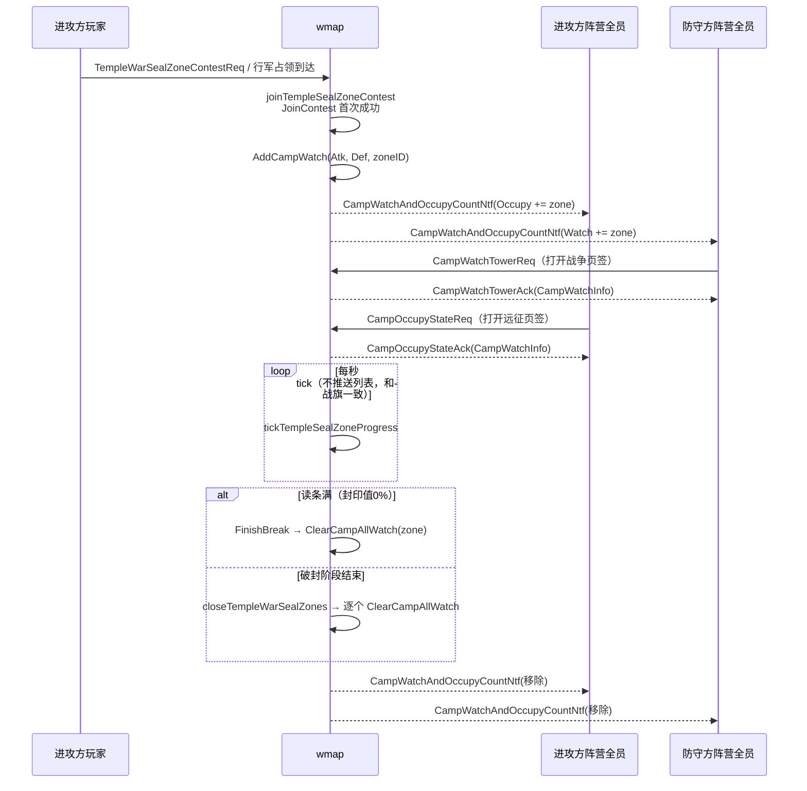

# 光剧本 - 神庙封印破封预警 实现分析

> 需求来源：`330/策划案/光剧本-神庙Boss玩法补充需求.xlsx`（V1.0，2026.9.8）「功能规则」页 **三、封印破封时的预警提示**。
> 「不看」页（6.6 特殊增益）策划已标注不要，不做。「多语言文本」页为空。
> 前置文档：[[光剧本-神庙玩法优化 第二版]]、[[光剧本-神庙玩法优化]]

## 一、需求要点

| | 3.1 战争列表（防守方） | 3.2 远征活动列表（进攻方） |
|---|---|---|
| 入口 | 主界面右侧「战争」按钮 → 战争页签 | 主界面「活动」按钮 → 活动页签 → 远征子页签（现在显示阵营战旗那里） |
| 接收者 | 本轮神庙**防守方**全阵营 | 本轮神庙**进攻方**全阵营 |
| 出现 | 进攻方成功点击「破除封印」后，每个封印单独一条 | 同左 |
| 消失 | ① 该封印的封印值降到 0%（被破除） ② 破封阶段结束，所有封印一起消失 | ①② 同左 ③ 玩家看过远征列表后，本次登录内没有新条目就消失 |
| 展示内容 | 建筑图标/名称（ExpBuildingCfg.DisplayKey/Name）、坐标、进攻方阵营名称+图标、**实时**封印进度、控制状态文本（防守方控制 `Tips01` 阻挡破除中 / 进攻方控制 `Tips02` 破除中）、支援按钮 | 建筑图标/名称、坐标、**范围内进攻方人数**（按玩家数，不是编队数）、控制状态文本（`Tips03` 破除被防守方阻碍 / `Tips04` 破除中）、前往按钮 |
| 红点 | 战争页签 +N，主界面入口 +N | 远征子页签只亮红点不显示数字，活动主页签 +N，主界面入口 +N |

## 二、结论：复用现有的「阵营预警 / 阵营占领」链路

远征里本来就有一套结构，**一个单位同时出现在进攻方的远征列表和防守方的战争列表里**，阵营战旗（AreaBuild）现在就是这么做的。本需求基本只需要把封印区域接进去。

### 2.1 现有链路（代码事实）

| 环节 | 位置 | 说明 |
|---|---|---|
| 数据 | `game/wmap/internal/expedition/mgr.go:102` `CampWatch` | `Watch[camp]` = 被攻击的单位（**战争页签**）；`Occupy[camp]` = 正在主动占领的单位（**活动-远征页签**）。挂在 `Mgr.CampWatch` 上，**会落库**（`expedition/loader.go:60` MakeDirty `campwatch`），重启不丢 |
| 加入 | `ctl_battlefield.go:264` `AddCampWatch(atkCamp, defCamp, unitId)` → `expedition/mgr.go:701` | 加进进攻方的 Occupy、防守方的 Watch，然后给两个阵营各发一次 `BroadCampWatch` |
| 删除 | `ctl_battlefield.go:244` `ClearCampAllWatch(unitId, clearAtk)` | 从所有阵营的 Watch（`clearAtk=true` 时连 Occupy 一起）里删掉这个单位并广播 |
| 推送 | `ctl_battlefield.go:273` `BroadCampWatch` → `CampWatchAndOccupyCountNtf` | 只带单位 ID 列表（Watch/Occupy），**客户端靠它算红点数量** |
| 战争列表详情 | `ctl_battlefield.go:869` `OnCampWatchTowerReq` | `packCampWatchInfos(Watch[camp])` |
| 远征列表详情 | `ctl_battlefield.go:839` `OnOccupyStateReq` | `packCampWatchInfos(Occupy[camp])` |
| 打包 | `ctl_battlefield_watch_handler.go:76` `packCampWatchInfos` | 按单位类型走**解析器注册表**（`newBattlefieldDefenderResolverRegistry`，现在注册了 `MapUnitArea`、`MapUnitDemonFortress`）解析成 `mentity.Defender`，再打成 `cspb.CampWatchInfo`。**解析失败或 `GetProgressCampId()<=0` 的单位会顺手从列表里剔除**（自愈） |
| 战旗的用法 | `ctl_area.go:764` | 开始读条时 `wmap.AddCampWatch(newCampId, area.GetPositiveCampId(), area.ID)` |
| play 转发 | `game/play/internal/handler.go:1613-1614` | `CampWatchTowerReq` / `CampOccupyStateReq` 已经注册了 `regMapMsg`，**不需要新增转发** |

### 2.2 时机对应（封印区域现有代码）

| 需求时机 | 代码位置 | 改动 |
|---|---|---|
| 出现：进攻方成功点击破除封印 | `ctl_templewar.go:646` `joinTempleSealZoneContest`，`zone.JoinContest(AtkCamp)` 首次返回 true 之后 | `wmap.AddCampWatch(groupCfg.AtkCamp, groupCfg.DefCamp, zone.GetID())`，仅当破封窗口已开放（`IsBreakOpen`） |
| 出现（补）：未开放期间提前加入争夺 | `openTempleWarSealZones`，`OpenBreak` 之后 | `CanJoinContest` 允许未开放（`TWS_BREAK_UNOPEN`）时就加入争夺，这类封印等破封窗口开放时再加入预警，否则红点计数会先于列表出现 |
| 消失①：封印值 0%（读条满） | `ctl_templewar.go:941` `settleTempleSealZoneProgress` 里 `zone.FinishBreak(...)` 之后 | `wmap.ClearCampAllWatch(zone.GetID(), true)` |
| 消失②：破封阶段结束 | `ctl_templewar.go:1222` `closeTempleWarSealZones`（`breachTempleWarSeal` 调用，提前全破 / 进度 100% / 超时都会走到） | 遍历本场 `SealZoneIDs`，每个都 `ClearCampAllWatch` |
| 兜底：本场结算 / GM 强制结束 / 新一轮重置 | `ctl_templewar.go:1327` `releaseTempleWarSealZones`、`ctl_templewar.go:576` `ResetForNewRound` | 同样清一遍；另外解析器对非 `IsBreakOpen()` 的区域返回 false，列表打包时自动剔除 |
| 消失③：进攻方看过列表后本次登录不再显示 | — | **纯客户端**（按本次登录的已读状态处理），服务端不管 |

> 说明：代码里的 `Progress` 是**破封读条**（0→`Expedition_Temple_Seal_OverallProgress`，只增不减），需求里的「封印值」= 1 − Progress/Max。「封印值降为 0%」就是读条满（`TWS_BREAK_DOWN`）。

## 三、改动清单

### 3.1 协议：不改，全部映射到 `CampWatchInfo` 原有字段

与阵营战旗同口径，客户端按战旗的逻辑解析即可：

| 字段 | 战旗 | 封印 |
|---|---|---|
| `campId` | 读条阵营 | 进攻方（`ContestCampID`，已加入争夺的阵营） |
| `ownerCampID` | 归属阵营 | 防守方（`HomeCampID`） |
| `progress` | 读条进度 | 破封读条（0→`Expedition_Temple_Seal_OverallProgress`） |
| `members` | 驻守玩家（去重） | 范围内进攻方玩家（去重），`len(members)` 即远征列表的「人数」，与每秒读条的 `AtkNums` 同口径 |
| `progressEndTime` | 0 | 进攻方控制（读条速度>0）时为预计读条满时间，防守方控制/无人读条时为 0。客户端据此区分「破除中」（Tips02/04）与「阻挡破除中」（Tips01/03），也可用来插值实时进度 |
| `cfgId` | ExpGridCfg ID | 同左（`GridCfgID`） |
| `coord` / `tp` / `unitId` | 坐标 / 类型 / 单位ID | 同左（`tp` = `MapUnitTempleSealZone`） |

### 3.2 服务端

1. **`TempleSealZone` 提供与配置、地图无关的字段**（`temple_seal_zone.go`）：`GetCampId()`→`HomeCampID`、`GetProgressCampId()`→`ContestCampID`（未加入争夺为 0，`packCampWatchInfos` 会过滤）、`GetExpGridCfgId()`→`GridCfgID`；`GetProgress/GetID/GetType/GetCoord` 已有。

2. **wmap 层适配器 `templeSealZoneDefender`**（`ctl_templewar.go`）：内嵌 `*mcity.TempleSealZone`，补齐 `mentity.Defender` 剩下两个方法：
   - `GetMember()`：`searchTempleSealZoneTroops` 搜出的进攻方部队去重玩家（`templeSealZoneBreakerIDs`，`countTempleSealZoneBreakers` 也改为复用它）
   - `GetProgressEndTime()`：`templeSealZoneProgressEndTime`，速度>0 时用 `templeSealZoneFinishTs`（与 `settleTempleSealZoneProgress` 读条满时间同一公式）推算，否则 0

   实体不依赖 gdconf 和地图搜索。

3. **注册解析器**（`ctl_battlefield_watch_handler.go`）：`registry.Register(cspb.MapUnitTempleSealZone, ...resolveTempleSealZoneDefender)`，`!zone.IsBreakOpen()` 时返回 false（自愈剔除），否则返回 `wmap.newTempleSealZoneDefender(zone)`。`packCampWatchInfo` **不改**。

4. **加入/删除挂点**：见 2.2。建议封一个 `clearTempleSealZoneCampWatch(zone)`，四处统一调用。

5. **刷新方式：和阵营战旗一样**，服务端只在条目**出现/消失**时推 `CampWatchAndOccupyCountNtf`，读条过程中不额外推送；列表详情是客户端请求时的快照。
   - 战旗现状（代码事实）：只在 `startProgress`（`ctl_area.go:764`）和占领/反占（`ctl_area.go:532`、`ctl_area.go:921`）时推送；`AreaBuild.GetProgressEndTime()` 固定返回 0（`accessor_AreaBuild.go:278`）；读条速度变化时的 `BroadcastUnitNtfImpl` 只发给视野内的玩家（`sendto.go:181`），不发给全阵营。
   - 封印的 `progressEndTime` 非 0 时客户端可以用 `progress` + `progressEndTime` 插值，服务端不依赖这一点。

6. **日志**：加入/删除预警打 `tlog.Infof`，带 `pid`（触发的玩家，消失时没有就写 0）、`zoneID`、`groupCfgID`、atk/def camp。

### 3.3 不需要改的

- play 层转发（已注册）
- 落库 / 重启恢复（`CampWatch` 本身落库；封印区域状态也落库；重启后的残留由解析器自愈）
- 红点计数（客户端直接用 `CampWatchAndOccupyCountNtf` 的 Watch/Occupy 数量）
- 配置表（文本 key `Expedition_Temple_SealBroken_Behavior`、`Tips01~04` 是客户端多语言）

## 四、流程

## 五、待确认

1. **实时刷新（已定）**：按阵营战旗的做法，服务端只在出现/消失时推送，不做变化推送。需求里「期望可以实时更新」由客户端自己实现：开着面板时定时拉取，或者用 `progress` + `progressEndTime` 插值。
2. **进度显示口径（客户端/策划）**：服务端下发的是原始破封读条值，客户端显示「封印值」时按 `1 - Progress/Expedition_Temple_Seal_OverallProgress` 换算，还是要服务端直接下发剩余封印值？
3. **建筑图标/名称（客户端）**：`CampWatchInfo.CfgId` 沿用战旗的口径填的是 ExpGridCfg ID，客户端再从 ExpGridCfg 找到 ExpBuildingCfg 取 DisplayKey/Name。客户端需按此口径取图标/名称（与战旗一致）。
4. **出现时机（策划）**：现在进攻方「行军占领到达」也会自动加入争夺（`PTroopArriveTempleSealZone`，不用点按钮）。按代码，这种情况同样会触发预警，和「点击破除封印」等价——需要策划确认可以这样处理。
5. **防守方夺回控制（策划）**：需求里只有破除/阶段结束会让条目消失，防守方夺回控制只切换文本（Tips01/03），条目保留。按此实现。

## 六、工作量预估

| 项 | 预估 |
|---|---|
| Defender 实现 + 适配器 + 解析器注册 | 2h |
| 加入/删除挂点 + 日志 | 1.5h |
| 单元测试（`ctl_templewar_test.go` 补加入/读条满/阶段结束三种场景） | 2h |
| 联调 | 0.5 天 |
