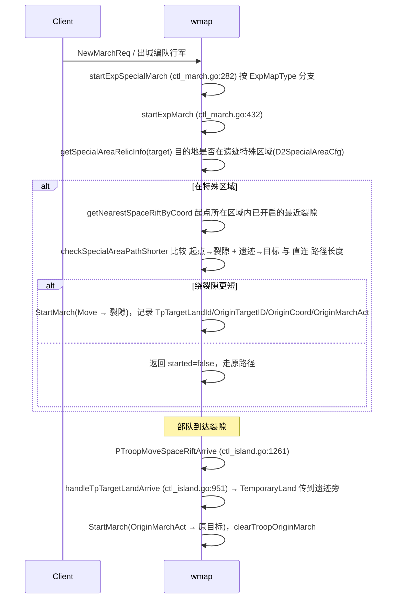

# 光剧本 - 增加空间裂隙传送 实现分析

> 策划案：`330/策划案/光剧本-增加空间裂隙传送.xlsx`（V1.0，2026.9.10）
> 结论先行：**火剧本已有一整套"空间裂隙 → 大陆传送（遗迹）"的实现，光剧本基本可以复用**。主要工作量是把火剧本里"遗迹专用"的那几处抽象成"可传送建筑"，再给光剧本（`types.MLight`）挂上分支。

## 一、需求要点

| # | 需求 | 服务器是否涉及 |
|---|------|----------------|
| 1 | 光地图新增建筑「空间裂隙（光）」：`ExpBuildingCfg` id=34201，Type=13 | ✅ 生成（已通用） |
| 2 | 锁定 / 开启两态，开启时间 = `ExpedeCalendarCfg.OpenTime` | ✅ `SpaceRift.OpenTs`（已通用） |
| 3 | 远征日历显示空间裂隙；点击跳到离城堡最近的裂隙（所有远征图通用） | ❌ 纯客户端 |
| 4 | 裂隙详情弹窗两个按钮：海岸城市传送 / 神庙传送；列表项 3 态（未解锁 / 可传送 / 阵营不可达） | ✅ 选择列表 + 传送校验 |
| 5 | 直接行军智能传送：目的地在「可传送建筑范围」内时，比较 直接走 vs 走到最近裂隙+从建筑走到目的地，取更短 | ✅ 核心改造点 |
| 6 | 5 的触发入口：拖动编队 / 选点行军 / 建筑详情的攻击、集结按钮 | ✅ 两个行军入口都要覆盖 |

可传送目标（`ExpLandTeleportCfg`，playbook=2）：
- 神庙 `31601~31616`（ExpBuildingCfg.Type=23 → `MapUnitLightTemple`）
- 海岸城市 `31801~31804`（Type=24 → `MapUnitCoastalCity`）
- `Region` = 所需占领的关卡 id，用于判断"阵营是否允许传送"

## 二、火剧本现有实现梳理

### 2.1 裂隙生成（通用，光剧本无需改代码）

- 日历建筑 `BFSpaceRift(13)` → `MapUnitSpaceRift`：`game/wmap/internal/ctl_battlefield_calendar_build_handler.go:25`
- 创建：`createSpaceRift` 计算 `OpenTs = 战场开始时间 + OpenTime`，并 `AddAreaSpaceRift(stateId, uid)` 建区域索引：`game/wmap/internal/ctl_battlefield_build_handler.go:299`
- 重启恢复索引：`game/wmap/internal/loader.go:467`
- 单位定义：`game/wmap/internal/mmap/melem/mcity/space_rift.go`

光剧本配置已就绪（gdconfig 提交 `028a08e8b 光剧本空间裂隙相关配置`）：
- `ExpBuildingGridCfg` 中 playbook=2、building_id=34201 共 28 个点位
- `ExpedeCalendarCfg` id=34201，playbook=2，OpenTime=849600s

### 2.2 手动传送（裂隙弹窗选择目标）

| 步骤 | 协议 | 代码 |
|------|------|------|
| 拉取可传送目标列表 | `ExpFireTpChooseReq/Ack` | `OnExpFireTpChooseReq` `game/wmap/internal/ctl_battlefield.go:3080`，火剧本返回 临时据点 + 遗迹（遗迹 `TpType=TP_Land`） |
| 发起传送 | `ExpFireTpReq/Ack` | `OnExpFireTpReq` `game/wmap/internal/ctl_battlefield.go:3034`：校验编队在裂隙 `OccupationRadius` 内 → 按 `TpTargetType` 分派 |
| 分派表 | — | `game/wmap/internal/ctl_battlefield_teleport_handler.go:36`，`TP_Land → teleportToLand → TemporaryLand` |
| 落地 | — | `TemporaryLand` `game/wmap/internal/ctl_battlefield.go:2996`：遗迹区域编队数限制 → `GetPaths(pt, unit)` 存在（=阵营可达） → `CalcPTTeleportTargetPos` 找落点 → 更新坐标并广播 |

### 2.3 智能传送（直接行军自动走裂隙）

两个行军入口都挂了这套逻辑：
- 普通行军：`startMarchByPath` → `startExpSpecialMarch` `game/wmap/internal/ctl_march.go:257`
- 出城编队行军：`game/wmap/internal/ctl_lineup.go:938` 处的 `switch types.ExpMapType(...)`

## 三、光剧本实现方案

### 3.1 改动点总览

| # | 位置 | 改动 |
|---|------|------|
| A | `ctl_march.go` `startExpSpecialMarch` switch | 新增 `case types.MLight` |
| B | `ctl_lineup.go:943` 附近 switch | 同步新增 `case types.MLight`（两处入口必须一致，否则编队出城不走裂隙） |
| C | `getSpecialAreaRelicInfo` | 抽一个 `getTeleportLandUnit(start, target) (munit.IUnit, bool)`：火/冰仍走 D2SpecialArea→遗迹；光剧本无遗迹区域，不判范围，直接选离目标最近的神庙/海岸城市作落点（见 3.2） |
| D | `startExpMarch` / `startMarchBySpaceRift` / `fillSpecialAreaOriginMarch` / `checkSpecialAreaPathShorter` | 参数 `*mcity.RelicBuilding` → `munit.IUnit`（实际只用到 `GetID()/GetCoord()`） |
| E | `startExpMarch` 兜底 | 火剧本找不到裂隙会走 `startMarchByTemporarySpot`（岛屿临时据点）；**光剧本没有岛，找不到裂隙直接返回 `(false, true)` 走原路径** |
| F | `OnExpFireTpChooseReq` | 光剧本分支：遍历 `LightTemple` + `CoastalCity`，返回 `TpType=TP_Land`、`CfgID`、`TargetEntityId`、`Coord` |
| G | `OnExpFireTpReq` / `TemporaryLand` | 补校验：①裂隙已开启（`now >= SpaceRift.OpenTs`，**现有代码未校验**）②光剧本 `TP_Land` 目标只能是 神庙/海岸城市 ③阵营可达 |
| H | `handleTpTargetLandArrive` | `targetUnit.GetType()==MapUnitAreaRelic && Move` 的"落地即结束"特判，光剧本扩展到 神庙/海岸城市 |

到达裂隙后的 `PTroopMoveSpaceRiftArrive → handleTpTargetLandArrive → TemporaryLand → 续行军` 链路是通用的，`TemporaryLand` 里的遗迹校验在光剧本下 `GetSpecialAreaCfgID` 取不到配置会直接放行，可直接复用。

### 3.2 「可传送建筑范围」判定（C 项，已确认：不需要范围）

> 结论（2026-10-16 确认）：**光剧本不需要"建筑范围"概念**。光剧本没有火剧本遗迹那种"区域内编队数上限"，所以任意行军目标都只需比较「直接走」和「走裂隙 + 传送 + 从落点建筑走」哪条更近，选近的。"范围内才判断"只是这个比较的一种特例，不需要单独建模。

火剧本之所以要"范围"，是因为遗迹区域 `D2SpecialAreaCfg` 同时承担编队数限制（`CheckRelicArea` / `CheckRelicAreaVisible`，`game/wmap/internal/ctl_relic.go:514,564`）。**光剧本已没有遗迹区域**（`D2SpecialAreaCfg` 无 playbook=2 数据），因此：
- `getSpecialAreaRelicInfo` 在光剧本恒返回 false，不能拿它做入口判断，光剧本分支要绕开它直接走 `getTeleportLandUnit`
- `TemporaryLand` 里的 `CheckRelicAreaVisible` / `CheckRelicArea` 在光剧本取不到配置，直接放行，可原样复用

光剧本 `getTeleportLandUnit(start, target)` 的选点逻辑：
1. **裂隙只选玩家当前所在区域（StateId）内的**：取该区域内已开启、离部队最近的裂隙；当前区域没有可用裂隙 → 自己直接行军过去，不跨区域找裂隙。直接复用 `getNearestSpaceRiftByCoord`（`game/wmap/internal/ctl_march.go:389`，按起点坐标取区域 → `GetAreaSpaceRift` → 过滤 `OpenTs` → 取最近），无需改动
2. 候选落点 = 本局所有 神庙 + 海岸城市（`ExpLandTeleportCfg` playbook=2）
3. 取**离目标直线距离最近**的候选作为落点（只取 1 个，避免每次行军对 20 个建筑都寻路）
4. 剪枝：若 `直线(起点→裂隙) + 直线(落点→目标) >= 直线(起点→目标)`，绕行不可能更短，直接走原路径，省掉寻路
5. 否则走 `checkSpecialAreaPathShorter` 用真实寻路比较；落点不可达（本阵营关卡未占领 → `GetPaths` 不存在）也视为不走裂隙

> 第 3 步只看离目标最近的一个落点：最近的落点不可达时，次近的可达落点可能仍更优，这种情况会退化成直接走。如果策划要求严格最优，就改成按直线距离排序、依次尝试，直到找到可达的那个。

### 3.3 「阵营是否允许传送」（G-③）

- 策划描述：按 `ExpLandTeleportCfg.Region` 关卡是否已被本阵营占领判断。
- 现状：`ExpLandTeleportCfg.tsv` 表头为 `C_`（仅客户端），**服务器 gdconf 没有这张表**。火剧本服务器侧靠 `TemporaryLand` 里的 `GetPaths(pt, unit)` 寻路是否存在来兜底（关卡未占领则不可通行 → 无路径）。
- 建议：服务器沿用"寻路可达"作为最终校验（与火剧本一致，客户端用 Region 只做展示）；如果策划要求严格按 Region 判，则把表改为 `cs` → `make conf` 生成 gdconf，再在 G 中按 Region 校验。

### 3.4 时间比较 vs 距离比较

策划写的是"所需时间"，火剧本 `checkSpecialAreaPathShorter` 比的是**路径长度**。同一编队速度一致时两者等价；若光剧本存在区域减速/加速 buff，需要改为按 `路径长度 / 行军速度` 计算。另外传送本身是瞬时的，不计时间。

## 四、风险与待确认

- [x] 「建筑范围」具体定义 —— 不需要范围，所有目标都比较远近（见 3.2）
- [ ] 神庙按轮次开放（神庙攻防战 `TempleGroupCfg`），非当轮神庙是否可作为传送目标？海岸城市是否在海岸保卫战期间才存在？——决定 F 里列表过滤规则
- [ ] 集结：策划 c 条提到"建筑详情的集结按钮"。火剧本的智能传送只作用于玩家编队行军（`fillSpecialAreaOriginMarch` 用 `UnitToPlayerTroopMust`），集结部队（RallyTroop）是否也要走裂隙需确认
- [ ] 裂隙开启时间：手动传送 `OnExpFireTpReq` 当前未校验 `OpenTs`，依赖客户端隐藏按钮，光剧本顺带补上（对火剧本也是修复）
- [ ] 传送前编队状态限制（战斗中/采集中/携带宝藏），火剧本岛屿传送有 `IslandTeleportStatusCheck`（`game/wmap/internal/ctl_island.go:456`），大陆传送 `TemporaryLand` 没有，是否需要统一
- [ ] 协议：如服务器下发可传送状态，`ExpFireTpChooseInfo` 需加字段（改 proto → `make g`）；若客户端自行用 Region 判断则无需改

## 五、工作量预估（服务器）

| 项 | 预估 |
|----|------|
| A/B/C/D/E 智能传送接入光剧本 + 重构参数类型 | 1 天 |
| F/G/H 手动传送列表与校验 | 0.5 天 |
| 自测（两个行军入口 × 直连更短/裂隙更短 × 神庙/海岸城市 × 关卡可达/不可达） | 0.5~1 天 |

## 六、实现记录（2026-10-16，分支 h5_new_tf_v1053_remote_fight_light，未提交）

> 2026-10-16 确认：光剧本**新增专用协议**（列表 + 传送），`ExpFireTp*` 只服务火剧本；列表开放时间按**建筑自身日历**；可传送状态由**服务器下发**。

### 6.1 协议（protocol 仓库）

| 消息 | 字段 |
|------|------|
| `ExpLightTpChooseReq` | 无 |
| `ExpLightTpChooseAck` | `errCode`、`repeated ExpLightTpChooseInfo infos` |
| `ExpLightTpChooseInfo` | `targetEntityId`、`cfgID`、`unitType`（神庙/海岸城市）、`coord`、`openTs`（毫秒）、`canTp`（本阵营是否可传送） |
| `ExpLightTpReq` | `TroopID`、`SpaceRiftEntityId`、`TargetEntityId` |
| `ExpLightTpAck` | `errCode`、`TroopID`、`TargetEntityId`、`coord`（落地坐标） |

### 6.2 配置（gdconfig 仓库）

- `ExpLandTeleportCfg.tsv` 表头由 `C_`/`c` 改为 `A_`/`cs`，服务器加载；新增 `gdconf/conf_explandteleport.go`，在 `confs.go`、`cfg_func_map.go` 注册
- `make conf` 顺带改动的无关文件（map 重排、i18n 字段重排、其他表同步）已还原，未提交

### 6.3 服务器口径

- **openTs** = `GetExpeditionPhaseStartTime(BFPBattleIn)` + 建筑日历 `OpenTime`（`getTimeConfig`，与建筑创建口径一致）。海岸城市 31801/31802 有 1036800 秒偏移，31803/31804 为 0；神庙没有按建筑 id 配的日历，按战斗开始即开放
- **canTp** = `ExpLandTeleportCfg.Region` 中**任一**关卡（ExpStateCfg）的 `Grid` 在本阵营 `AreaBuilds`（`GetCampOccupyIds`）中
- **手动传送校验**（`OnExpLightTpReq`）：光剧本地图 → 编队属于本人 → 编队状态（`IslandTeleportStatusCheck`：战斗/采集/行军/遗迹宝藏）→ 裂隙存在、已开启、编队在占领半径内 → 目标为神庙/海岸城市、已开放、canTp → `TemporaryLand`（寻路可达 + 找落点）
- **智能传送落点**只在"已开放且 canTp"的建筑中选离目标最近的一个

### 6.4 改动文件

| 文件 | 改动 |
|------|------|
| `game/wmap/internal/ctl_light_space_rift.go`（新增） | `OnExpLightTpChooseReq` / `OnExpLightTpReq`；`startLightMarch` 智能传送；开放时间、canTp、裂隙校验 |
| `game/wmap/internal/ctl_march.go` / `ctl_lineup.go` | 两个行军入口 `case types.MLight`；落点参数放宽为 `munit.IUnit` |
| `game/wmap/internal/ctl_battlefield.go` | `OnExpFireTpReq`：裂隙未开启拒绝（火剧本同样生效）；光剧本地图直接拒绝，引导走 `ExpLightTpReq` |
| `game/wmap/internal/ctl_island.go` | `handleTpTargetLandArrive`：目标就是落点建筑且为移动时落地即完成 |
| `game/wmap/internal/handler.go` / `game/play/internal/handler.go` | 注册 `ExpLightTpChooseReq`、`ExpLightTpReq`（play 侧 `regMapMsg` 转发） |
| `pb/cspb/*`、`benchmark/.../protocol_catalog.json*` | `make g` 生成 |

### 6.5 未决 / 风险

- canTp 取"任一关卡"：Region 两个关卡分属两个阵营（如 82 阵营1、89 阵营4），推断为"本阵营那一侧占领即可"，需策划确认
- 新增失败统一返回 `ErrCodeTeleportFailed`，客户端如需区分"未开放/阵营不可达"需新增错误码
- 智能传送在到达裂隙时不再复核 openTs/canTp，只依赖 `TemporaryLand` 的寻路可达

验证：`go build ./game` 通过；`golangci-lint`（增量，wmap/play/gdconf）0 问题；**尚未在服务器上实测**。

## 关联
- [[光剧本-神庙玩法优化]]
- [[光剧本-神庙玩法优化 第二版]]
