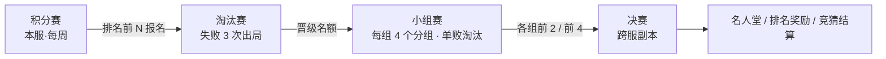
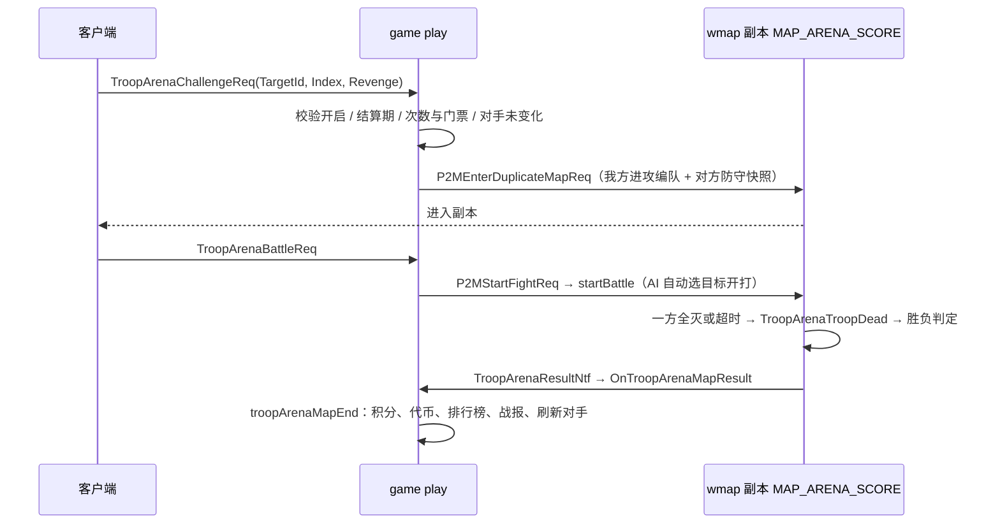
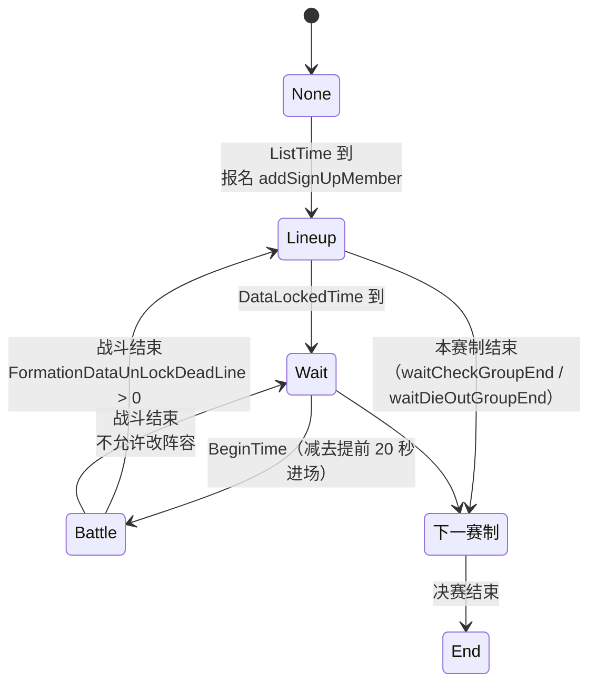
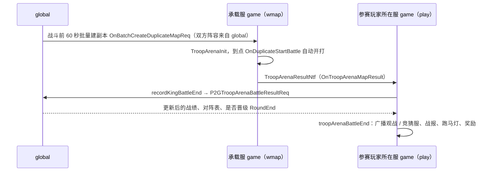

# 巅峰竞技场玩法

> 基于分支 `h5_new_tf_v1055_arena_king` 的 HEAD（`83398db23a`）梳理，**不包含** H5-13290 / H5-13291 / H5-13293 的本地修改。
> 相关：[[2026-11-02-巅峰对决淘汰赛对手空血反胜判定错误]]、[[战斗流程]]

## 1. 总览

巅峰竞技场由三种赛事组成，共用一套编队、战斗副本和配置表：

| 赛事 | 枚举 `TroopArenaEnemy` | 副本 `MapType` | 范围 | 周期 |
|---|---|---|---|---|
| 积分赛 | `TroopArenaScoreEnemy = 1` | `MAP_ARENA_SCORE` | 本服 | 每周一期，常驻 |
| 战区争霸 | `TroopArenaGroupEnemy = 2` | `MAP_ARENA_GROUP` | 跨服（按新老服分组，每组最多 4 服） | `TopArena_WarZone_GlobalTime` |
| 巅峰对决 | `TroopArenaKingEnemy = 3` | `MAP_ARENA_KING` | 跨服（按赛道 zone 分组） | `TopArena_Peak_Time` |

战区争霸和巅峰对决（代码里统称 king）的参赛资格都来自**积分赛排名**，赛制都是 **淘汰赛 → 小组赛 → 决赛**（`TroopArenaMatchEnemy`：`DieOut=1 / Group=2 / Finals=3`）。巅峰对决里英雄等级统一锁定为 `TopArena_Peak_HeroLv`。

### 参与的服务

| 服务 | 职责 | 主要代码 |
|---|---|---|
| game play | 积分赛全部逻辑；king 的本服阶段推进、报名、编队、奖励、竞猜、名人堂 | `game/play/internal/ctl_troop_arena.go`、`ctl_troop_arena_king.go` |
| game wmap | 战斗副本：创建部队、AI 选目标、判胜负 | `game/wmap/internal/ctl_troop_arena.go` |
| global | king 的跨服数据：服务器分组、淘汰赛 / 小组赛 / 决赛匹配、战绩、建战斗副本、竞猜汇总 | `global/internal/ctl_troop_arena.go`、`global/internal/match/arena/` |

## 2. 数据结构

### 2.1 本服全局：`TroopArenaMgr`（`game/play/internal/trooparena/arena.go:16`，存库，每 5 分钟整份写一次）

| 字段 | 说明 |
|---|---|
| `StartTs / LastStartTs / EndTs` | 本期 / 上期开始时间，本期结束时间 |
| `Status` | `ArenaStatusRun` 开启、`ArenaStatusWait` 结算或转移中 |
| `MarchInfo` / `PlayerBattleProps` | **积分赛防守快照**：玩家防守编队的行军信息和战斗属性。被挑战时用；战区争霸报名时也从这里复制 |
| `HistoryMarchInfo` | 周重置时保存上期快照，转移排行榜时回填（`bson:"-"`） |
| `MarchKingInfo` / `PlayerKingBattleProps` | **巅峰对决快照**：英雄等级锁定为巅峰等级，只记录积分赛前 `TopArena_Peak_Num` 名。巅峰对决报名时从这里复制 |

### 2.2 玩家：`TroopArenaData`

| 字段 | 说明 |
|---|---|
| `AtkSlots` / `DefSlots` | 进攻 / 防守阵容：阵位 index → 编队 ID |
| `ArenaFreeTimes` | 当天已用的免费次数 |
| `ArenaCompareEnemy` | 当前 5 个对手 |
| `EnemyId / IsRevenge / EnemyCreateTime` | 当前挑战的对手、是否复仇、副本创建时间 |
| `RevengeInfo` | 当天已复仇的对手（每人一次） |
| `Record` | 战斗记录 |

### 2.3 本服 king：`TroopArenaKingMgr`（`trooparena/arena_king.go:21`）

| 字段 | 说明 |
|---|---|
| `Basic` | 赛事类型 `ArenaType`、赛制 `MatchType`、阶段 `Phase`、轮 `Round` / 局 `Count`、分组、匹配结果（`MatchDieOut` / `MatchKing` / `MatchFinalsKing`）、本服入选名单 `IsInArenaKing` 等 |
| `MarchInfo` | 本服报名玩家的初始阵容（报名时生成，上传 global 后清空） |
| `TroopArenaPlayer.MatchPlayerMap` | 参赛玩家数据（含阵容、战绩），从 global 拉取，`bson:"-"` 不落库 |
| `GroupHistory / FinalsHistory` | 小组赛 / 决赛战报 |
| `Guess` | 竞猜数据 |

### 2.4 global：`TroopArenaOpenInfo` + `TroopArenaPlayer`（`global/internal/match/arena/mgr.go`）

- `TroopArenaOpenInfo`：一次赛事的全局状态，包括参赛服务器 `JoinServerInfo`、分组 `MatchGroupToPlayer`、轮次、匹配结果、本轮已结算记录 `BattleEndRecord`。
- `TroopArenaPlayer`：跨服参赛玩家，包括 `MarchInfo / Props`、`WinCount / FailCount`、淘汰赛专用的 `DieOutWinCount / DieOutFailCount / FailRound`、小组赛和决赛对阵表位置 `CurIndex`、对手 `MatchEnemyId`、是否已淘汰 `Fail`。

## 3. 积分赛

### 3.1 周期

| 时间点 | 处理 | 代码 |
|---|---|---|
| 每天 23:30（服务器时区，当天 0 点 + 24 小时 − 30 分钟） | 按排名发**每日奖励**邮件（`TopArenaRankRewardCfg`，`Type=1`） | `TroopArenaDayRewardCheck` `:2551`，`openNextTroopArenaDayTimer` |
| 23:30 ~ 24:00 | **结算期，不能挑战**（`checkInAccount`） | `:100`、`troopArenaDailySettlementStartTs` `:95` |
| 每天 0 点（玩家跨天） | 免费次数清零、复仇记录清空、刷新对手 | `PlayerTroopArenaNextDay` `:2492` |
| 周末那次每日结算 | 发**周奖励**（`Type=2`），然后 `InitTroopArena` 重置 | `:2551 → :2771` |

**周重置**（`InitTroopArena` `:2771`）：
1. 下期结束时间：下周一 0 点 − 30 分钟 − 1 秒；
2. `MarchInfo` 挪到 `HistoryMarchInfo`，状态改为 `Wait`；
3. 排行榜转移（`TroopArenaRankTimeCheck` `:2652`）：每秒转 1000 人，新积分 = 旧积分 × `TopArena_Integral_Reset_Ratio` / 10000。衰减后低于 `TopArena_Initial_Integral` 的不再转移。同时回填这些玩家的防守快照；
4. 转移完成后删除旧榜，状态改回 `Run`；榜上不足 200 人时用机器人补齐（`RobotAddTroopArena` `:2718`，积分区间见 `TopArenaRobotRandomCfg`）。

### 3.2 挑战流程

**挑战前校验**（`OnTroopArenaChallengeReq` `:212`）：
- 功能已解锁（`UnlockToparena`），积分赛处于开启状态，不在结算期；
- 玩家不在其他竞技场副本里。副本创建超过 30 分钟，或没有对手时，会强制退出（`shouldForceLeaveTroopArenaMap` `:345`）；
- **次数**（`TroopArenaCheckCost` `:2458`）：先用每天的免费次数（`TopArena_Initial_Times`），用完扣门票（`TopArena_Ticket_Cost`）；
- **复仇**：每个对手每天只能复仇一次（`RevengeInfo`）；
- **普通挑战**：对手位置要和 `Index` 对上。自己或对手的排名变化了，会报 `ErrCodeArenaChallengers` 并自动刷新对手。

**对手刷新**（`SearchTroopChallenger` `:2130` / `SearchRange` `:2164`）：
- 共 5 个位置，每个位置按 `TopArena_Rand_Enemy1~5` 配置的排名偏移范围 `[min, max, 下限, 上限]`，从自己当前名次附近随机挑人，不会挑到自己；
- 触发刷新的时机：手动刷新、跨天、战斗结束、排名变化；
- 对手没有防守快照时，用 `checkAndSetDefLineup` 补一份默认阵容（前 4 个编队）。

**跳过战斗**（`OnTroopArenaJumpBattleReq` `:504`）：积分 ≥ `TopArena_Battle_Skip_Condition` 时可以跳过。按副本当前的血量和坐标做一次快速战斗结算，结果和正常打完一样处理。

### 3.3 战斗规则（wmap）

- **阵位加成**：`TopArenaFormationCfg` 按阵位 index 给指定阵位加属性或伤害加成（`addTroopArenaProps` `:180`）；
- **AI**：每 5 秒（`OnAITick` `:509`）给没在行军、也没在战斗的部队选最近的敌人进攻；
- **阵亡加成**：一方每阵亡一个编队，存活的编队获得 `TopArena_Battle_Buff` × 阵亡数的加成（`checkAndAddDeadBuff` `:939`）；
- **时长**：`TopArena_Battle_Time_Limit` 秒。创建后 5 分钟内不点开始，副本自动销毁；
- **胜负判定**（`checkTroopArenaEnd` `:777`），依次比较：
  1. **存活编队数**多的胜；
  2. 相同时比**剩余兵力**；
  3. 再相同时比**造成的伤害**；仍相同则下方胜。
- **触发结算的路径**：
  - 部队阵亡时，`battleTroopDead → TroopArenaTroopDead(troopID)`；
  - 每 5 秒 `OnAITick` 发现一方全灭，或点开始时就已经一方全灭，走 `TroopArenaTroopDead(-1)`；
  - 超时，`TroopArenaTroopDead(-1, true)`（`module.go:1092`）。

### 3.4 结算（`troopArenaMapEnd` `:1377`）

| 项 | 公式 |
|---|---|
| 胜方加分 | `ceil((1 + 修正) × TopArena_Win_Integral)`；修正 = `clamp((败方积分 − 胜方积分) × 系数, 下限, 上限) / 10000`，参数取 `TopArena_Win_Integral_Effect` |
| 败方扣分 | `ceil((1 + 修正) × TopArena_Fail_Integral)`，参数取 `TopArena_Fail_Integral_Effect`；扣完最低为 0 |
| 发起方代币 | `ceil(胜/负系数 / 10000 × (1 + 积分差修正) × TopArena_Reward 里的数量)`；系数为 `TopArena_Reward_Success_Ratio` / `TopArena_Reward_Fail_Ratio` |

只有发起方拿代币，防守方只变积分。结算后还会：
- 名次进入前 `TopArena_Broadcast` 名时发跑马灯；
- 写双方战报；
- 推送商店刷新通知；
- 刷新发起方的对手列表；
- 名次在前 `TopArena_Peak_Num` 名内时，记录发起方的巅峰对决快照（`recordKingBattleLineUp` `:1499`）。

### 3.5 编队

| 操作 | 协议 / 入口 | 效果 |
|---|---|---|
| 选进攻编队 | `TroopArenaUseLineupReq(IsDef=false)` `:967` | 写 `AtkSlots`；没有防守编队时，同时设为防守编队 |
| 选防守编队 | `TroopArenaUseLineupReq(IsDef=true)` | 写 `DefSlots`，马上刷新积分赛防守快照（`troopArenaPowerCheck` `:1147`） |
| 拖动阵位 | `TroopArenaDragLineupReq` `:750` | 交换阵位，在副本里会同步给副本 |
| 改编队内容（英雄、装备、宠物等） | `ctl_lineup.go`、`ctl_pet.go` → `TroopArenaLineupChange` `:902` | 刷新积分赛防守快照；在副本里还会同步给副本 |
| 战力重算、登录、换服 | `ReCalcPower` / `OnTroopArenaLogin` 等 → `troopArenaPowerCheck` | 刷新积分赛防守快照 |

> `troopArenaPowerCheck`：用 `DefSlots` 生成快照，`DefSlots` 为空时改用 `AtkSlots`，写入 `MarchInfo / PlayerBattleProps`，同时更新玩家的积分赛防守战力。
> 巅峰对决快照 `MarchKingInfo` **只**在两处刷新：自己主动打完一场积分赛（`recordKingBattleLineUp`）、换服（`ctl_change_server.go`）。

### 3.6 其他
- **商店**：积分赛代币（`TopArena_Coin`）可以在竞技场商店兑换；部分商品有排名条件（`CheckTroopArenaShop`，`SBCT_Troop_Arena_Score`）。
- **观战**：`P2MTroopArenaInOrOutReq`，人数上限 `TopArena_MaxWatchNum`。

## 4. 战区争霸 / 巅峰对决（king）

### 4.1 开启时间

global 统一算开启时间，game 拉取后自己开定时器（`TroopArenaKingNextOpen` `:45`、`kingNextOpenTimer` `:87`）：

| 赛事 | 配置 | 规则 |
|---|---|---|
| 巅峰对决 | `TopArena_Peak_Time [首次开始时间戳, 持续天数, 间隔天数]` | 从首次时间开始，按间隔循环（`troopArenaKingOpenTime`） |
| 战区争霸（全服） | `TopArena_WarZone_GlobalTime [首次开始时间戳, …]` | 按间隔循环；上一次是巅峰对决时，从巅峰对决结束后开始算。注意：global `troopArenaGroupOpenTime` 取下标 1 作间隔，game `kingNextOpenTimer` 取下标 2，两处不一致 |
| 战区争霸（新服） | `TopArena_WarZone_FirstTime [开服 x 天, 持续, 间隔, 次数]` | 开服 x 天后单独开启若干轮新服赛（`troopArenaKingNewServerOpenTime` `:160`）；离下次全服赛事不到 3 天时，会互相顺延 |

活动开启时（`TroopArenaKingStartCheck` `:183`）：重置 king 数据，开下一阶段定时器，给在线玩家弹窗；战区争霸还会重置对应商店的购买资格。服务器配置的 `ActShield` 里屏蔽了这个活动时，不开启。

### 4.2 阶段状态机

每个赛制（淘汰赛、小组赛、决赛）都按这几个阶段循环（`TroopArenaKingNextEvent` `:368`、`TroopArenaKingPhaseCheck` `:1414`）：

| 阶段 | 含义 | 时长 |
|---|---|---|
| `ArenaPhaseNone` | 等待名单 | `ListTime`。期间上传本服信息参与服务器分组，并检查前 N 名的默认防守阵容（`checkDefLienUp` `:273`） |
| `ArenaPhaseLineup` | 设置阵容 | `DataLockedTime`；第二轮起改为上一场结束 + 解锁时长（`checkAndGetNextTime` `:296`） |
| `ArenaPhaseWait` | 锁定，不能操作 | `BeginTime`，加上轮次、局次间隔（`nextBattle`） |
| `ArenaPhaseBattle` | 战斗 | `TopArena_Battle_Time_Limit` + 提前 20 秒进场 + 3 秒等结果 |
| `ArenaPhaseEnd` | 结束 | 决赛打完 |

时长配置都在 `TopArenaRaceCfg`（按赛事类型、赛制、配置版本 `TopArena_Version` 区分）。

### 4.3 服务器分组（global `startMatchServerGroup` `:2684`）

- 每个服上传 `TopPower`：积分赛前 64 名的平均最高战力（`arenaKingUpChangeInfo` `:517`）。没有活跃玩家的服，在最小和最大值之间随机取一个，避免这些服全挤在一组；
- **巅峰对决**：按开服时间对应的赛道 zone 分组（`gdconf.GetZoneIdByCreateTime`），同一 zone 的服都在一组，人数不限；
- **战区争霸**：按 `TopArena_ZoneLine`（开服天数）分成新服、老服两类，按 `TopPower` 排序后每 4 个服一组（`TROOP_ARENA_GROUP_SERVER_NUM`）；只剩 1 个服的组并入前一组。

### 4.4 报名（`addSignUpMember` `:1544`）

阶段从 `None` 切到 `Lineup` 时执行：
- **名额**（`getInBattleCount` `:1520`）：巅峰对决每服 `TopArena_Peak_Num` 人；战区争霸按同组服数取 `TopArena_WarZone_Num` 里的阶梯值，新服赛取 `TopArena_WarZone_Num_NewServer`；
- 按积分赛排名从高往低取，跳过机器人；
- 阵容来源：
  - 战区争霸：复制积分赛防守快照 `MarchInfo`；
  - 巅峰对决：复制巅峰对决快照 `MarchKingInfo`；
  - 快照为空的玩家不报名（`checkDefLienUp` 会提前补默认阵容）；
- 写入 `IsInArenaKing`，然后立即分批上传 global（每批 20 人，`groopUpDate` `:581`）。

### 4.5 淘汰赛（`ArenaMatchDieOut`）

**匹配**（global `StartMatchServerDieOut` `:2482`）：
- 每组内，失败次数 < 3（`TROOP_ARENA_DIE_OUT_FAIL_MAX`）的玩家参加本轮；
- 按 `FailRound` 分桶，桶内随机排序后两两配对，落单的轮空；
- 所有对局打乱后按时间段排开：每段 `TopArena_Battle_Time_Limit` 秒，依次创建副本；
- 每组挑 8 场（`TROOP_ARENA_DIE_OUT_OB_MAX`）作为可观战、可竞猜的场次。

**每场结算**（`recordBattleEnd` `:1571`）：胜者 `WinCount++`，败者 `FailCount++`；败者 `DieOutFailCount ≥ 3` 时，记下淘汰轮次和淘汰他的对手。

**结束条件**（`checkArenaGroupBattleAllEnd` `:389`）：
- 每轮结束后看每组：剩余人数（失败次数 < 3）仍多于晋级名额（`TopArena_WarZone_PromotionNum` / `TopArena_Peak_PromotionNum`）时，标记失败满 3 次的人淘汰，继续下一轮；否则这个组的淘汰赛结束；
- 所有组都结束后，按「失败次数少优先，再比胜场多」取前晋级名额人，其余标记淘汰；
- 保底：超过 40 轮（`TROOP_ARENA_DIE_OUT_GROUP_MAX`）强制结束；
- 结束后切到小组赛（`waitDieOutGroupEnd` `:1395`）。

**奖励**：淘汰赛每打完一场，按胜负发奖（`addBattleReward` `:2292`，奖励类型：战区争霸 3、巅峰对决 6）。

### 4.6 小组赛（`ArenaMatchGroup`）

**分组**（global `StartMatchServerGroup` `:1931`）：
- 每组取晋级的玩家，按战力从高到低，依次放进 4 个分组（`TROOP_ARENA_DIE_OUT_GROUP_MEMBER_LIMIT`）里人数最少的那个，人数相同时随机；
- 分组内的位置再随机打乱，形成对阵表（`JoinMember` 数组，`CurIndex` 是位置）。

**赛制**：**单败淘汰的对阵表**。每轮相邻位置的两人对战，胜者进入下一轮的位置（`roundBattleWinIndex`）。
- 每轮可以打多局（`TopArenaRaceCfg.GameNum[0]`，例如 3 局 2 胜），每局之间间隔 `GameInterval`，轮与轮之间间隔 `RoundInterval`；
- 一轮最后一局打完，按胜场决定谁晋级（`winByCount`）。

### 4.7 决赛（`ArenaMatchFinals`）

- **人选**（`GetFinalsMember` `:2143`）：
  - 战区争霸：每个分组取第 1、2 名，第 1 名对其他分组的第 2 名，并避免同组相遇（`checkFailArr`）；
  - 巅峰对决：每个分组取前 4 名，按 `TroopArenaFinalsIndex` 的种子位排进对阵表，高分组和低分组随机交叉（`randomBattleIndex`）；
- 赛制和小组赛一样（对阵表、多局、按胜场晋级）；
- **副本在跨服创建**（`isCrossCreate`）。淘汰赛和小组赛的副本建在对局第一位玩家（`ArenaPlayer[0]`）的原服，新服赛建在新服（`createTroopArenaByManyTimes`）。

### 4.8 战斗与结果上报

- 巅峰对决的副本到时间**自动开战**，不用玩家点开始；
- 同一场比赛，global 只结算一次（`BattleEndRecord`）。上报的轮次、局次和当前不一致时忽略；
- 战斗阶段结束后，game 再从 global 拉一次结果（`checkBattleEnd` `:799`），然后进入下一阶段。

### 4.9 参赛阵容修改规则

| 时机 | 规则 |
|---|---|
| 报名前 | 见 [3.5](#3-5-编队)。战区争霸取积分赛防守快照（最新）；巅峰对决取巅峰对决快照（**最后一场主动挑战积分赛时**的防守阵容，或换服时） |
| 报名后 | 只能**进入巅峰地图**改（`troopArenaDefCreat` `:128`，要求在参赛名单里、没被淘汰、允许改阵容）。在地图里选编队、拖阵位、改编队内容，都会通过 `setArenaKingLineupChange` `:1448` 更新 `MatchPlayerMap` 并同步 global |
| 地图外 | 普通编队界面、积分赛界面的修改，**不影响**已报名的参赛阵容 |
| 允许改的时间（`allowChangeLineUp` `:5006`） | `RoundDataUnLockDeadLine ≤ 0`：只能在 `ArenaPhaseLineup` 改；`> 0`：除了 `ArenaPhaseWait` 都能改 |

### 4.10 竞猜

- 淘汰赛的可观战场次，和小组赛、决赛的每一场都可以竞猜（`OnTroopArenaKingGuessReq` `:3171`、`OnTroopArenaKingGuessOddsReq` `:3542`）；
- 用竞猜币下注，有保底下注额（`TopArena_MinChips`）和下注上限（`TopArena_MaxBetChips`）；
- 赔率按双方下注额算，有保底（`TopArena_MinOdds`）和上限（`TopArena_MaxOdds`）；
- 结算发邮件（`TopArena_Guess_Settlement_Mail`），决赛结束后统一结算一次（`sendGuessReward` `:2011`）；
- 竞猜币可按 `TopArena_CoinConvert` 的比例转成竞技场商店货币；
- 下注数据先汇总到 global（`updateGuessToGlobal` `:3649`）。

### 4.11 奖励与名人堂

- **排名奖励**（`sendTroopArenaRankReward` `:2173`）：小组赛和决赛结束时，按对阵表的最终名次，给本服玩家发邮件。奖励类型：战区争霸 4 / 5，巅峰对决 7 / 8；名次文案对应 16 强、8 强、4 强、亚军、冠军；
- **名人堂**（`sendTroopArenaPeakKing` `:2116`、`putHallFameData` `:4468`）：按届数（`Session`）、赛道（zone）记录；
- **点赞**：每天 `TopArena_LikeTimes` 次，奖励 `TopArena_LikeRewards`（`OnGiveLikeArenaTroopReq` `:4653`、`OnGiveLikePeakKingReq` `:4715`）；
- **跑马灯**：比赛胜负有跑马灯（`sendArenaWinMarquee` `:1678`），比赛期间有弹幕（`TopArena_Barrage*`）；
- 比赛开启时，同组服务器里 ID 最小的服建一个聊天室（`createTroopArenaChatRoom` `:896`）。

## 5. 主要配置

| 配置 | 用途 |
|---|---|
| `TopArenaBattleCfg` | 每种赛事的地图 `MapId`、可上阵编队数 `AvailableTroopsNum` |
| `TopArenaRaceCfg` | king 各赛制的阶段时长、轮次、局数 `GameNum`、轮 / 局间隔、改阵容截止时间、名次文案 `RoundPlayerRank` |
| `TopArenaFormationCfg` | 阵位加成 |
| `TopArenaBornPointCfg` | 出生点、阵位数量 |
| `TopArenaRankRewardCfg` | 排名奖励（`Type` 1~8，见 `trooparena/def.go`） |
| `TopArenaRobotCfg` / `TopArenaRobotRandomCfg` | 机器人阵容 / 机器人积分区间 |
| `D2Config` `TopArena_*` | 积分公式、次数、门票、名额、开启时间、竞猜、点赞等参数（`gdconf/def_d2config.go:896` 起） |

## 6. 风险与边界（现状）

- **胜负判定只认死亡标记**：5 秒一次的兜底结算可能抢在死亡标记写入前执行，刚被打空的编队会被算成存活（见 [[2026-11-02-巅峰对决淘汰赛对手空血反胜判定错误]]，H5-13291）；
- **巅峰对决快照只在主动挑战后刷新**：最后一场之后再改防守阵容或换装备，报名时不会带上（H5-13293）；
- **锁定等级与共生英雄**：锁定等级时，共生 SSR 英雄算属性仍取被共生主英雄的真实等级，没吃到锁定等级的属性（H5-13290）；
- **`OnTroopArenaUseLineupReq` 巅峰分支**：`allowChangeLineUp()` 不通过时只设了错误码，没有 return，后面仍会生成阵容并发给副本。global 不会被改到，但副本里显示的阵容可能和实际不一致；
- `MatchPlayerMap` 不落库，game 重启后从 global 拉回，参赛阵容以 global 为准；
- 淘汰赛配对按 `FailRound` 分桶，代码注释写的是"按失败次数排序"，两者含义不同，需要确认是否符合设计。

## 关联
- [[战斗流程]]
- [[2026-11-02-巅峰对决淘汰赛对手空血反胜判定错误]]
