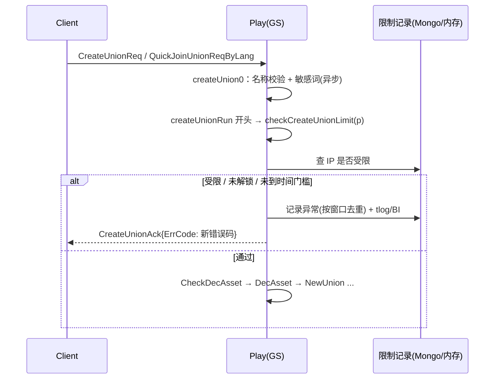

# 建盟脚本快速限制 - 实现评估（对抗式检查）

> 原案：`330/策划案/建盟脚本快速限制_功能策划案(1).xlsx`
> 方法：先读代码确认能不能做、改哪里，再用 **h5prod 线上 927 服的真实脚本样本**逐条验证每层规则能不能拦住。

## 0. 结论

| 层 | 实现难度 | 能否拦住线上样本 | 结论 |
|---|---|---|---|
| ① 建盟时间门槛 | 低 | **边缘**：样本注册后 7.5~11.2 分钟建盟，门槛设 12 分钟才全部命中；脚本改一个 sleep 就能绕过 | 可做，但只能算"减速带" |
| ② 设备重复限制 | 中 | **完全无效**：WEBGL 端 `DeviceID` 固定为 `"n/a"`，占新角色的 99.7% | **按原案做会一次误封整服**，必须砍掉或改方案 |
| ③ 网络来源(IP)限制 | 中 | **基本无效**：8 个样本用了 7 个不同的住宅 IP | 做了也拦不住，只增加误伤风险 |
| 封禁账号 | **中高** | — | GS 没有现成的"自动封号"通路，要新做（见 §3.2） |

**建议**：原案的三层里只有①能直接落地；②按原案落地是事故级风险；③性价比很低。建议改成 **①时间门槛 + 补建盟解锁校验 + 用"批量注册聚类/批量行为"做判定信号**，处罚先用"拒绝建盟 + 记日志 + 告警"，**不要自动封号**，跑一个开服周期看命中率再说。

---

## 1. 线上证据：927 服脚本样本

927 服在 2026-09-23 16:42 左右开服。建盟最早的 8 个联盟，盟主是**连号**角色：

| 角色 | 注册时间 | 注册 IP | 注册→建盟 | 联盟人数 | 现在状态 |
|---|---|---|---|---|---|
| 12337280 | 16:43:18.279 | 49.75.180.209 | 10.3 分 | 3 | 主城 32，角色 1 级，未付费 |
| 12337281 | 16:43:18.295 | **61.171.103.77** | 10.6 分 | 81 | 同上 |
| 12337282 | 16:43:18.317 | 121.236.18.90 | 8.2 分 | 3 | 同上 |
| 12337283 | 16:43:18.326 | 58.209.139.66 | 8.6 分 | 86 | 同上 |
| 12337284 | 16:43:18.337 | 121.227.110.199 | 7.5 分 | 66 | 同上 |
| 12337285 | 16:43:18.356 | 115.229.182.184 | 9.2 分 | 78 | 同上 |
| 12337286 | 16:43:18.491 | **61.171.103.77** | 11.2 分 | 86 | 同上 |
| 12337287 | 16:43:18.510 | 47.116.4.71 | 10.9 分 | 3 | 同上 |

几个事实：

- **8 个号在 232ms 内注册完**。同一时段全服正常注册速度约 20 人/分钟（约 3 秒一个），这个密度是明显离群值。
- 全部是微信渠道（`WeiXin_Mohe`），UDID 各不相同（`olFCC5...` 开头，看起来是 openid）。
- IP：8 个号用了 7 个不同的 IP，只有 61.171.103.77 重复了 1 次。
- 建盟后大约 1.5 小时，8 个号在 1 分钟内一起最后一次登录（18:24:14~18:25:16），之后再也没上线。
- 其中 5 个联盟拉到了 66~86 人，说明拉人效果很好。
- 正常盟主做对比：`神之领域` 盟主 12340473 注册后 147 分钟建盟；`曙光联盟` 盟主 12348455 付费 6 元，注册后 78 分钟建盟。这两个都没有落进 12 分钟以内。

> 样本量说明：927 服目前只有 13 个联盟，统计意义有限，只能证明"原案挡不住这批号"，不能拿来定正常玩家的门槛。门槛要再拉几个新服的数据。

### 设备、IP、渠道字段的实际填充情况（927 服最近 3000 个角色）

| 字段 | 情况 |
|---|---|
| `clientinfo.deviceid` | WEBGL 2990 个角色**全是 `"n/a"`**；只有 10 个 ANDROID 角色有真实值 |
| `clientinfo.udid` | 2989 个不同值，基本一人一个，是**账号级**标识，不是设备 |
| `clientinfo.ip` | 2986 个不同值；是 gate 看到的 TCP 对端地址，不是客户端自己上报的 |
| `clientinfo.channelid` | **全部为空** |
| 渠道实际可用字段 | `accounttype` / `paytype`：WeiXin_Mohe 2723、DouYin_Mohe 204、ZhiFuBao 37、XianYu 26、Android 10 |
| 全服 IP 共享 | 1 个 IP 挂 16 个号（14.145.30.186，微信+抖音混合），113 个 IP 各挂 2 个号 |

---

## 2. 逐条对抗检查

### ① 建盟时间门槛

- 实现：`p.Stat.RegisterTs`（`game/play/internal/mplayer/player.go:111`）就是角色首次创建时间，直接用。
- 转服：转服本身要求注册满若干天（`ctl_change_server.go:265-270`），新服开服的时间窗口里转服不会出现，原案"转服不重置"的顾虑可以不管。
- **对抗 1：脚本绕过成本为 0。** 样本建盟集中在 7.5~11.2 分钟，门槛 10 分钟只能拦住 4/8。脚本加一句 sleep 就过了。原案第 36 行自己也承认了这点。
- **对抗 2：误伤正常快速建盟的人。** 开服抢盟主的真人（公会成员组队进新服）通常也是注册后几分钟就建盟。门槛越高，误封越多，而原案对命中的处罚是**直接封号**。
- **对抗 3：处罚反而给脚本提供了探测信号。** 被封号是很明确的反馈，脚本作者试一次就知道门槛是多少。只拒绝建盟、提示"稍后再试"更不容易被摸出规律。

### ② 设备重复限制 ❌

- **H5 没有设备 ID。** WEBGL 端 `DeviceID` 固定为 `"n/a"`，也就是全服"同一台设备"。
- 按原案写 `if deviceID != ""` 这样的判断**过滤不掉 `"n/a"`**，第 2 个异常号出现时就会把**全服 WEBGL 玩家的建盟权限一起锁掉**。
- UDID 是 openid 级别，一个号一个值，拿来做"设备"维度等于没有这一层。
- 原案的"缺失信息不合并统计"方向是对的，但必须明确把 `"n/a"`、`"unknown"`、空串都算作缺失。这样处理完，这一层实际只对 Android 包（约 0.3%）起作用。
- 如果真想要设备维度，需要客户端接入浏览器指纹或平台 SDK 提供的设备标识。这是客户端 + 平台的需求，服务端单独做不了，而且浏览器指纹本身也能被伪造。

### ③ 网络来源（IP）限制

- IP 来源可信：`gate/server/handler.go:231-235` 用的是 `conn.RemoteAddr()`，登录时再由 gate 覆盖进 `CInfo.IP`（`handler.go:410`），客户端改不了。前提是 gate 前面没有 L7 代理，从线上 IP 的分布看确实是真实的公网 IP。
- **对抗 1：样本用的是代理池**，8 个号 7 个 IP，门槛设 2 也只能拦住 61.171.103.77 这一个 IP 上的第 2 个号。
- **对抗 2：移动网络 CGNAT、公司/网吧出口共享 IP 很常见。** 线上已经有 1 个 IP 挂 16 个号的情况，门槛低了就会误伤。
- 结论：做起来不难，但拦截率接近 0。如果要做，门槛要调高（比如 ≥5），而且只拒绝建盟，不封号。

### ④ 原案漏掉的问题

1. **建盟接口不校验解锁条件。** `OnCreateUnionReq` → `createUnion0`（`ctl_union.go:431-511`）没有调用 `CheckUnlock(p, Unlockunionbtn)`，代码里还留着 `// TODO 以后是否有等级和冷却限制`（`ctl_union.go:454`）。邀请处理那里是有校验的（`ctl_union.go:2051`）。`UnlockConfigCfg` id=27 配置的是主城(hq) ≥ 21。所以脚本可以直接发协议建盟，不用管 UI 有没有解锁。
   - 注意：样本号现在主城已经 32 级，没法确认建盟那一刻是否已经到了 21 级。**这个校验必须补，但不能指望它单独拦住样本。**
2. **还有第二个建盟入口。** `OnQuickJoinUnionReqByLang` 在没有可加入的联盟时会调用 `AutoCreateUnionByLang` **免费**建盟（`ctl_union.go:147-220`）。检查必须放在 `createUnion0` 或 `createUnionRun` 这一层，否则会被绕过。
3. **"检查通过后才扣费"**：现有流程是 `createUnionRun` 开头先 `CheckDecAsset` 再 `DecAsset`（`ctl_union.go:515-527`），只要把检查放在 `createUnionRun` 最前面就自然满足。
4. **"按渠道配置"**：`ChannelID` 线上全部为空，应该改成按 `AccountType`（`WeiXin_Mohe` / `DouYin_Mohe` 等）来区分。
5. **拉人才是真正的危害**，原案把私聊、邮件、联盟邀请的限制都挪到了"另立需求"。只拦建盟的话，脚本可以用 1 个过了门槛的号建盟，其余号负责拉人，效果不受影响。

---

## 3. 实现方案与工作量

### 3.1 检查点

- 改动位置：`game/play/internal/ctl_union.go` 的 `createUnionRun` 开头，统一覆盖两个建盟入口。`AutoCreateUnionByLang` 失败时不回 Ack，也要确认客户端表现正常。
- 统计范围：单个 GS 进程内（新服刷号本身就是单服行为）。用内存 map 加定时持久化，存到 GS 自己的库（比如新建一个 collection 或者放进 `globalvalue`）。**不需要跨服**。
- 窗口去重：`map[ip]map[playerID]firstTs`，同一个号只计 1 次，满足原案"重复请求不累计"。
- 到期恢复：限制记录上存 `expireTs`，查询时判断是否过期，不需要定时器。

### 3.2 封号通路（原案"封禁当前账号"）

现状：

- 登录时真正拦截封号的是 gate 查 door 库的 `blacklist_player` / `blacklist_account` / `blacklist_ip`（`gate/server/handler.go:101-122`，`gate/server/blacklist_check.go`）。
- 这几张表只有 igame 后台接口会写（`igame/internal/receiver/api/banned_role.go:99-121`）。
- GS 里的 `Other.BandTimes`（`ctl_player.go:1157`、`ctl_cmd.go:7448`）**只写不读，登录时不会拦截**。
- GS 没有 door 库的连接配置，只有到 door 的 NATS 通道（比如 `ctl_shop.go:475` 的 `natsrpc.Cast(natsdef.Door, ...)`）。

要实现自动封号，有两种做法：

| 方案 | 做法 | 改动 |
|---|---|---|
| A（推荐） | GS 通过 NATS 发给 door，door 按 `BannedRoleAdd` 的逻辑写 `blacklist_player`，GS 再踢人 | protocol 新增消息，door 新增 handler，GS 发送并踢线。牵涉 3 处 + 协议 |
| B | GS 登录时检查 `Other.BandTimes` | 只改 GS，但和后台封号是两套数据，解封、客服查询都看不到，**不推荐** |

**建议第一期不做自动封号**，只做"拒绝建盟 + 记录 + 告警"。原因：①时间门槛的误伤率还没法评估；②自动封号需要跨 3 个进程改动；③封号会把门槛暴露给脚本作者。

### 3.3 工作量估算（服务端）

| 项 | 人天 |
|---|---|
| 补 `CheckUnlock(Unlockunionbtn)` + 新错误码（proto，`make g`） | 0.5 |
| 时间门槛 + 按 AccountType 读配置（D2Const 或新建表，`make conf`） | 1 |
| IP 窗口计数、去重、限制、到期、持久化 | 1.5 |
| GM 命令：查询、手动解除、撤销计数（原案 §5） | 1 |
| 日志 / BI 埋点 | 0.5 |
| 自测 + 联调 | 1 |
| **小计（不含封号、不含设备层）** | **≈5.5** |
| 自动封号（方案 A，含 door 和协议） | +2~3 |
| 设备层（前提是客户端先提供可信设备 ID） | +1（服务端）+ 客户端和平台工作量 |

---

## 4. 更有效的替代信号（基于样本）

| 信号 | 样本上的表现 | 服务端能否做 | 被脚本绕过的成本 |
|---|---|---|---|
| **同服批量注册聚类**（比如 1 秒内同渠道注册 ≥5 个角色） | 8 个号在 232ms 内 | 能，`RegisterTs` 已有 | 中：需要拉开注册间隔，开服抢位的收益就降低了 |
| **"只升主城"画像**（建盟时 citytechs 只有 2 项、角色 1 级、零付费） | 8/8 命中 | 能 | 中：需要模拟完整的养成 |
| 新号的建盟冷却/门槛（主城、关卡、在线时长） | — | 能 | 中 |
| 批量同步上下线 | 8 个号在 1 分钟内一起最后上线 | 能，但只能事后判定 | 低 |

> 注意："只升主城"这一条要先确认 H5 新手流程里正常玩家在前 30 分钟 citytechs 是不是也只有 2 项。对照组 12340473（正常盟主）也只有 2 项，**所以这个信号目前的区分度不明**，要再抽样。

建议判定方式：**多个信号组合打分**，只命中一项时只记录不处罚。第一期跑一个开服周期，拿数据回来再定处罚。

---

## 5. 需要策划确认的问题

1. 设备层是否接受"H5 端不生效"？如果需要，客户端和平台能提供什么设备标识？
2. 命中后是否**只拒绝建盟**，先不封号？（强烈建议）
3. 时间门槛具体设多少？需要再拉 2~3 个新服"正常盟主注册→建盟"的分布，数据可以由服务端来拉。
4. 渠道维度改用 `AccountType`，可以吗？
5. 拉人限制（邀请、私聊、邮件）要不要一起做？只拦建盟的话收益有限。
6. `AutoCreateUnionByLang`（快速加入找不到联盟时自动免费建盟）是否也纳入限制？

## 关联

- 原案：`330/策划案/建盟脚本快速限制_功能策划案(1).xlsx`
- [[登录流程]]（ClientInfo、IP 的来源）
- [[网络层与消息转发链路]]
