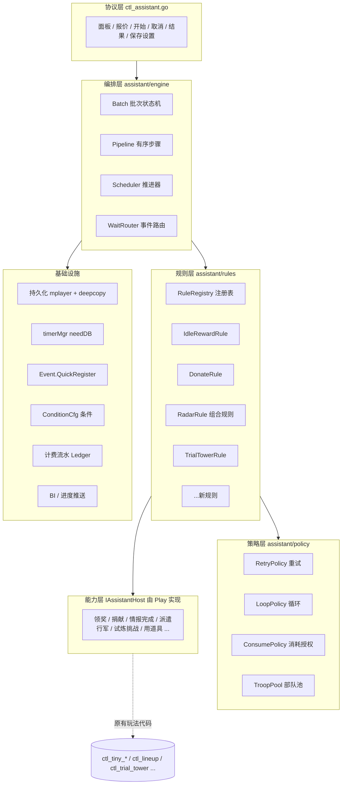
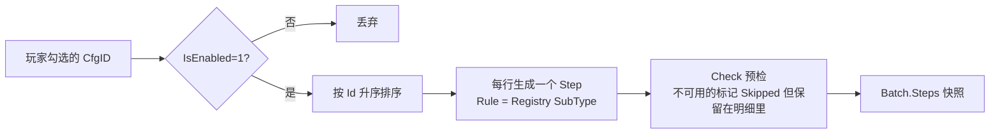
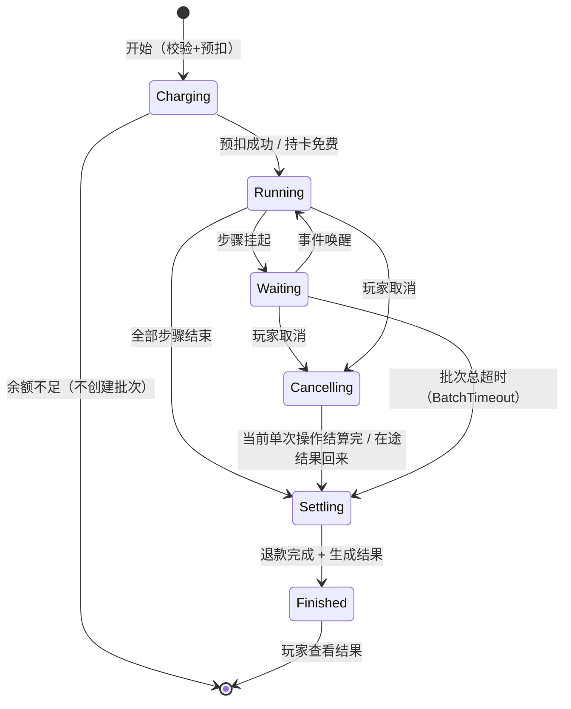
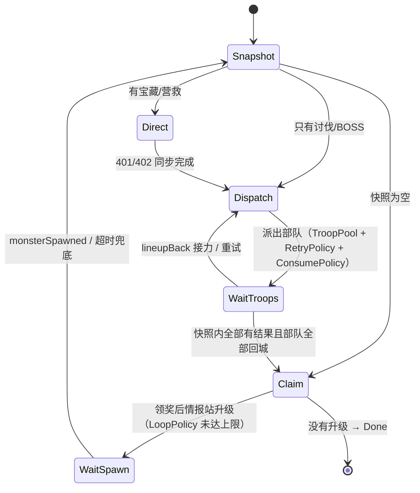
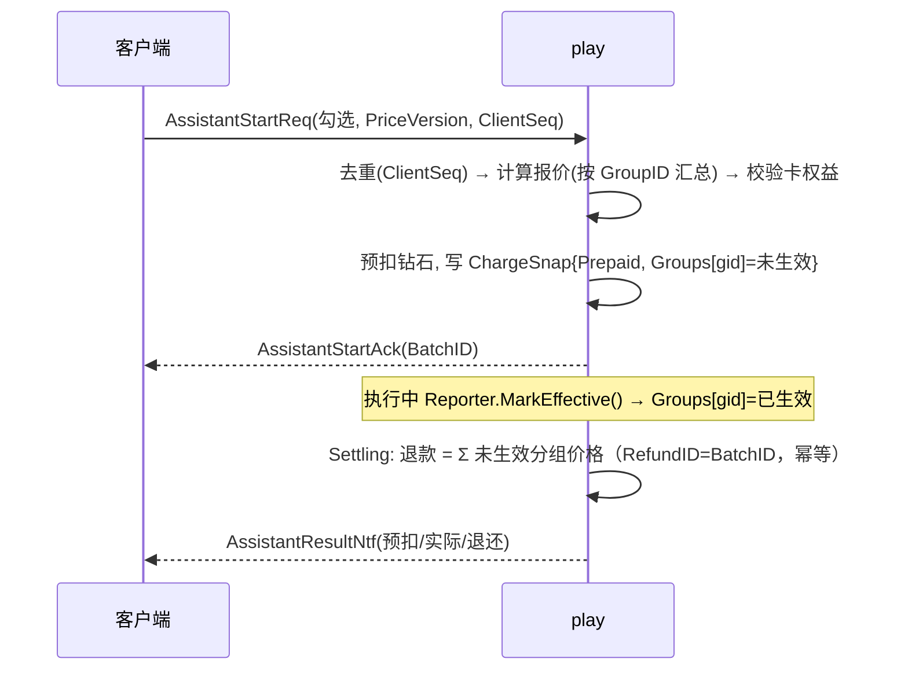

# 指尖助手 功能架构

> ⚠️ 本文是早期设计稿，部分结构（策略层、WaitRouter 命名等）与最终代码不同。**以 [[指尖助手服务端设计与实现]] 为准。**

> 依据：[[指尖助手策划案评审_V1.11]]（截至 2026-10-14 的已定规则）、[[指尖助手策划案评审]]
> 目标：**扩展性强**（新增玩法只加一个规则文件和一行配置）、**编排性强**（顺序、重试、循环、等待都由框架和配置决定）、**每种类型可以设计自己的规则**。

## 一、设计约束（来自已定规则）

| # | 约束 | 对架构的要求 |
|---|---|---|
| 1 | 按 `FingertipAssistantCfg.Id` 升序依次执行 | 编排器按配置生成有序流水线，客户端顺序不作数 |
| 2 | 同步和异步混合：领奖、捐献是同步的；试炼塔是 `BATTLECALC` 异步回调；讨伐/BOSS 要等行军和回城 | 每个步骤都可以“挂起等待事件 → 被事件唤醒继续” |
| 3 | 情报站：完成当前情报 → 领奖 → **升级则再来一轮** | 规则内部能循环，循环条件由规则自己判断 |
| 4 | 讨伐/BOSS：每条最多 3 次（含首次），部队按编号顺序，回城后接力 | 通用的“重试策略”和“资源池（部队）” |
| 5 | 体力不足自动用体力道具（需授权和上限） | 通用的“消耗授权”能力，所有规则共用 |
| 6 | 情报完成后才执行下一个事件 → 批次可能持续很久 | 批次要持久化，玩家离线和服务器重启都能恢复 |
| 7 | 按主事件分组计费，至少一次生效才收费，未生效的分组退款 | 计费流水和执行解耦，必须幂等 |
| 8 | 进度页、取消、断线续跑、统一结算 | 批次状态机 + 进度推送 + 结果汇总 |

## 二、总体分层



**依赖方向**：上层依赖下层的**接口**，不依赖具体实现（DIP）。
- 编排层**不认识任何具体玩法**，只认识 `IRule`。
- 规则层**不直接调用 `*Play`**，只调用 `IAssistantHost` 接口；`Play` 在 `ctl_assistant_host.go` 里实现这个接口（适配器）。
- 新增玩法 = 新增一个 Rule + 一次注册 + 一行配置，**主流程不改**（OCP）。

## 三、核心模型

### 3.1 批次 Batch（持久化）

挂在 `Player` 上，新建 `mplayer/massistant`，改完执行 `make deepcopy`。

```go
// AssistantData 玩家的指尖助手数据
type AssistantData struct {
    Settings *Settings // 玩家设置：勾选项、所选部队、消耗授权（跨批次保存）
    Batch    *Batch    // 当前批次；同一时间只有一个
    Results  []*Result // 未查看的结算结果（ResultRetention 到期清理）
}

// Batch 一次速办批次
type Batch struct {
    BatchID     int64
    State       int32        // BatchState，由状态机管理
    StartTs     int64
    Cursor      int32        // 当前执行到的 Steps 下标
    Steps       []*Step      // 按 CfgID 升序，开局快照
    Charge      *ChargeSnap  // 计费快照：价格版本、持卡、预扣、各组是否生效
    ConsumeUsed map[int32]int64 // 本批次已自动消耗的道具 cfgID → 数量，用于和授权上限比较
    Version     int64        // 每次推进 +1，用于丢弃过期的回调
}

// Step 一个子事件（对应配置一行）
type Step struct {
    CfgID    int32    // FingertipAssistantCfg.Id，同时决定顺序
    SubType  int32    // SubEventType，决定用哪个 Rule
    GroupID  int32    // MainEventType，计费分组
    State    int32    // StepState
    WaitKeys []string // 挂起时等待的事件 Key
    Data     []byte   // 规则私有状态（bson 编码），框架不解析
    Report   *Report  // 本步骤的结果：奖励、消耗、次数、失败原因
}
```

**关键点：`Step.Data` 是规则私有状态**
- 每个规则自己定义状态结构（比如情报站的轮次、快照、每条情报的尝试次数），用 bson 编码后存进 `Data`。
- 框架只负责存取，不解析。新增规则**不需要改 `Batch`/`Step` 的结构**，也不用为每个规则重新跑 deepcopy。
- 规则通过 `ctx.LoadState(&s)` / `ctx.SaveState(&s)` 读写。

### 3.2 规则接口（按能力拆分，ISP）

```go
// IRule 所有规则都必须实现：同步执行一次
type IRule interface {
    SubType() int32
    // Check 提交前和每次执行前的可用性检查（只读）。不可用时返回原因，步骤会被标记为跳过
    Check(ctx *RuleCtx) cspb.ErrCode
    // Run 开始或继续执行。返回结果，或者返回“挂起等待”
    Run(ctx *RuleCtx) Outcome
}

// IEventRule 需要异步等待的规则额外实现：被事件唤醒
type IEventRule interface {
    OnEvent(ctx *RuleCtx, evt *WaitEvent) Outcome
}

// ICancelableRule 取消时需要清理的规则（如清除情报的自动派遣标记）
type ICancelableRule interface {
    OnCancel(ctx *RuleCtx)
}

// IReconcileRule 重启、登录后需要对账的规则（如检查在途部队是否已经回城）
type IReconcileRule interface {
    Reconcile(ctx *RuleCtx) Outcome
}
```

```go
// Outcome 规则一次执行的结果
type Outcome struct {
    Kind     OutcomeKind // Done / Skipped / Failed / Waiting
    WaitKeys []string    // Kind==Waiting 时等待的事件，如 "lineupBack:<lineupID>"
    Timeout  int64       // 等待超时（毫秒），0 表示用配置的 NodeTimeout
    Reason   cspb.ErrCode
}
```

- **同步规则**（领奖、捐献）只实现 `IRule`，`Run` 直接返回 `Done/Skipped/Failed`。
- **异步规则**（试炼塔、讨伐）在 `Run` 里发起操作，返回 `Waiting`；结果回来时框架调用 `OnEvent`。
- 编排层按需做类型断言（`if r, ok := rule.(IEventRule); ok`），规则不需要实现用不到的方法。

### 3.3 规则上下文 RuleCtx（参数对象）

```go
// RuleCtx 规则执行时能拿到的一切；以后加数据只往这里加字段，规则签名不变
type RuleCtx struct {
    Player  *mplayer.Player
    Host    IAssistantHost   // 能力层，调用原有玩法
    Cfg     *gdconf.FingertipAssistantCfg
    Params  *RuleParams      // 解析后的配置参数（重试次数、上限等）
    Setting *Settings        // 玩家设置（只读快照）
    Batch   *Batch
    Step    *Step
    Report  *Reporter        // 记录奖励、消耗、生效标记、明细
    Policy  *PolicyKit       // 重试、循环、消耗授权、部队池
}
```

## 四、编排层

### 4.1 流水线的生成

- 排序在 afterLoad 时做好，缓存成 `[]*FingertipAssistantCfg`。配置加载时校验：同组 Id 连续、同组价格一致、`SubType` 已注册。新表记得用 `check-afterload` 检查回调注册。
- 生成后就固定了。执行中配置热更，不影响已经开始的批次（`PriceVersion` 同理）。

### 4.2 推进器 Scheduler

```go
// advance 从 Cursor 开始一直往下执行，直到遇到挂起或者全部结束
func (s *Scheduler) advance(ctx *batchCtx) {
    for ctx.HasCurrentStep() {
        out := s.runStep(ctx)                 // 内部调用 rule.Run 或 rule.OnEvent
        if out.Kind == OutcomeWaiting {
            s.router.Bind(ctx, out.WaitKeys)  // 登记等待
            s.armTimeout(ctx, out.Timeout)    // timerMgr，needDB=true
            ctx.Save()
            return                            // 让出，等事件唤醒
        }
        ctx.FinishStep(out)                   // 写入结果，触发进度推送（观察者）
        ctx.MoveNext()
    }
    s.settle(ctx)                             // 计费核对、退款、生成结算结果
}
```

- **同步步骤**连续执行，一次请求里跑完。
- **第一个异步步骤**会让出执行权，一键请求先返回“已开始”，后续由事件推动。
- 推进始终在玩家所在的 play 协程里执行（`GetPlayerAsyn` 回调里），不需要额外加锁。

### 4.3 事件路由 WaitRouter

把游戏里的各种回调统一转换成 `WaitEvent{Key, Payload}`，再按 Key 找到等待中的批次并唤醒。**规则只声明 Key，不关心事件从哪里来**。

| WaitKey | 来源（挂载点） | 使用的规则 |
|---|---|---|
| `lineupBack:<lineupID>` | `setLineupDataCb` 末尾（补兵 + 重算战力之后，`ctl_lineup.go:3277` 起） | 讨伐/BOSS |
| `marchFail:<lineupID>` | `OnM2PMarchFail`（`ctl_lineup.go:1786`），需要 wmap 对助手派遣也回传失败 | 讨伐/BOSS |
| `monsterSpawned:<radar>` | `OnCreateMonsterReply`（`ctl_tiny_radar.go:221`） | 情报站（升级后的下一轮） |
| `battleCalc:<reqID>` | `AsynCall(conf.BATTLECALC)` 的回调 | 试炼塔、竞技场、资源副本 |
| `timeout:<batchID>:<ver>` | timerMgr 定时器 | 所有异步规则 |
| `manualRecall:<lineupID>` | wmap 召回成功后回传的标记（见评审 4.1） | 讨伐/BOSS |

- **挂载点只调用一个函数** `play.assistantNotify(p, key, payload)`，不在原有玩法里写任何助手逻辑（观察者模式）。
- 回调里带上 `Batch.Version`。如果版本已经变了（比如已经取消或超时），就丢弃这个回调，避免重复推进。
- 玩家不在线时，这些回调本来就会通过 `GetPlayerAsyn` 加载玩家，所以离线也能推进。

### 4.4 批次状态机（规则 14）



步骤状态：`Pending → Running → (Waiting ⇄ Running) → Done / Skipped / Failed / Cancelled`。
每个状态是一个实现 `IState` 的对象，跳转只能通过 `TransitTo`，业务代码里不写 `if state == X`。

## 五、策略层：可复用的“编排积木”

规则不用每次都自己写重试、循环、上限。框架提供通用策略，**参数来自配置**，规则只需要组合使用。

| 策略 | 作用 | 配置来源 | 使用者 |
|---|---|---|---|
| `RetryPolicy` | 按 Key（如 questId）计数，最多 N 次（含首次），区分“可重试失败”和“终止性失败” | `MaxAttempts` | 讨伐/BOSS、勇者塔 |
| `LoopPolicy` | 满足条件就再来一轮，设最大轮数兜底 | `MaxRounds` | 情报站（升级再循环） |
| `LimitPolicy` | 单步骤最多操作 N 次 | `MaxOps` | 捐献、广告扫荡、资源副本、竞技场 |
| `ConsumePolicy` | 自动消耗道具：检查授权开关 → 选道具（顺序可配）→ 检查本批次上限 → 扣除并加资源 → 记账 | 玩家设置 + `ConsumeRule` | 讨伐/BOSS 体力；以后的体力扫荡、招兵 |
| `TroopPool` | 玩家所选部队池：按编号（`LineupMgr.Lineups` 下标）升序取空闲部队，回城后归还，手动召回后移出 | 玩家设置 | 讨伐/BOSS；以后的采集等 |
| `ConditionGate` | 用 `ConditionCfg` 判断开启条件 | `UnlockCondition`（条件 ID 数组） | 所有规则的 `Check` |

**终止性失败 vs 可重试失败**由规则返回的 ErrCode 决定，`RetryPolicy` 用一张表来区分：
- 可重试：战败、所选部队暂时都忙。
- 终止（整个步骤直接结束）：体力不足且无可用道具、不在主大地图、远征末期、城堡被攻击、怪物已过期。

**ConditionGate 的代码事实**：项目已有通用条件系统 `ConditionCfg`（`gdconf/conf_condition.go`，字段 `ConditionType / CompareOption / ConditionValue1`），按 ID 判断的入口是 `checkConditionCommon(p, cID)`（`condition_check.go:177`）。配置里 `UnlockCondition int[]` 直接填 `ConditionCfg` 的 ID 就可以复用。
> 评审 V1.11 第四章第 4 条说“条件应该用 UnlockConfig 的字符串 Key”，这一点**更正**：两套都有，`UnlockConfigCfg` 管功能入口解锁（`FingertipAssistant`），子事件的开启条件用 `ConditionCfg` 的 ID 更合适。运行时状态（有没有可领收益、是否在联盟）仍然由规则的 `Check` 判断。

## 六、规则层：类型如何“设计规则”

### 6.1 注册表（OCP）

```go
var ruleRegistry = map[int32]IRule{}

// RegisterRule 启动时注册；重复注册直接 panic，配置里出现未注册的 SubType 会在 afterLoad 时报错
func RegisterRule(r IRule) {
    if _, ok := ruleRegistry[r.SubType()]; ok {
        panic(fmt.Sprintf("assistant rule %d registered twice", r.SubType()))
    }
    ruleRegistry[r.SubType()] = r
}

func init() {
    RegisterRule(&IdleClaimRule{})
    RegisterRule(&GoldDonateRule{})
    RegisterRule(&RadarRule{})
    // ...
}
```

### 6.2 规则的三个层次

| 层次 | 做法 | 例子 |
|---|---|---|
| **只改配置** | 同一个规则，不同参数 | 资源副本换副本 ID、竞技场改次数上限、勇者塔改尝试次数 |
| **组合通用规则** | 用通用模板 + 一个能力函数 | 所有“领取类”（挂机收益、城墙、试炼日奖、免费抽卡）都用 `ClaimRule{claim: host.ClaimXxx}`；所有“按次数循环的同步操作”（捐献、广告扫荡）都用 `RepeatRule{once: host.DonateOnce}` |
| **专用规则** | 自己实现 `IRule` + `IEventRule` | 情报站、试炼塔、讨伐 |

通用模板示例：

```go
// ClaimRule 领取类通用规则：检查 → 领一次 → 记录
type ClaimRule struct {
    subType int32
    claim   func(h IAssistantHost, p *mplayer.Player) (cspb.ErrCode, []*cspb.TypIDVal)
}

func (r *ClaimRule) Run(ctx *RuleCtx) Outcome {
    code, awards := r.claim(ctx.Host, ctx.Player)
    if code != cspb.ErrCodeSuccess {
        return Skipped(code)
    }
    ctx.Report.AddAwards(awards)
    ctx.Report.MarkEffective() // 本组至少生效一次 → 计费
    return Done()
}

// RepeatRule 按次数重复的同步操作：每次前检查，达到上限或条件不满足就停
type RepeatRule struct {
    subType int32
    once    func(h IAssistantHost, p *mplayer.Player) (cspb.ErrCode, []*cspb.TypIDVal)
}

func (r *RepeatRule) Run(ctx *RuleCtx) Outcome {
    limit := ctx.Policy.Limit(ctx.Params.GetMaxOps())
    for limit.Next() {
        code, awards := r.once(ctx.Host, ctx.Player)
        if code != cspb.ErrCodeSuccess {
            return ctx.Report.DoneOrSkipped(code) // 至少成功过一次就是 Done
        }
        ctx.Report.AddAwards(awards)
        ctx.Report.MarkEffective()
    }
    return Done()
}
```

注册时只需要一行：
```go
RegisterRule(&ClaimRule{subType: SubIdleClaim, claim: IAssistantHost.ClaimIdleReward})
RegisterRule(&RepeatRule{subType: SubGoldDonate, once: IAssistantHost.DonateUnionTechOnce})
```

### 6.3 组合规则：情报站 RadarRule

情报站是一个**内部有阶段的规则**，它的阶段也用一个小状态机管理，状态存在 `Step.Data` 里。



```go
// radarState 情报站规则的私有状态，存于 Step.Data
type radarState struct {
    Phase     int32
    Round     int32             // 当前轮次，从 1 开始
    LevelPre  int32             // 领奖前的情报站等级
    Pending   []int64           // 本轮待处理的 questId（已按规则排序）
    Running   map[int64]int64   // lineupID → questId（在途）
    Attempts  map[int64]int32   // questId → 已尝试次数（含首次）
    Results   map[int64]int32   // questId → 最终结果
    Removed   []int64           // 被手动召回、移出部队池的 lineupID
}
```

各阶段调用的能力（都在 `IAssistantHost` 里，由 Play 实现，复用原有代码）：

| 阶段 | 能力 | 复用的现有代码 |
|---|---|---|
| Snapshot | `RadarSnapshot(p, types)` | `p.GetRadar().RangeQuests`、`isRadarTarget`，过滤 `MonsterID==0`、理查德、手动在途 |
| Direct | `RadarFinishDirect(p, questID)` | 抽出 `finishRadarQuest`：`EventFinishRadarMonster` / `EventPveRadarQuestCnt` / BI；`DeleteQuestMonsterReq` 删除单只怪（评审 3.10） |
| Dispatch | `RadarDispatch(p, lineupIdx, questID)` | `newTroop` 的校验和派遣，附带“助手派遣”标识（评审 3.2.1） |
| Claim | `RadarClaimAll(p)` | `getQuestsAwards` + `AddAssets` + `afterRadar`（`AddAssets` 会同步触发 `addRadarExp` 升级刷新） |

### 6.4 规则清单（首版）

| CfgID | 规则 | 类型 | 等待的事件 | 主要能力 |
|---|---|---|---|---|
| 101 | `ClaimRule` 挂机收益 | 同步 | — | 挂机领奖 |
| 102/103 | `RepeatRule` 广告扫荡/鸡腿 | 同步 | — | 需要免广告权益；没有就跳过 |
| 201 | `RepeatRule` 金币捐献 | 同步 | — | `OnUnionTechDonateD2Req` 抽出单次捐献 |
| 301 | `ClaimRule` 城墙 | 同步 | — | 城墙领奖 |
| 401–404 | `RadarRule` | 异步 + 组合 | `lineupBack`、`marchFail`、`monsterSpawned`、`timeout` | 见 6.3 |
| 501 | `ClaimRule` 试炼日奖 | 同步 | — | `OnGetTrialTowerDailyRewardReq` 抽出 |
| 502/503 | `TrialTowerRule` | 异步链式 | `battleCalc` | `trialChallengeDirect`（评审 V1.9 3.2.2） |
| 601 | `DungeonRule` | 异步链式 | `battleCalc` | 资源副本扫荡/快速战斗 |
| 701/702 | `ArenaRule` | 异步链式 | `battleCalc` | 竞技场快速战斗 |
| 801 | `ClaimRule` 免费抽卡 | 同步 | — | 免费次数 |
| 901 | `RepeatRule` 宠物技能 | 同步 | — | 冷却检查 |
| 1001/1101 | 二期 | — | — | 需要消耗授权设置 |
| 1201 | 不做（评审 3.6） | — | — | — |

## 七、能力层 IAssistantHost（防腐层）

**原则**：原有玩法的 `OnXxxReq(p, req)` 都是“校验 + 执行 + 回包”写在一起。要为每个用到的玩法抽出一个**内部函数**：只做校验和执行，返回 `ErrCode + 奖励`，不回包。原来的协议入口改为调用这个内部函数再回包。这样手动和助手走的是同一套逻辑，数值不会不一致。

```go
// IAssistantHost 助手需要的玩法能力；由 *Play 实现（ctl_assistant_host.go）
// 按玩法拆成小接口再组合，规则只依赖自己需要的那一个
type IIdleHost interface {
    ClaimIdleReward(p *mplayer.Player) (cspb.ErrCode, []*cspb.TypIDVal)
}
type IRadarHost interface {
    RadarSnapshot(p *mplayer.Player, types []int32) []int64
    RadarFinishDirect(p *mplayer.Player, questID int64) (cspb.ErrCode, []*cspb.TypIDVal)
    RadarDispatch(p *mplayer.Player, args *RadarDispatchArgs) cspb.ErrCode
    RadarClaimAll(p *mplayer.Player) (awards []*cspb.TypIDVal, levelUp bool)
}
type IItemHost interface {
    // ConsumeForAsset 用道具补足资源（如体力），返回实际消耗的道具
    ConsumeForAsset(p *mplayer.Player, need *cspb.TypIDVal, rule *ConsumeRule) (cspb.ErrCode, []*cspb.TypIDVal)
}
// ... ITrialHost / IArenaHost / IUnionTechHost

type IAssistantHost interface {
    IIdleHost
    IRadarHost
    IItemHost
    // ...
}
```

**改造清单**：每抽出一个内部函数，都要回归该玩法的手动流程。这部分是工作量的主体，建议按规则分期来做。

## 八、计费 Ledger


- 计费只和 `GroupID` 的“是否生效”有关，规则只需要调用 `MarkEffective()`，**不接触钱**。
- 退款用 `BatchID` 作为唯一流水号，重启后重复执行也不会重复退款。
- 持卡免费：`ChargeSnap.FreeCard=true`，预扣为 0，流程照走（方便统一结算展示）。

## 九、进度、结果与观察者

- `Reporter` 在步骤状态变化时发出内部事件 `AssistantStepChanged`。订阅者有三个：**进度推送**（在线时发 `AssistantProgressNtf`）、**BI**（`Assistant_Node_End` 等，对应策划案第 11 章）、**红点**。规则和推进器都不直接调用推送或 BI。
- 结算结果写入 `AssistantData.Results`，玩家查看后清除。按步骤展示明细，情报站再按轮次展开。

## 十、持久化与恢复

| 场景 | 处理 |
|---|---|
| 玩家离线 | 批次在玩家数据里；事件回调通过 `GetPlayerAsyn` 加载玩家后照常推进 |
| 服务器重启 | 超时定时器用 `timerMgr.RegisterTimer(..., needDB=true)`，重启后仍会触发。玩家加载时，对处于 `Waiting` 的步骤调用 `IReconcileRule.Reconcile`。比如讨伐：检查 `Running` 里的部队是否已经在城，已经在城就当作收到了 `lineupBack` |
| 回调重复或迟到 | 比较 `Batch.Version` 和步骤状态，不匹配就丢弃 |
| 跨天 | 每个规则在 `Check` 里按当前状态判断；批次总超时兜底 |
| 取消 | 状态变为 `Cancelling`：同步步骤不再开始；异步步骤调用 `OnCancel`（停止派遣、清除标记），在途结果回来后结算，然后进入 `Settling` |

## 十一、配置设计（建议版）

**主事件表** `FingertipAssistantGroupCfg`（新增，解决“同组价格重复填”）
| 字段 | 说明 |
|---|---|
| `GroupId` | 主事件 ID（= MainEventType） |
| `NameKey` | 名称多语言 |
| `DiamondCost` | 分组价格，同组只收一次 |

**子事件表** `FingertipAssistantCfg`（按 Id 执行）
| 字段 | 类型 | 导出 | 说明 |
|---|---|---|---|
| `Id` | int | cs | 唯一，**同时决定执行顺序**；上线后不改，留空位 |
| `GroupId` | int | cs | 所属主事件 |
| `SubType` | int | cs | 规则类型，对应 `RegisterRule` |
| `NameKey` | string | c | 子事件名称 |
| `UnlockCondition` | int[] | cs | `ConditionCfg` ID 数组，全部满足才可用 |
| `MaxOps` | int | cs | 单次最多操作次数，0 表示按原玩法上限 |
| `MaxAttempts` | int | cs | 单个目标最多尝试次数（含首次），0 表示不重试 |
| `MaxRounds` | int | cs | 最多循环轮数，0 表示不循环 |
| `ExecuteParams` | int[] | cs | 规则专用参数，每种 `SubType` 单独说明含义 |
| `IsEnabled` | int | cs | 0 关闭 / 1 开启 |
| `DefaultSelected` | int | c | 第一次打开时是否默认勾选 |

- 通用策略参数（`MaxOps / MaxAttempts / MaxRounds`）单独成列，策划一眼能看懂，框架统一解析。只有规则专用的参数才放进 `ExecuteParams`。
- 表头按项目规范：`A_INT_id` 前缀 + `cs/c` 导出标记 + 类型 + 字段名 + `id` 行。
- afterLoad 校验：`SubType` 已注册、`GroupId` 存在、同组 Id 连续、`UnlockCondition` 里的 ID 都存在。

**全局配置**（D2Const 或单独常量）：`NodeTimeout`、`BatchTimeout`、`ResultRetention`、`FreeCardBenefitId`、自动用道具的默认顺序。

## 十二、协议（新增后执行 `make g`）

| 协议 | 说明 |
|---|---|
| `AssistantPanelReq/Ack` | 面板：各子事件当前是否可用、预计费用、玩家设置、当前批次进度、未查看结果 |
| `AssistantSaveSettingReq/Ack` | 保存勾选偏好、所选部队、消耗授权 |
| `AssistantStartReq/Ack` | 开始：勾选的 CfgID、`PriceVersion`、`ClientSeq`（去重） |
| `AssistantProgressNtf` | 进度推送：步骤状态、当前轮次、在途数量 |
| `AssistantCancelReq/Ack` | 取消 |
| `AssistantResultReq/Ack` | 拉取或确认结算结果 |

## 十三、目录结构

```
game/play/internal/
├── ctl_assistant.go             # 协议处理（只做参数校验和调用 engine）
├── ctl_assistant_host.go        # *Play 实现 IAssistantHost（适配器）
├── ctl_assistant_hook.go        # 各挂载点 → assistantNotify(key, payload)
├── assistant/
│   ├── engine/                  # Batch 状态机、Scheduler、WaitRouter、Reporter、Ledger
│   ├── policy/                  # Retry / Loop / Limit / Consume / TroopPool / ConditionGate
│   ├── rules/                   # 各规则 + registry.go
│   └── host.go                  # IAssistantHost 等接口定义
└── mplayer/massistant/          # AssistantData / Batch / Step（持久化，deepcopy，accessor_*.go）
```
- `assistant/` 不依赖 `*Play`，可以单独写单元测试：用假的 Host 驱动 Scheduler，验证顺序、挂起和唤醒、重试、循环、取消、超时。
- 字段访问统一用 `accessor_*.go` 里的 Get/Set；map 和 slice 的 Get 方法内部做 nil 初始化（老数据反序列化后可能为空）。

## 十四、新增一个玩法要做什么（验证扩展性）

以“免费抽卡”为例：
1. Host 增加 `ClaimFreeDraw(p)`，从原有协议入口里抽出内部函数，原入口改为调用它。
2. `rules/registry.go` 增加一行 `RegisterRule(&ClaimRule{subType: SubFreeDraw, claim: ...})`。
3. 配置表增加一行：`Id=801, GroupId=8, SubType=801, ...`。
4. 多语言增加名称 Key。

**不需要改**：编排器、批次结构、计费、协议、进度推送、结算。

如果是需要等待的玩法（比如以后的“采集”），再实现 `IEventRule.OnEvent`，在 WaitRouter 表里增加一个 Key 和对应的挂载点。

## 十五、分期建议

| 期 | 内容 | 说明 |
|---|---|---|
| P1 | 框架（engine/policy/持久化/计费/协议）+ 同步规则（101、201、301、501、801、901）+ 情报站宝藏/营救 | 先跑通“一键同步完成 + 计费 + 结算” |
| P2 | 情报站讨伐/BOSS（部队池、重试、接力、自动用体力道具、升级循环）+ 恢复与取消 | 异步和持久化的主要风险集中在这一期 |
| P3 | 试炼塔、资源副本、竞技场（`battleCalc` 链式） | 依赖抽出不依赖副本地图的挑战函数 |
| P4 | 招兵、通用扫荡、体力扫荡 | 需要策划补全消耗授权设置 |

## 十六、风险
1. **抽内部函数的回归面大**：每个玩法都要保证手动流程不变，需要测试配合逐个回归。
2. **wmap 失败回传**：助手派遣失败目前是直接回包给客户端，要改成也回传给 play（评审 3.2.1 第 2 点），否则部队池和重试计数会错乱。
3. **长批次带来的状态一致性**：批次和玩家的手动操作长期并存，要靠每次执行前重新 `Check` 和对账来兜底，而不是依赖开局时的快照。
4. **BATTLECALC 压力**：试炼塔、竞技场链式战斗集中触发，需要压测。

## 十七、实现落地（2026-10-14）

> 按本架构一次性实现，不分期。以下是代码位置与未实现项。

**代码位置（gs）**
| 层 | 文件 |
|---|---|
| 编排/规则 | `game/play/internal/assistant/`：`engine.go`（批次推进/挂起/唤醒/取消/超时/结算）、`rule.go`（接口与注册表）、`rule_claim.go`（领取/重复类模板）、`rule_trial.go`、`rule_radar.go`、`rule_extra.go`、`host.go`（能力接口）、`engine_test.go` |
| 持久化 | `game/play/internal/mplayer/massistant/`（`Player.Assistant`，bson `assistant`） |
| 协议/挂载 | `ctl_assistant.go`（5 个协议、定时器、登录对账、道具补行动力）、`ctl_assistant_host.go`（IHost 适配） |
| 抽出的公共函数 | `claimAutoCollect`、`claimAdvByCard`、`claimWallDepot`、`donateUnionTech`/`pickDonateTech`、`claimTrialDaily`/`buildTrialBattleReq`/`settleTrialWin`、`claimTinyQuests`、`finishRadarMonster`、`newTroopCore`、`heroLottery`、`usePetSkills`（原协议入口改为调用它们） |
| 行军链路 | `PlayToMapMarchReq.IsAssistant`：wmap 第一阶段、play 第二阶段、wmap 第三阶段失败都回传助手；`M2PTroopSetLineupData.ManualRecalled` + `PlayerTroop.ManualRecalled`（手动召回成功才标记）；`MarchCheckCtx.TopUp` 行动力不足时按授权自动用道具 |
| 配置 | `FingertipAssistantCfg` / `FingertipAssistantGroupCfg`（gdconfig 新表 + gdconf 加载与 afterLoad 校验）、`UnlockConfigCfg` 1105 `FingertipAssistant`（城堡150）、`D2ConfigCfg` 3030~3035 |
| 协议 | `AssistantPanel/SaveSetting/Start/Cancel/Result` Req/Ack、`AssistantProgressNtf`、`AssistantResultNtf`、`ErrCodeAssistant*`（11780~11798） |

**已实现的子事件**：101/102/103 挂机奖励、201 联盟捐献、301 城墙、401~404 情报站（合并为一个步骤）、501/502/503 试炼之塔、801 免费抽卡、901 宠物经济技能。

**情报站类型映射（代码事实）**：`RadarDotCfg.QuestType` 11=宝藏、12=营救、13=野怪、14=讨伐（单人战斗）、22=理查德（集结，不代打）；“BOSS 情报”是独立玩法 `TinyType_RadarBoss`。配置 401=[11]、402=[12]、403=[13,14]。

**未实现**
| 子事件 | 原因 |
|---|---|
| 601 资源副本 | 代码中未找到“金币/龙纹石副本”对应玩法，需要策划指明具体系统 |
| 701/702 巅峰竞技场 | 跨服玩法，需要 global 同步，选目标规则未定义 |
| 1001 军营招兵 / 1101 通用扫荡 | 策划案标注“待补充设置”，没有规则 |
| 1201 哈罗德 | 评审建议首版去掉 |

以上任一项补齐设计后，只需新增一个规则 + 注册 + 配置行。
