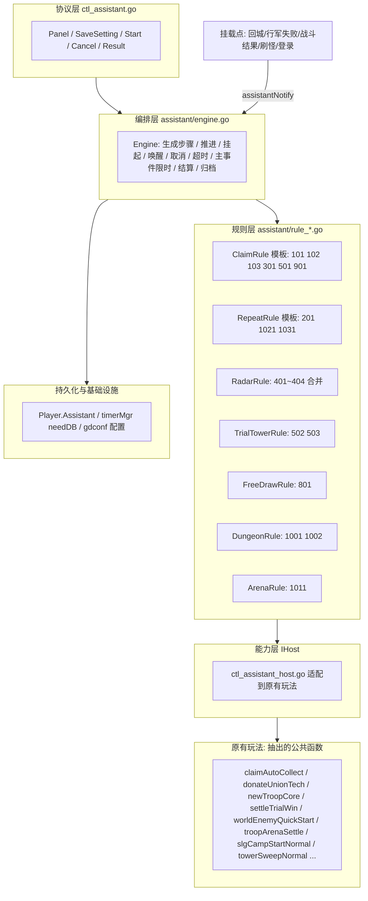
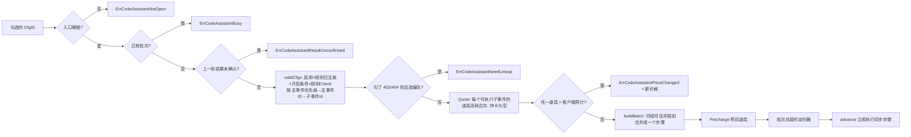
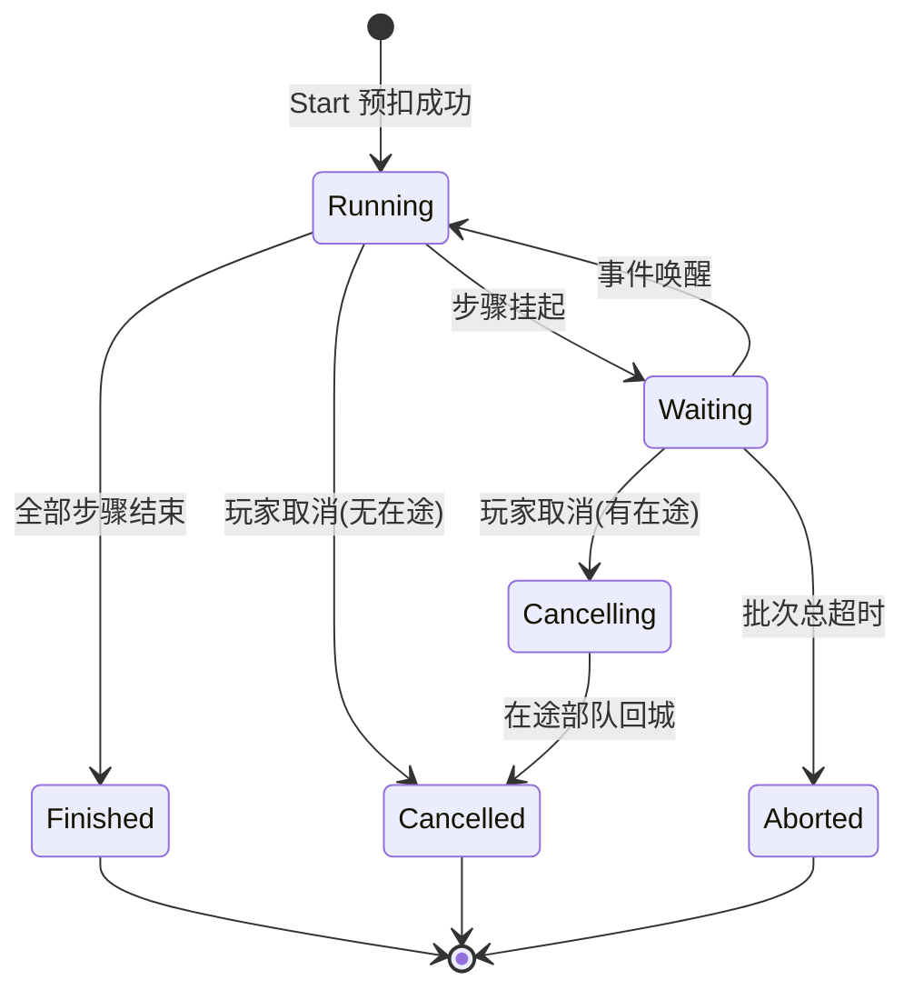
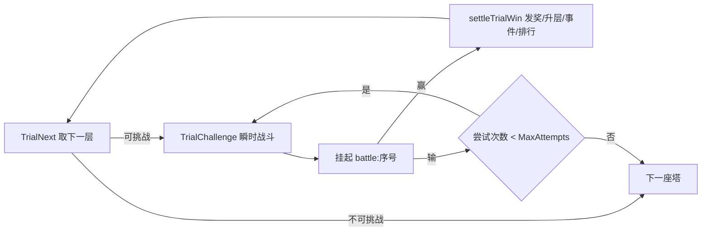
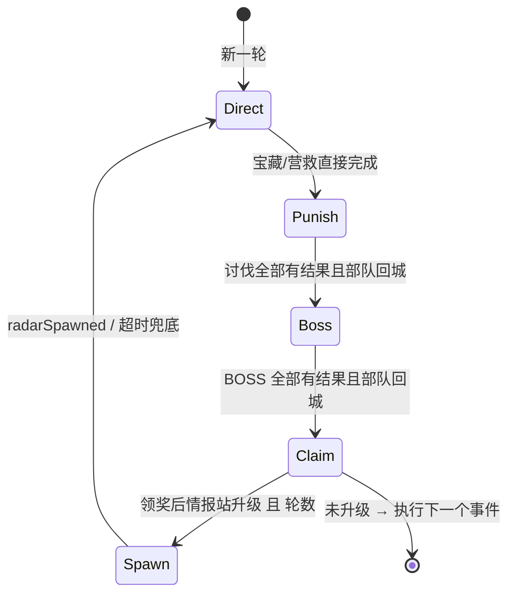
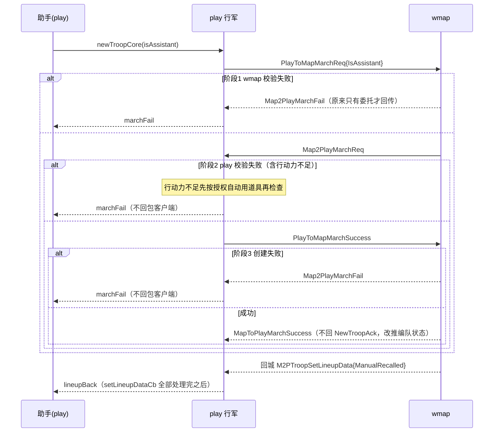

# 指尖助手 服务端设计与实现

> 本文是指尖助手服务端的**最终版**说明，内容与代码一致。早期设计稿见 [[指尖助手功能架构]]，规则来源见 [[指尖助手策划案评审_V1.11]]、[[指尖助手策划案评审]]；错误码见 [[指尖助手_错误码.html]]；配置表的可视化版本见 `指尖助手_配置表.html`。
>
> 代码分支：gs / gdconfig / protocol 均在 `h5_new_tf_v1054_assistant`。protocol 已提交（最新 df106436）；gs 改动**未提交**。

## 一、功能概述

玩家在主城（城堡 ≥150 级）打开指尖助手，勾选要代办的日常，点“开始速办”。服务端按配置顺序一次性执行同步事项（领奖、捐献等），遇到需要等待的事项（战斗结果、情报站行军回城）就挂起，事件到达后继续，全部结束后统一结算，**每个子事件单独收费**（消耗为策划配置的道具），未生效的子事件退还。结束后玩家需**确认结果**才能开下一轮，最近若干轮保存在**执行记录**里。

| 已实现子事件 | 说明 |
| --- | --- |
| 101 领取挂机收益 | 原“领取挂机奖励” |
| 102 广告扫荡 / 103 广告鸡腿 | 需要广告卡；一次领完今日剩余次数 |
| 201 联盟金币捐献 | 优先推荐科技，捐到次数或金币用完 |
| 301 城墙奖励 | 领取城墙仓库资源 |
| 401 地图宝藏 / 402 营救士兵 | **不行军**，直接完成并扣行动力 |
| 403 讨伐情报 / 404 BOSS 情报 | **正常行军**，并行派遣、回城接力、每条最多 3 次 |
| 501 勇者每日奖励 | — |
| 502 勇者试炼 / 503 属性试炼 | 不进副本的瞬时战斗，链式逐层挑战 |
| 801 免费抽卡 | 只用免费次数，绝不转付费 |
| 901 宠物经济技能 | 使用所有不在 CD 的主动奖励类技能 |
| **1001 金币副本 / 1002 龙纹石副本** | 资源副本（世界之敌）快速战斗，一次打完今日剩余次数 |
| **1011 巅峰竞技场** | 积分排位赛，只用免费次数，每场挑战战力最低的对手，不进副本 |
| **1021 军营招兵** | 服务器算出最大可征数量，普通征兵一次征满 |
| **1031 体力扫荡** | 主线塔防普通扫荡，扫到体力不足或今日次数用完 |

未实现：巅峰竞技场的“每日悬赏”（服务端没有对应玩法）、1201 哈罗德（原因见第十章）。

## 二、已定规则（来自评审讨论）

| # | 规则 | 落地方式 |
|---|---|---|
| 1 | 执行顺序：主事件按 `FingertipAssistantGroupCfg.Priority`，主事件内按子事件 `Id` | 引擎按配置生成有序步骤，客户端传入顺序不作数 |
| 2 | 宝藏/营救直接完成并领奖，不行军 | `RadarFinishDirect`：推进任务、扣行动力、删地图怪 |
| 3 | 讨伐/BOSS 正常行军 | 复用原出征逻辑 `newTroopCore`，带助手标记 |
| 4 | 每条情报最多尝试 3 次（含首次），打输不直接失败 | `MaxAttempts=3`；打输返还体力，代价只有兵力 |
| 5 | 编队按编号（槽位下标）升序选取 | `RadarIdleLineups` 按 `GetLineIndex` 排序 |
| 6 | 体力（行动力）不足时自动使用道具 | 玩家授权 + 数量上限；行军检查阶段补足 |
| 7 | 完成对应类型情报后，领奖；**领奖升级则再来一轮**，否则执行下一个事件 | 情报站规则内部阶段机 + `MaxRounds` |
| 8 | 情报站领奖后不会刷新普通情报（代码事实） | 只有升级会刷出新一批；BOSS 链按原玩法；时间段刷新的情报留到下一次速办 |
| 9 | 讨伐/BOSS 完成前不执行后续事件 → 批次可能持续很久 | 批次持久化、定时器落库、登录对账 |
| 10 | 编队被玩家召回/途中改派后，**忙完回来继续派** | 手动接管不计次数、不移出派遣池；等待被占用编队回城（2026-10-15） |
| 11 | 上一轮结果确认后才能开下一轮 | `ErrCodeAssistantResultUnconfirmed`（2026-10-15） |
| 12 | 每个主事件有执行时长限制，超过算超时失败 | `FingertipAssistantGroupCfg.TimeLimit`；规则可自带时限覆盖（2026-10-16） |
| 13 | 竞技场只用免费次数，不扣门票 | 助手不走 `TroopArenaCheckCost`（2026-10-16） |
| 14 | 资源副本历史伤害达到快速扫荡门槛（100 万）才开启 | 沿用原玩法 `Requirements` 校验（2026-10-16） |

## 三、总体架构

**设计原则**
- **编排层不认识任何玩法**，只认识 `IRule` 接口；新增玩法 = 新增规则 + `RegisterRule` + 配置表一行，主流程不改（开闭原则）。
- **规则只调用 `IHost` 接口**，由 `assistantHost` 适配到 `*Play`（依赖倒置、防腐层）；引擎可以用假 Host 做单元测试。
- **原玩法逻辑不复制**：把各 `OnXxxReq` 的“校验 + 执行”抽成公共函数，协议入口和助手共用，手动和助手的数值一致。
- **挂载点只调一个入口** `play.assistantNotify(p, key, payload)`，原玩法里不写助手业务（观察者）。
- **不进副本、不切地图**：需要战斗的玩法（试炼塔、资源副本、竞技场）都直接交给 BATTLECALC 计算后走原结算，玩家留在当前地图。

## 四、编排引擎

代码：`game/play/internal/assistant/engine.go`

### 4.1 规则接口（按能力拆分）

| 接口 | 文件 | 谁实现 | 作用 |
|---|---|---|---|
| `IRule` | `rule.go` | 所有规则 | `SubTypes()` 负责的子事件；`Check()` 只读可用性；`Run()` 开始执行 |
| `IEventRule` | `rule.go` | 试炼塔、情报站、资源副本、竞技场 | `OnEvent()` 被事件唤醒 |
| `ICancelableRule` | `rule.go` | 试炼塔、情报站、资源副本、竞技场 | `OnCancel()` 取消时收尾，返回 Wait 表示还有在途操作 |
| `IReconcileRule` | `rule.go` | 情报站 | `Reconcile()` 登录/重启后对账 |
| `IMergeableRule` | `rule.go` | 情报站 | 同一主事件连续子事件合并成一个步骤 |
| `IPanelRule` | `rule.go` | 多数规则 | 面板展示值（挂机分钟、剩余次数、剩余情报数、当前层、可征数量） |
| `ITimeLimitRule` | `rule.go` | 竞技场 | 规则自带执行时长限制，代替主事件配置的 `TimeLimit` |

规则返回 `Outcome`（`outcome.go`）：`Done` / `Skipped(reason)` / `Failed(reason)` / `Wait(timeout, keys...)`。

### 4.2 开始速办 `Engine.Start`（engine.go:123）

- **只有当前可执行的子事件才计入报价并创建步骤**（例如没有挂机收益就不收挂机组的钱）。
- 设置（所选编队、道具授权）在开始时做**快照**，执行期间只读。
- **上一轮结果必须先确认**：批次结束后结果存在 `AssistantData.Result`，玩家发 `AssistantResultReq{batchId, confirm:true}` 清除之后才能开下一轮，否则返回 `ErrCodeAssistantResultUnconfirmed`(11799)。GM 命令 `assistantRunAll` 会先自动确认旧结果。

### 4.3 推进、挂起与唤醒

- `advance`（engine.go:222）：从游标开始逐个执行；同步步骤直接结束并后移；遇到 `Wait` 就挂起返回。
- `runStep`（engine.go:243）：进入新主事件时开始计时（见 4.6），已超时直接记失败；否则重新校验后执行规则。
- `suspend`（engine.go:323）：记录等待的事件 Key、截止时间（不超过主事件截止时间），`Version+1`，取消旧定时器并创建新的唤醒定时器（落库）。
- `Notify`（engine.go:371）：只有当前步骤正在等待该 Key 时才唤醒，否则丢弃（过期/重复回调天然被过滤）。
- `OnTimer`（engine.go:384）：唤醒定时器只认当前 `Version`，到期投递 `KeyTimeout`；批次总超时直接中止。
- `wake`（engine.go:403）：主事件已超时则直接记超时失败；否则交给规则 `OnEvent`。
- `Resume`（engine.go:432）：玩家登录时，等待已超时的投递超时事件，否则调用规则的 `Reconcile` 对账。

| 等待 Key | 来源挂载点 | 使用者 |
|---|---|---|
| `lineupBack:<编队ID>` | `setLineupDataCb` 末尾（补兵、重算战力之后），带是否被玩家手动接管（召回/途中改派） | 情报站：在途部队回城；所选编队被占用后回城 |
| `marchFail:<编队ID>` | 行军三个阶段的失败回传 | 情报站 |
| `battle:<序号>` | BATTLECALC 回调：试炼塔 `BattlePayload`、资源副本 `DungeonPayload`、竞技场 `ArenaPayload` | 试炼塔、资源副本、竞技场 |
| `radarSpawned` | `OnCreateMonsterReply` 末尾 | 情报站（升级后下一轮） |
| `timeout` | 引擎定时器 | 所有挂起步骤 |

### 4.4 批次与步骤状态

步骤状态（`cspb.AssistantStepState`）：Pending 等待执行 → Running 执行中 → Waiting 挂起 → Done 完成（至少一次生效）/ Skipped 跳过（未执行任何操作）/ Failed 失败 / Cancelled 已取消。步骤的 `reason` 记录跳过/失败/停止的原因。

### 4.5 计费

> 2026-10-14：**收费按每个子事件**（`FingertipAssistantCfg.DiamondCost`），不再按主事件分组。
> 2026-10-15：**消耗不再是钻石，而是策划配置的道具/资源**：`DiamondCost` 类型改为 `[]TypIDVal`（字段名沿用）。

- 开始时预扣 = 本次可执行的每个子事件消耗合并（`gdconf.MergeTypIDVal`），持卡时为空；`Charge.Items` 按子事件 ID 记录消耗与是否生效。
- 报价比较 `costExceeds`（engine.go:60）：服务端报价里**任一道具**数量高于客户端 `expectCost` 中同一道具，就返回 `PriceChanged` 和新报价 `needCost`。
- 预扣/退还走 `CheckDecAssets` / `DecAssets` / `AddAssets`，BI reason 为 `assistant_charge` / `assistant_refund`。
- 规则在该子事件的原功能操作生效时标记生效：单子事件步骤用 `IncDone`；情报站合并步骤用 `IncDoneFor(cfgID)` / `MarkEffectiveCfg(cfgID)` 归属到具体子事件——宝藏/营救按情报任务类型归 401/402，讨伐归 403，情报站BOSS 归 404；派出行军成功即生效。竞技场**战败也算生效**（原挑战已结算）。
- 结束时 `Charge.CalcRefund`（massistant/batch.go:220）：实际消耗 = 生效子事件的消耗合并，退还 = 未生效子事件的消耗合并；`Settled` 标记保证只退一次。
- 结算协议 `AssistantChargeInfo.items` 下发每个子事件的价格与是否生效，客户端可展示“哪些收费、哪些退还”。
- 自动用掉的道具、征兵材料、扫荡体力属于原玩法消耗，不退。

### 4.6 取消与超时

- **取消**（engine.go:462）：不再开始新步骤；当前挂起步骤调用 `OnCancel`。情报站会停止派遣，等在途部队回城后再结束；试炼塔、资源副本、竞技场不再计入在途战斗（原玩法照常结算）。
- **主事件执行时长限制**（`enterGroup` engine.go:265，2026-10-16）：
  - 进入某个主事件的第一个步骤时开始计时，截止 = 开始时间 + 时长限制；同组步骤共用；
  - 时长限制优先取规则的 `ITimeLimitRule.TimeLimit()`，否则取 `FingertipAssistantGroupCfg.TimeLimit`（秒），0 = 不限；
  - 挂起等待不超过截止时间；到点当前步骤记 **Failed(`ErrCodeAssistantTimeout`)**，同组未开始的步骤也记超时失败，**继续下一个主事件**，批次不中止；
  - 超时后在途操作按原玩法结算，结果不再计入；已生效的子事件照常收费。
- **批次总超时**（`abort`，engine.go:495）：当前步骤 Failed(超时)，剩余步骤 Cancelled，状态 Aborted，照常退款。

### 4.7 结果确认与执行记录（2026-10-15）

- 批次结束时 `ArchiveBatch(limit)`（massistant/batch.go:19）：
  - 放进 `Result`（当前未确认的结果）；
  - 追加到 `Records`（执行记录），超过 D2Config `Fingertip_Assistant_Record_Limit`（默认 10）删最早的；
  - 清掉各步骤的规则私有状态 `Data` 与等待信息，减小存储。
- 确认 `ConfirmResult`（batch.go:60）：`Result` 与执行记录里同一批次都标 `Confirmed=true`（从库加载后两者是两份对象），并清掉 `Result`；重复确认无变化。
- `AssistantResultReq` 用 `FindFinished`（batch.go:47）先找未确认结果再找执行记录，历史记录也能查看/确认；确认后再打包，回包带最新 `confirmed`。
- 下发：`AssistantPanelAck.records`（不排序，客户端按 `endTs` 排）；`AssistantResult.confirmed` 在 `ResultNtf`、面板、`ResultAck`、记录里都带，用于红点。刚结束未确认的那一轮同时出现在 `result` 和 `records` 里。

## 五、各规则逻辑

### 5.1 领取 / 重复类（`rule_claim.go`）

| 子事件 | Check | 执行 | 复用的原逻辑 |
|---|---|---|---|
| 101 挂机收益 | 结算后有可领奖励 | 领取 | `claimAutoCollect` |
| 102 广告扫荡 / 103 广告鸡腿 | 有广告卡（`MonthCardTypeAdv`）且今日有剩余次数 | 一次领完剩余次数 | `claimAdvByCard` |
| 201 金币捐献 | 在联盟、剩余捐献次数 >0 | 循环捐献直到失败或达到 `MaxOps` | `pickDonateTech` + `donateUnionTech` |
| 301 城墙 | 仓库有可领资源 | 领取 | `claimWallDepot` |
| 501 勇者日奖 | 试炼塔解锁、今日未领、层数 >0 | 领取 | `claimTrialDaily` |
| 901 宠物经济技能 | 有可用的主动奖励类技能 | 一次全部使用 | `usePetSkills` + `PetSkill.ReadyEconomyBuffs` |
| 1021 军营招兵 | 已解锁、不在生产中、材料至少够征 1 个 | 按最大可征数量普通征兵一次 | `slgCampStartNormal` |
| 1031 体力扫荡 | 主线塔防已开启、背包放得下、体力够、今日次数未用完 | 循环扫荡直到不满足或达到 `MaxOps` | `towerSweepNormal` |

捐献目标：**优先推荐科技**，其次按科技组 ID 升序，跳过满级、经验已满、研究中的科技。

**1021 军营招兵**（2026-10-16）
- 可征数量 `slgCampAffordable`（ctl_slgcamp.go:268）= min(单次上限 `ReserveNumBase + PropReserveNumAdd`，每种材料 `拥有 / RecruitmentCost`)。
- 发起生产即算完成，不等生产结束；扣掉的材料记入结算“消耗”，预备兵按原玩法生产时间入账，不出现在奖励里。
- 不可用时透传原玩法错误码：未解锁 `ErrCodeSlgCampNotUnlock`、生产中 `ErrCodeSlgCampWrongStatus`、材料不足为资源不足错误码。

**1031 体力扫荡**（2026-10-16）
- 等同客户端 `TowerSweepReq{SweepType:0, TdTyp:TinyType_TowerDefense}`。
- 每次扣当前最高章节的扫荡体力（`GetChanllengeCost(..., isSweep=true)`），今日上限 `AdvPostCfg(RawTowerSweep).Times`。
- 不自动用道具补体力；奖励记“奖励”，体力记“消耗”。

### 5.2 免费抽卡（`rule_extra.go`）
- `ExecuteParams` 为卡池 ID 列表（默认 `[2,3]` 普通/高级），按顺序用完免费次数。
- 调用 `heroLottery` 时 `CostType=1`（只用免费），免费不足时原玩法直接失败，**不会扣钻石**。

### 5.3 试炼之塔（`rule_trial.go`）

- 502 只打勇者塔；503 依次打冰、火、光、毒四座属性塔（代码里没有“弓塔”）。
- `TrialNext` 校验（ctl_assistant_host.go）：试炼塔解锁、**玩家不在试炼副本里**、**跳过战斗已解锁**（勇者层数 ≥ `TrialTowerJumpFightingUnlocking`，否则等于白送跳过）、**今日开放**（属性塔开放日 1~7，原来只有客户端拦）、每日次数、属性塔该兵种有英雄、该层配置存在、属性塔每层的勇者层数门槛 `AttributeTowerUnlock`。
- 编队准备与进副本一致：勇者塔同步主编队，属性塔只用 1 号编队；兵力按试炼规则补满，不消耗玩家兵力。
- 每次挑战补发 `EventTrialTowerChallenge`（原来只在副本开打时发）。
- 勇者塔用 `MaxOps` 限制单次推进层数（默认 50），避免一次打几十层。

### 5.4 情报站（`rule_radar.go`）

401~404 合并为一个步骤，内部按阶段执行，状态存在 `Step.Data`：

**情报类型映射（代码事实）**

| `RadarDotCfg.QuestType` | 怪物 | 处理 |
|---|---|---|
| 11 | 情报站-宝箱（Category 22） | 401 直接完成 |
| 12 | 情报站-营救（Category 21） | 402 直接完成 |
| 13 | 普通野怪 | 403 行军 |
| 14 | 情报站-玩家战斗（Category 23） | 403 行军 |
| 22 | 理查德（集结怪，Category 25） | **不代打** |
| `TinyType_RadarBoss` | 情报站-Boss（Category 24） | 404 行军 |

**快照**：只取进行中、怪已刷出（有坐标）、没有部队在途攻击的情报；按怪等级降序、questId 升序。新出现的情报只在下一轮快照纳入。

**“第几轮”**：一轮 = 直接完成 → 讨伐 → BOSS → 一键领奖。领奖后情报站升级会按新等级刷出一批情报，助手等怪刷出后再跑一轮，最多 `MaxRounds` 轮；当前轮次通过 `AssistantStepInfo.round` 下发。产出到上限（没有可打的情报）时自然结束，不等下一个时间段刷新。

**直接完成（401/402）**：按原玩法的行动力消耗扣除（不足时按授权自动用道具）→ 调用 `finishRadarMonster`（推进 `EventFinishRadarMonster` / `EventPveRadarQuestCnt` / BI）→ 删除地图上的怪。

**行军（403/404）**
- 每次推进：所有空闲的所选部队按编号顺序，各领一条队首情报并行派出；派出成功即计费生效。
- **部队回城**：情报已完成 → 成功；被玩家手动接管（召回或途中改派）→ 不计次数，情报放回队首，**部队仍留在派遣池**，空闲后继续派；打输 → 次数未满放回队首，满了记失败。
- **行军创建失败**：行动力不足/地图不对/城堡被攻击/远征末期为**终止性**原因，本阶段停止派遣；其他原因按重试处理。
  - 行动力在 play 阶段2 才检查，失败是**异步**回传的：`RadarDispatch` 当场返回成功，之后才收到 `marchFail`。出现终止性原因后 `dispatchIdle` 直接返回（rule_radar.go:508），否则失败的情报放回队首后会被反复派出、刷 `CheckDecAssets` 报错（2026-10-15 修复）。
- **所选部队被其他玩法占用**（`busyLineups` rule_radar.go:130）：
  - 有在途部队时，挂起等待的 Key 除了在途部队，还包括所选编队中“不在城内、也不是助手派出”的编队的 `lineupBack`，它们一回城就接着派；
  - 所选部队全都被占用时**不记受阻**，等它们回城；只有所选部队在城内但都不可用时才记受阻，按 `Retry_Interval` 重试，次数用尽记失败；
  - 编队一直不回来（如长期驻防）时，最长等到主事件时长限制或批次总超时。
- **超时对账**：检查在途部队是否已在城，已在城按回城处理（防止回城消息丢失）。

**领奖与升级循环**：一次性领取情报站与情报站 BOSS 的全部已完成任务（`claimTinyQuests`），比较领奖前后情报站等级；升级则等新怪刷出（`radarSpawned`）后开始下一轮。

**前置条件**（`RadarAllowed`）：玩家在主大地图或远征地图、不在远征末期、城堡未被攻击。

### 5.5 行动力自动补足（`ctl_assistant.go: assistantTopUp`）
- 只有玩家在设置里勾选“自动使用道具”才生效，受 `StaminaItemLimit` 限制（0=不限）。
- 候选道具：D2Config `Fingertip_Assistant_Stamina_Items` 按顺序；为空则自动识别效果为该资源的道具，按面额从小到大。
- 只补到够本次消耗；用掉的道具计入当前步骤的“自动消耗”和批次额度。
- 触发点：讨伐/BOSS 在行军第二阶段（`OnMap2PlayMarchReq`）检查行动力时；宝藏/营救直接完成扣行动力时。

### 5.6 资源副本 = 世界之敌（`rule_dungeon.go`，2026-10-16）

- 代码里叫“世界之敌”：`InjuryTestingBoosTypeCfg` 每行一个副本（1 金币、2 龙纹石，分别由 `InjuryTesting_Open_Conditions` / `Drangon_open_chapter` 解锁）。
- 2026-10-16 拆成两个子事件：**1001 金币副本 → 世界之敌 1**，**1002 龙纹石副本 → 世界之敌 2**（`dungeonOfSubType`，subtype.go）；同属主事件 10，不合并，各自计费。`ExecuteParams` 填了则以配置为准。
- 每个子事件：可打则发起一次快速战斗（`worldEnemyQuickStart`），**一次打完今日剩余次数**；挂起等 `battle:<序号>`。
- 可打的条件（`DungeonAvailable`）：已解锁；跨天补次数后今日剩余 >0；**历史最高伤害 ≥ `Requirements`（快速扫荡所需伤害，当前 100 万）**——与客户端点“扫荡”的规则一致，没达标的玩家这一项不可用（`ErrCodeUnavailable`）。
- 结果：结算成功 = 完成；战斗超时或异常记失败（步骤 Failed 并退款）。
- 助手校验/发起时会临时切换玩家“当前选中的世界之敌副本”（`we.CfgId`），调用完恢复，不影响玩家正在看的界面。

### 5.7 巅峰竞技场积分排位赛（`rule_arena.go`，2026-10-16）

- 等同玩家点挑战后选对手打，但**不进副本**：直接用跳过战斗的推演（`trenaQueckAttack`，起始坐标与兵力传空 = 从头打），再走原积分赛结算。
- 每场：对手列表为空先刷新；选**战力最低**的对手（不含自己）；**只用免费次数**（`TopArena_Initial_Times`，不扣门票）；结算后刷新对手列表，下一场重新选。
- 可挑战条件（`ArenaAvailable` ctl_assistant_host.go:399）：`Unlock_TopArena`、竞技场开放且不在每日结算时段、玩家不在竞技场副本、有免费次数。**不受跳过战斗的积分要求（`TopArena_Battle_Skip_Condition`）限制**。
- 胜记 `doneCnt`、负记 `failCnt`，胜负都拿代币、都算生效收费；免费次数用完或达到 `MaxOps` 结束；停止原因写入步骤 `reason`。
- 时限：实现 `ITimeLimitRule`，**整体 3 分钟**，不使用主事件配置的 `TimeLimit`；单场最多等 60 秒。
- 战斗服务异常（回包为空）：退回本次免费次数并停止。
- 日志：`assistant arena challenge / settle / finish`（都带玩家 ID、对手、胜负、积分、免费次数、停止原因）。

## 六、持久化

代码：`game/play/internal/mplayer/massistant/`，挂在 `Player.Assistant`（bson `assistant`），访问 `p.GetAssistant()`（旧数据自动初始化）。

| 结构 | 关键字段 |
|---|---|
| `AssistantData` | `Settings` 玩家设置；`Batch` 当前批次；`Result` 最近一次未确认结果；`Records` 执行记录 |
| `Settings` | `SelectedCfgIDs` 勾选；`RadarLineupIDs` 派遣编队；`AutoUseStamina` 授权；`StaminaItemLimit` 上限 |
| `Batch` | `BatchID`、`State`、`Cursor`、`Steps`、`Charge`、`Settings` 快照、`ConsumeUsed` 已用道具、`Version`、`CancelFlag`、两个定时器 ID、`Confirmed` 是否已确认、`GroupID`/`GroupEndTs` 正在计时的主事件与截止时间 |
| `Step` | `CfgIDs`、`SubType`、`GroupID`、`State`、`Reason`、`WaitKeys`、`WaitUntil`、`Data`（规则私有状态 bson，归档时清空）、`DoneCnt`/`FailCnt`/`Round`、`Awards`/`Costs` |
| `Charge` | `FreeCard`、`PrepaidCosts`、`Items`（子事件ID → `ChargeItem{Costs, Effective}`）、`Settled`、`ActualCosts`、`RefundCosts`；消耗均为 `[]*cspb.TypIDVal` |

- 规则私有状态用 bson 存进 `Step.Data`，新增规则**不用改批次结构、不用重跑 deepcopy**。
- 计费字段由 `Prepaid/Actual/Refund/Cost`（int64）改名为 `PrepaidCosts/ActualCosts/RefundCosts/Costs`（道具列表）：改名是为了让库里旧的 int64 数据被 bson 忽略，而不是解码报错；代价是改动前进行中的旧批次结束时不会退款。
- 每个玩家最多多存 `Record_Limit` 份批次（含步骤明细），存档相应变大。
- 定时器类型 `TimerTypeAssistant = 3860`，`needDB=true`，重启后仍会触发。

## 七、协议

protocol 已提交：2af256bc（初版）→ fb241eb2（结果确认错误码、费用明细）→ 1cf5197e（消耗改为道具）→ df106436（执行记录、确认状态）。全部字段均有注释。

| 协议 | 说明 |
|---|---|
| `AssistantPanelReq/Ack` | 面板：各子事件可用状态与展示值、设置、当前批次、未确认结果、**执行记录 `records`**、预计费用、是否持卡 |
| `AssistantSaveSettingReq/Ack` | 保存勾选、派遣编队（只保留玩家拥有的普通编队）、道具授权与上限 |
| `AssistantStartReq/Ack` | 开始：勾选的 CfgId + 客户端预计费用 `expectCost`；任一道具报价更高时拒绝，并在 `needCost` 返回新价格 |
| `AssistantCancelReq/Ack` | 取消当前批次 |
| `AssistantResultReq/Ack` | 查看/确认结果（未确认结果或执行记录中的批次）；`confirm=true` 标记已确认并清除未确认结果，清除后才能开始下一轮 |
| `AssistantProgressNtf` | 步骤状态变化时推送 |
| `AssistantResultNtf` | 批次结束推送；登录时也会推送未确认结果 |

结构体：`AssistantTaskInfo`、`AssistantSettings`、`AssistantChargeInfo`（含 `items` 每个子事件的收费明细）、`AssistantChargeItem`、`AssistantStepInfo`、`AssistantBatchInfo`、`AssistantResult`（含 `confirmed` 红点用）；枚举 `AssistantBatchState`、`AssistantStepState`；错误码 `ErrCodeAssistant*`（11780~11799），明细见 [[指尖助手_错误码.html]]。

费用相关字段均为 `repeated TypIDVal`：`AssistantPanelAck.expectCost`、`AssistantSaveSettingAck.expectCost`、`AssistantStartReq.expectCost`、`AssistantStartAck.needCost`（原 `needDiamond`）、`AssistantChargeInfo.prepaid/actual/refund`、`AssistantChargeItem.cost`。

## 八、配置表设计

### 8.1 为什么需要这些表

| 表 | 作用 | 没有它会怎样 |
|---|---|---|
| `FingertipAssistantCfg`（新增） | 定义能做哪些事、主事件内顺序、价格、每件事的参数 | 顺序、开关、重试次数写死在代码里 |
| `FingertipAssistantGroupCfg`（新增） | 主事件执行优先级与执行时长限制 | 调整主事件先后要改大量子事件 Id；无法限时 |
| `D2ConfigCfg` 新增 7 行 | 持卡免费、超时、重试间隔、道具、执行记录上限 | 无法线上调整 |
| `UnlockConfigCfg` 新增 1 行 | 主城入口解锁 | 解锁条件写死 |

### 8.2 FingertipAssistantCfg

| 字段 | 类型 | 导出 | 说明 |
|---|---|---|---|
| `Id` | int | cs | 唯一编号，**同一主事件内的执行顺序**；上线后不改（玩家勾选按 Id 保存） |
| `GroupId` | int | cs | 主事件 ID（`FingertipAssistantGroupCfg`）：决定主事件优先级；情报站 401~404 据此合并为一个步骤 |
| `SubType` | int | cs | 规则类型，对应 `RegisterRule` |
| `NameKey` | string | c | 子事件名称多语言 Key |
| `Description` | int | cs | 子事件描述显示（客户端用） |
| `DiamondCost` | TypIDVal[] | cs | **该子事件的消耗**（策划配置的道具/资源），单独收费，未生效退还 |
| `UnlockCondition` | int[] | cs | `ConditionCfg` ID，全部满足才可选 |
| `MaxOps` | int | cs | 单次最多操作次数，0=按原玩法上限 |
| `MaxAttempts` | int | cs | 单个目标最多尝试次数（含首次） |
| `MaxRounds` | int | cs | 最多循环轮数（情报站升级循环） |
| `ExecuteParams` | int[] | cs | 规则专用参数（情报类型、卡池 ID、世界之敌副本 ID） |
| `IsEnabled` | int | cs | 0 关闭 / 1 开启 |
| `DefaultSelected` | int | c | 首次默认勾选 |
| `Comment` | string | s | 备注 |

当前数据（消耗均为 `vm 11151002`，列中只写数量）：

| Id | Group | SubType | 消耗 | MaxOps | MaxAttempts | MaxRounds | ExecuteParams | 默认勾选 | 说明 |
|---|---|---|---|---|---|---|---|---|---|
| 101 | 1 | 101 | 10 | 0 | 0 | 0 | [] | 1 | 领取挂机收益 |
| 102 | 1 | 102 | 10 | 0 | 0 | 0 | [] | 0 | 广告扫荡 |
| 103 | 1 | 103 | 10 | 0 | 0 | 0 | [] | 0 | 广告鸡腿 |
| 201 | 2 | 201 | 10 | 0 | 0 | 0 | [] | 0 | 金币捐献 |
| 301 | 3 | 301 | 5 | 0 | 0 | 0 | [] | 1 | 城墙奖励 |
| 401 | 4 | 401 | 15 | 0 | 0 | 10 | [11] | 1 | 地图宝藏 |
| 402 | 4 | 402 | 15 | 0 | 0 | 10 | [12] | 1 | 营救士兵 |
| 403 | 4 | 403 | 15 | 0 | 3 | 10 | [13,14] | 0 | 讨伐情报 |
| 404 | 4 | 404 | 15 | 0 | 3 | 10 | [] | 0 | BOSS 情报 |
| 501 | 5 | 501 | 20 | 0 | 0 | 0 | [] | 1 | 勇者每日奖励 |
| 502 | 5 | 502 | 20 | 50 | 3 | 0 | [] | 0 | 勇者试炼 |
| 503 | 5 | 503 | 20 | 0 | 1 | 0 | [] | 0 | 属性试炼 |
| 801 | 8 | 801 | 5 | 0 | 0 | 0 | [2,3] | 1 | 免费抽卡 |
| 901 | 9 | 901 | 5 | 0 | 0 | 0 | [] | 1 | 宠物经济技能 |
| 1001 | 10 | 1001 | 5 | 0 | 0 | 0 | []（=世界之敌 1） | 1 | 金币副本 |
| 1002 | 10 | 1002 | 5 | 0 | 0 | 0 | []（=世界之敌 2） | 1 | 龙纹石副本 |
| 1011 | 11 | 1011 | 5 | 5 | 0 | 0 | [] | 1 | 巅峰竞技场积分赛 |
| 1021 | 12 | 1021 | 5 | 0 | 0 | 0 | [] | 1 | 军营招兵 |
| 1031 | 13 | 1031 | 5 | 0 | 0 | 0 | [] | 1 | 体力扫荡 |

加载校验（`gdconf/conf_fingertipassistant_ext.go`）：`GroupId` 必须在主事件表中存在，否则启动报错；按“主事件优先级 → 主事件ID → 子事件Id”排好序缓存。

### 8.3 FingertipAssistantGroupCfg（主事件）

| 字段 | 类型 | 导出 | 说明 |
|---|---|---|---|
| `Id` | int | cs | 主事件ID，子事件表 `GroupId` 引用 |
| `NameKey` | string | c | 主事件名称多语言 Key（面板分组名） |
| `Priority` | int | cs | **执行优先级，越小越先执行**；相同时按主事件ID |
| `TimeLimit` | int | cs | **执行时长限制（秒）**，0=不限；规则自带时限时以规则为准（竞技场 3 分钟） |
| `Description` | int | cs | 是否显示总描述（客户端用） |
| `Comment` | string | s | 备注 |

| Id | NameKey | Priority | TimeLimit | 说明 |
|---|---|---|---|---|
| 1 | Assistant_Idle_Reward | 10 | 10 | 挂机奖励 |
| 2 | Assistant_Alliance_Tech | 20 | 10 | 联盟科技 |
| 3 | Assistant_Wall_Reward | 30 | 10 | 城墙奖励 |
| 4 | Assistant_Intelligence | 40 | 600 | 情报站 |
| 5 | Assistant_Trial_Tower | 50 | 10 | 试炼之塔 |
| 8 | Assistant_Free_Recruit | 80 | 10 | 免费抽卡 |
| 9 | Assistant_Pet_Skill | 90 | 10 | 宠物经济技能 |
| 10 | Assistant_Resource_Dungeon | 100 | 10 | 资源副本 |
| 11 | Assistant_Peak_Arena | 120 | 10（不生效，规则自带 3 分钟） | 巅峰竞技场 |
| 12 | Assistant_Barracks_Recruit | 130 | 10 | 军营招兵 |
| 13 | Assistant_Stamina_Sweep | 140 | 10 | 体力扫荡 |

**执行顺序** = 主事件 `Priority` 升序 → 主事件 ID 升序 → 子事件 `Id` 升序。

> 注意：试炼塔、资源副本都是异步战斗，10 秒限时可能偏紧；若出现“超时失败”，优先调大对应主事件的 `TimeLimit`。

### 8.4 D2ConfigCfg 新增（1862~1868）

| ID | Constant | Val / Array | 说明 |
|---|---|---|---|
| 1862 | `Fingertip_Assistant_Free_Card` | 0 | 持该月卡类型免助手费用，0=无（**待定**） |
| 1863 | `Fingertip_Assistant_Node_Timeout` | 1800 | 异步步骤单次等待超时（秒） |
| 1864 | `Fingertip_Assistant_Batch_Timeout` | 21600 | 批次总超时（秒） |
| 1865 | `Fingertip_Assistant_Retry_Interval` | 30 | 编队受阻重试间隔（秒） |
| 1866 | `Fingertip_Assistant_Spawn_Wait` | 10 | 升级后等待刷怪（秒） |
| 1867 | `Fingertip_Assistant_Stamina_Items` | 0 | 补行动力道具（按顺序）；为空时自动识别 |
| 1868 | `Fingertip_Assistant_Record_Limit` | 10 | 执行记录保留条数 |

### 8.5 UnlockConfigCfg 新增

| ID | Constant | hq | 说明 |
|---|---|---|---|
| 1107 | `FingertipAssistant` | 150 | 主城入口，城堡 ≥150 级；代码常量 `gdconf.Fingertipassistant`（`make conf` 生成的名字） |

### 8.6 怎么配置
- **调主事件先后**改 `FingertipAssistantGroupCfg.Priority`；**调主事件内子事件先后**改子事件 `Id`；**关闭**改 `IsEnabled=0`；**改价**改子事件表的 `DiamondCost`（进行中的批次不受影响）。
- **限时**改 `FingertipAssistantGroupCfg.TimeLimit`（秒）。
- **开启条件**：在 `ConditionCfg` 建条件，把 ID 填进 `UnlockCondition`（如属性试炼“城堡120级解锁”）。
- **情报站范围**：401/402/403 的 `ExecuteParams` 填 QuestType；**资源副本** 1001/1002 留空即按子事件对应世界之敌 1/2，填了以配置为准。
- **生效**：tsv 提交 gdconfig 后按常规流程导入配置库；两张新表不在热更白名单，改后需重启 game 服。

## 九、对原有代码的逻辑改动

> 原则：抽出公共函数，**原协议入口改为调用它，对外行为不变**；助手相关的分支都以 `IsAssistant` 或批次存在为前提。

### 9.1 抽出的公共函数（play）

| 原入口 | 抽出的函数 | 位置 | 行为变化 |
|---|---|---|---|
| `OnAutoCollectGetReq` | `claimAutoCollect` | ctl_autocollect.go:176 | 无 |
| `OnViewAdvReq` 广告卡分支 | `isAdvCardSource` / `advCardLeft` / `claimAdvByCard` | ctl_tiny_tower_talent.go:569~585 | 无；新增参数 `clientReported`（协议入口=1，助手=0，社区看广告计数补全） |
| `OnWallAppointGetRewardReq` | `wallDepotHasReward` / `claimWallDepot` | ctl_wall.go:577~587 | 无 |
| `OnUnionTechDonateD2Req` | `donateUnionTech` / `pickDonateTech` | ctl_union_tech.go:74 / 180 | **修复**：原代码 `append` 到配置的 `UpgradeCost01` 切片，可能污染配置；改为复制 |
| `OnGetTrialTowerDailyRewardReq` | `checkTrialDaily` / `claimTrialDaily` | ctl_trial_tower.go:168 / 185 | 多了日奖配置为空的保护 |
| `TrialAttack` | `buildTrialBattleReq` | ctl_trial_tower.go:522 | 无；可传入指定编队 |
| `TrialQuickAttackEnd` | `settleTrialWin` | ctl_trial_tower.go:573 | 无 |
| `OnNewQuestAwardsReq` | `claimTinyQuests` | ctl_tiny_play.go:67 | 无 |
| `radarNpcDeadEvent` | `finishRadarMonster` | ctl_tiny_radar.go:82 | 事件参数在回调外读取，逻辑不变 |
| `newTroop` | `newTroopCore` | ctl_lineup.go:1115 | 无；返回错误码，由外层决定是否回包 |
| `OnHeroLotteryReq` | `heroLottery` / `heroFreeDrawAvailable` | ctl_hero.go:1928 / 2084 | 无 |
| `OnUsePetSkillReq` | `usePetSkills` | ctl_pet.go:238 | 无 |
| —（新增） | `PetSkill.ReadyEconomyBuffs` | mplayer/mpet/pet_skill.go:123 | 只读 |
| `OnWorldEnemyQuickBattleReq` | `worldEnemyQuickCheck` / `worldEnemyQuickStart` / `settleWorldEnemyQuick` | ctl_world_enemy.go:1095 / 1122 / 1155 | **修复**：战斗回包为空不再 panic（按未结算处理，不发奖不扣次数）；按发起时的副本结算并恢复玩家当前选中的副本 |
| `OnTroopArenaJumpBattleReq` | `trenaQueckAttack(…, targetID, …)` / `getTroopResultByQuick(…, targetID, …)` | ctl_troop_arena.go:712 / 585 | 对手 ID 改为显式传入，不读玩家身上的“当前对手”；原入口传原值，行为不变 |
| `troopArenaMapEnd` | `troopArenaSettle(ack, isJump, noMap)` | ctl_troop_arena.go:1394 | 原副本流程 `noMap=false` 不变；助手 `noMap=true`：不校验所在副本、不 `leaveMap` |
| `OnSlgCampProduceReq` 普通征兵 | `slgCampUnlockCode` / `slgCampMaxCount` / `slgCampCost` / `slgCampAffordable` / `slgCampStartNormal` / `slgCampProducedEvent` | ctl_slgcamp.go:229~305 | 快速/钻石征兵不变；解锁配置缺失时由“成功”改为 `ErrCodeServerData` |
| `OnTowerSweepReq` 体力扫荡分支 | `towerSweepNormalCheck` / `towerSweepNormalLeft` / `towerSweepNormal` | ctl_tiny_tower_single.go:506~546 | 无；广告分支删掉了多余的 `sweepType == 1` 判断 |

### 9.2 行军链路（play + wmap + iproto）

| 改动 | 位置 |
|---|---|
| `marchCtx.isAssistant`；`newTroopCore` 把它带到 `PlayToMapMarchReq.IsAssistant` | play/ctl_lineup.go:1196，iproto/p2m.go:478 |
| wmap 阶段1 失败：委托**或助手**都回传 `Map2PlayMarchFail` | wmap/ctl_lineup.go:165 |
| play 阶段2 失败：助手走 `assistantOnMarchFail`，不回包 | play/ctl_lineup.go:1593 |
| play 阶段2 行动力检查：助手派遣挂 `TopUp` 回调 | play/ctl_lineup.go:1633，ctl_troop.go:53/183 |
| 阶段3 失败 `OnM2PMarchFail`：助手通知后返回，不回包 | play/ctl_lineup.go:1831 |
| 创建成功：助手不回 `NewTroopAck`，改推编队状态 | play/ctl_lineup.go:1918 |
| 回城：`setLineupDataCb` 用 defer 在所有处理结束后通知 | play/ctl_lineup.go:3319 |
| 手动接管标记：`RecallTroop` 召回成功后 `SetManualRecalled(true)` | wmap/ctl_march.go:1079，mtroop/player_troop.go:91 |
| 手动接管标记：途中改派 `OnP2MNewMarchCheckSuccess` 成功后同样 `SetManualRecalled(true)` | wmap/ctl_march.go:509 |
| 回城消息带上标记 | wmap/ctl_playertroop.go:1057，iproto/m2p.go:495 |

### 9.3 其他挂载

| 改动 | 位置 |
|---|---|
| 情报怪刷出后通知 `radarSpawned` | play/ctl_tiny_radar.go:281 |
| 登录事件 `assistantOnLogin`（对账 + 推送进度/结果） | play/event.go |
| 5 个协议注册 | play/handler.go |
| 定时器 `TimerTypeAssistant=3860` 注册 | play/module.go，types/def.go |
| `Play.assistantEng` 引擎（惰性创建） | play/module.go |
| BI reason：`assistant_charge`(660) / `assistant_refund`(661) / `assistant_use_item`(662) | game/bi/def/const.go |
| gdconf：两张表的加载、注册、`cfg_func_map`、D2Config/Unlock 常量 | gdconf/ |
| GM 命令 `assistantRunAll`：自动确认旧结果后执行全部可用事件 | play/ctl_assistant_cmd.go |

### 9.4 已修复的问题（联调中发现）

| 问题 | 原因 | 修复 |
|---|---|---|
| 情报站行动力不足时反复派遣、刷 `CheckDecAssets` 报错 | 行军失败异步回传后情报放回队首、次数 -1，`dispatchIdle` 不看终止性原因 | 出现终止性原因后本阶段不再派遣 |
| 编队被召回/改派后助手不再使用 | 召回被移出派遣池；改派无标记，回城被当成打输 | 改派也打手动接管标记；手动接管不移出派遣池；等待被占用编队回城 |
| 竞技场一场都打不成，60 秒后超时 | 助手不进副本，结算通知没有 `Buffer`，写战斗记录 `getBattleData` 空指针 panic | `arenaSettle` 补 `Buffer{UpPid: 对手, DownPid: 自己}`（无增益按钮） |
| 竞技场 10 秒主事件限时内打不完 | 异步推演 + 多场串行 | 竞技场自带 3 分钟总时限 |

## 十、未实现与待确认

| 项 | 说明 |
|---|---|
| 巅峰竞技场“每日悬赏” | 服务端只有解锁常量 `Unlock_Daily_Copy`，没有业务代码，需要策划说明具体玩法 |
| 通用扫荡（玩法清单） | 目前只实现了主线塔防体力扫荡（1031）；其他玩法需策划列出 |
| 1201 哈罗德 | 评审建议首版去掉 |
| 体力扫荡是否自动用道具补体力 | 目前体力用完即停 |
| 持卡卡种 | `Fingertip_Assistant_Free_Card` 待定 |
| 开启条件 | 需要填 `ConditionCfg` ID |
| 多语言 | 所有 `NameKey` 待补 |
| 打开面板的副作用 | `UnionDonateLeft` 每次 `RefreshRecoverAsset` 会推 `AssetNtf`（一次面板 3 次）；`AutoCollectMinutes`、`WallHasReward` 会结算挂机/城墙收益 |
| 离线玩家内存驻留 | 批次等待期间定时器/事件会刷新访问时间，离线玩家最长驻留到批次总超时 |

## 十一、测试与上线

- **单元测试**：`assistant/engine_test.go`（假 Host）覆盖同步完成、按 Id 顺序、报价/持卡/未选编队、情报站并行派遣与接力、打输重试、手动接管后回城继续派、所选部队被占用时等待回城、异步行军失败（行动力不足）不重复派遣、升级再来一轮、行动力不足终止并退款、上一轮结果未确认不能开新一轮、执行记录上限与确认状态、多道具报价比较、主事件限时与规则自带时限、资源副本（金币/龙纹石拆分）、竞技场（胜负计入/MaxOps/异常退款）、军营招兵、体力扫荡、取消、批次超时、试炼塔链式挑战与过期回包；`gdconf/conf_fingertipassistant_ext_test.go` 覆盖排序与校验。均通过。
- play 包原有测试中 `TestUnionQuickFilterByLanguage*`、`TestPackUnionPlayer*` 在未改动的 HEAD 上同样失败，与本需求无关；play 包 vet 有大量历史告警，测试需 `-vet=off`。
- **联调中**，重点验证：行军三阶段失败回传、手动召回/改派标记、被占用编队回城后接力、离线回城接力、重启后定时器与对账、道具退款只发生一次、竞技场结算与战斗记录、金币/龙纹石副本（需历史伤害 ≥100 万的号）。
- 上线步骤：gdconfig 新表 `FingertipAssistantCfg`、`FingertipAssistantGroupCfg` 与新增行导入配置库 → 发布 gs → 客户端对接协议与多语言。
