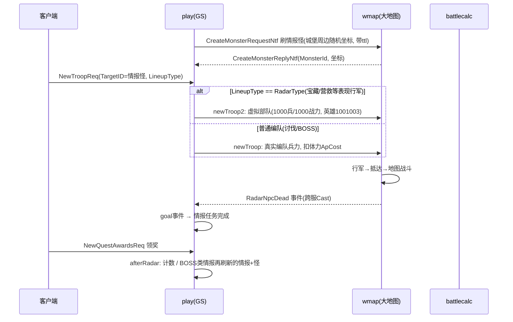
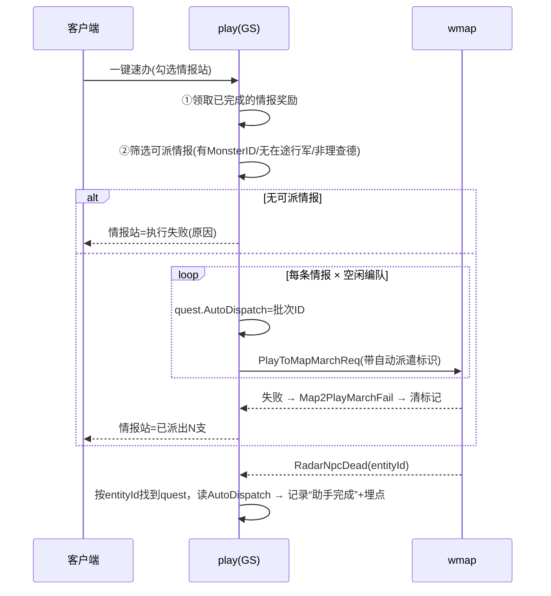
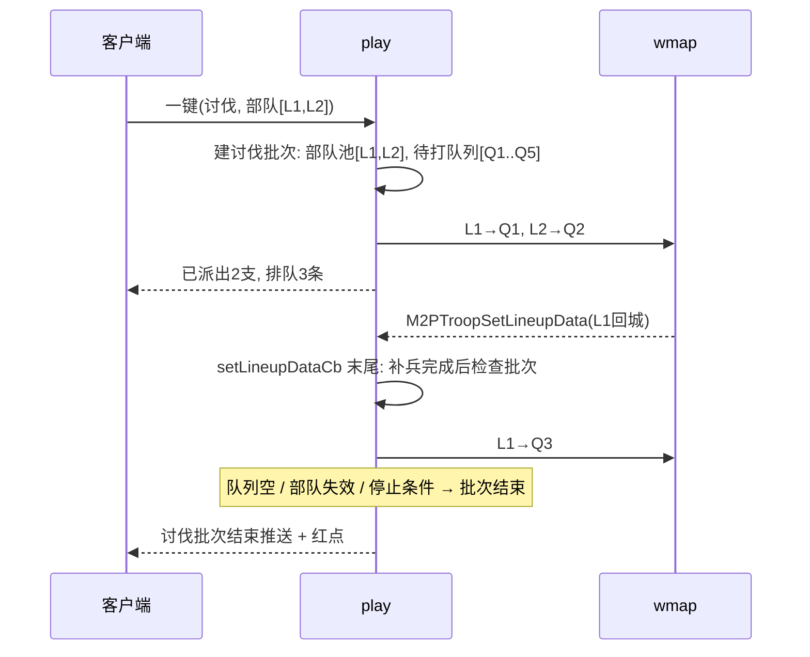

# 指尖助手 策划案评审（基于 V1.9）

> 源文档：`指尖助手策划案.html`（策划：程丹阳，V1.9，2026.10.09）
> 后续复审：[[指尖助手策划案评审_V1.11]]

## 一、主要功能

把玩家每天要做的重复日常**一键完成**：点击后服务端一次性执行勾选的任务，并弹一次统一结算。（策划案 V1.9 原文写的是“后台执行”，2026-10-11 已确认改为一键完成。）

| 维度 | 内容 |
|---|---|
| 入口 | 主城入口，`UnlockConfigCfg.tsv` Key=`FingertipAssistant`，城堡等级≥150 |
| 流程 | 勾选任务 → 报价 → 提交（扣钻石/持卡免费）→ 服务端一次性执行 → 统一结算 |
| 收费 | 按**任务分组**固定钻石价；分组只要有 1 次操作生效就全额收费，完全未执行的分组退款；持指定卡免费 |
| 任务范围 | 挂机奖励（领取/广告扫荡/广告鸡腿）、联盟科技捐献、城墙奖励、情报站（宝藏/营救/讨伐/BOSS）、试炼之塔（日奖/勇者/四属性塔）；扩展：资源副本、竞技场、免费抽卡、宠物技能、军营招兵、通用扫荡、体力扫荡/鸡腿购买 |
| 原则 | 不绕过原玩法的次数、资源、战斗、免广告条件；奖励在单次操作成功时即时发放，弹窗只展示 |
| 可靠性 | 请求去重、扣费与发奖幂等（原文中的断线续跑、进度页、取消执行属于后台方案，需删改） |

## 二、逻辑是否顺畅

主干流程清晰，费用规则（预扣→按分组实扣→退款）和异常表都考虑得比较细。下面这些地方存在**矛盾或说不清**：

### 2.1 自相矛盾 / 表述不一致
1. **“挂机奖励”就是一个分组，但子项跨度巨大**：领取收益（免费、无消耗）和体力扫荡/鸡腿购买（消耗资源）在同一分组。按“组内 1 次生效即收全组费用”，玩家只勾了“领取收益”也要付整组价格——而领取收益本身是一键操作，几乎无价值，**收费感受很差**。建议领取类和消耗类拆组，或纯领取类免费。
2. **“部分执行仍收全组费用”与“城墙无收益跳过→退款”的边界**：示例里城墙“无收益跳过”退还，但如果城墙只有 1 金币收益也算“生效”全额收费。需要定义“最小有效操作”，否则玩家会觉得被坑。
3. **3.3 标号 05 写“120级为示意，助手入口150级解锁”**：截图与规则不一致，需出正式图，否则客户端会照图做。
4. **10 章节编号顺序是 10.3 → 10.1 → 10.2**；12 章多语言有两张表，`Assistant_Start_Diamond` 和 `Assistant_Start_Execute` 文本都是“开始速办”，重复 Key。
5. **“勇者试炼首次失败后最多重试3次”**：同一编队、同一层、确定性战斗的话，重试 3 次结果一样，只是白耗时间/兵；若战斗有随机性，则等于给玩家“刷随机”的福利，和手动玩法不一致。需策划确认战斗是否有随机、重试是否消耗兵力。
6. **“资源副本单次批量3次 / 不足3次的尾数按原接口支持处理”**：取消粒度是“单次操作”，但一次接口是 3 次，那么取消后最多多打 2 次——文案 `Assistant_Cancel_Confirm` 需要能反映这一点（5.5 已提到，但正文 5.1 没写）。

### 2.2 遗漏 / 未定义
| # | 遗漏点 | 说明 |
|---|---|---|
| 1 | **广告任务如何“后台”执行** | 广告奖励原流程是客户端看完广告再上报（如 `ctl_adevent.go:90 OnAdEventEndReq`、`ctl_tiny_tower_talent.go:164 OnViewAdvReq`）。文档只说“需免广告权益”，未说明**无免广告权益时**这两个子项是置灰不可选、还是提交后跳过（是否计费）。 |
| 2 | **编队选择** | 情报站讨伐/BOSS、试炼塔、竞技场、资源副本都要编队。文档没说用哪个编队、编队被占用（出征中/在副本中）怎么办、兵力不足是否自动补兵。 |
| 3 | **与玩家手动操作的互斥** | 后台在打试炼塔时，玩家手动进入试炼塔/竞技场/捐献怎么办？是禁止、排队，还是允许并发后各自校验？文档只提了“资源被其他操作消耗”，没提**玩法状态冲突**（如玩家正身处副本地图）。 |
| 4 | **联盟相关** | 执行中退出/被踢出联盟、切换联盟、联盟科技被改推荐；“目标科技”是推荐科技还是任意未满科技，未定义。 |
| 5 | **迁服 / 换服 / 跨服状态** | 执行中玩家迁服、进入跨服（cross）、冰髓争夺战等状态的处理未写。 |
| 6 | **执行时长与节奏** | 没有给出单节点/整轮预期时长，也没说是否刻意加间隔（“速办”是秒完还是模拟时间）。这直接决定进度页是否有意义、取消是否来得及。 |
| 7 | **费用权益细节** | 指定卡类型、价格、`PriceVersion` 都待定；跨天时“持卡锁定本轮”与卡过期的结算口径需与支付侧对齐。 |
| 8 | **每日使用次数** | 没限定每天能开几轮。持卡免费 + 无限轮次 → 其实只有第一轮有收益，但要防止客户端/脚本频繁提交压服务器。 |
| 9 | **任务目标/成就/BI 口径** | 后台执行是否计入每日任务、活动任务、成就（如试炼塔挑战次数 `goal.EventTrialTowerChallenge`）？大概率要计入，需明确。 |
| 10 | **结果保存期限** | `ResultRetention` 待定；多轮之间未查看的结果是否覆盖。 |
| 11 | **任务偏好保存**位置（服务端/本地）未定。 |
| 12 | **竞技场**“合法目标”选取规则、是否自动刷新对手、是否可能打到排名更高者导致掉分，未定义。 |
| 13 | **军营招兵/通用扫荡/鸡腿购买**设置界面完全没有 UI 与配置，属于“待补充”但列在总表中，首版范围要切干净。 |

## 三、开发中会遇到的问题（结合现有代码）

> **2026-10-11 更正**：已与策划确认，指尖助手**不是后台执行，而是“一键完成”**（点击后服务端一次性完成勾选任务并返回结果）。因此原“离线继续执行 / 玩家淘汰 / 重启恢复 / 进度页”相关的问题大部分不再成立；文档中“进度页、取消执行、断线续跑、批次超时”等章节需要策划同步删改。
> 一键完成后，**最大的难点集中在情报站：现有情报站必须在大地图上真实发起行军**。

### 3.1 情报站现有链路（代码事实）



| 环节 | 位置 | 说明 |
|---|---|---|
| 刷怪 | `game/play/internal/ctl_tiny_radar.go:188 remoteSpawnMonster` → `game/wmap/internal/ctl_map.go:2308 BatchSpawn` | 情报怪是**大地图上真实实体**，归属玩家，带 ttl，刷在城堡周边 |
| 刷怪回包 | `ctl_tiny_radar.go:221 OnCreateMonsterReply` | 异步回填 `MonsterID` 与坐标；刷失败（坐标为 0）则任务没有怪 |
| 发起行军 | `ctl_lineup.go:995 OnNewTroopReq` | `LineupType==RadarType` 走 `newTroop2`（`:1032`，注释“情报站的表现行军，其实也是真实行军”，虚拟 1000 兵）；否则走 `newTroop`（真实兵力） |
| 归属校验 | `game/wmap/internal/ctl_lineup.go:590 toNpcTroopMarchCheck` | 情报怪只能被主人行军；理查德只能主人集结 |
| 体力 | `ctl_troop.go:63 getRadarCost` | 打情报怪消耗 `NpcTroopPowerCfg.ApCost` |
| 远征限制 | `ctl_lineup.go:1021 InExpeditionRadarTime` | 远征结束前一段时间不能打情报怪 |
| 怪死亡 | `game/wmap/internal/ctl_npc.go:440-460` | `Radar_BOX/Rescue/Daniel/BOSS/Lichade` 死亡 → `RadarNpcDead` 事件 |
| 完成计数 | `ctl_tiny_radar.go:67 radarNpcDeadEvent` | 推 `EventFinishRadarMonster` / `EventPveRadarQuestCnt` |
| 领奖 | `ctl_tiny_play.go:58 OnNewQuestAwardsReq` → `ctl_tiny_quest.go:19 afterRadar` | 领奖后若是 BOSS 类情报会**再刷一个新情报+怪**（链式） |
| 回城 | `ctl_lineup.go:3296` | RadarType 编队回城直接置为在城，不涉及伤兵 |
| 怪类型 | `gdconf/def.go:1281-1285` | 21 营救 / 22 宝箱 / 23 Daniel / 24 BOSS / 25 理查德（集结） |

### 3.2 “一键完成”与情报站行军的矛盾
行军天然是**有时长的异步过程**：出发 → 行军 → 抵达 → 战斗 → 回城，玩家行军队列/编队数量有限。一键完成只能二选一：

| 方案 | 做法 | 优点 | 问题 |
|---|---|---|---|
| **A. 真行军（一键派遣）** | 服务端按情报列表自动选编队，批量发 `newTroop2/newTroop` | 完全复用地图战斗、死亡事件、领奖链路，数值与手动一致 | **不是“一键完成”**：结果要等行军回来；编队/队列不够时需排队续发 → 又回到“后台执行”；领奖仍需等待后再领；玩家要在大地图上（`p.GetMapInfo()`）；一次刷出大量行军给 wmap 压力 |
| **B. 虚拟结算（推荐）** | 不发行军：服务端直接判定/计算战斗 → 删除地图上的情报怪 → 标记任务完成 → 直接发奖 | 真正一键、同步出结果 | 需要新写一条“不经地图”的完成路径，见 3.3 |

**2026-10-11 结论：采用方案 A 的改进版**：一键只负责“派出行军”，派遣时给情报打上“自动派出”标记，情报完成时再根据标记记录是否由助手完成；没有可执行情报时，情报站这项直接判为执行失败。理查德（集结怪）明确排除。实现要点见 3.2.1。原方案 B 保留在下方作为对比。

### 3.2.1 方案 A（标记自动派遣）实现要点



**1. 标记放在哪里**
- 放在**情报任务**上，不放在行军上：`mquest.RadarQuest`（`mplayer/mquest/quest.go:58`）新增 `AutoDispatchBatch int64` 和 `AutoDispatchTs`。需要持久化，改完执行 `make deepcopy`。
- 原因：完成事件 `RadarNpcDead` 只带 `entityId / playerId / 怪类型 / cfgId`（`wmap/ctl_npc.go:450`），不带行军和编队信息。在 `radarNpcDeadEvent`（`ctl_tiny_radar.go:67`）里，可以用 `entityId` 按 `isRadarTarget` 的方式反查到 quest，然后读标记。play 侧就能闭环，不用改 wmap 事件。
- 情报 BOSS（`RadarBossQuest`）如果也要支持，同样要加。

**2. 派遣失败要能回到 play（关键）**
- 现在 wmap 的行军校验失败是**直接回包给客户端**（`wmap/ctl_lineup.go:160-172` 的 defer 里用 `mapSendToPlayer`），play 不知道失败了，标记会残留。
- 已经有现成的机制：委托出征（`IsDelegate`）失败时，wmap 会发 `Map2PlayMarchFail` 回 play（`wmap/ctl_lineup.go:165`、`:860` → `play/ctl_lineup.go:1786 OnM2PMarchFail`），play 回滚编队状态。助手派遣可以照这个做：`PlayToMapMarchReq` 加一个“助手派遣”标识，失败时走 `Map2PlayMarchFail`，在 `OnM2PMarchFail` 里清掉 quest 的标记，并修正本次结算里的派出数量。
- 注意 `wmap/ctl_march.go:376-417` 里第二阶段（`OnP2MNewMarchCheckSuccess`）的失败也是直接 `mapSendToPlayer`，**这几处也要一起改**，否则漏掉。

**3. 一键请求怎么回包**
- `Cast2Map` 只发不等结果。一键请求只能回复“**已发起 N 支**”，真正成功或失败是异步的。要么改用 `AsynCall2Map` 等 wmap 回复后再回结算包，要么结算只展示“已派出”，失败通过后续推送修正。建议用前者，结果更准确。
- **奖励不会出现在本次结算里**，因为行军回来才算完成。策划案第 6 章“统一结算展示奖励”对情报站不成立，结算里应显示“已派出 N 支 / 失败原因”。

**4. 奖励怎么领**
- 打完怪后情报任务是“已完成未领取”，原流程要玩家手动领（`OnNewQuestAwardsReq`）。
- 建议：**每次一键时，先领取已完成的情报奖励，再派新行军**（这也符合策划案第 8 章“领取已完成奖励→处理下一条”）。抽出 `getQuestsAwards` + `AddAssets` + `afterRadar` 作为内部函数复用。
- 需要和跨天邮件补发（`ctl_tiny_play.go:792`）互斥，防止重复。
- 是否只自动领带标记的情报，还是全部已完成的都领，需要策划定。

**5. 怎么派（复用现有逻辑）**
- 宝藏/营救：走 `newTroop2`（`ctl_lineup.go:1032`）。它会自动找第一个在城的情报编队（RadarType，最多 `LineupMaxSize=8`，要过 `IsUnlocked`），虚拟兵力，不需要选编队。
- 讨伐/BOSS：走 `newTroop`，用**真实编队**，会有真实战损，与手动一致。
- **2026-10-11 确认：讨伐由客户端自己选择出征部队**，见 5.1。
- 两者都要把 `OnNewTroopReq` 里的前置校验抽出来复用：`isRadarTarget`、`InExpeditionRadarTime`（`ctl_lineup.go:998`）。

**5.1 讨伐的部队选择（客户端选）**
- **协议**：一键请求里给讨伐加一个字段 `repeated int32 PunishLineupIndexes`（普通编队下标，按玩家选择的顺序）。也可以把选择存在服务端做偏好，客户端打开助手时回填。
- **服务端仍要逐个复检**：客户端选完到点击提交之间，编队状态可能已经变了。每个下标都按 `newTroop` 的流程校验：
  - `checkTroop`（`ctl_lineup.go:893`）：下标范围、`IsUnlocked`、编队存在、`IsInCity`、委托中的编队不能用；
  - `lineupPowerForBattle` 战力不为 0（`ErrCodeLineupPowerIsZero`）；
  - 体力 `ApCost`：每派一支扣一次，不够就停。
  - 不通过的编队跳过，并在结算里写明原因（出征中 / 无兵 / 体力不足）。
- **编队和情报怎么对应（2026-10-11 已定：玩家只选部队，服务端分配情报）**
  - 服务端能拿到的数据：情报品质 `RadarDotCfg.QuestQuality`、怪等级和坐标 `radar.GetCoordByQuestID(qid)` → `CoordLine{EntityLv, PosX, PosY}`（`tiny_play/tiny_radar.go:427`）、编队战力 `lineupPowerForBattle`。
  - **建议规则**：
    1. 筛出可派的讨伐情报：有 `MonsterID`、没有在途行军、不是理查德、未完成。
    2. 情报排序：怪等级降序 → 品质降序 → 离城距离升序 → questId 升序（保证结果稳定）。
    3. 部队排序：先校验，去掉不可用的；剩下的按战力降序。
    4. 按顺序一一配对，强部队打高等级的怪；部队用完或体力用完就停止。
  - 备选规则：部队保持玩家选择的顺序，不按战力排。玩家可以自己控制谁打难的。由策划二选一。
  - 首版**不按战力是否打得过来过滤**，打输就按原玩法处理（部队回城、情报保留、清标记）。以后需要的话再加“部队战力 < 怪战力 × 系数时跳过”。
  - 部队比情报少时，多出的情报**排队**，部队回城后接力派出（见 5.2）。勾了讨伐但一支部队都没选，或者选的全部不可用，讨伐判为失败。
- **服务端要能自己判断哪些情报是“讨伐”**：现在用情报专用编队还是普通编队，是**客户端**在 `NewTroopReq.LineupType` 里决定的，服务端没有对应规则。一键时服务端必须自己区分“宝藏/营救 → `newTroop2`”和“讨伐 → `newTroop` + 玩家所选部队”。需要和客户端对一下现在的判断依据（`RadarDotCfg.EventType` / `BattleType`，或怪类型 `Radar_Rescue=21 / Radar_BOX=22 / Radar_Daniel=23 / Radar_BOSS=24`），在服务端写成同一套规则，最好在配置里加一个明确字段。
- **与宝藏/营救的区别**：宝藏/营救用情报专用编队（虚拟兵，`newTroop2` 自动选），不需要玩家选，也不占普通编队。
- **边界**：
  - 城堡被攻击时，`newTroop` 会先给编队分 1 个兵（`p.City.BeAttack` 分支），回 play 后再重新分配兵力。助手派遣是否允许在城堡被攻击时出征，需要确认，建议禁止。
  - 部队派出后，玩家想手动用这支编队做别的事，已经不在城了，这是正常行为，不用特殊处理。
  - 策划案需要补 UI：任务选择页的讨伐子项要有“选择部队”的入口和展示（第 3 章截图里没有），以及“未选部队”时的提示和多语言文本。

**5.2 部队不足时的接力派遣（2026-10-11 已定）**

> 需求：可用部队数 < 讨伐情报数时，部队回城后自动去打下一条情报。
> 这意味着讨伐这一项**又变成了有生命周期的“后台批次”**，只是范围限定在讨伐，不涉及其他玩法。



**1. 需要持久化的批次状态**（挂在玩家身上，`make deepcopy`）
```go
type AssistantPunishBatch struct {
    BatchID    int64
    StartTs    int64
    LineupIDs  []int64          // 玩家所选部队（存 ID，不存下标，下标可能被调整）
    PendingQ   []int64          // 待打情报 questId（开局快照，排好序）
    Running    map[int64]int64  // lineupID -> questId（在途）
    Done       []*PunishResult  // questId、结果、失败原因
    State      int32            // 进行中 / 已结束 / 已取消
}
```
- 情报队列在开局时**快照**。之后新刷出的情报（如领奖触发的链式情报）不加入，避免没完没了。
- 每条情报只打一次，打输就记失败，不再用别的部队重试。否则打不过的情报会被反复送兵。

**2. 接力挂在哪里（代码事实）**
- 普通编队回城入口：wmap `ctl_playertroop.go:1040` 发 `M2PTroopSetLineupData` → play `ctl_lineup.go:3277 OnSetLineupData` → `GetPlayerAsyn` → `setLineupDataCb`。**玩家离线也会加载执行**，所以离线时接力也能继续。
- 回城时会触发 `gdevent.LineupBack2City`（`ctl_lineup.go:3456`），但**有两个坑**：
  1. 事件只带 `ParamPlayer`，**没有 lineupID**；
  2. 它在**自动补兵 `autoFillLineupSoldiers`（`:3520`）和重算战力 `ReCalcPower` 之前**触发。挂在这个事件上派出去的是**没补兵的残兵**。
- 结论：在 `setLineupDataCb` **末尾**（补兵和重算战力之后）显式调用 `play.assistantOnLineupBack(p, lineupID)`，或者回城后用定时器推迟一个 tick 再派。不要直接订阅 `LineupBack2City`。
- 委托出征在同一个函数里已经有“回城 → 改状态”的先例（`lineup.IsDelegate()` 分支），接力逻辑放在这附近即可。

**3. 每次接力前都要重新校验**
- 编队仍在批次里、在城、战力 > 0（回城有战损，补兵后可能还是不够）；
- 体力 `ApCost` 足够；
- 玩家仍在主大地图，不在远征、跨服或副本，也不在 `InExpeditionRadarTime` 时段；
- 城堡没有被攻击（`p.City.BeAttack`），因为城防战期间编队兵力会被临时调用；
- 目标情报仍然有效：未完成、怪还在（有 TTL）、没被玩家手动派过。如果无效就取队列里的下一条。
- 校验不过就把该部队**移出批次**（不影响其他部队），记录原因。

**4. 玩家手动操作的冲突**
| 情况 | 处理 |
|---|---|
| 玩家手动召回助手派出的部队 | **已定**：移出批次，不再接力（实现见 4.1）|
| 部队回城后玩家马上手动派出 | 接力在回城回调里同步执行，玩家来不及操作。需要策划确认这样是否可以接受，或者给一个“停止讨伐”按钮 |
| 玩家手动去打队列里的情报 | 接力时发现情报已有在途行军或已完成，跳过 |
| 玩家修改编队（换英雄、调兵） | 以回城时编队的实际状态为准，不锁编队 |

**4.1 手动召回的识别（2026-10-11 已定：手动召回的部队移出批次）**

现状（代码事实）：
- 手动召回：客户端 `RecallMarchReq{EntityID}` → play `ctl_city.go:50 OnRecallMarchReq` **原样转发** → wmap `ctl_march.go:1049 OnRecallMarchReq` → `checkRecallTroop` → `RecallTroop`，成功或失败都由 wmap 直接回包给客户端。
- `EntityID` 是**行军实体 ID**，不是编队 ID。实体 ID 由 play 在行军成功时生成（`play/ctl_lineup.go:1690 TroopID: idgen.NewID()`），**编队上没有保存**。
- 回城消息 `M2PTroopSetLineupData`（`game/iproto/m2p.go:477`）只有 `LineupID`，**区分不出是手动召回、打完自动回城，还是系统强制召回**（如情报怪被删时的 `RecallRadarTroopReq`、远征遣返）。

方案对比：
| 方案 | 做法 | 问题 |
|---|---|---|
| ① play 侧拦截 | 派遣时在批次里记录 `troopID→lineupID`；`OnRecallMarchReq` 收到时，如果 `EntityID` 属于批次，就把对应部队移出 | 召回在 wmap 可能失败（`checkRecallTroop`：战斗中、集结中等），play 先移出就会误判；要准确还得等 wmap 回结果 |
| **② wmap 打标记回传（推荐）** | wmap `OnRecallMarchReq` 在 `RecallTroop` **成功后**给 `PlayerTroop` 设 `ManualRecalled=true`；`M2PTroopSetLineupData` 新增 `ManualRecalled bool`，在 `ctl_playertroop.go:1040` 组装时带上；play 在 `setLineupDataCb` 末尾的接力处判断：`ManualRecalled` 为真就移出批次，否则继续接力 | 改动小、判断准确；系统强制召回不走这个入口，自然不会被误判为手动 |

方案 ② 的注意点：
- `PlayerTroop` 新字段要能持久化（wmap 部队会存盘），否则重启期间回城的部队会丢失标记。
- 手动召回的入口要找全：除了 `OnRecallMarchReq`，确认是否还有道具召回、一键召回全部部队等其他入口（`ctl_playertroop.go:2282` 是委托撤退，模拟了召回，不算玩家手动召回）。
- 召回失败（`checkRecallTroop` 不通过）时不打标记，部队继续正常流程。

被召回部队**原本要打的那条情报**怎么办：
- 情报没打成，要清掉自动派遣标记（3.2.1 第 7 点）。
- **已定（2026-10-11）：放回待打队列，由其他部队接力打。**
  - 按开局的排序规则（怪等级 → 品质 → 距离 → questId）**插回原位置**，不放到队尾，保证高等级的情报仍然优先。
  - 召回**不算一次尝试**，不受“每条情报只打一次”的限制（那条只针对打输）。
  - 放回时同时更新 `Running`（删掉 lineupID）和 `PendingQ`，并且在同一个函数里处理，避免出现“情报既不在队列也不在途”的丢失。
  - 下次被取出时照常校验：怪的 TTL 可能已到、玩家可能已经手动去打，无效就跳过。
  - 如果批次里已经没有部队了，批次结束，队列里剩下的情报在汇总里标“未执行（部队已召回）”。
  - 不会无限循环：每次手动召回都会让批次少一支部队，接力次数有上限。

**5. 批次结束条件**
- 队列打完，且所有在途部队都已回城；
- 所有部队都移出了批次；
- 玩家主动停止（需要新增协议和按钮）；
- 跨天（情报会刷新）；
- 超时兜底：比如开局后 N 小时强制结束，防止批次永远挂着。

**6. 对原结论的影响**
- 情报站的结算分成两步：一键时立即返回“已派出 N 支，排队 M 条”；批次结束后**推送一次讨伐汇总，并给助手入口加红点**。策划案第 2、6、9 章的“执行中动态标识、待查看红点、离线完成后登录展示”对讨伐重新适用，第 4、5 章的进度页和取消也要部分保留（至少一个“停止讨伐”）。
- **计费**：讨伐按“组”收一次；如果接力中途结束，已经派出过的算生效，不退。
- **自动派遣标记**：每次接力派出都要给对应情报打标记（3.2.1 第 1 点），失败回调（`OnM2PMarchFail`）里除了清标记，还要把这支部队标记为空闲，或者移出批次。
- **重启**：批次状态是持久化的；在途行军在 wmap 上，回城后仍会走 `setLineupDataCb`，能自然续上。要注意重启期间回城的消息是否会丢；可以在玩家登录或加载时，检查批次里“在途”但实际已经在城的部队，补一次接力。

**6. 什么情况判定失败（情报站这一项）**
| 情况 | 处理 |
|---|---|
| 没有未完成的情报 | 执行失败：无可执行情报 |
| 讨伐：未选部队 / 所选部队全部不可用 | 讨伐执行失败（写明原因）|
| 情报存在但怪还没刷出（`MonsterID==0`）| 跳过该条；全部跳过则失败 |
| 该情报已有在途行军（某编队 `TargetID==MonsterID`）| 跳过，不重复派 |
| 理查德（集结怪）| 跳过 |
| 无空闲编队 | 宝藏/营救：停止；讨伐：排队等部队回城接力（5.2）|
| 体力不足 / 远征末期 | 停止派遣，已派的算成功；讨伐批次结束 |
| 玩家不在主大地图（远征、跨服、副本）| 失败 |

**7. 标记的清理时机（避免残留）**
- 行军创建失败：`OnM2PMarchFail` 清掉。
- 打输或怪消失，行军回城：在 RadarType 回城处（`ctl_lineup.go:3296`）和普通编队回城处，按编队的 `TargetID` 找到情报，如果还没完成就清标记（记一次“助手派遣未完成”）。
- 情报刷新、跨天删除、怪过期：随 quest 一起删掉即可。
- 玩家对带标记的情报又手动派了一次：以最后一次派遣为准，或者不允许手动重复派。

**8. 计费口径要和策划定**
- 情报组算“生效”的时间点：**派出成功**就收费，还是**完成**才收费？派出后打输、怪过期要不要退？
- 建议按派出成功收费，退款只针对“创建行军失败”。完成时再判断要异步退款，复杂度高。

**9. 其他**
- 一次派出最多 8 支（加普通编队），wmap 压力可控，但要防止玩家连点。用批次 ID 去重：同一批次已派过的情报不再派。
- 埋点：派遣、完成、失败都带批次 ID 和 quest ID，对应策划案 11 章。

---
（以下为原方案 B 对比，已不采用）

**原建议（不采用）：宝藏/营救走方案 B（直接判定完成）；讨伐/BOSS 首版要么方案 B + `BATTLECALC` 瞬时战斗，要么首版不支持；理查德（集结怪）明确排除。**

### 3.2.2 试炼之塔一键实现（2026-10-11）

**结论：战斗本身不需要在副本里。** 现有“快速战斗”的核心 `TrialAttack` 是调 `BATTLECALC` 做瞬时战斗，不依赖副本地图；只是它外面的入口和结算函数**绑在玩家当前所在的副本地图上**。把这层绑定拆掉，就能在主城直接一键挑战。

**现状链路（代码事实）**
| 环节 | 位置 | 与副本的耦合 |
|---|---|---|
| 进副本 | `ctl_trial_tower.go:610 OnEnterDuplicateMapReq` | 校验 `CanChallenge`、属性塔英雄数、`IsLayerFinished`、层配置；勇者塔 `ReloadLineups` 复制主编队；属性塔只保留 1 号编队，并 `FulfillSoldiers` 补满兵；在 wmap 创建副本，`SetMapInfo` 记录副本 |
| 副本内实时战斗 | `:310 OnStartTrialTowerFightReq` → 地图战斗 → `:922 OnDuplicateMapResultNtf` | 完全依赖副本 |
| **快速战斗** | `:358 OnTrialQuickBattleReq` | ① 要求 `IsTrialTowerMap(p.GetMapType())`；② 勇者塔层数 ≥ `TrialTowerJumpFightingUnlocking`（跳过按钮的解锁条件）；③ 向副本要 `P2MTrialStateReq` 拿当前层 bossID |
| 瞬时战斗 | `:505 TrialAttack` | 对编队 `FulfillSoldiers` 补满兵，组 `BattleCalcReq`，先 `AsynCall2Map(P2MGetBattleBuffReq)`（**回包没被使用，代码已注释**），再 `AsynCall(conf.BATTLECALC)` |
| 结算 | `:435 TrialQuickAttackEnd` | 从 `p.GetMapInfo()` 读**塔类型和层数**；胜利时发奖、`UpdateTowerLevel`、`TrialTowerLevel` 事件、联盟聊天、排行榜；最后 `P2MLeaveMapReq` + `SetMapInfo(nil)` **关闭副本** |
| 次数 | `trialtower/trialtower.go:140 UpdateTowerLevel` | **只有通关新层才 `TodayCnt++`**，打输不扣次数；属性塔 `TodayCnt` 达到 `TrialTowerDailyNumLimit` 后不能再打（`:117 CanChallenge`）；勇者塔不限次数 |
| 日奖 | `:151 OnGetTrialTowerDailyRewardReq`、`:183 OnGetTrialPropertyTowerRewardReq` | **不依赖副本**，可以直接调用 |

**一键方案：新增不依赖地图的挑战函数**
```go
// 一键/内部用：不进副本，直接按层挑战，结果回调给调用方
func (play *Play) trialChallengeDirect(p *mplayer.Player, towerType cspb.TrialTowerType,
    level int32, cb func(win bool, rewards []*cspb.TypIDVal, code cspb.ErrCode))
```
1. **校验**（与 `OnEnterDuplicateMapReq` + `OnTrialQuickBattleReq` 保持一致，抽成公共函数）：塔已解锁（`UnlockTrialTower`）、`CanChallenge`、属性塔有该兵种英雄、`level = 当前层+1` 未通关且有配置、**跳过战斗已解锁**（勇者塔层数 ≥ `TrialTowerJumpFightingUnlocking`，否则一键等于白送跳过功能）、**属性塔今天开放**（见下方坑 1）。
2. **准备编队**：照进副本的逻辑来做，勇者塔 `ReloadLineups` 同步主编队，属性塔只取 1 号编队。
3. **bossID 从配置取**：`GetTrialTowerLayerConfig(type, level).LevelBoss[0]`，不再向副本要。
4. **战斗**：把 `TrialAttack` 改成接收塔类型和层数，去掉那次没用的 `AsynCall2Map(P2MGetBattleBuffReq)`，直接调 `BATTLECALC`。
5. **结算**：把 `TrialQuickAttackEnd` 拆成两部分：
   - 公共的 `settleTrialWin(p, type, level)`：发奖、`UpdateTowerLevel`、`TrialTowerLevel` 事件、聊天、排行榜、BI；
   - 原快速战斗入口保留“关副本 + `SetMapInfo(nil)` + 回包”，一键入口不碰 `MapInfo`。
6. **补发 goal 事件**：`goal.EventTrialTowerChallenge` 现在只在副本开打时发（`:349`），一键时每次挑战都要补发，否则每日任务不计数。

**连续挑战（每次战斗都是异步回调）**
- 每次战斗都是 `BATTLECALC` 异步回调，所以要**链式执行**：回调里判断胜负，赢了就打下一层，输了或到上限就结束这座塔，然后进入下一座塔（勇者 → 冰/火/光/毒）。整条链跑完后，再统一回一键结算包。
- 次数上限：属性塔每座最多 `limit - TodayCnt` 层；**勇者塔不限次数，必须加单次一键的层数上限**（配置 `MaxOperations`），否则可能一口气打几十层，一次请求耗时很长。
- 打输的处理：因为打输不扣次数，策划案写的“勇者塔失败后重试 3 次”**不会消耗任何资源**。如果战斗是确定性的，重试结果一样，纯属浪费 BATTLECALC；需要确认 `BATTLECALC` 是否有随机性。建议首版打输就停止。
- 一次一键最多的战斗次数大约是：勇者塔上限 + 4 × 每日上限。需要压测 BATTLECALC，客户端要有 loading，请求要有整体超时。

**需要注意的坑**
1. **服务端不校验属性塔的开放日**：`OpenDays` 只在入口信息里下发给客户端（`ctl_trial_tower.go:47`），`OnEnterDuplicateMapReq` 不校验，是客户端自己拦的。一键时**服务端必须自己判断今天是否开放**，否则会绕过开放日限制。
2. **玩家正在试炼副本里**（`IsTrialTowerMap(p.GetMapType())`）时，一键应跳过试炼之塔，避免和副本里的进度冲突（同一层被打两次、`MapInfo` 被改）。链式执行期间也要加一个“一键挑战中”的标记，拦住手动进入试炼副本。
3. **兵力**：`TrialAttack` 会对编队 `FulfillSoldiers` 补满兵，这是试炼塔的原有规则（不消耗玩家真实兵力），一键沿用即可。
4. **跨天**：链式执行跨过零点时 `TodayCnt` 会被重置。以开始时算好的计划层数为准，不额外多打。
5. **日奖顺序**：勇者塔日奖按当前层发（`GetTrialTowerDailyRewardsCfgByLevel(level)`）。**先挑战再领日奖**，玩家拿到的奖励更多。要和策划确认顺序；策划案第 8 章写的是“先领日奖再挑战”。
6. 联盟聊天 `PassTrailTowerChatMsg` 只在配置的层数才会发，连续打多层也不会刷屏。

### 3.3 方案 B 需要处理的点（对比用，已不采用）
1. **战斗计算**：可复用 `BATTLECALC` 瞬时战斗（参考 `ctl_trial_tower.go:505 TrialAttack`、`ctl_world_enemy.go:1220`）。但试炼塔编队兵力是用 `FulfillSoldiers` 补满的“免费兵”，**情报讨伐用的是玩家真实兵力**：瞬时战斗后的死兵/伤兵、医院容量、兵力回补，原来都在地图战斗与回城流程里处理，需要在 play 侧补一套战损结算，否则会出现“一键讨伐不掉兵”的数值漏洞。
2. **宝藏/营救的“战斗”**：现在用的是 1000 虚拟兵（`newTroop2`），胜负基本确定，可以直接视为胜利；需要策划确认营救/宝箱是否存在打不过的情况。
3. **删除地图怪**：要通知 wmap 删除对应情报怪（已有 `DeleteQuestMonsterReq`，`ctl_tiny_radar.go:87`），并处理**玩家已经手动派了行军在路上**的情况：怪被删后在途行军要召回（已有 `RecallRadarTroopReq`，`wmap/ctl_map.go:2131`）；或者判定“有在途行军的情报不参与一键”。
4. **事件与计数要补齐**：手动链路靠地图怪死亡触发 `RadarNpcDead` → `EventFinishRadarMonster`/`EventPveRadarQuestCnt`、BI `BIRadarNpcDead`、活动计数 `ActvCommanderActvRadarWinCnt`。虚拟结算**必须手动补发同样的事件**，否则每日任务/活动/成就不计数。建议抽一个公共函数 `finishRadarQuest(p, quest, byAssistant)`，手动和一键都走它。
5. **体力消耗**：讨伐/BOSS 的 `ApCost` 在行军校验里扣，一键要自己扣并校验；体力不足时停止后续情报。
6. **怪还没刷出来**：刷怪是异步的（`CreateMonsterRequestNtf` → `CreateMonsterReplyNtf`），刚生成的情报可能还没有 `MonsterID`。一键时应**以任务为准，不依赖地图怪是否存在**；或跳过没有怪的任务。
7. **链式刷新**：BOSS 类情报领奖后会再生成新情报（`afterRadar` → `SpawnGiftQuest` + `remoteSpawnMonster`）。一键是否继续处理新生成的情报？要设上限，避免一次点击无限循环；新情报的刷怪也是异步的，同一请求里拿不到。
8. **所在地图**：玩家在远征/跨服/副本地图时，`p.GetMapInfo()` 指向别的地图，删怪/刷怪消息会发错地方；远征期间还有 `InExpeditionRadarTime` 限制。需要定义这些状态下情报站置灰或跳过。
9. **跨天自动领奖**：`ctl_tiny_play.go:792 OnNextDayTinyQuestReward` 会把未领奖励邮件补发，一键领奖与跨天补发要互斥，防止重复。

### 3.4 其他玩法（一键完成后同样存在）
- **现有逻辑与协议请求强耦合**：玩法基本都是 `OnXxxReq(p, req)`，校验、执行、`SendTo` 回包写在一起，不返回结果。一键完成要把每个玩法抽出“校验 + 执行 + 返回奖励”的内部函数，原协议入口改为调用它。工作量主要在这里，并且每改一个玩法都要回归手动流程。
- **试炼塔**：`OnTrialQuickBattleReq`（`ctl_trial_tower.go:358`）要求玩家**在试炼副本地图中**；`TrialQuickAttackEnd` 读 `p.GetMapInfo()` 的层数，结束时 `P2MLeaveMapReq` 并 `SetMapInfo(nil)`，不能直接复用，要改成传入塔类型和层数、不碰玩家当前地图的版本。
- **异步结果的汇总**：战斗类（BATTLECALC、AsynCall2Map）是异步回调，“一键”请求需要等所有回调回来再统一回结算包；要设置超时，并处理部分成功。串行一次请求里打很多场，耗时可能是秒级，需要压测并给客户端一个 loading 状态。
- **钻石计费**：同步完成后，预扣和退款可以简化为“执行完按实际生效分组一次性扣费”。但战斗是异步的，仍要防止扣费前后状态不一致。建议先校验余额并锁定，执行完再按结果一次性扣除，失败则不扣。
- **联盟科技捐献**：`ctl_union_tech.go:50 OnUnionTechDonateD2Req` 有暴击随机并修改联盟共享数据，需要确认循环调用时的推荐科技切换和次数刷新。
- **广告类**：广告奖励是客户端看完广告后上报（如 `ctl_adevent.go:90`），只有免广告权益能一键。
- 协议、配置、BI：新增协议需执行 `make g`；新增配置表需用 `check-afterload` 检查回调注册；BI 需要新增 reason。

## 四、建议
1. **首版收敛范围**：领取/捐献类 + 情报站（方案 A：一键派遣 + 自动派遣标记）；试炼塔、竞技场等战斗类放第二期；理查德（集结）排除。
2. **情报站按方案 A 推进**，需要策划确认：结算只展示“已派出 N 支”、一键时是否自动领取已完成情报的奖励、讨伐分配规则（建议“强部队打高等级怪”，或按玩家选择顺序）、讨伐/宝藏营救在服务端的区分依据、计费按派出还是按完成。
3. **重新设计计费分组**：领取类与消耗/战斗类分开，或领取类免费，避免“领个挂机收益也收整组钱”。
4. **补齐**：编队选择规则、与手动操作互斥规则、无免广告权益时的表现、每日轮次上限、任务/成就计入口径、执行节奏（是否有时长）。
5. **删除后台执行相关内容**：进度页、取消执行、断线续跑、批次超时等章节需策划同步删改。
6. 出正式 UI 图（去掉“120级示意”），清理重复多语言 Key、修正章节编号。
